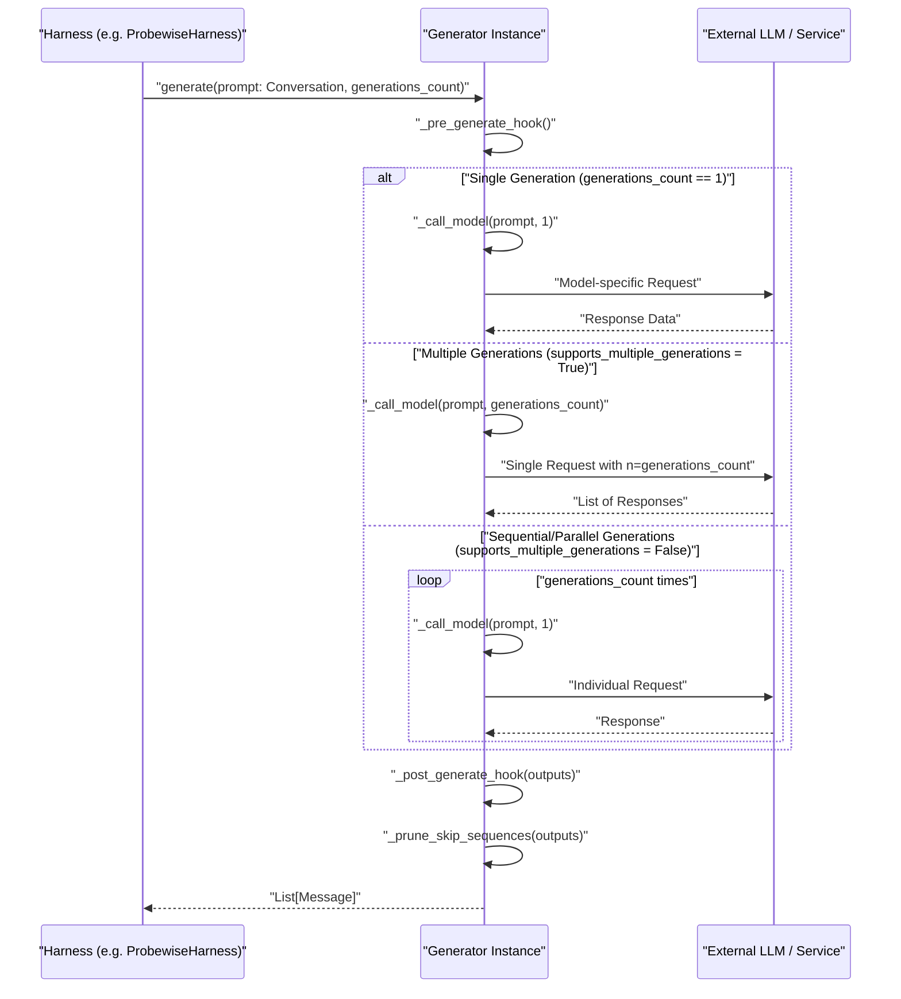
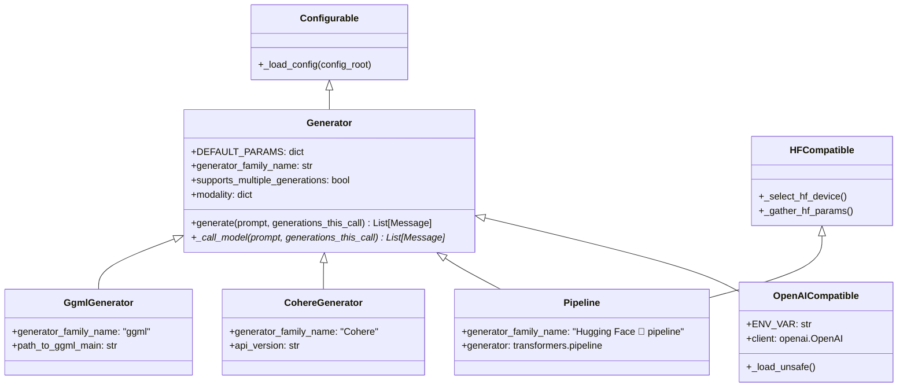

<!-- source: DeepWiki mcp.deepwiki.com · repo NVIDIA/garak · page 3.2 Generators · fetched 2026-10-26 -->

# Generators

<details>
<summary>Relevant source files</summary>

The following files were used as context for generating this wiki page:

- [garak/_plugins.py](garak/_plugins.py)
- [garak/generators/base.py](garak/generators/base.py)
- [garak/generators/cohere.py](garak/generators/cohere.py)
- [garak/generators/ggml.py](garak/generators/ggml.py)
- [garak/generators/huggingface.py](garak/generators/huggingface.py)
- [garak/generators/langchain_serve.py](garak/generators/langchain_serve.py)
- [garak/generators/openai.py](garak/generators/openai.py)
- [garak/generators/replicate.py](garak/generators/replicate.py)
- [garak/generators/test.py](garak/generators/test.py)
- [garak/generators/watsonx.py](garak/generators/watsonx.py)
- [garak/resources/plugin_cache.json](garak/resources/plugin_cache.json)
- [tests/generators/test_generators.py](tests/generators/test_generators.py)
- [tests/generators/test_generators_base.py](tests/generators/test_generators_base.py)
- [tests/generators/test_test.py](tests/generators/test_test.py)
- [tests/generators/test_watsonx.py](tests/generators/test_watsonx.py)

</details>


Generators are the interface layer between garak and Large Language Models (LLMs). They provide a unified abstraction for accessing diverse LLM deployment patterns, from cloud APIs to local models, enabling garak probes to test vulnerabilities across different model architectures and hosting environments.

For information about how generators are orchestrated during vulnerability testing, see [Harnesses](#3.4). For details on configuring generator parameters, see [Configuration System](#2.3).

## Generator Architecture Overview

The generator system follows a plugin architecture where all generators inherit from the `Generator` base class [garak/generators/base.py:21-22]() and implement standardized interfaces for model interaction.

### Core Generator Flow



Sources: [garak/generators/base.py:138-224]()

### Generator Class Hierarchy



Sources: [garak/generators/base.py:21-50](), [garak/generators/openai.py:134-190](), [garak/generators/huggingface.py:46-60](), [garak/generators/cohere.py:31-57](), [garak/generators/ggml.py:28-49]()

## Base Generator System

The `Generator` base class defines the core interface and behavior patterns. All `garak` generators must inherit from this [garak/generators/base.py:3-4]().

### Core Interface

| Method | Purpose | Implementation Status |
|--------|---------|------------------------|
| `_call_model(prompt, generations_this_call)` | Execute model-specific logic or API call | **Required** - Abstract method [garak/generators/base.py:74-84]() |
| `generate(prompt, generations_this_call)` | Manages orchestration, hooks, and parallelism | Inherited - Avoid overriding [garak/generators/base.py:138-147]() |
| `_pre_generate_hook()` | Setup logic before model invocation | Optional override [garak/generators/base.py:86-87]() |
| `_post_generate_hook(outputs)` | Processing after model invocation | Optional override [garak/generators/base.py:102-104]() |

### Configuration Parameters

Generators use a `DEFAULT_PARAMS` dictionary to manage model settings [garak/generators/base.py:25-32]():

```python
DEFAULT_PARAMS = {
    "max_tokens": 150,
    "temperature": None,
    "top_k": None,
    "context_len": None,
    "skip_seq_start": None,
    "skip_seq_end": None,
}
```

### Modality Support

Generators declare their input/output capabilities using the `modality` attribute [garak/generators/base.py:44](). For example, `BlankVision` supports text and image inputs [garak/generators/test.py:193-199]().

## Generator Categories

Garak organizes generators into families based on their integration method. For detailed technical information on each, refer to the child pages.

### Hugging Face Generators
These generators support local execution via `transformers` pipelines or remote access via the Inference API. They include specialized support for `LLaVA` multimodal models and `Optimum` optimizations.
For details, see [Hugging Face Generators](#3.2.1).

### REST API Generators
A flexible system for interfacing with any LLM that provides a RESTful endpoint. This includes built-in support for NVIDIA Cloud Functions (NVCF), LangChain, and systems requiring mTLS or guardrail integration.
For details, see [REST API Generators](#3.2.2).

### Specialized Generators
This category covers dedicated integrations for major providers and local runners, including:
* **Cloud Providers**: OpenAI, Anthropic, Azure, AWS Bedrock, Google Vertex AI, IBM Watsonx.
* **Inference Servers**: NVIDIA NIM, Groq, Mistral, Replicate, Ollama.
* **Local Runners**: GGML (llama.cpp).
* **Meta-Generators**: LiteLLM and Function-based generators.

For details, see [Specialized Generators](#3.2.3).

## Key Implementation Patterns

### OpenAI Compatibility
The `OpenAICompatible` class [garak/generators/openai.py:134]() serves as a base for any service using the OpenAI-style REST API. It handles `Conversation` to `list[dict]` conversion [garak/generators/openai.py:193]() and manages the `openai.OpenAI` client lifecycle [garak/generators/openai.py:162]().

### GGUF/GGML Support
The `GgmlGenerator` [garak/generators/ggml.py:28]() allows testing models in GGUF format by wrapping the `llama.cpp` executable. It constructs command-line arguments based on parameters like `repeat_penalty` and `top_k` [garak/generators/ggml.py:51-71]() and executes the process using `subprocess.run` [garak/generators/ggml.py:129-134]().

### Test Generators
Garak includes several "dummy" generators in `garak/generators/test.py` for debugging and framework testing:
* `Blank`: Always returns an empty string [garak/generators/test.py:14-24]().
* `Repeat`: Echoes the last user message [garak/generators/test.py:27-37]().
* `Lipsum`: Generates Lorem Ipsum text of configurable length [garak/generators/test.py:72-109]().
* `ReasoningLipsum`: Simulates a reasoning trace (e.g., ``) followed by output [garak/generators/test.py:112-143]().

## System Integration

### Plugin Discovery and Caching
Generators are discovered by `garak._plugins.enumerate_plugins("generators")` [garak/_plugins.py:177](). The project maintains a `plugin_cache.json` [garak/resources/plugin_cache.json]() which stores metadata such as `modality`, `extra_dependency_names`, and `description` to speed up startup.

### Parallelism
The `Generator.generate` method handles parallel requests if the generator is marked as `parallel_capable` [garak/generators/base.py:39](). It utilizes a `multiprocessing.Pool` to manage concurrent `_call_model` invocations based on the `parallel_requests` configuration [garak/generators/base.py:176-200]().

Sources: [garak/generators/base.py:176-205](), [garak/_plugins.py:39-121](), [garak/generators/test.py:112-190]()

---

