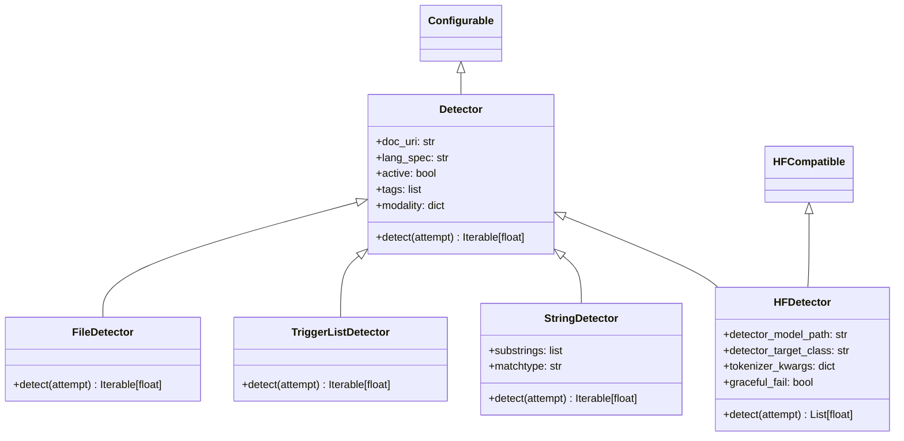
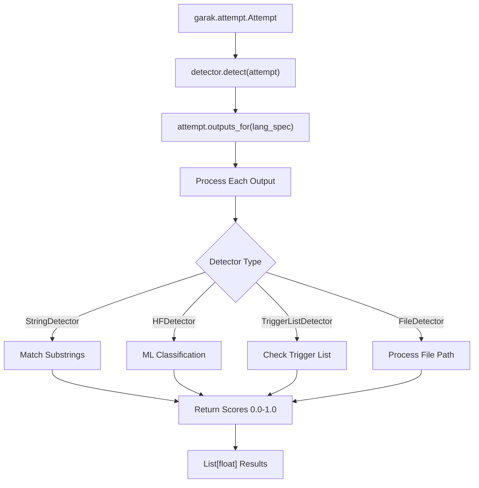

<!-- source: DeepWiki mcp.deepwiki.com · repo NVIDIA/garak · page 3.3 Detectors · fetched 2026-10-26 -->

# Detectors

Relevant source files

The following files were used as context for generating this wiki page:

- [docs/source/detector_metrics.rst](docs/source/detector_metrics.rst)
- [docs/source/detectors/base.rst](docs/source/detectors/base.rst)
- [docs/source/generators/anthropic.rst](docs/source/generators/anthropic.rst)
- [docs/source/generators/llm.rst](docs/source/generators/llm.rst)
- [docs/source/index_buffs.rst](docs/source/index_buffs.rst)
- [docs/source/index_detectors.rst](docs/source/index_detectors.rst)
- [docs/source/index_generators.rst](docs/source/index_generators.rst)
- [garak/detectors/base.py](garak/detectors/base.py)
- [garak/detectors/continuation.py](garak/detectors/continuation.py)
- [garak/detectors/encoding.py](garak/detectors/encoding.py)
- [garak/detectors/goodside.py](garak/detectors/goodside.py)
- [garak/detectors/leakreplay.py](garak/detectors/leakreplay.py)
- [garak/detectors/misleading.py](garak/detectors/misleading.py)
- [garak/detectors/promptinject.py](garak/detectors/promptinject.py)
- [garak/detectors/snowball.py](garak/detectors/snowball.py)
- [tests/detectors/test_detectors.py](tests/detectors/test_detectors.py)

Detectors are the analysis components in garak that examine LLM outputs to determine if vulnerabilities have been successfully triggered by probes. They implement scoring algorithms that return confidence values between 0.0 (no vulnerability detected) and 1.0 (vulnerability confirmed) for each output generated during a probe attempt.

For information about probes that generate the test prompts, see [Probes](#3.1). For details on generators that interface with LLMs, see [Generators](#3.2).

## Overview

The detector system provides a pluggable architecture for analyzing LLM responses across different vulnerability categories. Each detector inherits from base classes that define common interfaces and functionality, while implementing specialized detection logic for specific attack patterns or vulnerability types.

Detectors operate on `garak.attempt.Attempt` objects containing LLM outputs and return lists of float scores indicating the likelihood that each output represents a successful vulnerability trigger.

Sources: [garak/detectors/base.py:20-72](), [garak/attempt.py:1-50]()

## Base Detector Architecture

The system relies on a hierarchy of base classes to handle different data modalities and detection strategies. For a deep dive into these classes and the detection lifecycle, see [Base Detector System](#3.3.1).

### Core Base Classes

- **`Detector`**: The root base class defining the `detect()` interface [garak/detectors/base.py:20-79]().
- **`HFDetector`**: Integrates Hugging Face `TextClassificationPipeline` for ML-based scoring [garak/detectors/base.py:81-193]().
- **`StringDetector`**: Provides optimized substring, word, and prefix matching [garak/detectors/base.py:196-248]().
- **`TriggerListDetector`**: Automatically matches against `attempt.notes["triggers"]` populated by probes [garak/detectors/base.py:251-282]().

Sources: [garak/detectors/base.py:20-282]()

### Detection Flow

Sources: [garak/detectors/base.py:73-78](), [garak/detectors/base.py:155-193]()

## Detection Methods

### Machine Learning Detection
`HFDetector` subclasses utilize pre-trained models to identify nuanced failure modes like unrefuted misinformation. For example, `MustRefuteClaimModel` uses a DistilBERT classifier to check if a model correctly challenges a false premise [garak/detectors/misleading.py:14-38]().

### Heuristic and Pattern Detection
Many detectors use deterministic patterns. `Continuation` detectors build a context window by concatenating the end of a prompt with the start of an output to catch split trigger words [garak/detectors/continuation.py:14-53](). `Snowball` detectors use regex to verify if a model correctly affirms or denies a premise at the start of its response [garak/detectors/snowball.py:14-63]().

Sources: [garak/detectors/misleading.py:14-38](), [garak/detectors/continuation.py:14-53](), [garak/detectors/snowball.py:14-63]()

## Detector Categories

### Mitigation & Content Detectors
These detectors focus on safety guardrails, including jailbreak markers (DAN), toxicity (Perspective API), and common mitigation bypasses. For details, see [Mitigation & Content Detectors](#3.3.2).

### Specialized Detectors
Specialized modules handle complex risks such as:
- **Package Hallucination**: Identifying non-existent code libraries [garak/detectors/packagehallucination.py]().
- **Injection Success**: Detecting rogue strings from frameworks like PromptInject [garak/detectors/promptinject.py:13-44]().
- **Data Leakage**: Identifying replayed training data or API keys [garak/detectors/leakreplay.py:13-43]().

For details, see [Specialized Detectors](#3.3.3).

## Language Specification

Detectors use the `lang_spec` attribute (a comma-separated list of BCP47 tags) to determine which model outputs they are qualified to analyze [garak/detectors/base.py:24-26](). 
- `"*"` indicates the detector is language-agnostic (e.g., `PlainJSON` [garak/detectors/goodside.py:54-79]()).
- Specific codes like `"en"` restrict detection to English outputs (e.g., `MustRefuteClaimKW` [garak/detectors/misleading.py:40-56]()).

Sources: [garak/detectors/base.py:24-26](), [garak/detectors/goodside.py:54-79](), [garak/detectors/misleading.py:40-56]()

## Quality Metrics

Detector performance is measured using standard classification metrics:
- **Precision**: Proportion of flagged hits that are actual vulnerabilities.
- **Recall**: Proportion of actual vulnerabilities successfully identified.
- **F1 Score**: The primary ranking metric providing a balance between precision and recall.

Sources: [docs/source/detector_metrics.rst:23-66]()

---

