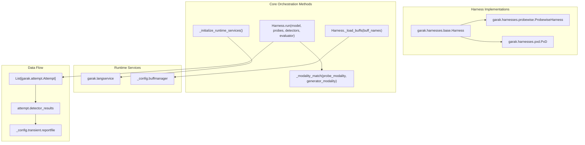
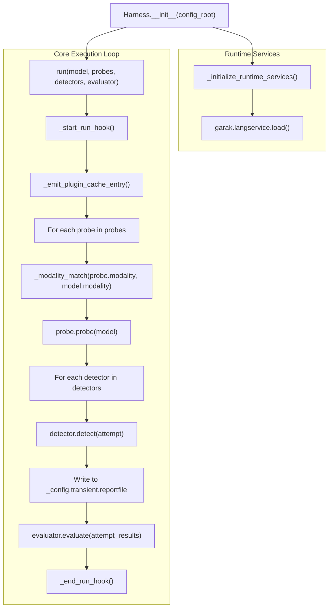
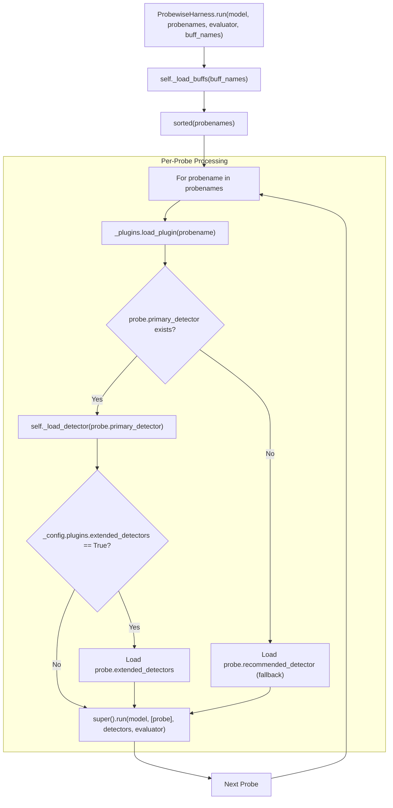
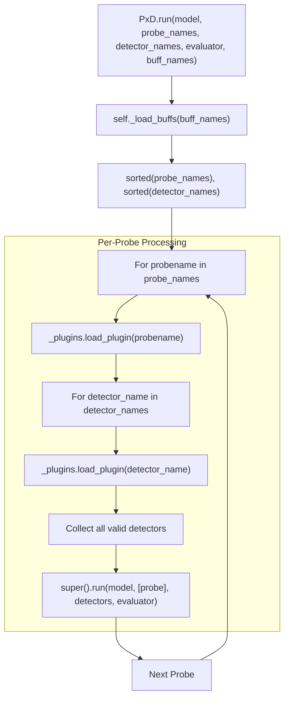
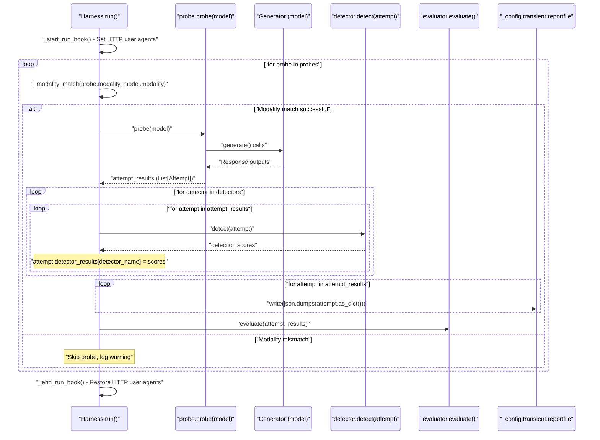

<!-- source: DeepWiki mcp.deepwiki.com · repo NVIDIA/garak · page 3.4 Harnesses · fetched 2026-10-26 -->

# Harnesses

Relevant source files

The following files were used as context for generating this wiki page:

- [garak/buffs/base.py](garak/buffs/base.py)
- [garak/buffs/low_resource_languages.py](garak/buffs/low_resource_languages.py)
- [garak/harnesses/base.py](garak/harnesses/base.py)
- [garak/harnesses/probewise.py](garak/harnesses/probewise.py)
- [garak/harnesses/pxd.py](garak/harnesses/pxd.py)
- [tests/evaluators/__init__.py](tests/evaluators/__init__.py)
- [tests/evaluators/test_base.py](tests/evaluators/test_base.py)
- [tests/evaluators/test_evaluators.py](tests/evaluators/test_evaluators.py)
- [tests/harnesses/test_harnesses.py](tests/harnesses/test_harnesses.py)
- [tests/plugins/test_plugins.py](tests/plugins/test_plugins.py)

## Purpose and Scope

Harnesses are the orchestration layer in garak that coordinate the execution of vulnerability tests. They manage the flow from probes generating test inputs, through generators producing LLM outputs, to detectors analyzing those outputs, and finally to evaluators assessing the results. The base `garak.harnesses.base.Harness` class provides the core orchestration logic, while specialized harnesses like `ProbewiseHarness` and `PxD` implement different probe-detector coordination strategies.

For information about the individual components that harnesses coordinate, see [Probes](#3.1), [Generators](#3.2), [Detectors](#3.3). For details on the overall system architecture, see [Architecture](#2).

## Architecture Overview

Harnesses serve as the central orchestration point in garak's testing pipeline. The `garak.harnesses.base.Harness` class provides the foundational orchestration logic that coordinates between probes, generators, detectors, and evaluators:

Sources: [garak/harnesses/base.py:81-182](), [garak/harnesses/base.py:27-48](), [garak/harnesses/base.py:102-134]()

## Base Harness System

The `garak.harnesses.base.Harness` class inherits from `garak.configurable.Configurable` and provides the foundational orchestration logic. It implements the core testing loop and manages runtime services required for vulnerability assessment.

### Core Architecture

The base harness defines the essential coordination pattern:

### Key Methods and Configuration

| Method | Purpose | Implementation |
|---|---|---|
| `__init__(config_root)` | Initialize harness and runtime services | [garak/harnesses/base.py:92-98]() |
| `run(model, probes, detectors, evaluator)` | Core orchestration method | [garak/harnesses/base.py:135-212]() |
| `_load_buffs(buff_names)` | Load prompt transformation buffs | [garak/harnesses/base.py:99-127]() |
| `_start_run_hook()` | Set HTTP user agents for session | [garak/harnesses/base.py:128-130]() |
| `_end_run_hook()` | Restore HTTP user agents | [garak/harnesses/base.py:132-134]() |

The harness uses the `DEFAULT_PARAMS` configuration with `strict_modality_match: False` allowing flexible modality matching between probes and generators [garak/harnesses/base.py:88-90]().

### Runtime Services Initialization

The `_initialize_runtime_services()` function at [garak/harnesses/base.py:27-48]() loads essential services:

- **Language Service**: Imports and initializes `garak.langservice` for translation support.
- **Service Validation**: Calls `service.enabled()`, `service.start_msg()`, and `service.load()`.
- **Error Handling**: Raises `GarakException` if critical services fail to initialize.

Sources: [garak/harnesses/base.py:81-98](), [garak/harnesses/base.py:27-48](), [garak/harnesses/base.py:135-212]()

## Harness Types

Garak provides two main harness implementations with different probe-detector coordination strategies:

### ProbewiseHarness

The `garak.harnesses.probewise.ProbewiseHarness` implements intelligent detector selection based on probe recommendations:

**Detector Selection Logic** ([garak/harnesses/probewise.py:86-108]()):
- **Primary Path**: Uses `probe.primary_detector` as main detector.
- **Extended Path**: Adds `probe.extended_detectors` when `_config.plugins.extended_detectors` is True.
- **Fallback Path**: Uses deprecated `probe.recommended_detector` for compatibility.

The `_load_detector()` method at [garak/harnesses/probewise.py:19-28]() handles detector loading with graceful failure handling.

### PxD Harness

The `garak.harnesses.pxd.PxD` harness implements exhaustive probe-detector combinations:

**Key Characteristics**:
- Runs every probe against every specified detector [garak/harnesses/pxd.py:6-12]().
- Processes probe-detector combinations sequentially by calling the base harness `run` method for each probe [garak/harnesses/pxd.py:60]().

Sources: [garak/harnesses/probewise.py:18-112](), [garak/harnesses/pxd.py:22-62]()

## Evaluator Subsystem

The Evaluator is responsible for analyzing detector scores and determining if a probe "hit" (succeeded in finding a vulnerability).

### Evaluator Types

| Class | Logic | Source |
|---|---|---|
| `Evaluator` | Base class for all evaluators. | [garak/evaluators/base.py:22]() |
| `ThresholdEvaluator` | Marks a hit if the detector score exceeds a specified threshold. | [garak/evaluators/base.py:22]() |
| `ZeroToleranceEvaluator` | Marks a hit if any detector score is greater than zero. | [garak/evaluators/base.py:22]() |

### Evaluation Flow

The harness calls `evaluator.evaluate(attempt_results)` after detectors have processed the outputs [garak/harnesses/base.py:209](). Evaluators calculate pass/fail rates and manage calibration/z-scores for comparative analysis [tests/evaluators/test_base.py:29-41]().

Sources: [garak/evaluators/base.py:22](), [garak/harnesses/base.py:209](), [tests/evaluators/test_evaluators.py:168-192]()

## Execution Flow and Data Structures

### Core Execution Sequence

### Modality Matching Logic

The `_modality_match()` function implements compatibility checking [garak/harnesses/base.py:215-224]():
- **Strict mode** (`strict=True`): Exact modality match required.
- **Flexible mode** (`strict=False`): Probe modalities must be a subset of generator modalities.

### Data Flow and State Management

| Stage | Data Structure | Location |
|---|---|---|
| **Probe Execution** | `attempt_results` | [garak/harnesses/base.py:189]() |
| **Detection** | `attempt.detector_results` | [garak/harnesses/base.py:201]() |
| **Reporting** | `_config.transient.reportfile` | [garak/harnesses/base.py:207]() |

Sources: [garak/harnesses/base.py:135-224](), [garak/harnesses/base.py:128-134](), [tests/harnesses/test_harnesses.py:32-50]()

---

