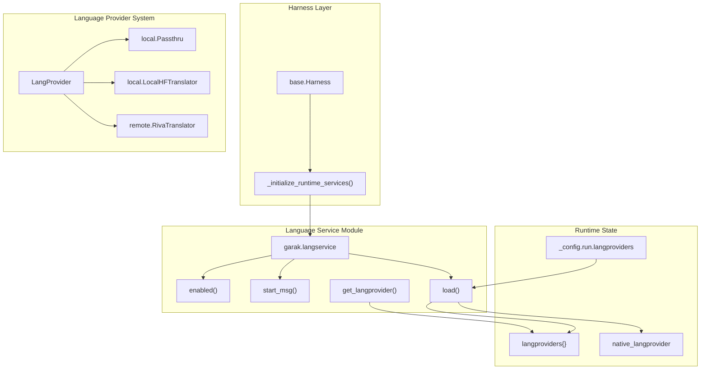
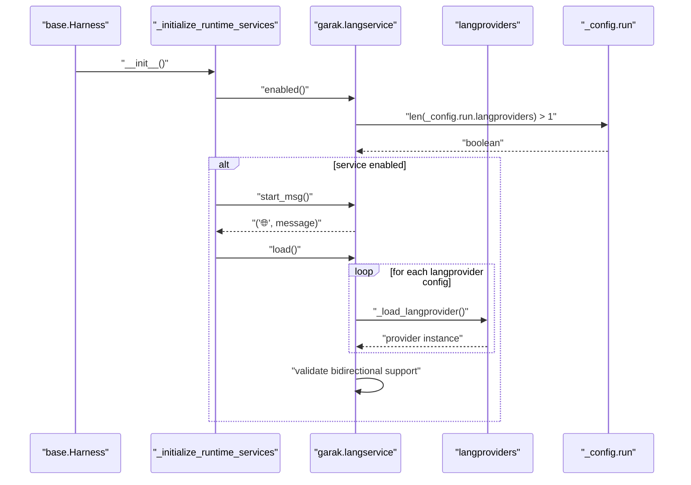
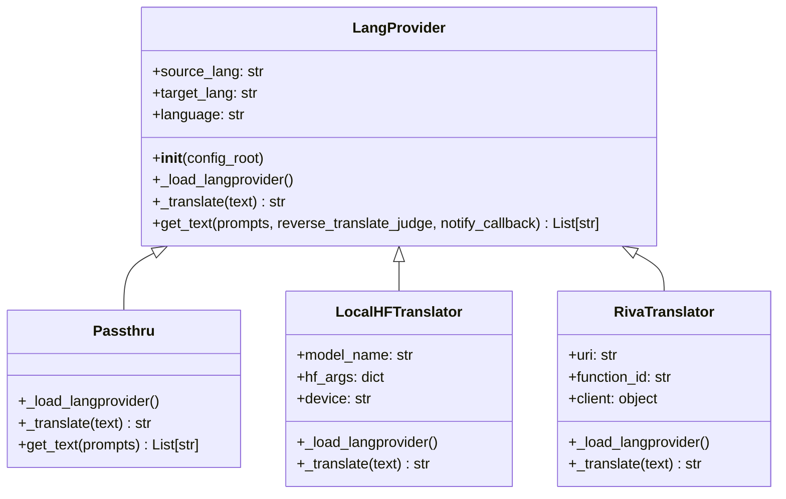
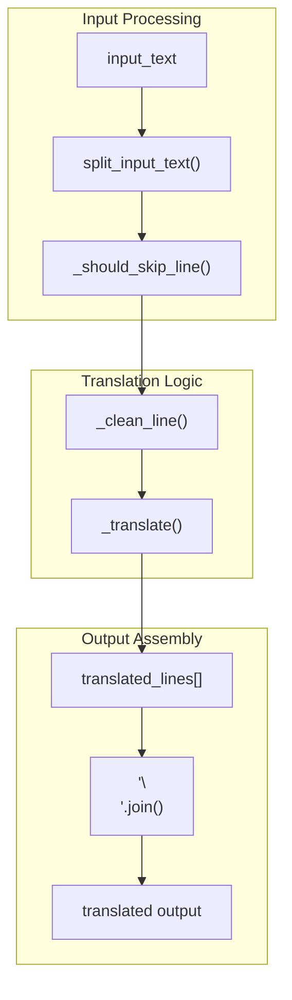

<!-- source: DeepWiki mcp.deepwiki.com · repo NVIDIA/garak · page 3.5 Language Services · fetched 2026-10-26 -->

# Language Services

<details>
<summary>Relevant source files</summary>

The following files were used as context for generating this wiki page:

- [docs/source/attempt.rst](docs/source/attempt.rst)
- [docs/source/how.rst](docs/source/how.rst)
- [docs/source/langservice.rst](docs/source/langservice.rst)
- [garak/generators/bedrock.py](garak/generators/bedrock.py)
- [garak/langproviders/base.py](garak/langproviders/base.py)
- [garak/langproviders/local.py](garak/langproviders/local.py)
- [garak/langproviders/remote.py](garak/langproviders/remote.py)
- [garak/langservice.py](garak/langservice.py)
- [tests/generators/test_bedrock.py](tests/generators/test_bedrock.py)
- [tests/langservice/detectors/test_detectors_leakreplay.py](tests/langservice/detectors/test_detectors_leakreplay.py)
- [tests/langservice/detectors/test_detectors_misleading.py](tests/langservice/detectors/test_detectors_misleading.py)
- [tests/langservice/detectors/test_detectors_snowball.py](tests/langservice/detectors/test_detectors_snowball.py)
- [tests/langservice/probes/test_probes_base.py](tests/langservice/probes/test_probes_base.py)
- [tests/langservice/probes/test_probes_goodside.py](tests/langservice/probes/test_probes_goodside.py)
- [tests/langservice/test_langprovision.py](tests/langservice/test_langprovision.py)

</details>


The Language Services system provides centralized multilingual support for garak's vulnerability testing framework. It enables probes and detectors to operate across different languages by providing translation capabilities and language-specific processing. This system coordinates language providers that handle translation tasks, allowing garak to test LLM vulnerabilities in languages other than English.

For information about probe-specific multilingual testing, see [Probes](3.1). For detector language processing, see [Detectors](3.3).

## Service Architecture

The Language Services system operates as a runtime service initialized by harnesses and consumed by probes and detectors throughout the testing pipeline.

### Core Service Components



The service follows a three-layer architecture: harness initialization, service coordination, and provider implementation. The `garak.langservice` module acts as a singleton coordinator that manages multiple language provider instances in the `langproviders` dictionary [garak/langservice.py:15-16]().

**Sources:** [garak/langservice.py:15-16](), [garak/langservice.py:68-104](), [garak/langproviders/base.py:138-149]()

### Service Lifecycle



The service initializes during harness construction, loads configured providers, and validates that bidirectional translation pairs are available [garak/langservice.py:68-103](). For example, if `en,ja` is configured, the system expects a matching `ja,en` provider [garak/langservice.py:91-102]().

**Sources:** [garak/langservice.py:33-43](), [garak/langservice.py:68-103](), [garak/langservice.py:91-102]()

## Language Provider System

### Base Provider Architecture

The `LangProvider` base class defines the translation interface and common text processing logic used by all language providers.



The base class implements the logic for processing lists of prompts, while concrete implementations provide the actual translation mechanisms via `_translate` [garak/langproviders/base.py:157-207]().

**Sources:** [garak/langproviders/base.py:138-241](), [garak/langproviders/local.py:14-31](), [garak/langproviders/local.py:32-150](), [garak/langproviders/remote.py:17-95]()

### Provider Implementations

#### Local Providers
*   **Passthru**: A no-op provider used when source and target languages are the same [garak/langproviders/local.py:14-31]().
*   **LocalHFTranslator**: Uses Hugging Face models like `facebook/m2m100` or `Helsinki-NLP/opus-mt` for local translation [garak/langproviders/local.py:32-150](). It handles device placement (CPU/CUDA) and tokenizer configuration automatically [garak/langproviders/local.py:56-106]().

#### Remote Providers
*   **RivaTranslator**: Interfaces with NVIDIA Riva NMT services via gRPC [garak/langproviders/remote.py:17-95]().
*   **DeeplTranslator**: Uses the DeepL API for high-quality remote translation [garak/langproviders/remote.py:97-158]().
*   **GoogleTranslator**: Integrates with Google Cloud Translation API [garak/langproviders/remote.py:160-207]().

**Sources:** [garak/langproviders/local.py:14-150](), [garak/langproviders/remote.py:17-207]()

## Runtime Integration

### Service Discovery and Loading

The language service integrates with garak's plugin system through the harness initialization process. The `load()` function iterates through `_config.run.langproviders` to instantiate the required plugins [garak/langservice.py:68-81]().

```python
# garak/langservice.py:75-81
    for entry in _config.run.langproviders:
        # example _config.run.langproviders[0]['language']: en-ja classname encoding
        # results in key "en-ja" and expects a "ja-en" to match that is not always present
        langproviders[entry["language"]] = _load_langprovider(
            # TODO: align class naming for Configurable consistency
            language_service=entry
        )
```

### Probe and Detector Usage

Probes use language services to translate attack prompts into a target language. After the LLM generates a response, the `Probe._postprocess_attempt` method uses the language service to translate the output back into the source language (reverse translation) for detection [tests/langservice/probes/test_probes_base.py:108-147]().

Detectors can then analyze either the raw output or the `reverse_translation_outputs` stored in the `Attempt` object [tests/langservice/detectors/test_detectors_snowball.py:30-43]().

**Sources:** [garak/langservice.py:106-114](), [tests/langservice/probes/test_probes_base.py:135-147](), [tests/langservice/detectors/test_detectors_snowball.py:10-26]()

## Translation Workflow

### Text Processing Pipeline



The `LangProvider` handles text cleanup, including removing invisible Unicode characters and splitting long inputs to prevent model overflow [garak/langproviders/base.py:157-207]().

**Sources:** [garak/langproviders/base.py:157-207](), [garak/langproviders/base.py:96-103]()

### Batch Translation Interface

The primary interface for plugins is the `get_text()` method, which processes lists of prompts:

| Parameter | Type | Purpose |
|-----------|------|---------|
| `prompts` | `List[str]` | Input text strings to translate |
| `reverse_translate_judge` | `bool` | Whether to validate meaningfulness for reverse translation |
| `notify_callback` | `Callable` | Optional progress notification callback |

**Sources:** [garak/langproviders/base.py:221-241]()

## Configuration

Language providers are configured in the `garak` configuration files or via CLI. A typical configuration includes the language pair and the provider type.

```yaml
# Example langservice configuration
run:
  target_lang: "ja"
  langproviders:
    - language: "en,ja"
      model_type: "local.LocalHFTranslator"
      model_name: "facebook/m2m100_418M"
    - language: "ja,en"
      model_type: "local.LocalHFTranslator"
      model_name: "facebook/m2m100_418M"
```

**Sources:** [garak/langservice.py:73-88](), [tests/langservice/probes/test_probes_base.py:45-53]()

---

