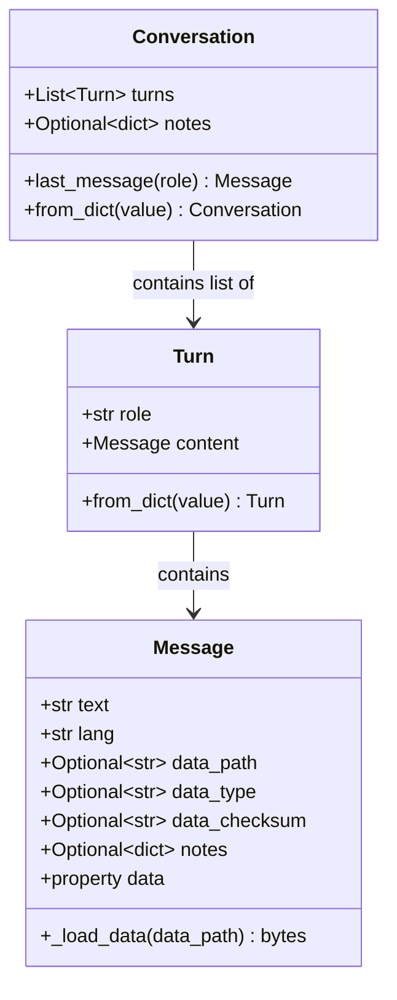
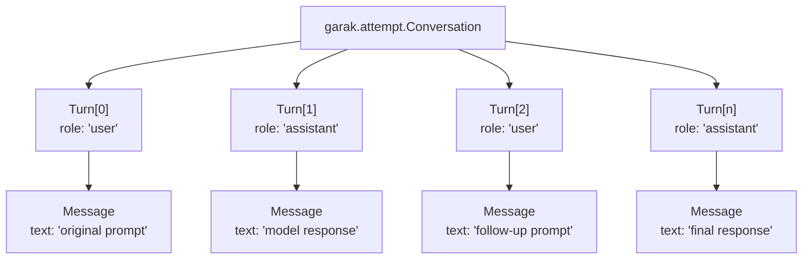
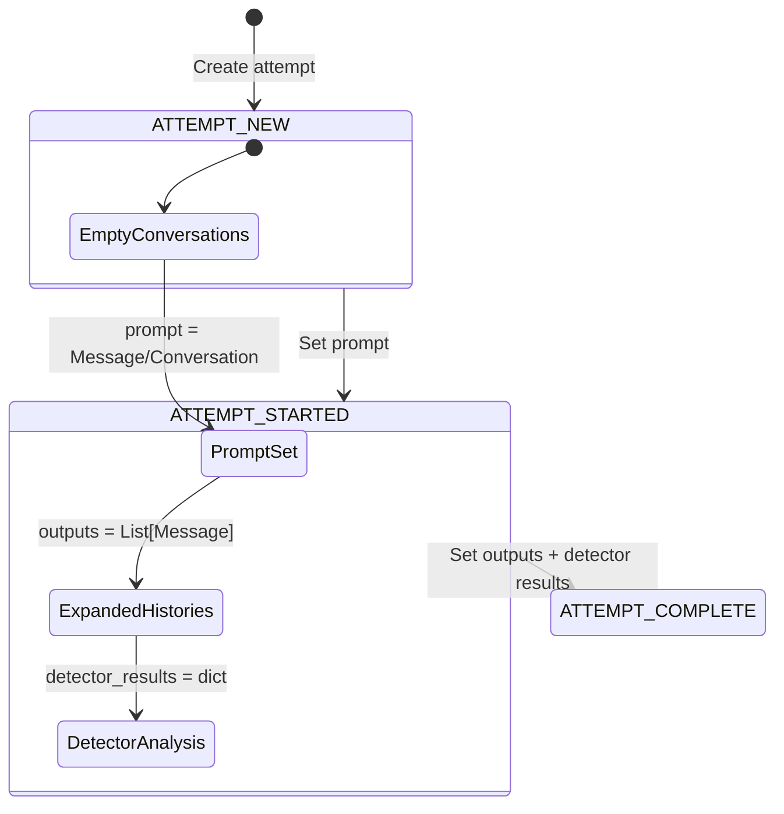
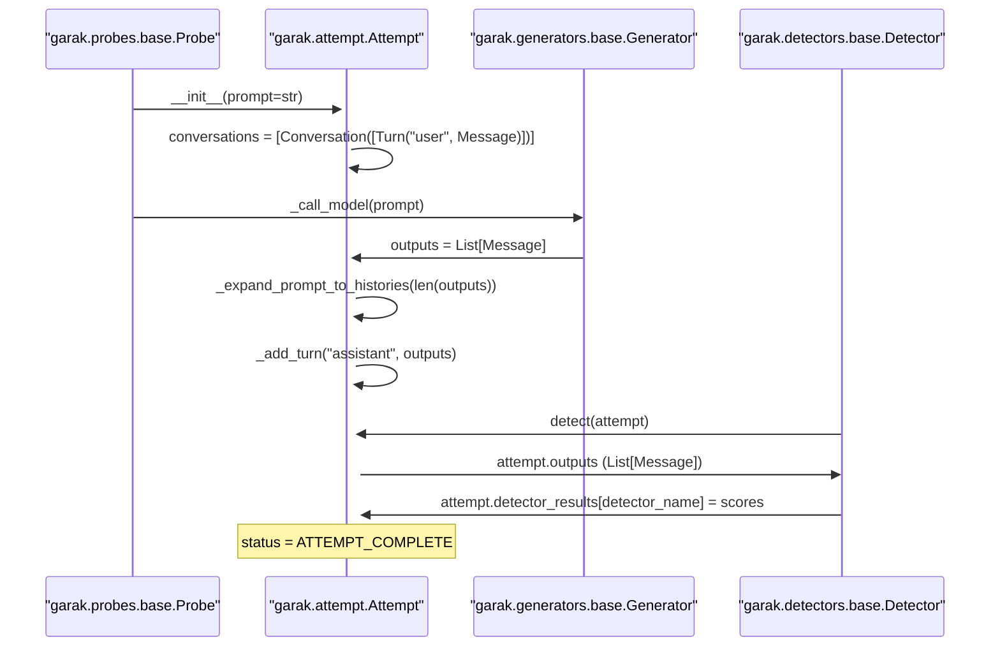
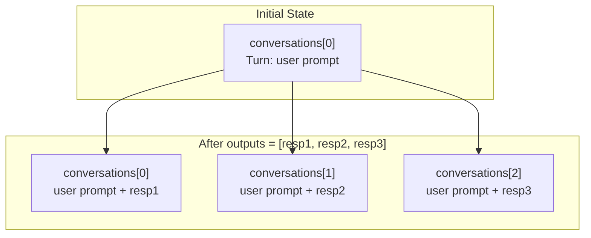
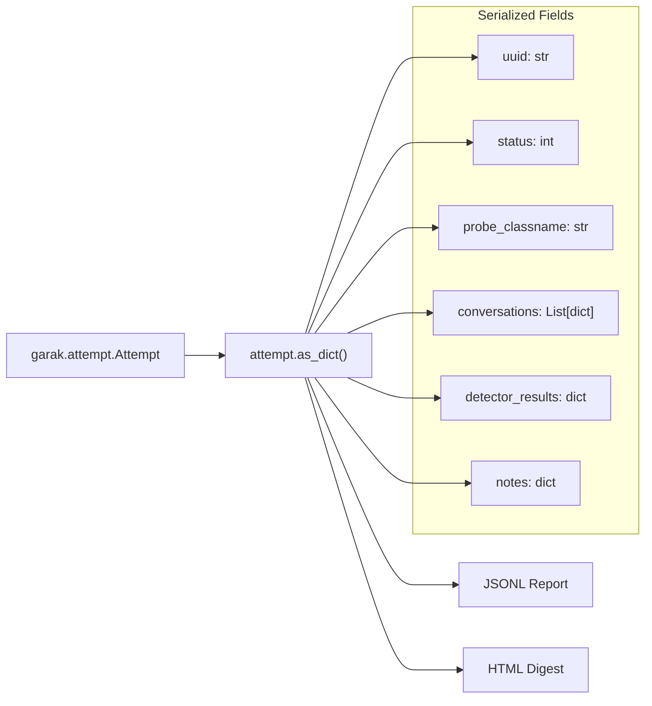

<!-- source: DeepWiki mcp.deepwiki.com · repo NVIDIA/garak · page 3.6 Data Structures · fetched 2026-10-26 -->

# Data Structures

Relevant source files

The following files were used as context for generating this wiki page:

- [docs/source/attempt.rst](docs/source/attempt.rst)
- [docs/source/how.rst](docs/source/how.rst)
- [docs/source/langservice.rst](docs/source/langservice.rst)
- [garak/attempt.py](garak/attempt.py)
- [tests/_assets/analyze/test_with_ci.report.jsonl](tests/_assets/analyze/test_with_ci.report.jsonl)
- [tests/analyze/test_aggregate.py](tests/analyze/test_aggregate.py)
- [tests/analyze/test_report_digest_plugin_cache.py](tests/analyze/test_report_digest_plugin_cache.py)
- [tests/test_attempt.py](tests/test_attempt.py)
- [tests/test_internal_structures.py](tests/test_internal_structures.py)

This document details the core data structures that flow through garak's vulnerability assessment pipeline: `Message`, `Turn`, `Conversation`, and `Attempt`. These structures encapsulate prompts, responses, conversation histories, and test metadata as they move between probes, generators, detectors, and evaluators.

## Message Structure

The `Message` class represents a single message that can contain text, multimedia attachments, language metadata, and arbitrary notes. Messages serve as the atomic unit of communication between garak and LLM systems.

**Message Properties and Multimodal Support**

The `Message` structure supports both text and binary data through a lazy-loading mechanism. When `data_path` is set, the binary data is loaded on-demand and automatically checksummed for integrity verification.

| Property | Type | Purpose |
|----------|------|---------|
| `text` | `str` | Primary text content |
| `lang` | `str` | BCP47 language code |
| `data_path` | `str` | Path to binary attachment |
| `data_type` | `str` | MIME type of attachment |
| `data_checksum` | `str` | SHA256 checksum of data |
| `notes` | `dict` | Free-form metadata |

Sources: [garak/attempt.py:22-87]()

## Turn and Conversation Structures

The `Turn` class associates a `Message` with a conversational role (`system`, `user`, or `assistant`), while `Conversation` maintains an ordered sequence of turns to track multi-turn dialogues.

**Role-Based Message Organization**

The `Conversation.last_message()` method provides convenient access to the most recent message, optionally filtered by role. This is essential for extracting the latest model outputs for detector analysis.

Sources: [garak/attempt.py:91-145]()

## Attempt Structure

The `Attempt` class is the central data structure that encapsulates everything about a single vulnerability test execution. It tracks the complete lifecycle from initial prompt through model responses to detector analysis results.

**Attempt Lifecycle and State Management**

**Core Attempt Properties**

| Property | Type | Purpose |
|----------|------|---------|
| `status` | `int` | Lifecycle state (NEW/STARTED/COMPLETE) |
| `prompt` | `Conversation` | Initial prompt as conversation |
| `outputs` | `List[Message]` | Latest model responses |
| `conversations` | `List[Conversation]` | Full conversation histories per generation |
| `detector_results` | `dict` | Vulnerability scores by detector name |
| `probe_classname` | `str` | Originating probe identifier |
| `targets` | `List[str]` | Expected vulnerable response patterns |
| `goal` | `str` | Human-readable test objective |

Sources: [garak/attempt.py:173-243]()

## Data Flow Through Assessment Pipeline

The following diagram shows how these data structures flow through garak's core assessment components, with specific method calls and class interactions:

**Multi-Generation Expansion**

When a generator produces multiple responses to a single prompt, the `Attempt` automatically expands from a single conversation history to multiple parallel histories, maintaining alignment between prompts and responses via `_expand_prompt_to_histories`.

Sources: [garak/attempt.py:390-433](), [tests/test_attempt.py:150-187]()

## Serialization and Persistence

All data structures implement complete serialization to support report generation and analysis. The `Attempt.as_dict()` method produces a dictionary suitable for JSON serialization, handling nested dataclasses and preserving all metadata.

**Serialization Schema**

The serialization process handles complex nested structures including `Message` attachments, conversation histories, and detector result arrays while maintaining data integrity through checksums and type preservation.

Sources: [garak/attempt.py:244-276](), [tests/test_attempt.py:76-84]()

## Language and Translation Support

The data structures include built-in support for multilingual testing through language tags and translation metadata. The `prompt_for()` and `outputs_for()` methods provide language-aware access to original and translated content.

**Language-Aware Data Access**

| Method | Purpose | Returns |
|--------|---------|---------|
| `attempt.prompt_for(lang)` | Get prompt in specified language | `Conversation` |
| `attempt.outputs_for(lang)` | Get outputs in specified language | `List[Message]` |
| `attempt.lang` | Get language of current prompt | `str` |

When content is translated for cross-language testing, the original prompt is preserved in `attempt.notes["pre_translation_prompt"]` and reverse-translated outputs are stored in `attempt.reverse_translation_outputs`.

Sources: [garak/attempt.py:357-388](), [tests/_assets/analyze/test_with_ci.report.jsonl:3]()

---

