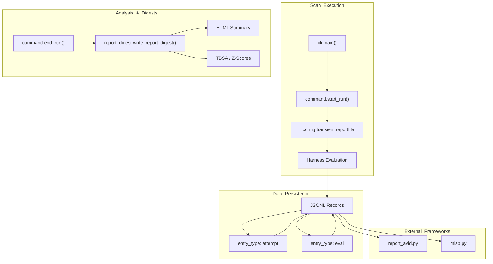
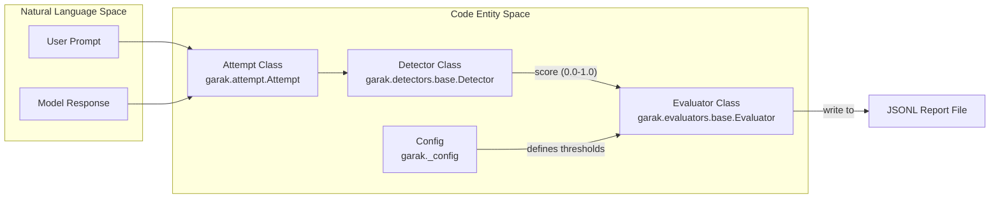

<!-- source: DeepWiki mcp.deepwiki.com · repo NVIDIA/garak · page 4 Report Generation & Analysis · fetched 2026-10-26 -->

# Report Generation & Analysis

Relevant source files

The following files were used as context for generating this wiki page:

- [docs/source/configurable.rst](docs/source/configurable.rst)
- [garak/_config.py](garak/_config.py)
- [garak/analyze/__init__.py](garak/analyze/__init__.py)
- [garak/analyze/aggregate_reports.py](garak/analyze/aggregate_reports.py)
- [garak/analyze/analyze_log.py](garak/analyze/analyze_log.py)
- [garak/analyze/count_tokens.py](garak/analyze/count_tokens.py)
- [garak/analyze/get_tree.py](garak/analyze/get_tree.py)
- [garak/analyze/misp.py](garak/analyze/misp.py)
- [garak/analyze/perf_stats.py](garak/analyze/perf_stats.py)
- [garak/analyze/qual_review.py](garak/analyze/qual_review.py)
- [garak/analyze/report_avid.py](garak/analyze/report_avid.py)
- [garak/analyze/report_digest.py](garak/analyze/report_digest.py)
- [garak/cli.py](garak/cli.py)
- [garak/command.py](garak/command.py)
- [garak/evaluators/base.py](garak/evaluators/base.py)
- [garak/resources/garak.core.yaml](garak/resources/garak.core.yaml)
- [tests/cli/test_cli_list_filtering.py](tests/cli/test_cli_list_filtering.py)
- [tests/test_config.py](tests/test_config.py)

This document provides a comprehensive guide to understanding and analyzing garak scan results. Garak generates detailed reports in multiple formats, providing insights into LLM vulnerabilities through structured data and visual presentations. 

## Overview

Garak's reporting system is designed to transform raw probe-detector interactions into actionable security intelligence. The process begins with the generation of a JSONL (JSON Lines) report during the scan and concludes with post-processing utilities that create human-readable summaries, statistical analyses, and security framework mappings.

For detailed information on specific reporting topics, see the following child pages:
*   **[Report Formats & Analysis](#4.1)**: Deep dive into JSONL structure, HTML digests, the `report_digest` pipeline, aggregate reports, and TBSA scoring.
*   **[OWASP & AVID Integration](#4.2)**: Integration with security frameworks (OWASP LLM Top 10, AVID, MISP) and vulnerability databases.
*   **[Report Viewer UI](#4.3)**: Using the React-based frontend for interactive visualization of scan results.

## The Reporting Pipeline

The reporting lifecycle starts at the beginning of a `garak` run and continues through evaluation and post-run analysis.

### Execution to Output Flow

Sources: [garak/command.py:42-121](), [garak/command.py:124-160](), [garak/evaluators/base.py:62-141]()

## Core Report Formats

### JSONL (The Source of Truth)
Every garak run produces a `.report.jsonl` file. This file contains the complete telemetry of the scan, including configuration setup, every prompt sent, every response received, and the specific detector scores for each interaction.
*   **Setup Records**: Store the configuration used for the run [garak/command.py:79-108]().
*   **Attempt Records**: Contain the raw interaction data (prompt, output, triggers) [garak/evaluators/base.py:120-141]().
*   **Eval Records**: Store the aggregated pass/fail statistics for each probe-detector pair [garak/evaluators/base.py:186-215]().

### HTML Digest
By default, `garak` generates an HTML summary at the end of a run. This digest uses Jinja2 templates to provide a high-level overview of the model's performance, grouped by probe module or security taxonomy.
Sources: [garak/analyze/report_digest.py:368-501](), [garak/command.py:147-156]()

## Scoring & Metrics

Garak utilizes several metrics to evaluate model safety:
1.  **Pass Rate**: The percentage of attempts that did not trigger a detector [garak/analyze/report_digest.py:162]().
2.  **Z-Scores (Calibration)**: Measures how a model performs relative to a baseline of other models. A Z-score of 0 indicates average performance, while negative scores indicate higher risk [garak/analyze/calibration.py:1-50]().
3.  **Confidence Intervals**: Garak can calculate bootstrap confidence intervals to provide statistical certainty for the results [garak/evaluators/base.py:148-171]().

### DEFCON Scale
Garak maps scores to a 1-5 "DEFCON" scale (1 being worst, 5 being best) to provide immediate visual feedback on risk levels.

| DEFCON | Meaning | Comment |
| :--- | :--- | :--- |
| 1 | Terrible | Critical Risk |
| 2 | Below Average | High Risk |
| 3 | Average | Elevated Risk |
| 4 | Above Average | Medium Risk |
| 5 | Excellent | Low/Minimal Risk |

Sources: [garak/analyze/__init__.py:7-35](), [garak/analyze/__init__.py:48-58]()

## Analysis Utilities

Garak includes several specialized modules for deeper analysis of report data:

| Module | Purpose |
| :--- | :--- |
| `aggregate_reports` | Merges multiple JSONL reports into a single consolidated file [garak/analyze/aggregate_reports.py:6-9](). |
| `perf_stats` | Computes mean, standard deviation, and normality (Shapiro-Wilk) across multiple reports [garak/analyze/perf_stats.py:6-11](). |
| `qual_review` | Generates a qualitative review highlighting specific failing examples (prompts/responses) [garak/analyze/qual_review.py:6-9](). |
| `report_avid` | Converts garak results into the AVID (AI Vulnerability Database) format [garak/analyze/report_avid.py:1-20](). |

## Summary of Relationships

Sources: [garak/attempt.py:1-50](), [garak/evaluators/base.py:28-60](), [garak/_config.py:12-40]()

For implementation details on how to parse these reports or integrate with external security tools, please refer to the child pages listed at the top of this document.

---

