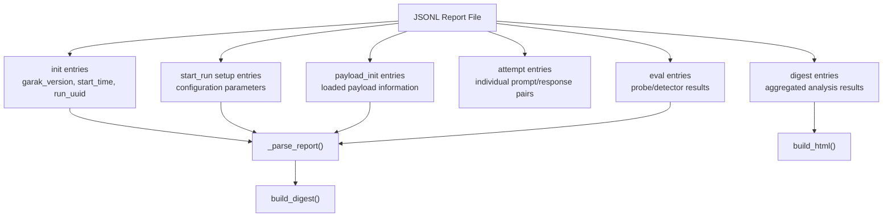
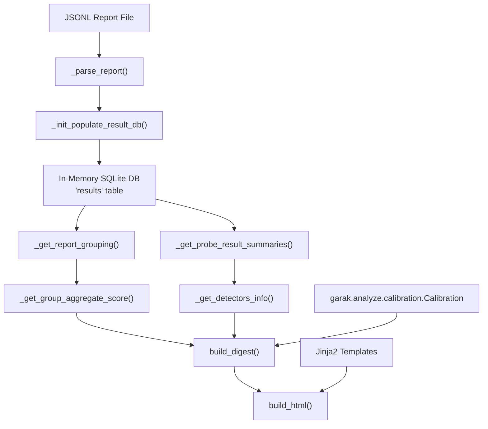

<!-- source: DeepWiki mcp.deepwiki.com · repo NVIDIA/garak · page 4.1 Report Formats & Analysis · fetched 2026-10-26 -->

# Report Formats & Analysis

Relevant source files

The following files were used as context for generating this wiki page:

- [docs/source/_ext/garak_ext.py](docs/source/_ext/garak_ext.py)
- [docs/source/configurable.rst](docs/source/configurable.rst)
- [docs/source/reporting.calibration.rst](docs/source/reporting.calibration.rst)
- [docs/source/reporting.rst](docs/source/reporting.rst)
- [garak/_config.py](garak/_config.py)
- [garak/analyze/__init__.py](garak/analyze/__init__.py)
- [garak/analyze/aggregate_reports.py](garak/analyze/aggregate_reports.py)
- [garak/analyze/analyze_log.py](garak/analyze/analyze_log.py)
- [garak/analyze/bootstrap_ci.py](garak/analyze/bootstrap_ci.py)
- [garak/analyze/calibration.py](garak/analyze/calibration.py)
- [garak/analyze/ci_calculator.py](garak/analyze/ci_calculator.py)
- [garak/analyze/count_tokens.py](garak/analyze/count_tokens.py)
- [garak/analyze/detector_metrics.py](garak/analyze/detector_metrics.py)
- [garak/analyze/get_tree.py](garak/analyze/get_tree.py)
- [garak/analyze/misp.py](garak/analyze/misp.py)
- [garak/analyze/perf_stats.py](garak/analyze/perf_stats.py)
- [garak/analyze/qual_review.py](garak/analyze/qual_review.py)
- [garak/analyze/rebuild_cis.py](garak/analyze/rebuild_cis.py)
- [garak/analyze/report_avid.py](garak/analyze/report_avid.py)
- [garak/analyze/report_digest.py](garak/analyze/report_digest.py)
- [garak/analyze/tbsa.py](garak/analyze/tbsa.py)
- [garak/cli.py](garak/cli.py)
- [garak/command.py](garak/command.py)
- [garak/configs/bag.yaml](garak/configs/bag.yaml)
- [garak/data/calibration/bag.md](garak/data/calibration/bag.md)
- [garak/data/calibration/calibration-2024-09update.json](garak/data/calibration/calibration-2024-09update.json)
- [garak/data/calibration/calibration-2025-05.json](garak/data/calibration/calibration-2025-05.json)
- [garak/data/calibration/calibration-2026-02.json](garak/data/calibration/calibration-2026-02.json)
- [garak/data/calibration/calibration.json](garak/data/calibration/calibration.json)
- [garak/evaluators/base.py](garak/evaluators/base.py)
- [garak/exception.py](garak/exception.py)
- [garak/report.py](garak/report.py)
- [garak/resources/garak.core.yaml](garak/resources/garak.core.yaml)
- [tests/_assets/report/report_test.report.jsonl](tests/_assets/report/report_test.report.jsonl)
- [tests/analyze/test_bootstrap_ci.py](tests/analyze/test_bootstrap_ci.py)
- [tests/analyze/test_calibration.py](tests/analyze/test_calibration.py)
- [tests/analyze/test_ci_calculator.py](tests/analyze/test_ci_calculator.py)
- [tests/analyze/test_detector_metrics.py](tests/analyze/test_detector_metrics.py)
- [tests/analyze/test_report_digest.py](tests/analyze/test_report_digest.py)
- [tests/analyze/test_tbsa.py](tests/analyze/test_tbsa.py)
- [tests/cli/test_cli_list_filtering.py](tests/cli/test_cli_list_filtering.py)
- [tests/test_config.py](tests/test_config.py)
- [tests/test_report.py](tests/test_report.py)

Garak generates detailed vulnerability assessment reports in JSONL format during scans and provides analysis tools to convert these into human-readable HTML digests, qualitative reviews, and aggregate risk scores. The system includes scoring algorithms, calibration against baseline models, and statistical analysis using bootstrap confidence intervals.

## JSONL Report Structure

Garak outputs scan results as JSON Lines (JSONL) files where each line contains a structured record. This format ensures that even if a scan is interrupted, the data captured up to that point is preserved.

### JSONL Entry Types

**Report Parsing and Metadata**

The `_parse_report` function extracts different entry types from JSONL files to reconstruct the scan state:

- **init**: Metadata including `garak_version`, `start_time`, and `run_uuid` [garak/analyze/report_digest.py:60-65]().
- **start_run setup**: Captures the full `_config` state at the beginning of the run [garak/command.py:79-108]().
- **payload_init**: Logs the specific payloads loaded for the scan [garak/analyze/report_digest.py:68-73]().
- **eval**: Summarized results for a specific probe-detector pair, including `passed` counts and `total_evaluated` [garak/analyze/report_digest.py:58-59]().
- **plugin_cache**: A snapshot of plugin metadata used during the run [garak/analyze/report_digest.py:74-82]().

Sources: [garak/analyze/report_digest.py:48-87](), [garak/command.py:79-121]()

## HTML Digest Generation Pipeline

The HTML report generation follows a pipeline that transforms raw JSONL data into a structured, interactive HTML document using Jinja2 templates.

### Data Flow and Database Processing

Garak utilizes an in-memory SQLite database during the analysis phase to perform efficient aggregations.

The `results` table schema includes fields for probe modules, groups (based on taxonomy), classes, detectors, scores, and confidence interval bounds [garak/analyze/report_digest.py:141-152]().

Sources: [garak/analyze/report_digest.py:134-209](), [garak/analyze/report_digest.py:461-509]()

## Scoring and Analysis Utilities

Garak implements several advanced scoring methodologies to move beyond simple pass/fail percentages.

### TBSA: Tier-Biased Security Aggregate

The TBSA is a single lossy score (1.0 to 5.0) derived from a garak run. It applies a harmonic mean to results across different probe tiers, weighting Tier 1 (probes of concern) more heavily than Tier 2 [garak/analyze/tbsa.py:201-215]().

- **Tier 1 Weight**: 2.0
- **Tier 2 Weight**: 1.0
- **Rounding**: TBSA is always rounded to one decimal place [garak/analyze/tbsa.py:47-57]().

Sources: [garak/analyze/tbsa.py:60-222](), [garak/analyze/tbsa.py:47-57]()

### DEFCON Ratings

Scores are mapped to a 5-level "DEFCON" scale to indicate risk severity.

| Rating | Absolute Comment | Relative Comment (Z-Score) |
| :--- | :--- | :--- |
| **1** | Immediate risk (failure) | Critical risk (bottom 16%) |
| **2** | Critical risk | Very high risk |
| **3** | Elevated risk | Elevated risk (±5% of mean) |
| **4** | Low risk | Medium risk |
| **5** | Minimal risk | Low risk (top 16%) |

Sources: [garak/analyze/__init__.py:7-35](), [garak/analyze/__init__.py:48-58]()

### Bootstrap Confidence Intervals

To handle uncertainty in detector performance, Garak can calculate confidence intervals (CIs) using bootstrap resampling. This is configured via `reporting.confidence_interval_method` [garak/evaluators/base.py:148-153]().

- **Implementation**: `calculate_bootstrap_ci` resamples binary outcomes (pass/fail) to estimate the range of the true failure rate [garak/analyze/bootstrap_ci.py:12-45]().
- **Detector Metrics**: The system can incorporate detector sensitivity and specificity into the CI calculation [garak/evaluators/base.py:157-162]().

Sources: [garak/evaluators/base.py:146-172](), [garak/analyze/bootstrap_ci.py:12-45]()

## Calibration and Qualitative Review

### Calibration

The `Calibration` class provides Z-scores by comparing the current run's performance against a baseline stored in `garak/data/calibration/calibration.json` [garak/analyze/calibration.py:16-25](). This helps distinguish between a model failing a "hard" probe vs. a "standard" one.

Sources: [garak/analyze/calibration.py:16-45]()

### Qualitative Review

The `garak.analyze.qual_review` module generates a report highlighting specific failing prompts and responses. It selects up to 10 examples of both passes and fails for each probe-detector pair to provide context for the numerical scores [garak/analyze/qual_review.py:110-120]().

Sources: [garak/analyze/qual_review.py:40-152]()

## Aggregate Reports

When a scan is split across multiple runs (e.g., running one probe at a time), the `aggregate_reports` utility merges multiple JSONL files into a single consistent report [garak/analyze/aggregate_reports.py:6-9]().

- **Logic**: It verifies that the `target_type` and `target_name` match across all input files before merging [garak/analyze/aggregate_reports.py:141-152]().
- **Output**: A new JSONL file with a fresh `aggregate_uuid` and a generated digest covering the combined data [garak/analyze/aggregate_reports.py:89-132]().

Sources: [garak/analyze/aggregate_reports.py:62-168]()

## Summary of Analysis Modules

| Module | Key Function / Class | Purpose |
| :--- | :--- | :--- |
| `report_digest` | `build_digest`, `build_html` | Main HTML report generator |
| `tbsa` | `digest_to_tbsa` | Calculates the 1.0-5.0 aggregate score |
| `calibration` | `Calibration` | Manages baseline comparisons and Z-scores |
| `bootstrap_ci` | `calculate_bootstrap_ci` | Statistical uncertainty estimation |
| `qual_review` | `build_review` | Extracts text samples of vulnerabilities |
| `aggregate_reports`| `main` | Merges multiple report files |

Sources: [garak/analyze/report_digest.py:1-20](), [garak/analyze/tbsa.py:7-10](), [garak/analyze/calibration.py:1-10](), [garak/analyze/bootstrap_ci.py:1-10](), [garak/analyze/qual_review.py:6-9](), [garak/analyze/aggregate_reports.py:6-9]()

---

