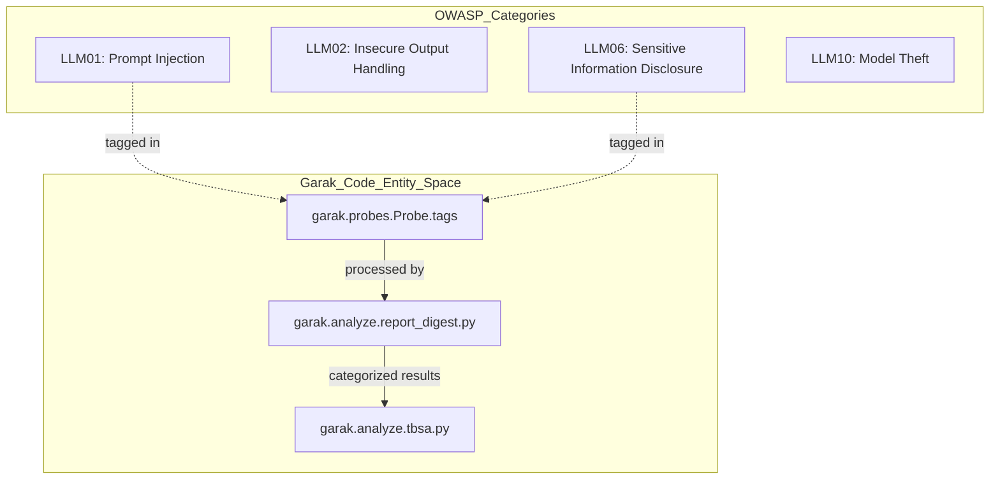

<!-- source: DeepWiki mcp.deepwiki.com · repo NVIDIA/garak · page 4.2 OWASP & AVID Integration · fetched 2026-10-26 -->

# OWASP & AVID Integration

<details>
<summary>Relevant source files</summary>

The following files were used as context for generating this wiki page:

- [CONTRIBUTING.md](CONTRIBUTING.md)
- [FAQ.md](FAQ.md)
- [README.md](README.md)
- [garak/analyze/__init__.py](garak/analyze/__init__.py)
- [garak/analyze/aggregate_reports.py](garak/analyze/aggregate_reports.py)
- [garak/analyze/analyze_log.py](garak/analyze/analyze_log.py)
- [garak/analyze/count_tokens.py](garak/analyze/count_tokens.py)
- [garak/analyze/get_tree.py](garak/analyze/get_tree.py)
- [garak/analyze/misp.py](garak/analyze/misp.py)
- [garak/analyze/perf_stats.py](garak/analyze/perf_stats.py)
- [garak/analyze/qual_review.py](garak/analyze/qual_review.py)
- [garak/analyze/report_avid.py](garak/analyze/report_avid.py)
- [garak/analyze/tbsa.py](garak/analyze/tbsa.py)
- [garak/report.py](garak/report.py)
- [tests/_assets/report/report_test.report.jsonl](tests/_assets/report/report_test.report.jsonl)
- [tests/analyze/test_tbsa.py](tests/analyze/test_tbsa.py)
- [tests/test_report.py](tests/test_report.py)

</details>


This document covers garak's integration with security vulnerability frameworks, specifically the OWASP LLM Top 10, AVID (AI Vulnerability Database), and MISP. It explains how garak categorizes, tags, and converts report data into industry-standard formats for standardized security assessment.

## Framework Overview

Garak integrates with established AI security frameworks to provide standardized vulnerability categorization. The system supports taxonomy-based tagging of probes, enabling results to be grouped by industry-standard classifications rather than just code module names.

## OWASP LLM Top 10 Integration

The OWASP LLM Top 10 provides a framework for the most critical security risks in LLM applications. Garak maps its probes to these categories through a tagging system defined in the probe classes.

### OWASP Taxonomy Mapping



Probes are tagged using the `owasp:llm10` prefix. For example, `topic.WordnetControversial` includes tags for both AVID and OWASP [tests/analyze/test_tbsa.py:38-42]().

Sources: [tests/analyze/test_tbsa.py:38-42](), [garak/analyze/report_digest.py:144-153]()

## AVID Integration

AVID (AI Vulnerability Database) provides a structured approach to documenting AI vulnerabilities. Garak includes a dedicated conversion utility, `report_avid`, to transform native JSONL reports into AVID-compliant JSON.

### AVID Conversion Data Flow

The conversion process uses the `avidtools` library to map garak evaluation records into the AVID data model.

```mermaid
graph LR
    subgraph "Garak_Internal"
        JSONL["report.jsonl"]
        ReportClass["garak.report.Report"]
        ConvertAvid["garak.analyze.report_avid.py"]
    end
    
    subgraph "AVID_Data_Model"
        AvidReport["avidtools.datamodels.report.Report"]
        AvidImpact["avidtools.datamodels.components.Impact"]
        AvidTaxonomy["avidtools.datamodels.components.AvidTaxonomy"]
    end
    
    JSONL -->|load| ReportClass
    ReportClass -->|export| AvidReport
    ConvertAvid -->|convert_to_avid| JSONL
    AvidReport -->|contains| AvidImpact
    AvidImpact -->|contains| AvidTaxonomy
```



### Key Conversion Logic
1. **Metadata Mapping**: The `target_type` and `target_name` from the garak run setup are mapped to AVID `affects.deployer` and `affects.artifacts` [garak/report.py:92-102]().
2. **Metric Calculation**: Garak `passed` and `total_evaluated` counts are converted into AVID `Metric` objects [garak/report.py:138-150]().
3. **Taxonomy Extraction**: The system filters probe tags starting with `avid:` (e.g., `avid-effect:security:S0301`) to populate the `AvidTaxonomy` risk domains and lifecycle views [garak/report.py:153-166]().

Sources: [garak/report.py:87-175](), [garak/analyze/report_avid.py:16-115]()

## MISP Integration & Taxonomy Tagging

Garak uses MISP (Malware Information Sharing Platform) format for managing its internal tag definitions. This ensures that every security tag used in the codebase has a standardized description.

### MISP Tag Validation
The module `garak.analyze.misp` provides utilities to:
- Report probes per MISP tag [garak/analyze/misp.py:34-47]().
- Identify untagged probes [garak/analyze/misp.py:42-43]().
- Validate that all tags used in code exist in the `tags.misp.tsv` resource file [garak/analyze/misp.py:26-32]().

### Taxonomy Processing in Reports
When generating digests, garak can filter results by taxonomy. The logic in `report_digest.py` splits tags on the `:` delimiter to group results by framework [garak/analyze/report_digest.py:144-153]().

Sources: [garak/analyze/misp.py:25-57](), [garak/analyze/report_digest.py:144-153]()

## Scoring & Defcon Levels

To provide a framework-agnostic view of risk, garak uses "Defcon" levels (1-5, where 1 is worst) to normalize scores across different probes.

| Level | Absolute Meaning (0..1) | Relative Meaning (Z-Score) |
| :--- | :--- | :--- |
| 1 | Immediate Risk / Complete Failure | Critical Risk (Bottom 16%) |
| 2 | Critical Risk | Very High Risk |
| 3 | Elevated Risk | Elevated Risk (Mean ±5%) |
| 4 | Low Risk | Medium Risk |
| 5 | Minimal Risk | Low Risk (Top 16%) |

The function `score_to_defcon` handles this mapping using bounds defined in `ABSOLUTE_DEFCON_BOUNDS` and `RELATIVE_DEFCON_BOUNDS` [garak/analyze/__init__.py:7-58]().

### Tier-Biased Security Aggregate (TBSA)
The TBSA is a lossy, single-score metric (1.0 to 5.0) derived from a garak run. It weights Tier 1 probes (of concern) more heavily than Tier 2 (SOTA research) [garak/analyze/tbsa.py:7-22]().
- **T1 Weight**: 2.0 [garak/analyze/tbsa.py:211]().
- **T2 Weight**: 1.0 [garak/analyze/tbsa.py:211]().
- **Calculation**: Uses a weighted harmonic mean of the aggregate defcons for each tier [garak/analyze/tbsa.py:199-215]().

Sources: [garak/analyze/__init__.py:7-58](), [garak/analyze/tbsa.py:157-215](), [garak/analyze/qual_review.py:122-142]()

## Implementation Details

### Key Classes and Functions

| Entity | File Path | Description |
| :--- | :--- | :--- |
| `Report.export()` | [garak/report.py:87]() | Primary method for generating AVID-compliant reports from internal records. |
| `convert_to_avid()` | [garak/analyze/report_avid.py:16]() | CLI utility function to convert a `.report.jsonl` file to `.avid.jsonl`. |
| `digest_to_tbsa()` | [garak/analyze/tbsa.py:60]() | Aggregates probe/detector scores into a single weighted security score. |
| `misp_report()` | [garak/analyze/misp.py:25]() | Validates codebase tags against the MISP reference file. |

### Usage Examples

**Generate AVID Report:**
```bash
python3 -m garak.analyze.report_avid -r garak.report.jsonl
```
This produces a file named `garak.avid.jsonl` containing multiple AVID report objects [garak/analyze/report_avid.py:111-115]().

**Calculate TBSA Score:**
```bash
python3 -m garak.analyze.tbsa -r report_digest.json
```
This outputs the Tier-Biased Security Aggregate and a unique `version_probe_hash` to ensure the score is interpreted within the context of the specific probes run [garak/analyze/tbsa.py:178-185]().

Sources: [garak/analyze/report_avid.py:129-145](), [garak/analyze/tbsa.py:178-185](), [garak/report.py:170-175]()

---

