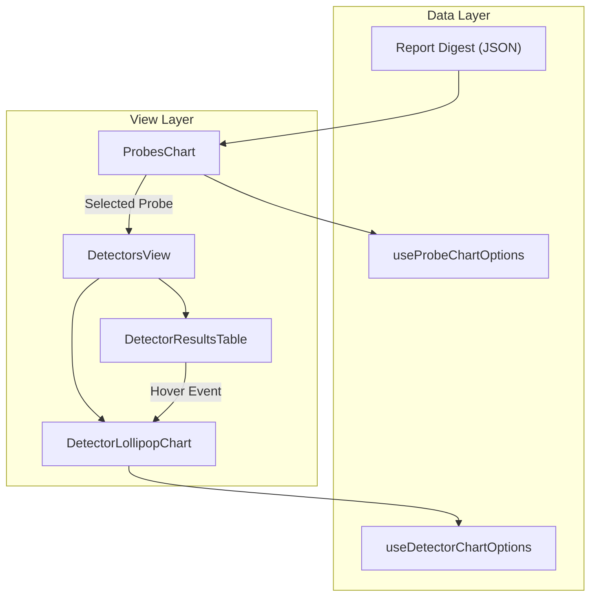
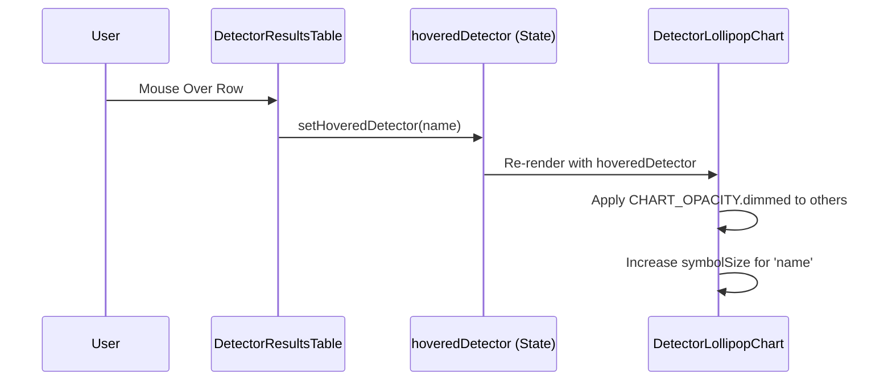

<!-- source: DeepWiki mcp.deepwiki.com · repo NVIDIA/garak · page 4.3 Report Viewer UI · fetched 2026-10-26 -->

# Report Viewer UI

Relevant source files

The following files were used as context for generating this wiki page:

- [garak-report/README.md](garak-report/README.md)
- [garak-report/package.json](garak-report/package.json)
- [garak-report/src/components/DetectorChart/DetectorChartHeader.tsx](garak-report/src/components/DetectorChart/DetectorChartHeader.tsx)
- [garak-report/src/components/DetectorChart/DetectorLollipopChart.tsx](garak-report/src/components/DetectorChart/DetectorLollipopChart.tsx)
- [garak-report/src/components/DetectorChart/DetectorResultsTable.tsx](garak-report/src/components/DetectorChart/DetectorResultsTable.tsx)
- [garak-report/src/components/DetectorChart/__tests__/DetectorChartHeader.test.tsx](garak-report/src/components/DetectorChart/__tests__/DetectorChartHeader.test.tsx)
- [garak-report/src/components/DetectorChart/__tests__/DetectorFilters.test.tsx](garak-report/src/components/DetectorChart/__tests__/DetectorFilters.test.tsx)
- [garak-report/src/components/DetectorChart/__tests__/DetectorResultsTable.test.tsx](garak-report/src/components/DetectorChart/__tests__/DetectorResultsTable.test.tsx)
- [garak-report/src/components/DetectorChart/index.tsx](garak-report/src/components/DetectorChart/index.tsx)
- [garak-report/src/components/DetectorsView.tsx](garak-report/src/components/DetectorsView.tsx)
- [garak-report/src/components/ProbeChart/ModuleFilterChips.tsx](garak-report/src/components/ProbeChart/ModuleFilterChips.tsx)
- [garak-report/src/components/ProbeChart/ProbeBarChart.tsx](garak-report/src/components/ProbeChart/ProbeBarChart.tsx)
- [garak-report/src/components/ProbeChart/__tests__/ModuleFilterChips.test.tsx](garak-report/src/components/ProbeChart/__tests__/ModuleFilterChips.test.tsx)
- [garak-report/src/components/ProbeChart/index.tsx](garak-report/src/components/ProbeChart/index.tsx)
- [garak-report/src/components/ProbesChart.tsx](garak-report/src/components/ProbesChart.tsx)
- [garak-report/src/components/__tests__/DetectorsView.test.tsx](garak-report/src/components/__tests__/DetectorsView.test.tsx)
- [garak-report/src/components/__tests__/ErrorBoundary.test.tsx](garak-report/src/components/__tests__/ErrorBoundary.test.tsx)
- [garak-report/src/components/__tests__/ProbesChart.slider.test.tsx](garak-report/src/components/__tests__/ProbesChart.slider.test.tsx)
- [garak-report/src/components/__tests__/ProbesChart.test.tsx](garak-report/src/components/__tests__/ProbesChart.test.tsx)
- [garak-report/src/components/__tests__/ProbesChart.tooltip.test.tsx](garak-report/src/components/__tests__/ProbesChart.tooltip.test.tsx)
- [garak-report/src/constants/theme.ts](garak-report/src/constants/theme.ts)
- [garak-report/src/hooks/__tests__/useDetectorChartOptions.test.ts](garak-report/src/hooks/__tests__/useDetectorChartOptions.test.ts)
- [garak-report/src/hooks/__tests__/useGroupedDetectors.test.ts](garak-report/src/hooks/__tests__/useGroupedDetectors.test.ts)
- [garak-report/src/hooks/__tests__/useProbeTooltip.test.ts](garak-report/src/hooks/__tests__/useProbeTooltip.test.ts)
- [garak-report/src/hooks/__tests__/useSeverityColor.test.ts](garak-report/src/hooks/__tests__/useSeverityColor.test.ts)
- [garak-report/src/hooks/__tests__/useSortedDetectors.test.ts](garak-report/src/hooks/__tests__/useSortedDetectors.test.ts)
- [garak-report/src/hooks/useDetectorChartOptions.ts](garak-report/src/hooks/useDetectorChartOptions.ts)
- [garak-report/src/hooks/useFlattenedModules.ts](garak-report/src/hooks/useFlattenedModules.ts)
- [garak-report/src/hooks/useGroupedDetectors.ts](garak-report/src/hooks/useGroupedDetectors.ts)
- [garak-report/src/hooks/useProbeChartOptions.ts](garak-report/src/hooks/useProbeChartOptions.ts)
- [garak-report/src/hooks/useProbeTooltip.ts](garak-report/src/hooks/useProbeTooltip.ts)
- [garak-report/src/hooks/useSortedDetectors.ts](garak-report/src/hooks/useSortedDetectors.ts)
- [garak-report/src/hooks/useTooltipFormatter.ts](garak-report/src/hooks/useTooltipFormatter.ts)
- [garak-report/src/pages/__tests__/Report.test.tsx](garak-report/src/pages/__tests__/Report.test.tsx)
- [garak-report/tools/dev/pre-commit-hook.sh](garak-report/tools/dev/pre-commit-hook.sh)
- [garak-report/vitest.setup.ts](garak-report/vitest.setup.ts)
- [garak-report/yarn.lock](garak-report/yarn.lock)
- [garak/analyze/ui/index.html](garak/analyze/ui/index.html)

The **garak-report** viewer is a specialized React-based frontend designed for interactive visualization of LLM vulnerability scan results. It transforms static JSONL report digests into a rich, graphical interface that allows security researchers to analyze probe performance, detector sensitivity, and relative model rankings.

## System Overview

The Report Viewer UI is a standalone TypeScript application built with **React** and **ECharts**. It consumes structured data from garak's `report_digest` pipeline to provide hierarchical views of scan results, ranging from high-level module summaries to granular detector statistics.

### Key Features
*   **Interactive Bar Charts**: Visualization of probe scores grouped by security modules.
*   **Lollipop Charts**: Comparative visualization of Z-scores for detectors within a specific probe.
*   **DEFCON Scoring**: Visual indicators for severity levels (DC-1 through DC-5).
*   **Detector Breakdown**: Tabular data for hit counts, total evaluations, and absolute scores.

### Natural Language to Code Entity Mapping

| System Concept | Code Entity | Role |
| :--- | :--- | :--- |
| **Probe Visualization** | `ProbesChart` | Orchestrates the primary bar chart showing probe scores. |
| **Detector Comparison** | `DetectorLollipopChart` | Visualizes Z-scores to compare model performance against benchmarks. |
| **Data Enrichment** | `useProbeChartOptions` | Transforms raw probe data into ECharts-compatible configurations. |
| **Score Normalization** | `useDetectorChartOptions` | Handles Z-score clamping and relative performance mapping. |
| **Theming** | `THEME_COLORS` | Provides consistent styling across light and dark modes. |

Sources: [garak-report/src/components/ProbesChart.tsx:1-165](), [garak-report/src/hooks/useDetectorChartOptions.ts:1-60](), [garak-report/src/constants/index.ts:1-50]()

## Architecture & Data Flow

The frontend operates as a consumer of the garak analysis pipeline. Data typically flows from a `.json` digest file into the React state, where it is enriched for visualization.

### Component Hierarchy and Data Flow

The following diagram illustrates how data flows from the enriched probe structures into specific UI components.

**UI Data Flow Diagram**

Sources: [garak-report/src/components/DetectorsView.tsx:29-95](), [garak-report/src/hooks/useProbeChartOptions.ts:41-67](), [garak-report/src/components/ProbesChart.tsx:135-165]()

## Implementation Details

### Probe Visualization
The primary entry point for scan analysis is the `ProbesChart`. It utilizes the `useProbeChartOptions` hook to generate a bar chart where each bar represents a probe's success rate.

*   **Hook**: `useProbeChartOptions` [garak-report/src/hooks/useProbeChartOptions.ts:41-46]()
*   **Logic**: It maps probe modules to a stable color palette defined in `MODULE_COLORS` [garak-report/src/hooks/useProbeChartOptions.ts:32-39]().
*   **Interaction**: Clicking a bar triggers `setSelectedProbe`, which updates the context to show the detailed `DetectorsView` [garak-report/src/components/ProbesChart.tsx:178-185]().

### Detector Analysis (Lollipop Charts)
When a probe is selected, the `DetectorsView` component renders a `DetectorLollipopChart`. This chart displays the **Z-score** (relative performance) of detectors.

*   **Z-Score Calculation**: The UI expects `relative_score` from the backend. A positive Z-score indicates better than average performance, while negative indicates worse [garak-report/src/components/DetectorChart/DetectorLollipopChart.tsx:142-158]().
*   **Clamping**: Z-scores are clamped to a specific range defined in `CHART_DIMENSIONS.zscore` to prevent outliers from distorting the chart scale [garak-report/src/hooks/useDetectorChartOptions.ts:103-105]().
*   **N/A Handling**: If calibration data is missing, the hook generates an "N/A" marker using a rectangular symbol [garak-report/src/hooks/useDetectorChartOptions.ts:113-137]().

### Shared State & Highlighting
The UI implements linked highlighting between the `DetectorResultsTable` and the `DetectorLollipopChart` using a shared `hoveredDetector` state in `DetectorsView` [garak-report/src/components/DetectorsView.tsx:41-42]().

**Interaction Logic Diagram**

Sources: [garak-report/src/components/DetectorsView.tsx:78-90](), [garak-report/src/hooks/useDetectorChartOptions.ts:107-110](), [garak-report/src/hooks/useDetectorChartOptions.ts:158-175]()

## Setup and Deployment

### Development Environment
The project uses `yarn` for dependency management. The frontend is a standard Vite/React project.

1.  **Install Dependencies**: `yarn install` [garak-report/yarn.lock:1-10]()
2.  **Start Dev Server**: `yarn dev`
3.  **Run Tests**: `yarn test` (Uses Vitest and React Testing Library) [garak-report/src/components/__tests__/DetectorsView.test.tsx:1-10]()

### Production Build
The application is compiled into a static `index.html` and bundled assets.
*   **Entry Point**: `garak/analyze/ui/index.html` [garak/analyze/ui/index.html:1-6]()
*   **Data Injection**: In production, the garak CLI replaces or provides a data source that the React app fetches to populate the `ProbesChart`.

## Key Component Reference

| Component | File Path | Responsibility |
| :--- | :--- | :--- |
| `DetectorsView` | `garak-report/src/components/DetectorsView.tsx` | Main container for a single probe's detailed analysis. |
| `DetectorLollipopChart` | `garak-report/src/components/DetectorChart/DetectorLollipopChart.tsx` | Renders the relative performance Z-score visualization. |
| `DefconBadge` | `garak-report/src/components/DefconBadge.tsx` | Displays the DC-1 to DC-5 risk levels. |
| `useGroupedDetectors` | `garak-report/src/hooks/useGroupedDetectors.ts` | Groups detector results across all probes for cross-model comparison. |

Sources: [garak-report/src/components/DetectorsView.tsx:29-35](), [garak-report/src/hooks/useGroupedDetectors.ts:37-86](), [garak-report/src/components/DetectorChart/DetectorLollipopChart.tsx:37-42]()

---

