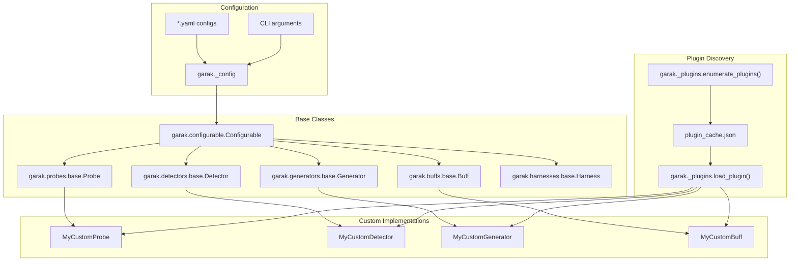
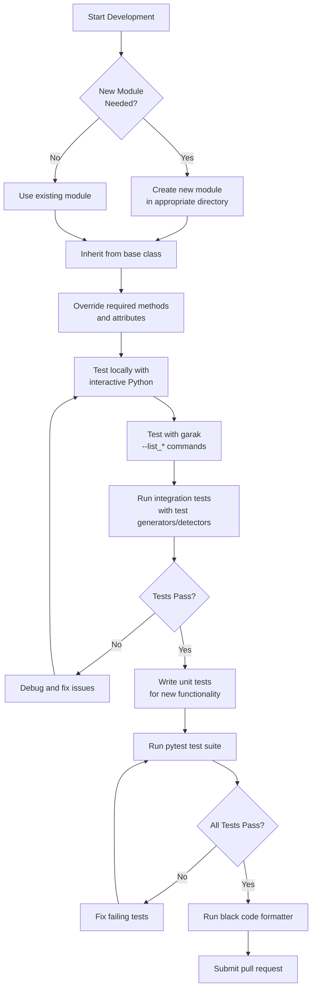

<!-- source: DeepWiki mcp.deepwiki.com · repo NVIDIA/garak · page 5 Extending garak · fetched 2026-10-26 -->

# Extending garak

<details>
<summary>Relevant source files</summary>

The following files were used as context for generating this wiki page:

- [.githooks/prepare-commit-msg](.githooks/prepare-commit-msg)
- [.gitignore](.gitignore)
- [AGENTS.md](AGENTS.md)
- [docs/source/contributing.rst](docs/source/contributing.rst)
- [docs/source/detectors/sysprompt_extraction.rst](docs/source/detectors/sysprompt_extraction.rst)
- [docs/source/extending.generator.rst](docs/source/extending.generator.rst)
- [docs/source/extending.probe.rst](docs/source/extending.probe.rst)
- [docs/source/extending.rst](docs/source/extending.rst)
- [docs/source/index.rst](docs/source/index.rst)
- [docs/source/probes/agent_breaker.rst](docs/source/probes/agent_breaker.rst)
- [docs/source/probes/goat.rst](docs/source/probes/goat.rst)
- [docs/source/translation.rst](docs/source/translation.rst)
- [garak/probes/goat.py](garak/probes/goat.py)

</details>


This document covers how to extend garak with custom components including probes, detectors, generators, and other plugins. It provides an overview of the plugin architecture, base classes, and development workflow for building new garak functionality.

For step-by-step tutorials on creating specific components, see [Custom Probes](#5.1), [Custom Detectors](#5.2), or [Custom Generators](#5.3). For development environment setup, see [Development Environment](#5.4).

## Plugin Architecture Overview

garak uses a modular plugin architecture where all major functionality is implemented as plugins that inherit from base classes. The plugin system supports automatic discovery, configuration management, and dynamic loading.

### Plugin Architecture



Sources: [docs/source/extending.rst:1-35](), [docs/source/extending.probe.rst:43-53](), [docs/source/extending.generator.rst:11-25]()

## Extension Points

### Probes

Probes implement vulnerability tests by inheriting from `garak.probes.base.Probe`. They encapsulate the attack logic, including multi-turn strategies like the O-T-S-R framework used in `GOATAttack`.

**Key Components:**
- `prompts`: List of test prompts to send to the target model.
- `goal`: Description of what the probe attempts to achieve.
- `tags`: MISP-format taxonomy categories for security frameworks (e.g., AVID, OWASP).
- `primary_detector`: The default detector to run for this probe.
- `tier`: Probe importance level from `garak.probes.Tier`.

For details, see [Custom Probes](#5.1).

Sources: [docs/source/extending.probe.rst:43-122](), [garak/probes/goat.py:32-106]()

### Detectors  

Detectors analyze model outputs to determine if vulnerabilities were triggered. They implement the `detect()` interface and return scores ranging from 0.0 (not vulnerable) to 1.0 (vulnerable).

For details, see [Custom Detectors](#5.2).

Sources: [docs/source/extending.rst:19-30]()

### Generators

Generators provide interfaces to language models. They handle API communication, authentication via `ENV_VAR`, and response formatting. They can support multiple modalities including text, image, and audio.

For details, see [Custom Generators](#5.3).

Sources: [docs/source/extending.generator.rst:1-83](), [docs/source/extending.probe.rst:117-121]()

### Buffs

Buffs transform prompts before they reach the generator, enabling techniques like lowercase transformation or encoding-based injections.

Sources: [docs/source/extending.rst:28-28]()

## Development Workflow

### Plugin Development Process



Sources: [docs/source/extending.rst:41-68](), [docs/source/contributing.rst:41-54]()

## Plugin Discovery and Loading

garak automatically discovers plugins by scanning the `probes/`, `detectors/`, `generators/`, and `buffs/` directories.

**Discovery and Dependencies:**
- `garak._plugins.load_plugin()` manages dynamic imports.
- `extra_dependency_names`: If a plugin requires external libraries, they should be listed in this parameter to be managed by the loader.
- **Naming**: Module files should be named after the technique (e.g., `encoding.py`) rather than the effect.

Sources: [docs/source/extending.rst:31-34](), [docs/source/extending.probe.rst:23-28]()

## Inheritance Patterns

### Iterative and Specialized Probes

Beyond the base `Probe`, garak provides specialized classes for complex attacks:
- `IterativeProbe`: Used for multi-turn attacks like `GOATAttack` that maintain conversation history.
- `EncodingMixin`: Used for probes involving character-level transformations or alternate encodings.

Sources: [garak/probes/goat.py:32-32](), [docs/source/extending.probe.rst:113-121]()

## Configuration and Metadata

Custom plugins inherit configuration support through the `Configurable` base class.

**Required Metadata for Probes:**
- `doc_uri`: Reference to the research paper or source of the technique.
- `active`: Boolean determining if the probe runs in default scans.
- `modality`: Dictionary defining input types (e.g., `{"in": {"text"}}`).

Sources: [docs/source/extending.probe.rst:93-122](), [docs/source/extending.generator.rst:40-56]()

## Testing Custom Plugins

### Verification Commands
```bash
# List probes to verify discovery
python3 -m garak --list_probes

# Test a new probe with a blank target
python3 -m garak -t test.Blank -p mymodule -d always.Pass
```

### Contribution Requirements
- **Formatting**: Use `black --config pyproject.toml`.
- **Sign-off**: Commits must include a `Signed-off-by` trailer.
- **Tests**: New components must include tests in the `tests/` directory (e.g., `tests/probes/test_probe_xyz.py`).

For details, see [Development Environment](#5.4).

Sources: [docs/source/extending.rst:44-61](), [docs/source/contributing.rst:61-79](), [AGENTS.md:101-104]()

---

