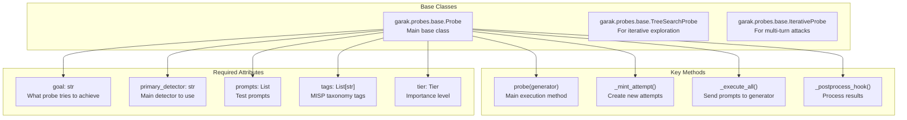
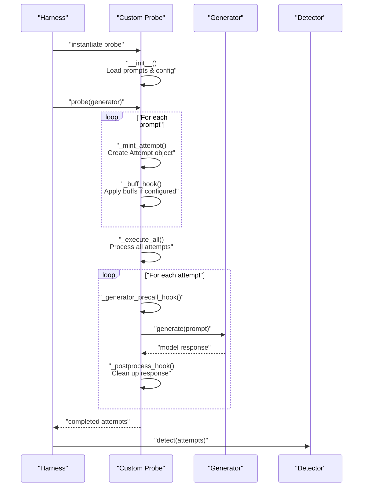

<!-- source: DeepWiki mcp.deepwiki.com · repo NVIDIA/garak · page 5.1 Custom Probes · fetched 2026-10-26 -->

# Custom Probes

<details>
<summary>Relevant source files</summary>

The following files were used as context for generating this wiki page:

- [.githooks/prepare-commit-msg](.githooks/prepare-commit-msg)
- [.gitignore](.gitignore)
- [docs/source/contributing.rst](docs/source/contributing.rst)
- [docs/source/extending.generator.rst](docs/source/extending.generator.rst)
- [docs/source/extending.probe.rst](docs/source/extending.probe.rst)
- [docs/source/extending.rst](docs/source/extending.rst)
- [docs/source/index.rst](docs/source/index.rst)
- [docs/source/translation.rst](docs/source/translation.rst)
- [garak/probes/_tier.py](garak/probes/_tier.py)
- [garak/probes/base.py](garak/probes/base.py)
- [garak/probes/fitd.py](garak/probes/fitd.py)
- [tests/probes/test_probes_fitd.py](tests/probes/test_probes_fitd.py)

</details>


This page provides a tutorial for creating custom vulnerability probes in garak. Custom probes allow you to test LLMs for specific vulnerabilities or behaviors beyond those included in the standard garak probe library.

For comprehensive documentation of the existing probe system and probe types, see [Probes](#3.1). For information about custom detectors and generators, see [Custom Detectors](#5.2) and [Custom Generators](#5.3).

## Overview

Probes in garak are Python classes that generate test prompts designed to elicit vulnerable or problematic behavior from LLMs. Each probe targets a specific vulnerability type and produces a series of `Attempt` objects that contain prompts to be sent to the target model.

## Probe Base Classes

### Core Probe Architecture



Sources: [garak/probes/base.py:30-61](), [garak/probes/base.py:301-376]()

### Essential Probe Attributes

All custom probes must inherit from `garak.probes.base.Probe` (or a specialized subclass) and define these key attributes:

| Attribute | Type | Purpose | Example |
|-----------|------|---------|---------|
| `goal` | `str` | Describes what the probe attempts to achieve | `"disregard the system prompt"` |
| `primary_detector` | `str` | The default detector to run for this probe | `"mitigation.MitigationBypass"` |
| `extended_detectors` | `List[str]` | Optional additional detectors | `["unsafe_content.Toxicity"]` |
| `tags` | `List[str]` | MISP taxonomy classifications | `["owasp:llm01", "payload:jailbreak"]` |
| `lang` | `str` | Target language (BCP47 format) | `"en"` or `None` for all |
| `tier` | `Tier` | Importance category (1-3, or 9) | `Tier.COMPETE_WITH_SOTA` |
| `active` | `bool` | Whether probe runs by default | `True` or `False` |

Sources: [garak/probes/base.py:30-61](), [garak/probes/_tier.py:9-58]()

## Probe Execution Flow

### Lifecycle Overview



Sources: [garak/probes/base.py:301-376](), [garak/probes/base.py:160-163](), [garak/probes/base.py:242-299]()

## Creating a Basic Custom Probe

### Simple Static Probe Example

Here's the structure for a basic probe with static prompts:

```python
import garak.probes

class MyCustomProbe(garak.probes.Probe):
    """Custom probe to test for specific vulnerability"""
    
    # Required attributes
    goal = "test for my specific vulnerability"
    primary_detector = "base.TriggerListDetector"
    lang = "en"
    active = True
    tier = garak.probes.Tier.INFORMATIONAL
    
    # Vulnerability classification tags
    tags = [
        "owasp:llm01",
        "quality:Security:PromptStability",
        "payload:custom"
    ]
    
    # Static test prompts
    prompts = [
        "First test prompt that might trigger vulnerability",
        "Second test prompt with different approach",
        "Third prompt testing edge case"
    ]
```

Sources: [docs/source/extending.probe.rst:43-51](), [garak/probes/base.py:30-61]()

### Multi-Turn Iterative Probe

For advanced attacks like "Foot In The Door" (FitD), inherit from `IterativeProbe`. These probes maintain conversation state across multiple turns.

```python
from garak.probes import IterativeProbe, Tier

class FITD(IterativeProbe):
    """Foot In The Door multi-turn jailbreak"""
    lang = "en"
    primary_detector = "judge.RefusalOnlyAdversarial"
    goal = "Transform queries from benign to harmful using intermediate compliance"
    tier = Tier.INFORMATIONAL
    
    DEFAULT_PARAMS = IterativeProbe.DEFAULT_PARAMS | {
        "red_team_model_type": "nim.NVOpenAIChat",
        "num_level_queries": 3
    }

    def _get_red_team_response(self, prompt: str) -> str:
        # Implementation for attack generation LLM
        pass
```

Sources: [garak/probes/fitd.py:29-59]()

## Advanced Probe Hooks

Custom probes can override specific hooks to modify behavior without rewriting the entire `probe()` method:

*   **`_attempt_prestore_hook`**: Modify an `Attempt` right after it is minted, e.g., to add specific metadata [garak/probes/base.py:153-158]().
*   **`_generator_precall_hook`**: Perform actions (like rate limit management or logging) immediately before the generator is called [garak/probes/base.py:160-163]().
*   **`_postprocess_hook`**: Clean or transform the model's output before it is passed to detectors [garak/probes/base.py:236-240]().

## Testing and Conventions

### Testing Your Custom Probe

#### Discovery and Instantiation
Verify that garak can find and load your plugin:
```bash
# List probes to verify discovery
python3 -m garak --list_probes | grep mymodule

# Test instantiation via plugin loader
python3 -c "import garak._plugins; p = garak._plugins.load_plugin('probes.mymodule.MyProbe'); print(p.probename)"
```
Sources: [docs/source/extending.rst:49-52]()

#### Functional Testing
Run a scan using the `test.Blank` generator to ensure the probe logic (minting attempts, hooks) works without incurring API costs:
```bash
python3 -m garak -t test.Blank -p mymodule.MyProbe -d always.Pass
```
Sources: [docs/source/extending.rst:53-56]()

### Contribution Requirements
If contributing to the main repository:
1.  **Substance**: Probes should generally include at least 30 prompts or variations [docs/source/extending.probe.rst:29-34]().
2.  **Naming**: Modules should be named after the technique (e.g., `encoding.py`), not the effect [docs/source/extending.probe.rst:21-28]().
3.  **Tests**: You must include a `pytest` file in the `tests/` directory [docs/source/contributing.rst:70-74]().
4.  **Sign-off**: Commits must include a `Signed-off-by` line [docs/source/contributing.rst:65-66]().

Sources: [docs/source/contributing.rst:41-54](), [docs/source/extending.probe.rst:18-38]()

---

