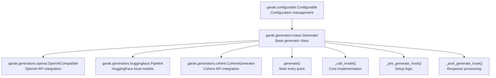
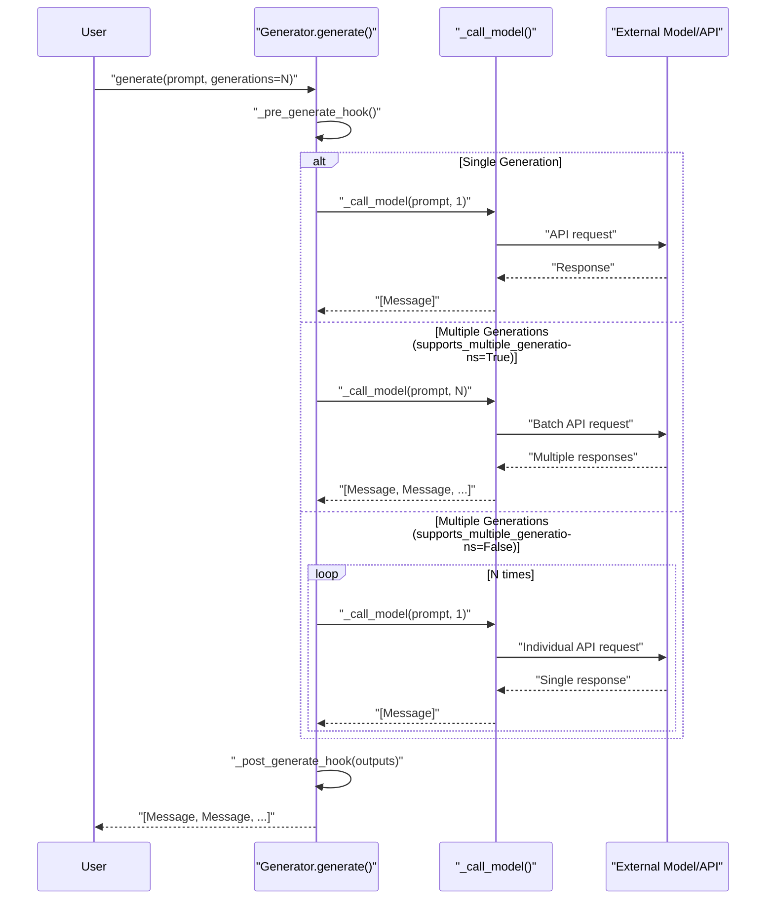
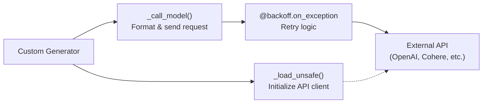
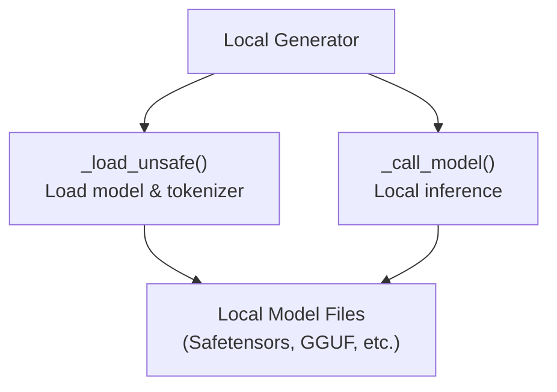

<!-- source: DeepWiki mcp.deepwiki.com · repo NVIDIA/garak · page 5.3 Custom Generators · fetched 2026-10-26 -->

# Custom Generators

<details>
<summary>Relevant source files</summary>

The following files were used as context for generating this wiki page:

- [.githooks/prepare-commit-msg](.githooks/prepare-commit-msg)
- [.gitignore](.gitignore)
- [docs/source/contributing.rst](docs/source/contributing.rst)
- [docs/source/extending.generator.rst](docs/source/extending.generator.rst)
- [docs/source/extending.probe.rst](docs/source/extending.probe.rst)
- [docs/source/extending.rst](docs/source/extending.rst)
- [docs/source/generators/rest.rst](docs/source/generators/rest.rst)
- [docs/source/index.rst](docs/source/index.rst)
- [docs/source/translation.rst](docs/source/translation.rst)
- [garak/_plugins.py](garak/_plugins.py)
- [garak/generators/base.py](garak/generators/base.py)
- [garak/generators/cohere.py](garak/generators/cohere.py)
- [garak/generators/ggml.py](garak/generators/ggml.py)
- [garak/generators/guardrails.py](garak/generators/guardrails.py)
- [garak/generators/huggingface.py](garak/generators/huggingface.py)
- [garak/generators/langchain.py](garak/generators/langchain.py)
- [garak/generators/nvcf.py](garak/generators/nvcf.py)
- [garak/generators/openai.py](garak/generators/openai.py)
- [garak/generators/replicate.py](garak/generators/replicate.py)
- [garak/generators/rest.py](garak/generators/rest.py)
- [garak/resources/plugin_cache.json](garak/resources/plugin_cache.json)
- [tests/conftest.py](tests/conftest.py)
- [tests/generators/test_nvcf.py](tests/generators/test_nvcf.py)
- [tests/generators/test_rest.py](tests/generators/test_rest.py)
- [tests/generators/test_rest_mtls_integration.py](tests/generators/test_rest_mtls_integration.py)

</details>


This document provides a comprehensive guide for developers who want to extend garak with custom generators. A generator in garak is a plugin that interfaces with language models or text generation services, providing a standardized way to send prompts and receive responses.

For information about using existing generators, see [Generators](#3.2). For documentation of specific generator implementations, see [Hugging Face Generators](#3.2.1), [REST API Generators](#3.2.2), and [Specialized Generators](#3.2.3).

## Generator Architecture Overview

All generators in garak inherit from the `Generator` base class and implement a standardized interface for text generation. The architecture separates model communication, configuration management, and response processing into distinct concerns.

**Generator Class Hierarchy and Core Methods**



**Generator Execution Flow**



Sources: [garak/generators/base.py:21-225](), [garak/generators/openai.py:134-294](), [garak/generators/huggingface.py:46-180]()

## Basic Generator Implementation

The minimal generator implementation requires inheriting from `Generator` and implementing the `_call_model` method. Here's the essential structure:

**Required Components**

| Component | Purpose | Example |
|-----------|---------|---------|
| `_call_model()` | Core generation method | Send prompt to model, return `List[Message]` |
| `generator_family_name` | Display name for the generator family | `"OpenAI"`, `"Hugging Face"` |
| `DEFAULT_PARAMS` | Default configuration parameters | `{"temperature": 0.7, "max_tokens": 150}` |
| `__init__()` | Constructor with configuration loading | Set up API clients, validate parameters |
| `extra_dependency_names` | Optional list of required Python packages | `["openai"]` |

**Basic Generator Template**

The simplest generator follows this pattern, as seen in the base class and simple implementations:

[garak/generators/base.py:21-105]() shows the base implementation:
- Inherit from `Generator` (which inherits from `Configurable`).
- Set `generator_family_name`.
- Implement `_call_model()` which takes a `Conversation` object and returns a `List[Union[Message, None]]`. [garak/generators/base.py:74-84]()
- Set `supports_multiple_generations` based on whether the underlying service can return multiple completions in one call. [garak/generators/base.py:46-48]()

**Configuration and Parameters**

Generators use the `DEFAULT_PARAMS` dictionary to define configurable parameters. The base class provides common parameters like `max_tokens`, `temperature`, and `context_len`. Custom generators extend this with their specific parameters:

[garak/generators/base.py:25-32]() defines the base parameters that all generators inherit. Custom parameters are added using dictionary union (`|`) syntax as shown in [garak/generators/openai.py:144-155]().

Sources: [garak/generators/base.py:21-140](), [garak/generators/openai.py:134-191](), [garak/generators/cohere.py:31-80]()

## API-based Generator Pattern

Most production generators interface with external APIs. The pattern involves authentication, request formatting, error handling, and response parsing.

**API Generator Architecture**



**Authentication and Environment Variables**

API generators typically use environment variables for authentication. The pattern includes:

1. Define `ENV_VAR` class attribute specifying the environment variable name.
2. The base `Generator` (via `Configurable`) handles credential loading.
3. Initialize the API client in the `_load_unsafe()` method.

[garak/generators/openai.py:137-168]() demonstrates the pattern where `ENV_VAR` is defined and the client is initialized in `_load_unsafe`.

**Error Handling with Rate Limiting**

Production generators implement exponential backoff for handling rate limits (HTTP 429) and transient errors:

[garak/generators/rest.py:37-51]() defines default parameters for REST generators, including `ratelimit_codes` (default `[429]`).

[garak/generators/cohere.py:81-147]() shows the `@backoff.on_exception` decorator handling multiple exception types (e.g., `TooManyRequestsError`, `ServiceUnavailableError`) with Fibonacci backoff.

**Response Processing**

API responses need conversion to garak's `Message` objects. The pattern involves:
- Extract text content from API response objects.
- Handle different response formats (single vs multiple generations).
- Return `List[Union[Message, None]]` where `None` indicates failed generation or refused prompt.

[garak/generators/nvcf.py:151-153]() shows extracting text from an NVCF response and wrapping it in `Message` objects.

Sources: [garak/generators/openai.py:134-191](), [garak/generators/cohere.py:31-147](), [garak/generators/rest.py:31-191](), [garak/generators/nvcf.py:20-153]()

## Local Model Generator Pattern

Local model generators run models directly (e.g., via Hugging Face `transformers` or GGUF runners). This pattern handles model loading, device placement, and local inference.

**Local Model Architecture**



**Model Loading and Initialization**

Local generators implement lazy loading in `_load_unsafe()` to manage resources:

[garak/generators/huggingface.py:72-125]() shows the HuggingFace `Pipeline` pattern:
- Check if model already loaded.
- Use `_gather_hf_params()` to collect configuration.
- Initialize the `transformers.pipeline`.
- Detect chat template support via `tokenizer.chat_template`.

**Device Management**

Local generators must handle hardware acceleration (CPU/GPU):

[garak/generators/huggingface.py:69]() calls `_select_hf_device()` to determine where the model should reside.

**Local Inference Execution**

Local inference requires careful handling of model inputs and outputs:

[garak/generators/huggingface.py:127-180]() demonstrates the pipeline inference pattern:
- Format prompts (handling chat vs. raw text). [garak/generators/huggingface.py:138-141]()
- Configure `generation_config` (e.g., `max_new_tokens`, `num_return_sequences`). [garak/generators/huggingface.py:143-149]()
- Execute inference with `torch.no_grad()`. [garak/generators/huggingface.py:134]()
- Post-process output (e.g., `deprefix_prompt`). [garak/generators/huggingface.py:167-174]()

Sources: [garak/generators/huggingface.py:46-180](), [garak/generators/base.py:21-140]()

## Advanced Features

Advanced generators implement features like multimodal support, parallel processing, and specialized configuration.

**Modality**

Generators define supported input/output modalities through the `modality` attribute. Valid elements include `text`, `image`, `audio`, `video`, `3d`:

[garak/generators/base.py:44]() sets the default modality to `{"in": {"text"}, "out": {"text"}}`.

**Parallel Processing**

Generators can configure parallel execution through `parallel_requests` and `max_workers` parameters:

[garak/generators/base.py:176-203]() implements parallel execution using `multiprocessing.Pool` when `parallel_requests > 1` and `parallel_capable = True`. Note that `Pipeline` (Hugging Face) sets `parallel_capable = False` to avoid GPU resource conflicts. [garak/generators/huggingface.py:58]()

**Skip Sequences**

Generators can automatically prune unwanted sequences from output using `skip_seq_start` and `skip_seq_end`:

[garak/generators/base.py:107-136]() implements `_prune_skip_sequences`, which uses regex to remove content between specified markers in the generated text.

Sources: [garak/generators/base.py:44-203](), [garak/generators/huggingface.py:46-58]()

## Integration with garak

Custom generators integrate with garak through the plugin system and configuration management.

**Plugin Registration and Discovery**

Generators are discovered by the `PluginCache` and loaded via `importlib`:

1. Place the generator file in `garak/generators/`.
2. Define the generator class (e.g., `MyGenerator(Generator)`).
3. The `PluginCache` scans the directory and catalogs classes inheriting from `Generator`. [garak/_plugins.py:175-183]()

**Command-line Integration**

Generators are selected using the `--model_type` and `--model_name` flags:

```bash
# Example: Using the Hugging Face Pipeline generator
garak --model_type huggingface.Pipeline --model_name gpt2
```

**Dependency Management**

If a generator requires external libraries, list them in `extra_dependency_names`:

[garak/generators/cohere.py:53]() specifies `extra_dependency_names = ["cohere"]`. Garak will check for these before attempting to use the generator.

Sources: [garak/_plugins.py:39-183](), [garak/generators/base.py:72](), [garak/generators/cohere.py:53]()

---

