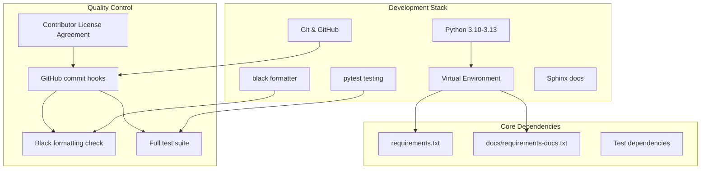
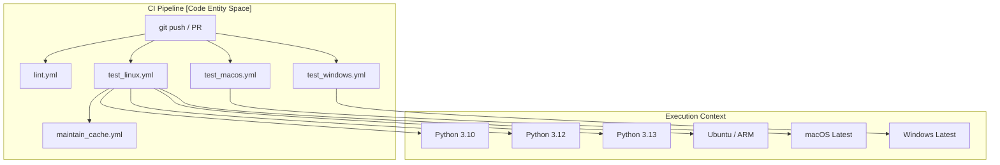
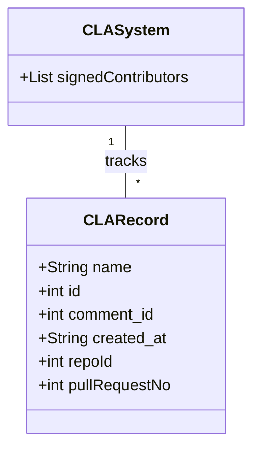

<!-- source: DeepWiki mcp.deepwiki.com · repo NVIDIA/garak · page 5.4 Development Environment · fetched 2026-10-26 -->

# Development Environment

<details>
<summary>Relevant source files</summary>

The following files were used as context for generating this wiki page:

- [.githooks/prepare-commit-msg](.githooks/prepare-commit-msg)
- [.github/ISSUE_TEMPLATE/bug_report.md](.github/ISSUE_TEMPLATE/bug_report.md)
- [.github/ISSUE_TEMPLATE/config.yml](.github/ISSUE_TEMPLATE/config.yml)
- [.github/ISSUE_TEMPLATE/documentation.md](.github/ISSUE_TEMPLATE/documentation.md)
- [.github/ISSUE_TEMPLATE/feature_suggestion.md](.github/ISSUE_TEMPLATE/feature_suggestion.md)
- [.github/ISSUE_TEMPLATE/plugin_suggestion.md](.github/ISSUE_TEMPLATE/plugin_suggestion.md)
- [.github/ISSUE_TEMPLATE/question.md](.github/ISSUE_TEMPLATE/question.md)
- [.github/PULL_REQUEST_TEMPLATE.md](.github/PULL_REQUEST_TEMPLATE.md)
- [.github/scripts/bump_version.py](.github/scripts/bump_version.py)
- [.github/workflows/labels.yml](.github/workflows/labels.yml)
- [.github/workflows/lint.yml](.github/workflows/lint.yml)
- [.github/workflows/maintain_cache.yml](.github/workflows/maintain_cache.yml)
- [.github/workflows/nightly.yml](.github/workflows/nightly.yml)
- [.github/workflows/prepare_package.yml](.github/workflows/prepare_package.yml)
- [.github/workflows/release.yml](.github/workflows/release.yml)
- [.github/workflows/remote_package_install.yml](.github/workflows/remote_package_install.yml)
- [.github/workflows/test_linux.yml](.github/workflows/test_linux.yml)
- [.github/workflows/test_macos.yml](.github/workflows/test_macos.yml)
- [.github/workflows/test_windows.yml](.github/workflows/test_windows.yml)
- [.gitignore](.gitignore)
- [AGENTS.md](AGENTS.md)
- [docs/source/contributing.rst](docs/source/contributing.rst)
- [docs/source/detectors/sysprompt_extraction.rst](docs/source/detectors/sysprompt_extraction.rst)
- [docs/source/extending.generator.rst](docs/source/extending.generator.rst)
- [docs/source/extending.probe.rst](docs/source/extending.probe.rst)
- [docs/source/extending.rst](docs/source/extending.rst)
- [docs/source/index.rst](docs/source/index.rst)
- [docs/source/probes/agent_breaker.rst](docs/source/probes/agent_breaker.rst)
- [docs/source/probes/goat.rst](docs/source/probes/goat.rst)
- [docs/source/translation.rst](docs/source/translation.rst)
- [garak/probes/goat.py](garak/probes/goat.py)
- [pylintrc](pylintrc)
- [signatures/cla.json](signatures/cla.json)
- [tests/langservice/conftest.py](tests/langservice/conftest.py)

</details>


This page provides a comprehensive guide to setting up a development environment for contributing to `garak`. It covers environment setup, development workflows, testing procedures, CI/CD infrastructure, and the contribution policy, including AI-assisted contributions.

## Environment Setup

### Prerequisites and Dependencies

`garak` is developed primarily on Linux and OSX systems and requires Python 3.10-3.13. The development environment uses several key components for code quality, testing, and documentation.



**Sources:** [docs/source/contributing.rst:34-49](), [.github/workflows/test_linux.yml:34](), [AGENTS.md:98-99]()

### Installation for Development

The recommended development setup involves forking the repository and installing in editable mode within a virtual environment.

| Method | Use Case | Command |
|--------|----------|---------|
| **Local Development** | Contributions & plugin dev | `pip install -r requirements.txt` |
| **Git Clone** | Local dev and contributions | `gh repo clone NVIDIA/garak` |
| **Repo Install** | Testing latest main branch | `pip install -U git+https://github.com/NVIDIA/garak.git` |

For development, ensure `libmagic` is installed (required for file type detection in some detectors):
- **macOS:** `brew install libmagic`
- **Linux:** `sudo apt-get install libmagic1`

**Sources:** [docs/source/contributing.rst:44-46](), [.github/workflows/test_macos.yml:53](), [.github/workflows/remote_package_install.yml:40]()

## Development Workflow

### Git Workflow and Branch Management

The development process follows a standard GitHub fork-and-branch workflow. `garak` requires explicit sign-offs for all commits.

**Commit Sign-off Requirements:**
Commit messages must include a `Signed-off-by` trailer. You can automate this using the provided githooks:
```bash
# Option 1: Copy the hook
cp .githooks/prepare-commit-msg .git/hooks/

# Option 2: Configure git to use the hooks directory
git config core.hooksPath .githooks
```

**Sources:** [docs/source/contributing.rst:64-68](), [.githooks/prepare-commit-msg:1-12]()

### Code Quality Standards

All contributions must pass automated quality checks before merging:

| Tool | Purpose | Command | Requirement |
|------|---------|---------|-------------|
| **black** | Code formatting | `black --config pyproject.toml <files>` | Mandatory |
| **pytest** | Unit testing | `python -m pytest tests/` | All tests pass |
| **pylint** | Static analysis | `pylint garak/` | Follows `pylintrc` |

**Sources:** [docs/source/contributing.rst:49-51](), [AGENTS.md:116-118]()

## Testing Framework

### CI/CD Workflows

`garak` employs extensive GitHub Actions workflows to ensure cross-platform compatibility and stability.



**Sources:** [.github/workflows/test_linux.yml:1-34](), [.github/workflows/test_macos.yml:1-40](), [.github/workflows/test_windows.yml:1-36]()

### Test Execution and Cache

Tests are run using `pytest`. The CI environment utilizes a shared resource cache for Hugging Face models and `garak` data to speed up execution.

```bash
# Run full test suite
python -m pytest tests/

# Run tests for a specific module
python -m pytest tests/probes/test_probe_xyz.py
```

**Sources:** [.github/workflows/test_linux.yml:65-66](), [AGENTS.md:104-105]()

## AI Contribution Policy (AGENTS.md)

`garak` has a strict policy regarding AI-assisted contributions to ensure the security toolkit remains robust and human-verified.

### Requirements for AI-Assisted PRs
1. **Human Accountability:** Pure code-agent PRs are prohibited. A human must review every line and defend the change.
2. **Mandatory Disclosure:** PR descriptions must explicitly state that AI assistance was used.
3. **Attribution:** Use commit trailers like `Co-authored-by: Claude` or `Co-authored-by: GitHub Copilot`.
4. **Verification:** The submitter must provide the specific test commands run and their results in the PR body.

### Prohibited Activities
- **Busywork:** Do not open PRs for tiny edits (single typos, isolated style changes) unless bundled with substantive work.
- **Duplicate Work:** Check open PRs and issues before starting.
- **Preliminary Issues:** Avoid issues labeled `preliminary` or `needs more information`.

**Sources:** [AGENTS.md:36-43](), [AGENTS.md:48-50](), [AGENTS.md:71-80]()

## Legal and Administrative

### Contributor License Agreement (CLA)

All contributors must sign the CLA. The project maintains a `signatures/cla.json` file tracking all authorized contributors by their GitHub ID and PR number.



**Sources:** [signatures/cla.json:1-10](), [docs/source/contributing.rst:75-82]()

### Communication Channels

| Channel | Purpose | URL |
|---------|---------|-----|
| **GitHub Discussions** | Technical design & questions | [NVIDIA/garak/discussions]() |
| **Discord** | Real-time community support | [discord.gg/uVch4puUCs]() |
| **GitHub Issues** | Bug reports & verified tasks | [NVIDIA/garak/issues]() |

**Sources:** [docs/source/contributing.rst:26-32](), [docs/source/index.rst:17-18]()

---

