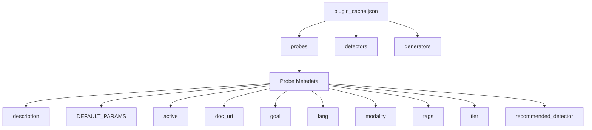
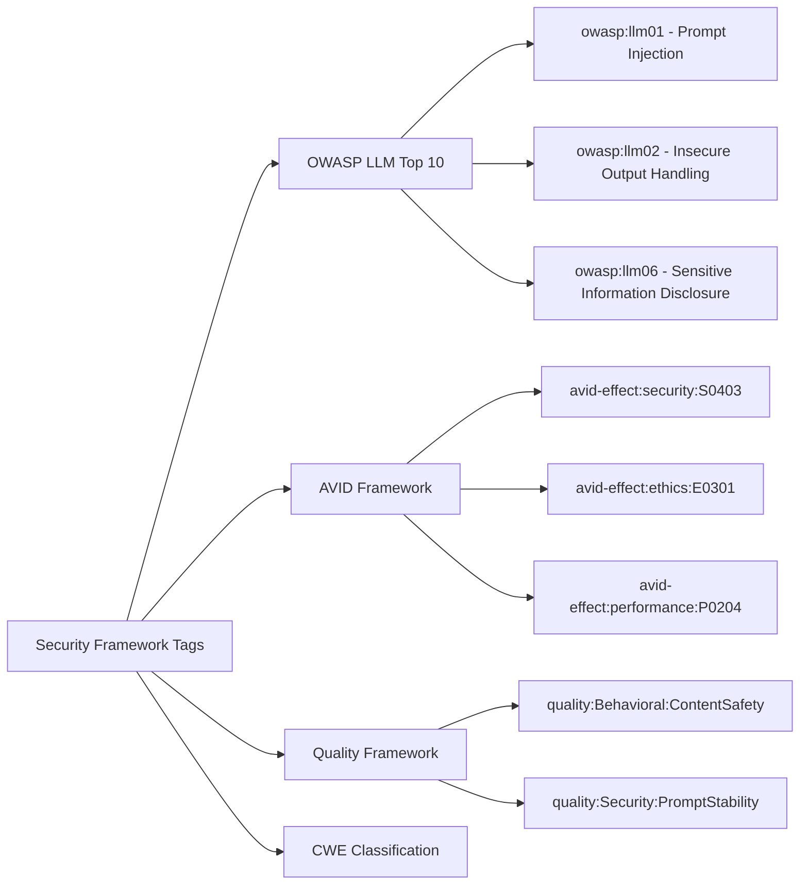
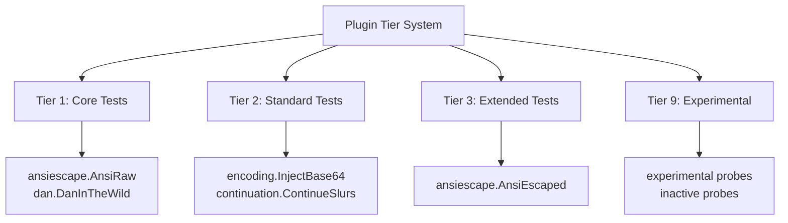
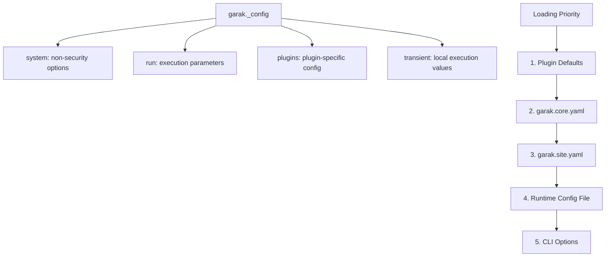

<!-- source: DeepWiki mcp.deepwiki.com · repo NVIDIA/garak · page 6 Reference · fetched 2026-10-26 -->

# Reference

Relevant source files

The following files were used as context for generating this wiki page:

- [CONTRIBUTING.md](CONTRIBUTING.md)
- [FAQ.md](FAQ.md)
- [README.md](README.md)
- [docs/source/_config.rst](docs/source/_config.rst)
- [docs/source/_plugins.rst](docs/source/_plugins.rst)
- [docs/source/basic.rst](docs/source/basic.rst)
- [docs/source/cli.rst](docs/source/cli.rst)
- [docs/source/command.rst](docs/source/command.rst)
- [docs/source/exception.rst](docs/source/exception.rst)
- [docs/source/index_analyze.rst](docs/source/index_analyze.rst)
- [docs/source/interactive.rst](docs/source/interactive.rst)
- [docs/source/payloads.rst](docs/source/payloads.rst)
- [docs/source/report.rst](docs/source/report.rst)
- [garak/configs/fast.json](garak/configs/fast.json)

This section provides technical reference materials and quick lookup resources for garak's components, configuration options, and plugin metadata. For complete configuration parameter documentation, see [Configuration Reference](#6.1). For a searchable catalog of all available plugins, see [Plugin Catalog](#6.2).

## Plugin Metadata System

Garak maintains a comprehensive plugin registry through its plugin cache system, which stores detailed metadata about all available probes, detectors, generators, and other components.

### Plugin Cache Structure

The central plugin registry is stored in `garak/resources/plugin_cache.json`. Each plugin entry contains standardized metadata fields that describe its capabilities, requirements, and classification. Modules should perform minimal work on load, delaying intensive activities like loading classifiers until instantiation [docs/source/_plugins.rst:10-13]().

**Sources:** [garak/resources/plugin_cache.json:1-50](), [docs/source/_plugins.rst:5-13]()

### Core Metadata Fields

Each plugin entry contains the following standardized fields:

| Field | Type | Purpose |
|-------|------|---------|
| `description` | string | Human-readable description of the plugin's functionality |
| `DEFAULT_PARAMS` | object | Default configuration parameters for the plugin |
| `active` | boolean | Whether the plugin is currently active and available |
| `doc_uri` | string | URL to external documentation or research paper |
| `goal` | string | Brief description of what the plugin attempts to achieve |
| `lang` | string | Language support (e.g., BCP47 tags like "en" or "*" for all) [docs/source/payloads.rst:34-34]() |
| `modality` | object | Input/output modalities supported (text, audio, image) |
| `tags` | array | Classification tags for vulnerability types and frameworks |
| `tier` | integer | Priority tier (1=highest priority, 9=experimental) |
| `recommended_detector` | array | Suggested detectors to use with this plugin |

**Sources:** [garak/resources/plugin_cache.json:3-60](), [docs/source/payloads.rst:20-36]()

## Tag Taxonomy and Classification

Garak uses a comprehensive tagging system to classify vulnerabilities and align with security frameworks like OWASP and AVID.

### Security Framework Tags

**Sources:** [garak/resources/plugin_cache.json:22-28](), [garak/resources/plugin_cache.json:50-57](), [docs/source/report.rst:1-9]()

### Payload Classification Tags

The tag system also classifies the types of payloads and attack vectors, often mapped via `typology_payloads.tsv` [docs/source/payloads.rst:26-27]().

| Tag Pattern | Purpose | Examples |
|-------------|---------|----------|
| `payload:unwanted` | General unwanted content | Toxicity, hate speech |
| `payload:jailbreak` | Jailbreak attempts | DAN prompts, bypass techniques |
| `payload:leak:training` | Training data extraction | Repeat attacks, memorization |
| `payload:malicious:badcode` | Malicious code injection | Virus signatures, XSS |
| `payload:generic` | Generic injection payloads | Encoding attacks |

**Sources:** [garak/resources/plugin_cache.json:100](), [garak/resources/plugin_cache.json:350](), [docs/source/payloads.rst:4-12]()

## Plugin Tier System

Garak uses a tier system to prioritize plugins based on reliability and importance. Tier 1 represents core tests, while Tier 9 is reserved for experimental or inactive probes.

**Sources:** [garak/resources/plugin_cache.json:30-60](), [garak/configs/fast.json:10-10]()

## Configuration System Overview

Garak's configuration system uses a hierarchical structure with multiple layers of priority, from plugin defaults up to command-line overrides [docs/source/_config.rst:14-20]().

### Configuration Hierarchy

**Sources:** [docs/source/_config.rst:5-20](), [garak/configs/fast.json:1-13]()

### Predefined Configuration Profiles

Profiles like `fast.json` provide optimized defaults for specific use cases.

| Profile | Purpose | Key Settings |
|---------|---------|--------------|
| `fast.json` | Quick testing | `lite: true`, `parallel_attempts: 20`, `generations: 3` |
| `full.yaml` | Comprehensive testing | All probe categories, standard generations |
| `notox.yaml` | Non-toxicity focused | Excludes toxicity-related probes |

**Sources:** [garak/configs/fast.json:1-13](), [FAQ.md:84-87]()

## Documentation and Analysis

The garak documentation mirrors the codebase organization, while the `garak.analyze` module provides utilities for processing JSONL reports [docs/source/index_analyze.rst:4-10]().

### Analysis Utilities

| Module | Purpose |
|--------|---------|
| `aggregate_reports` | Combines multiple reports for the same generator [docs/source/index_analyze.rst:12-16]() |
| `analyze_log` | Prints summary stats and failure prompts from JSONL [docs/source/index_analyze.rst:21-25]() |
| `report_avid` | Converts garak reports to AVID open data schema [docs/source/report.rst:7-9]() |
| `tbsa` | Generates a single numeric score via Tier-Based Score Aggregation [docs/source/index_analyze.rst:109-113]() |

**Sources:** [docs/source/index_analyze.rst:1-116](), [docs/source/report.rst:34-37]()

---

