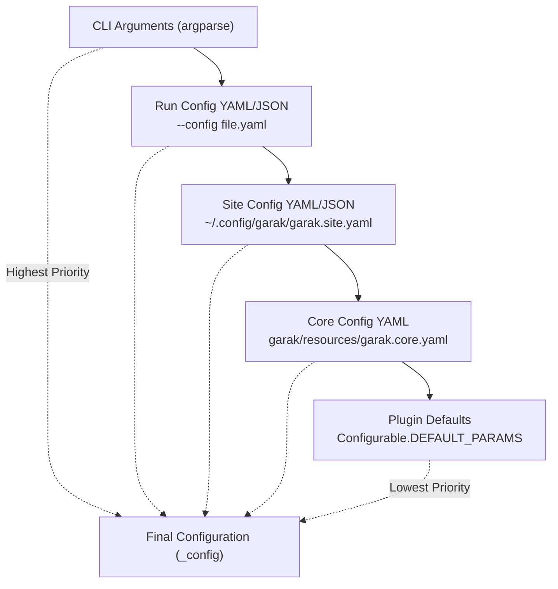
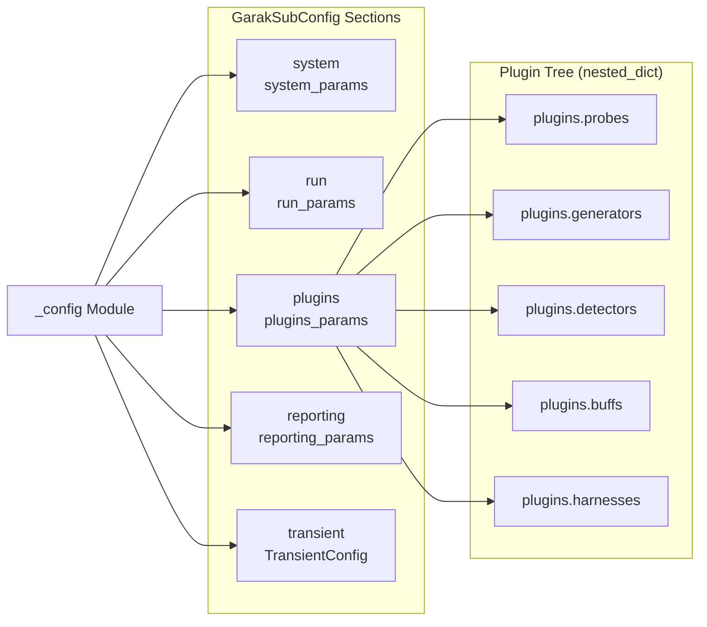
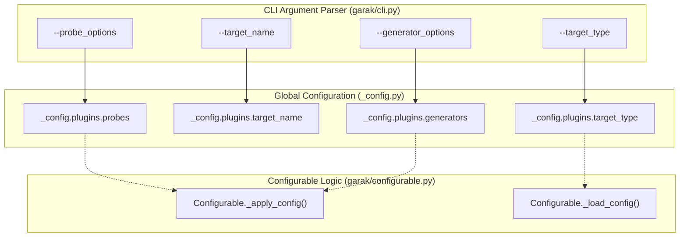
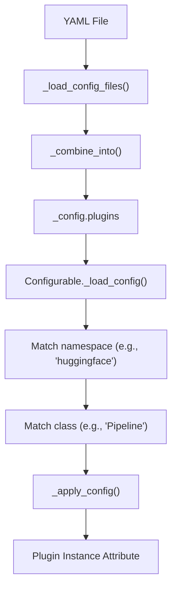

<!-- source: DeepWiki mcp.deepwiki.com · repo NVIDIA/garak · page 6.1 Configuration Reference · fetched 2026-10-26 -->

# Configuration Reference

<details>
<summary>Relevant source files</summary>

The following files were used as context for generating this wiki page:

- [docs/source/_config.rst](docs/source/_config.rst)
- [docs/source/_plugins.rst](docs/source/_plugins.rst)
- [docs/source/basic.rst](docs/source/basic.rst)
- [docs/source/cli.rst](docs/source/cli.rst)
- [docs/source/command.rst](docs/source/command.rst)
- [docs/source/configurable.rst](docs/source/configurable.rst)
- [docs/source/exception.rst](docs/source/exception.rst)
- [docs/source/index_analyze.rst](docs/source/index_analyze.rst)
- [docs/source/interactive.rst](docs/source/interactive.rst)
- [docs/source/payloads.rst](docs/source/payloads.rst)
- [docs/source/report.rst](docs/source/report.rst)
- [garak/_config.py](garak/_config.py)
- [garak/analyze/report_digest.py](garak/analyze/report_digest.py)
- [garak/cli.py](garak/cli.py)
- [garak/command.py](garak/command.py)
- [garak/configs/fast.json](garak/configs/fast.json)
- [garak/configurable.py](garak/configurable.py)
- [garak/evaluators/base.py](garak/evaluators/base.py)
- [garak/resources/garak.core.yaml](garak/resources/garak.core.yaml)
- [tests/cli/test_cli_list_filtering.py](tests/cli/test_cli_list_filtering.py)
- [tests/test_config.py](tests/test_config.py)
- [tests/test_configurable.py](tests/test_configurable.py)

</details>


This document provides a comprehensive reference for all configuration options and parameters available in garak. It covers the hierarchical configuration system, CLI arguments, YAML configuration files, and plugin-specific settings.

For information about creating custom configurations for specific use cases, see the basic usage guide in [1.2](). For details about the plugin system architecture, see [2.2]().

## Configuration System Overview

Garak uses a hierarchical configuration system where settings are loaded in the following priority order (highest to lowest):

1.  **CLI Parameters** - Command-line arguments override all other settings [garak/_config.py:6-7]()
2.  **Run Configuration** - User-specified YAML/JSON files via `--config` [garak/cli.py:138-139]()
3.  **Site Configuration** - `garak.site.yaml` in user config directory [docs/source/configurable.rst:32-32]()
4.  **Base Configuration** - `garak.core.yaml` in the package resources [garak/_config.py:33-40]()

Title: Configuration Override Hierarchy

Sources: [garak/_config.py:6-7](), [docs/source/configurable.rst:23-35](), [garak/cli.py:59-60]()

## Configuration Structure

The configuration system is organized into five main sections, each implemented as a `GarakSubConfig` dataclass [garak/_config.py:47-49]():

| Section | Purpose | Key Parameters |
| :--- | :--- | :--- |
| `system` | System-level runtime settings | `verbose`, `parallel_requests`, `parallel_attempts`, `max_workers` |
| `run` | Execution parameters | `seed`, `generations`, `eval_threshold`, `system_prompt` |
| `plugins` | Plugin configurations | `target_type`, `target_name`, nested plugin configs |
| `reporting` | Output and reporting | `taxonomy`, `report_prefix`, `confidence_interval_method` |
| `transient` | Runtime state (not set externally) | `run_id`, `report_filename`, `package_dir`, `starttime` |

Title: Configuration Object Model

Sources: [garak/_config.py:35-40](), [garak/_config.py:60-88](), [garak/_config.py:103-113]()

## CLI Arguments Reference

### System Parameters
These options manage the execution environment and performance [garak/cli.py:74-110]().

| Argument | Type | Default | Description |
| :--- | :--- | :--- | :--- |
| `--verbose` / `-v` | count | `_config.system.verbose` | Increase verbosity of output [garak/cli.py:75-81]() |
| `--narrow_output` | flag | `False` | Give narrow CLI output [garak/cli.py:89-92]() |
| `--parallel_requests` | int | `_config.system.parallel_requests` | Generator requests to launch in parallel for one prompt [garak/cli.py:94-98]() |
| `--parallel_attempts` | int | `_config.system.parallel_attempts` | Probe attempts to launch in parallel [garak/cli.py:100-104]() |
| `--skip_unknown` | flag | `False` | Allow skip of unknown plugins [garak/cli.py:106-109]() |

### Run Parameters
These options define the parameters for the vulnerability scan [garak/cli.py:111-140]().

| Argument | Type | Default | Description |
| :--- | :--- | :--- | :--- |
| `--seed` / `-s` | int | `_config.run.seed` | Random seed for reproducibility [garak/cli.py:113-118]() |
| `--generations` / `-g` | int | `_config.run.generations` | Number of generations per prompt [garak/cli.py:131-136]() |
| `--eval_threshold` | float | `_config.run.eval_threshold` | Minimum threshold for a successful hit [garak/cli.py:125-129]() |
| `--deprefix` | flag | `True` | Remove prompt from generator output [garak/cli.py:120-123]() |
| `--config` | str | `None` | YAML or JSON config file for the run [garak/cli.py:138-139]() |

### Plugin Selection
Options to specify which targets and vulnerabilities to test [garak/cli.py:141-193]().

| Argument | Type | Default | Description |
| :--- | :--- | :--- | :--- |
| `--target_type` / `-t` | str | `None` | Module/class of the generator (e.g., 'huggingface') [garak/cli.py:143-150]() |
| `--target_name` / `-n` | str | `None` | Name of the target model/endpoint [garak/cli.py:151-158]() |
| `--probes` / `-p` | str | `_config.plugins.probe_spec` | List of probe names or 'all' [garak/cli.py:160-166]() |
| `--probe_tags` | str | `_config.run.probe_tags` | Filter probes by taxonomy tags [garak/cli.py:168-172]() |
| `--detectors` / `-d` | str | `_config.plugins.detector_spec` | List of detectors to use [garak/cli.py:174-180]() |
| `--extended_detectors` | flag | `False` | Run all detectors if none specified [garak/cli.py:182-185]() |
| `--buffs` / `-b` | str | `_config.plugins.buff_spec` | List of buffs to apply [garak/cli.py:187-193]() |

### Plugin Configuration Options
Each plugin category (probes, generators, detectors, buffs) can receive specific JSON-formatted options via the CLI [garak/cli.py:195-210]().

| Argument Pattern | Description |
| :--- | :--- |
| `--{plugin}_options` | Options passed as a JSON dict string [garak/cli.py:207-210]() |
| `--{plugin}_option_file` | Path to a JSON file containing plugin options [garak/cli.py:201-205]() |

Title: CLI to Code Entity Mapping

Sources: [garak/cli.py:143-158](), [garak/cli.py:195-210](), [garak/configurable.py:72-110](), [garak/configurable.py:118-149]()

## YAML Configuration Reference

### Structure and Schema
The YAML configuration follows the structure of the `_config` module. It uses a three-level nesting for plugins: `type` -> `namespace` -> `classname` [garak/configurable.py:84-109]().

```yaml
system:
  verbose: 0
  parallel_attempts: 10
  max_workers: 500

run:
  seed: 42
  generations: 5
  eval_threshold: 0.5
  system_prompt: "You are a helpful assistant."

plugins:
  target_type: "huggingface"
  target_name: "gpt2"
  probes:
    test:
      generators:
        huggingface:
          Pipeline:
            hf_args:
              device: cuda
```

### Reporting Configuration
Settings related to output generation and analysis [garak/resources/garak.core.yaml:35-45]().

| Key | Type | Default | Description |
| :--- | :--- | :--- | :--- |
| `report_dir` | str | `garak_runs` | Directory for JSONL and HTML reports [garak/resources/garak.core.yaml:38]() |
| `taxonomy` | str | `None` | MISP taxonomy for report grouping [garak/resources/garak.core.yaml:37]() |
| `group_aggregation_function` | str | `lower_quartile` | Function for score aggregation [garak/resources/garak.core.yaml:41]() |
| `confidence_interval_method` | str | `bootstrap` | Method for calculating CIs [garak/resources/garak.core.yaml:42]() |
| `bootstrap_num_iterations` | int | 10000 | Iterations for bootstrap CI [garak/resources/garak.core.yaml:43]() |

Sources: [garak/resources/garak.core.yaml:1-45](), [docs/source/configurable.rst:41-88](), [garak/configurable.py:84-109]()

## Implementation Details

### Configuration Loading Flow
The `_config` module handles the merging of multiple configuration sources.

1.  **`load_base_config()`**: Loads the default `garak.core.yaml` from the package resources [garak/_config.py:249-253]().
2.  **`load_config()`**: Iteratively loads site-wide configs and user-provided run configs [garak/_config.py:256-294]().
3.  **`_combine_into()`**: Performs deep merging of nested dictionaries [garak/_config.py:148-156]().
4.  **`Configurable._load_config()`**: Called during plugin instantiation to pull specific settings from the global `_config` into the plugin instance [garak/configurable.py:72-117]().

Title: Data Flow from YAML to Plugin Instance

Sources: [garak/_config.py:148-156](), [garak/_config.py:159-201](), [garak/configurable.py:72-117](), [garak/configurable.py:118-149]()

### Directory Resolution
Garak uses the `xdg_base_dirs` library to determine standard paths [garak/_config.py:21-25]().

*   **`transient.config_dir`**: `XDG_CONFIG_HOME/garak` [garak/_config.py:70-70]()
*   **`transient.data_dir`**: `XDG_DATA_HOME/garak` [garak/_config.py:71-71]()
*   **`transient.cache_dir`**: `XDG_CACHE_HOME/garak` [garak/_config.py:72-72]()

Sources: [garak/_config.py:21-25](), [garak/_config.py:69-72](), [tests/test_config.py:188-196]()

### Security and Validation
*   **API Key Protection**: Garak checks file permissions for config files containing `api_key`. On Unix, it warns if the file is group or world-readable [garak/_config.py:179-201]().
*   **Deprecation Notices**: The config system tracks deprecated paths (e.g., `plugins.model_type`) and issues warnings via `garak.command.deprecation_notice` [garak/_config.py:28-31](), [garak/_config.py:203-213]().

Sources: [garak/_config.py:28-31](), [garak/_config.py:179-201](), [garak/command.py:24-30]()

---

