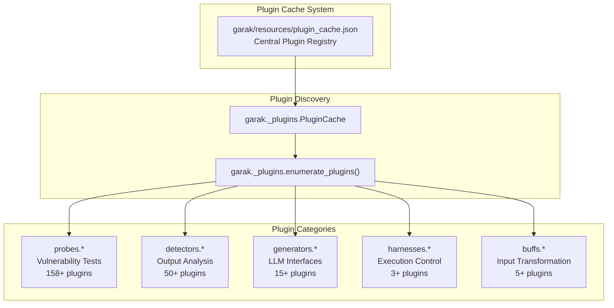
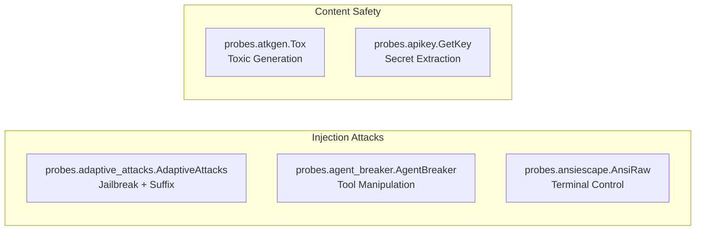
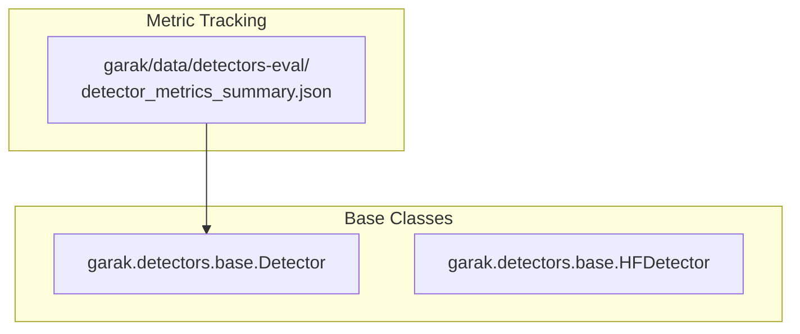
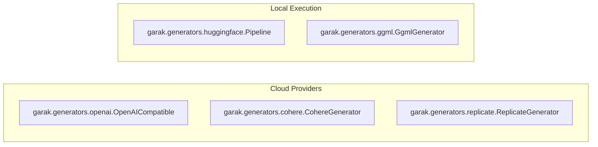
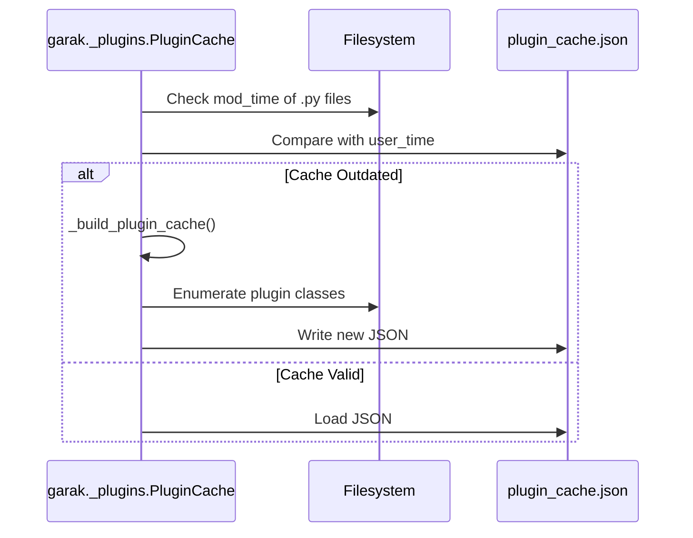

<!-- source: DeepWiki mcp.deepwiki.com · repo NVIDIA/garak · page 6.2 Plugin Catalog · fetched 2026-10-26 -->

# Plugin Catalog

Relevant source files

The following files were used as context for generating this wiki page:

- [docs/source/detector_metrics.rst](docs/source/detector_metrics.rst)
- [docs/source/detectors/base.rst](docs/source/detectors/base.rst)
- [docs/source/generators/anthropic.rst](docs/source/generators/anthropic.rst)
- [docs/source/generators/llm.rst](docs/source/generators/llm.rst)
- [docs/source/index_buffs.rst](docs/source/index_buffs.rst)
- [docs/source/index_detectors.rst](docs/source/index_detectors.rst)
- [docs/source/index_generators.rst](docs/source/index_generators.rst)
- [docs/source/index_probes.rst](docs/source/index_probes.rst)
- [docs/source/probes/adaptive_attacks.rst](docs/source/probes/adaptive_attacks.rst)
- [docs/source/probes/base.rst](docs/source/probes/base.rst)
- [garak/_plugins.py](garak/_plugins.py)
- [garak/data/adaptive_attacks/seeds.txt](garak/data/adaptive_attacks/seeds.txt)
- [garak/data/adaptive_attacks/suffixes.txt](garak/data/adaptive_attacks/suffixes.txt)
- [garak/generators/base.py](garak/generators/base.py)
- [garak/generators/cohere.py](garak/generators/cohere.py)
- [garak/generators/ggml.py](garak/generators/ggml.py)
- [garak/generators/huggingface.py](garak/generators/huggingface.py)
- [garak/generators/openai.py](garak/generators/openai.py)
- [garak/generators/replicate.py](garak/generators/replicate.py)
- [garak/probes/adaptive_attacks.py](garak/probes/adaptive_attacks.py)
- [garak/resources/plugin_cache.json](garak/resources/plugin_cache.json)
- [tests/probes/test_probes_adaptive_attacks.py](tests/probes/test_probes_adaptive_attacks.py)

This document provides a comprehensive catalog of all available plugins in the garak LLM vulnerability scanning framework. It covers the complete inventory of probes, detectors, generators, harnesses, and buffs, along with their metadata, classification system, and organizational structure.

For information about how to create custom plugins, see [Extending garak](#5). For details about the plugin discovery and loading system, see [Plugin System](#2.2). For configuration of specific plugins, see [Configuration Reference](#6.1).

## Plugin Organization Overview

Garak organizes plugins into five primary categories, each serving a distinct role in the vulnerability assessment pipeline. The plugin inventory is maintained in a centralized cache that enables efficient discovery and loading.

**Sources:** [garak/resources/plugin_cache.json:1-20](), [garak/_plugins.py:39-56](), [garak/_plugins.py:175-181]()

## Plugin Metadata Structure

Each plugin in the cache contains standardized metadata that defines its capabilities, requirements, and classification. This metadata is extracted during the cache build process using inspection of plugin classes.

| Field | Purpose | Example Values |
|-------|---------|----------------|
| `description` | Human-readable explanation | "Probe for eliciting ANSI control codes" |
| `goal` | Vulnerability objective | "print escaped ANSI terminal codes" |
| `active` | Availability status | `true`, `false` |
| `tier` | Execution priority | `1` (high), `2` (medium), `3` (normal) |
| `tags` | Classification labels | `["owasp:llm01", "avid-effect:security:S0100"]` |
| `modality` | Input/output types | `{"in": ["text"]}` |
| `primary_detector` | Default analyzer | `ansiescape.Escaped` |
| `parallelisable_attempts` | Concurrency support | `true`, `false` |

**Sources:** [garak/resources/plugin_cache.json:3-30](), [garak/probes/base.rst:8-20](), [garak/_plugins.py:175-181]()

## Probe Categories

Probes define methods for testing a generator for specific vulnerabilities. They are categorized by attack vector and impact tier.

### Security-Focused Probes

**Sources:** [garak/resources/plugin_cache.json:2-30](), [garak/resources/plugin_cache.json:31-74](), [garak/resources/plugin_cache.json:102-128](), [garak/resources/plugin_cache.json:199-217]()

### Specialized Attack Vectors

| Probe Family | Vulnerability Target | Primary Detector |
|--------------|---------------------|-------------------|
| `ansiescape` | Terminal injection | `ansiescape.Raw` |
| `apikey` | Credential leakage | `apikey.ApiKey` |
| `adaptive_attacks` | System prompt bypass | `mitigation.MitigationBypass` |
| `agent_breaker` | Excessive Agency | `agent_breaker.AgentBreakerResult` |

**Sources:** [garak/resources/plugin_cache.json:20](), [garak/resources/plugin_cache.json:64](), [garak/resources/plugin_cache.json:90](), [garak/resources/plugin_cache.json:168]()

## Detector Categories

Detectors identify failure modes in model outputs. Their quality is often measured by `hit_f1` scores stored in the metrics cache.

### Detection Mechanisms

**Sources:** [garak/_plugins.py:46-51](), [garak/_plugins.py:62-73](), [docs/source/detector_metrics.rst:87-93]()

## Generator Categories

Generators wrap interfaces for LLMs, supporting diverse backends from local pipelines to remote REST APIs.

### Generator Implementation Map

**Sources:** [garak/generators/openai.py:134-142](), [garak/generators/huggingface.py:46-56](), [garak/generators/cohere.py:31-55](), [garak/generators/replicate.py:23-36](), [garak/generators/ggml.py:28-49]()

## Plugin Tier System

Tiers describe the impact and priority of a probe. Tier 1 probes are generally high-impact or foundational tests.

| Tier | Priority | Examples |
|------|----------|----------|
| 1 | Critical | `probes.ansiescape.AnsiRaw`, `probes.ansiescape.AnsiRawTokenizerHF` |
| 2 | Standard | `probes.adaptive_attacks.AdaptiveAttacks`, `probes.apikey.GetKey` |
| 3 | Advanced | `probes.agent_breaker.AgentBreaker`, `probes.ansiescape.AnsiEscaped` |

**Sources:** [garak/resources/plugin_cache.json:28](), [garak/resources/plugin_cache.json:72](), [garak/resources/plugin_cache.json:99](), [garak/resources/plugin_cache.json:126](), [garak/resources/plugin_cache.json:148]()

## Plugin Discovery and Loading

The `PluginCache` class manages the lifecycle of the plugin registry, ensuring it is rebuilt if plugin files are modified.

**Sources:** [garak/_plugins.py:84-121](), [garak/_plugins.py:123-163](), [garak/_plugins.py:165-185]()

## Modality Support

Plugins define their input and output capabilities. While `garak` primarily assesses text output, probes can specify different input modalities.

| Plugin | Modality In | Modality Out |
|--------|-------------|--------------|
| `probes.adaptive_attacks.AdaptiveAttacks` | `["text"]` | N/A (Probe) |
| `generators.base.Generator` | `{"text"}` | `{"text"}` |

**Sources:** [garak/resources/plugin_cache.json:14-18](), [garak/generators/base.py:44]()

---

