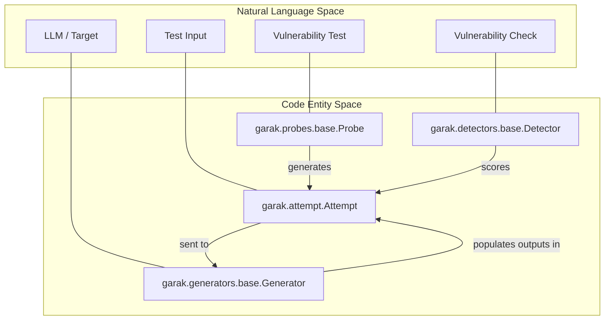
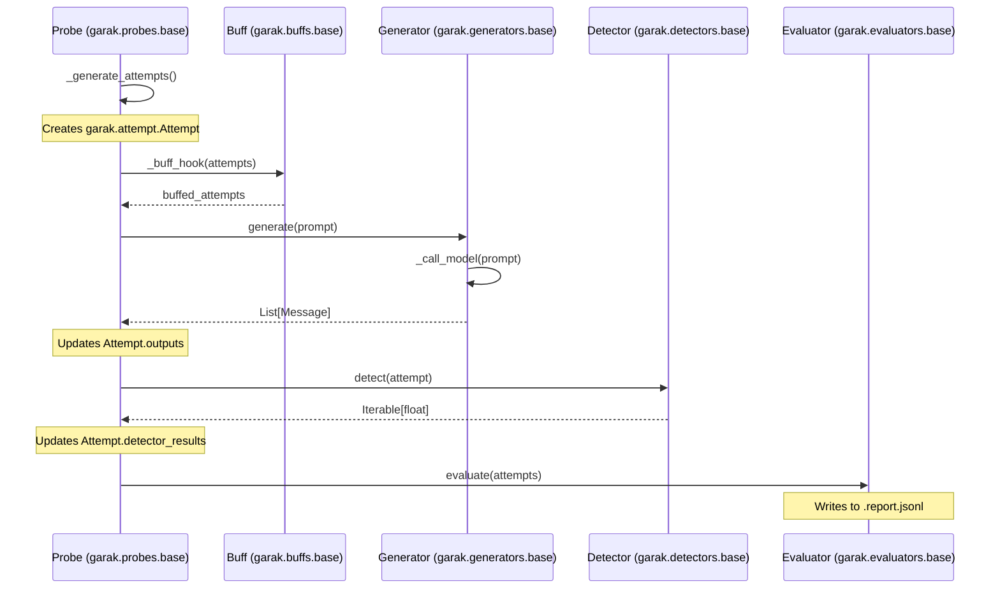

<!-- source: DeepWiki mcp.deepwiki.com · repo NVIDIA/garak · page 7 Glossary · fetched 2026-10-26 -->

# Glossary

Relevant source files

The following files were used as context for generating this wiki page:

- [CONTRIBUTING.md](CONTRIBUTING.md)
- [FAQ.md](FAQ.md)
- [README.md](README.md)
- [docs/source/configurable.rst](docs/source/configurable.rst)
- [garak/_config.py](garak/_config.py)
- [garak/_plugins.py](garak/_plugins.py)
- [garak/analyze/report_digest.py](garak/analyze/report_digest.py)
- [garak/analyze/tbsa.py](garak/analyze/tbsa.py)
- [garak/attempt.py](garak/attempt.py)
- [garak/cli.py](garak/cli.py)
- [garak/command.py](garak/command.py)
- [garak/detectors/base.py](garak/detectors/base.py)
- [garak/detectors/continuation.py](garak/detectors/continuation.py)
- [garak/detectors/encoding.py](garak/detectors/encoding.py)
- [garak/detectors/goodside.py](garak/detectors/goodside.py)
- [garak/detectors/leakreplay.py](garak/detectors/leakreplay.py)
- [garak/detectors/misleading.py](garak/detectors/misleading.py)
- [garak/detectors/promptinject.py](garak/detectors/promptinject.py)
- [garak/detectors/snowball.py](garak/detectors/snowball.py)
- [garak/evaluators/base.py](garak/evaluators/base.py)
- [garak/generators/base.py](garak/generators/base.py)
- [garak/generators/cohere.py](garak/generators/cohere.py)
- [garak/generators/ggml.py](garak/generators/ggml.py)
- [garak/generators/huggingface.py](garak/generators/huggingface.py)
- [garak/generators/openai.py](garak/generators/openai.py)
- [garak/generators/replicate.py](garak/generators/replicate.py)
- [garak/probes/base.py](garak/probes/base.py)
- [garak/probes/fitd.py](garak/probes/fitd.py)
- [garak/report.py](garak/report.py)
- [garak/resources/garak.core.yaml](garak/resources/garak.core.yaml)
- [garak/resources/plugin_cache.json](garak/resources/plugin_cache.json)
- [tests/_assets/analyze/test_with_ci.report.jsonl](tests/_assets/analyze/test_with_ci.report.jsonl)
- [tests/_assets/report/report_test.report.jsonl](tests/_assets/report/report_test.report.jsonl)
- [tests/analyze/test_aggregate.py](tests/analyze/test_aggregate.py)
- [tests/analyze/test_report_digest_plugin_cache.py](tests/analyze/test_report_digest_plugin_cache.py)
- [tests/analyze/test_tbsa.py](tests/analyze/test_tbsa.py)
- [tests/cli/test_cli_list_filtering.py](tests/cli/test_cli_list_filtering.py)
- [tests/detectors/test_detectors.py](tests/detectors/test_detectors.py)
- [tests/probes/test_probes_fitd.py](tests/probes/test_probes_fitd.py)
- [tests/test_attempt.py](tests/test_attempt.py)
- [tests/test_config.py](tests/test_config.py)
- [tests/test_internal_structures.py](tests/test_internal_structures.py)
- [tests/test_report.py](tests/test_report.py)

This page defines codebase-specific terminology, jargon, and domain concepts used within `garak`. It serves as a technical reference for onboarding engineers to understand how natural language security concepts map to specific code entities and data structures.

## Core System Entities

The following terms describe the primary components that orchestrate a vulnerability scan.

| Term | Definition | Code Pointer |
| :--- | :--- | :--- |
| **Probe** | A plugin that generates specific test inputs (prompts) designed to elicit a failure or vulnerability from an LLM. | `garak.probes.base.Probe` [garak/probes/base.py:30-61]() |
| **Generator** | A wrapper around an LLM or text-to-text service (e.g., Hugging Face, OpenAI API) that provides a uniform interface for inference. | `garak.generators.base.Generator` [garak/generators/base.py:21-49]() |
| **Detector** | A component that analyzes generator outputs to determine if a probe's attempt was "successful" (i.e., a vulnerability was found). | `garak.detectors.base.Detector` [garak/detectors/base.py:20-40]() |
| **Buff** | A transformation applied to a probe's prompt before it is sent to the generator (e.g., paraphrasing, encoding). | `garak.buffs.base.Buff` (referenced in `BuffManager`) [garak/_config.py:53-56]() |
| **Harness** | The orchestration logic that manages the flow of data between probes, generators, and detectors. | `garak.harnesses` (referenced in config) [garak/_config.py:113-113]() |
| **Evaluator** | Processes detector scores and produces final pass/fail metrics and confidence intervals. | `garak.evaluators.base.Evaluator` [garak/evaluators.base.py:28-39]() |

**Sources:** [garak/probes/base.py](), [garak/generators/base.py](), [garak/detectors/base.py](), [garak/_config.py](), [garak/evaluators/base.py]()

## Data Structures & Lifecycle

These terms define the data containers used as information flows through the system.

### Attempt
An `Attempt` is the central unit of work in `garak`. It tracks a single prompt from its origin in a probe through to the final scores from detectors.

*   **Prompt**: The input sent to the LLM, stored as a `Message` or `Conversation`. [garak/attempt.py:178-179]()
*   **Outputs**: A list of `Message` objects representing the LLM's responses. [garak/attempt.py:186-187]()
*   **Detector Results**: A dictionary mapping detector names to a list of scores (0.0 to 1.0) for each output. [garak/attempt.py:190-191]()

### Message & Conversation
*   **Message**: Encapsulates text content and optional metadata (data paths, checksums, mime types). [garak/attempt.py:22-44]()
*   **Turn**: Associates a `Message` with a role (system, user, assistant). [garak/attempt.py:91-100]()
*   **Conversation**: A sequence of `Turn` objects, used for multi-turn probing. [garak/attempt.py:120-130]()

### Natural Language to Code Entity Mapping
The following diagram illustrates how abstract scanning concepts are represented by specific Python classes.

**Diagram: Entity Mapping**

**Sources:** [garak/attempt.py](), [garak/probes/base.py](), [garak/generators/base.py](), [garak/detectors/base.py]()

## Execution Terminology

*   **Hit**: A successful elicitation of the behavior a probe is looking for. A "Hit" corresponds to a failure in the LLM's safety/security posture.
*   **Primary Detector**: The default detector associated with a probe, defined in the probe's metadata. [garak/probes/base.py:46-46]()
*   **Extended Detectors**: Additional detectors that can be run alongside the primary one to provide broader coverage. [garak/probes/base.py:48-48]()
*   **Plugin Cache**: A JSON file (`plugin_cache.json`) containing metadata for all discovered plugins to speed up loading and listing. [garak/resources/plugin_cache.json:1-30]()
*   **TBSA**: Total Behavioral Safety Assessment. A scoring methodology used in reports. [garak/analyze/report_digest.py:107-107]()

## Technical Architecture Flow

This diagram traces the lifecycle of a single probe execution, showing the interaction between the core classes.

**Diagram: Data Flow Lifecycle**

**Sources:** [garak/probes/base.py:165-172](), [garak/generators/base.py:138-147](), [garak/detectors/base.py:73-78](), [garak/evaluators/base.py:62-67]()

## Reporting & Analysis Terms

*   **JSONL Report**: The raw output of a `garak` run, where each line is a JSON object representing an initialization event, a setup record, or an evaluation result. [garak/analyze/report_digest.py:57-87]()
*   **Hitlog**: A specialized log file (`.hitlog.jsonl`) that records only the prompts and outputs that resulted in a detector "hit" (failure). [garak/evaluators/base.py:107-118]()
*   **Taxonomy**: A classification system (e.g., MISP, OWASP LLM Top 10) used to tag probes and group results in reports. [garak/analyze/report_digest.py:170-190]()
*   **Bootstrap CI**: A statistical method (Bootstrap Confidence Interval) used by the Evaluator to calculate the uncertainty of failure rates. [garak/evaluators/base.py:158-163]()

**Sources:** [garak/analyze/report_digest.py](), [garak/evaluators/base.py](), [garak/_config.py]()