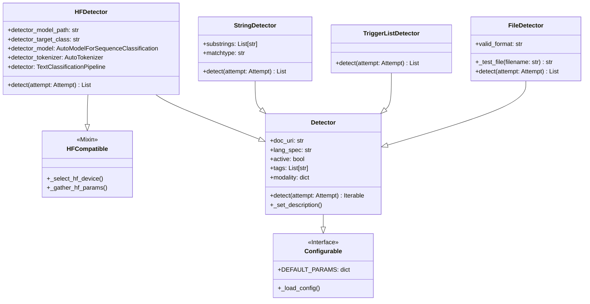
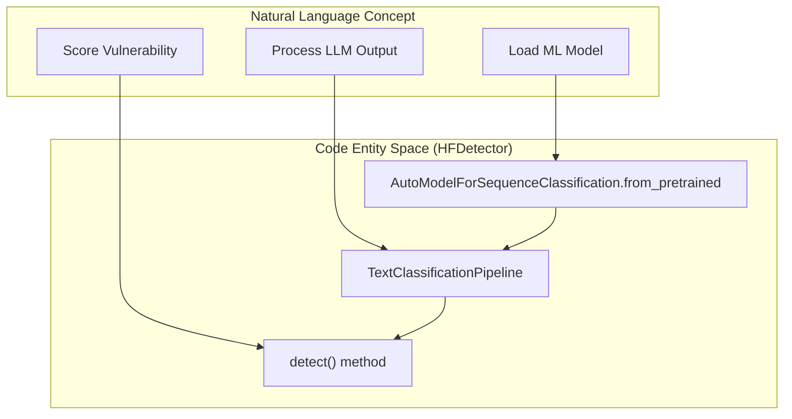
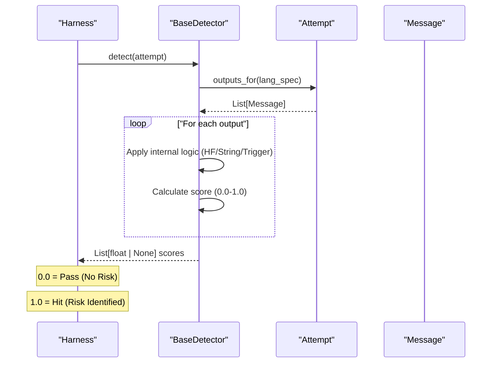

<!-- source: DeepWiki mcp.deepwiki.com · repo NVIDIA/garak · extra page Base Detector System · fetched 2026-10-26 -->

# Base Detector System

<details>
<summary>Relevant source files</summary>

The following files were used as context for generating this wiki page:

- [garak/analyze/bootstrap_ci.py](garak/analyze/bootstrap_ci.py)
- [garak/analyze/detector_metrics.py](garak/analyze/detector_metrics.py)
- [garak/detectors/always.py](garak/detectors/always.py)
- [garak/detectors/any.py](garak/detectors/any.py)
- [garak/detectors/base.py](garak/detectors/base.py)
- [garak/detectors/continuation.py](garak/detectors/continuation.py)
- [garak/detectors/encoding.py](garak/detectors/encoding.py)
- [garak/detectors/goodside.py](garak/detectors/goodside.py)
- [garak/detectors/leakreplay.py](garak/detectors/leakreplay.py)
- [garak/detectors/misleading.py](garak/detectors/misleading.py)
- [garak/detectors/promptinject.py](garak/detectors/promptinject.py)
- [garak/detectors/snowball.py](garak/detectors/snowball.py)
- [tests/analyze/test_bootstrap_ci.py](tests/analyze/test_bootstrap_ci.py)
- [tests/analyze/test_detector_metrics.py](tests/analyze/test_detector_metrics.py)
- [tests/detectors/test_detectors.py](tests/detectors/test_detectors.py)

</details>


## Purpose and Scope

The Base Detector System provides the foundational framework for analyzing LLM outputs to identify potential vulnerabilities, security issues, and undesired behaviors in garak vulnerability scans. This system defines the core interfaces, data structures, and common functionality that all detection components must implement.

This document covers the base detector classes, detection methodologies, and integration patterns. For information about specific detector implementations, see [Mitigation & Content Detectors](3.3.2) and [Specialized Detectors](3.3.3). For the broader vulnerability assessment pipeline, see [Execution Flow](2.4).

## Core Architecture

The detector system is built around a hierarchical class structure that provides different levels of functionality and abstraction:

### Code Entity Space: Detector Hierarchy


**Sources:** [garak/detectors/base.py:20-20](), [garak/detectors/base.py:81-81](), [garak/detectors/base.py:202-202](), [garak/detectors/base.py:255-255](), [garak/detectors/base.py:284-284]()

## Base Detector Classes

### Detector Class

The `Detector` class serves as the fundamental base for all detection components. It establishes the core contract that all detectors must fulfill [garak/detectors/base.py:20-21]().

| Attribute | Type | Purpose |
|-----------|------|---------|
| `doc_uri` | str | Reference documentation URL [garak/detectors/base.py:23-23]() |
| `lang_spec` | str | Language specification (BCP47 tags or "*") [garak/detectors/base.py:24-26]() |
| `active` | bool | Whether detector is enabled by default [garak/detectors/base.py:27-27]() |
| `tags` | List[str] | MISP taxonomy categories [garak/detectors/base.py:28-28]() |
| `modality` | dict | Supported input/output modalities (defaults to `out: text`) [garak/detectors/base.py:39-39]() |

The core `detect()` method signature expects an `Attempt` object and returns detection scores [garak/detectors/base.py:73-78]():

```python
def detect(self, attempt: garak.attempt.Attempt) -> Iterable[float | None]:
```

**Sources:** [garak/detectors/base.py:20-78]()

### HFDetector Class

The `HFDetector` class provides integration with HuggingFace transformer models for ML-based detection. It handles model loading, tokenization, and inference pipeline setup [garak/detectors/base.py:81-153]().

### Natural Language to Code Entity: HF Detection Flow


The class includes logic to normalize HuggingFace pipeline outputs to the standard 0.0-1.0 range based on the `detector_target_class` [garak/detectors/base.py:184-188]().

**Sources:** [garak/detectors/base.py:81-193]()

### StringDetector Class

The `StringDetector` provides pattern-based detection using configurable matching strategies [garak/detectors/base.py:202-253]():

| Parameter | Options | Description |
|-----------|---------|-------------|
| `matchtype` | `"str"` | Substring matching [garak/detectors/base.py:228-230]() |
| `matchtype` | `"word"` | Word boundary matching via regex [garak/detectors/base.py:231-235]() |
| `matchtype` | `"startswith"` | Prefix matching [garak/detectors/base.py:236-238]() |

**Sources:** [garak/detectors/base.py:202-253]()

### TriggerListDetector Class

The `TriggerListDetector` uses trigger strings stored in the attempt's metadata (`attempt.notes["triggers"]`) to perform detection [garak/detectors/base.py:255-282](). This enables dynamic detection where the probe defines what constitutes a "hit" for a specific attempt [garak/detectors/base.py:269-270]().

**Sources:** [garak/detectors/base.py:255-282]()

### FileDetector Class

The `FileDetector` abstract class handles detection scenarios where LLM outputs are file paths that need to be analyzed [garak/detectors/base.py:284-313](). It includes a `_test_file` method that sub-classes must implement to validate the content of the file at the given path [garak/detectors/base.py:291-293]().

**Sources:** [garak/detectors/base.py:284-313]()

## Detection Methods and Data Flow

The detection process follows a standardized pipeline that integrates with the broader garak execution flow:

### Detection Lifecycle Sequence


### Score Interpretation

All detectors must return floating-point scores in the range [0.0, 1.0] [garak/detectors/base.py:75-76]():
- `0.0`: No vulnerability detected (`pass_desc`) [garak/detectors/base.py:33-33]().
- `1.0`: Vulnerability confirmed (`hit_desc`) [garak/detectors/base.py:32-32]().
- Values between indicate confidence levels or partial matches (e.g., `DecodeApprox` using n-gram overlap [garak/detectors/encoding.py:57-65]()).

**Sources:** [garak/detectors/base.py:32-76](), [garak/detectors/encoding.py:31-67]()

## Configuration and Instantiation

Detectors integrate with garak's hierarchical configuration system through the `Configurable` base class [garak/detectors/base.py:20-20]().

### Default Parameters

Each detector class defines `DEFAULT_PARAMS` that specify configurable options:

```python
DEFAULT_PARAMS = {
    "skip": False,           # Whether to skip this detector [garak/detectors/base.py:42]
    "hf_args": {"device": "cpu"}, # HF device placement [garak/detectors/base.py:85]
    "graceful_fail": True,   # Handle errors during inference [garak/detectors/base.py:87]
}
```

**Sources:** [garak/detectors/base.py:41-43](), [garak/detectors/base.py:84-88]()

## Language and Modality Support

Detectors specify their language capabilities using `lang_spec` [garak/detectors/base.py:24-26]():
- `"*"`: Supports all languages (e.g., `DecodeMatch` [garak/detectors/encoding.py:17-17]()).
- `"en"`: English only (e.g., `MustRefuteClaimModel` [garak/detectors/misleading.py:28-28]()).

The modality system currently focuses on text output analysis [garak/detectors/base.py:39-39]().

**Sources:** [garak/detectors/base.py:24-39](), [garak/detectors/encoding.py:17-17](), [garak/detectors/misleading.py:28-28]()

## Integration with Plugin System

Detectors are discovered and loaded through garak's plugin system. The system validates detector structure and enforces interface compliance [tests/detectors/test_detectors.py:57-80]():

- All detectors must eventually inherit from `Detector` [tests/detectors/test_detectors.py:94-94]().
- Must implement the `detect()` method accepting an `attempt` parameter [tests/detectors/test_detectors.py:65-69]().
- Must support the `Configurable` interface [tests/detectors/test_detectors.py:95-95]().
- `_supported_params` must contain all `DEFAULT_PARAMS` [tests/detectors/test_detectors.py:72-79]().

**Sources:** [tests/detectors/test_detectors.py:57-95]()

---

