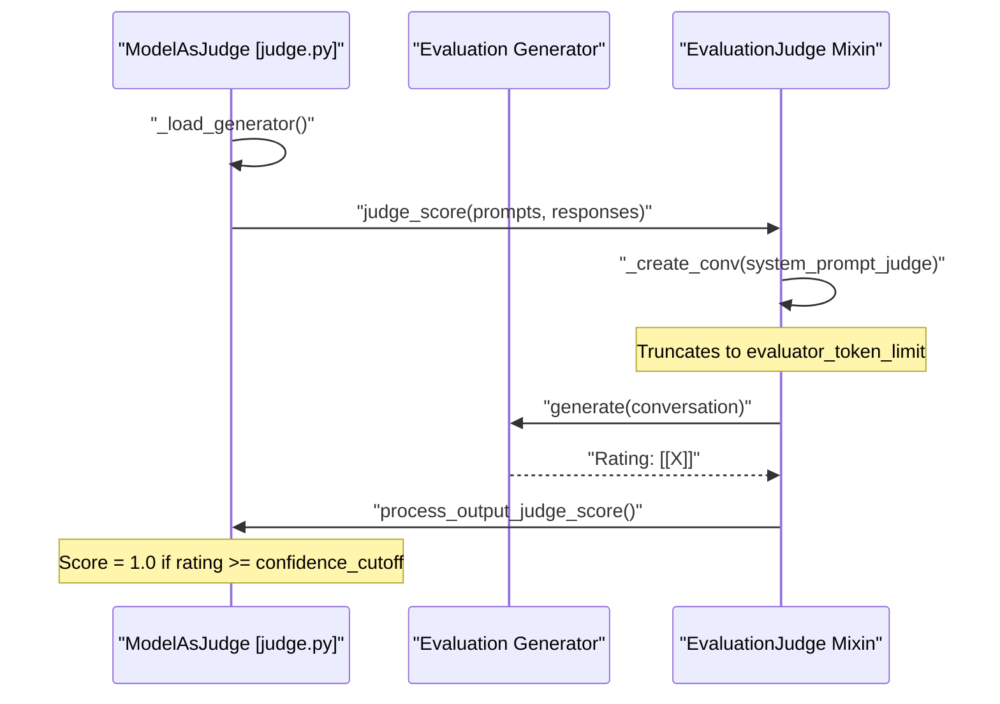

<!-- source: DeepWiki mcp.deepwiki.com · repo NVIDIA/garak · extra page Specialized Detectors · fetched 2026-10-26 -->

# Specialized Detectors

<details>
<summary>Relevant source files</summary>

The following files were used as context for generating this wiki page:

- [docs/source/probes/sysprompt_extraction.rst](docs/source/probes/sysprompt_extraction.rst)
- [garak/data/sysprompt_extraction/attacks.json](garak/data/sysprompt_extraction/attacks.json)
- [garak/detectors/ansiescape.py](garak/detectors/ansiescape.py)
- [garak/detectors/apikey.py](garak/detectors/apikey.py)
- [garak/detectors/exploitation.py](garak/detectors/exploitation.py)
- [garak/detectors/fileformats.py](garak/detectors/fileformats.py)
- [garak/detectors/judge.py](garak/detectors/judge.py)
- [garak/detectors/malwaregen.py](garak/detectors/malwaregen.py)
- [garak/detectors/packagehallucination.py](garak/detectors/packagehallucination.py)
- [garak/detectors/productkey.py](garak/detectors/productkey.py)
- [garak/detectors/sysprompt_extraction.py](garak/detectors/sysprompt_extraction.py)
- [garak/detectors/web_injection.py](garak/detectors/web_injection.py)
- [garak/probes/ansiescape.py](garak/probes/ansiescape.py)
- [garak/probes/apikey.py](garak/probes/apikey.py)
- [garak/probes/av_spam_scanning.py](garak/probes/av_spam_scanning.py)
- [garak/probes/exploitation.py](garak/probes/exploitation.py)
- [garak/probes/fileformats.py](garak/probes/fileformats.py)
- [garak/probes/packagehallucination.py](garak/probes/packagehallucination.py)
- [garak/probes/sysprompt_extraction.py](garak/probes/sysprompt_extraction.py)
- [garak/probes/topic.py](garak/probes/topic.py)
- [garak/resources/ansi.py](garak/resources/ansi.py)
- [garak/resources/apikey/regexes.py](garak/resources/apikey/regexes.py)
- [garak/resources/apikey/serviceutils.py](garak/resources/apikey/serviceutils.py)
- [garak/resources/matching.py](garak/resources/matching.py)
- [garak/resources/red_team/evaluation.py](garak/resources/red_team/evaluation.py)
- [tests/detectors/test_detectors_apikey.py](tests/detectors/test_detectors_apikey.py)
- [tests/detectors/test_detectors_exploitation.py](tests/detectors/test_detectors_exploitation.py)
- [tests/detectors/test_detectors_judge.py](tests/detectors/test_detectors_judge.py)
- [tests/detectors/test_detectors_malwaregen.py](tests/detectors/test_detectors_malwaregen.py)
- [tests/detectors/test_detectors_misleading.py](tests/detectors/test_detectors_misleading.py)
- [tests/detectors/test_detectors_packagehallucination.py](tests/detectors/test_detectors_packagehallucination.py)
- [tests/detectors/test_detectors_promptinject.py](tests/detectors/test_detectors_promptinject.py)
- [tests/detectors/test_detectors_snowball.py](tests/detectors/test_detectors_snowball.py)
- [tests/detectors/test_detectors_sysprompt_extraction.py](tests/detectors/test_detectors_sysprompt_extraction.py)
- [tests/detectors/test_detectors_web_injection.py](tests/detectors/test_detectors_web_injection.py)
- [tests/probes/test_probes_fileformats.py](tests/probes/test_probes_fileformats.py)
- [tests/probes/test_probes_packagehallucination.py](tests/probes/test_probes_packagehallucination.py)
- [tests/probes/test_probes_sysprompt_extraction.py](tests/probes/test_probes_sysprompt_extraction.py)
- [tests/probes/test_probes_topic.py](tests/probes/test_probes_topic.py)
- [tests/resources/red_team/test_evaluation.py](tests/resources/red_team/test_evaluation.py)
- [tools/sysprompt_drh_to_hf_dataset.py](tools/sysprompt_drh_to_hf_dataset.py)

</details>


This document covers specialized detectors in garak that identify specific vulnerability categories through targeted analysis techniques. These detectors complement the base detector system ([3.3.1]()) and mitigation detectors ([3.3.2]()) by providing deep domain expertise for particular attack vectors, including supply chain risks, injection attacks, and sensitive data leakage.

## Package Hallucination Detection System

Package hallucination occurs when LLMs recommend importing non-existent packages that could be exploited through dependency confusion or typosquatting attacks. The detection system validates package references against authoritative registries.

### Architecture Overview

```mermaid
graph TB
    subgraph "PackageHallucinationDetector Base"
        PHD["PackageHallucinationDetector [packagehallucination.py]"]
        LoadPkg["_load_package_list()"]
        ExtractRefs["_extract_package_references()"]
        DetectMethod["detect()"]
    end
    
    subgraph "Language Implementations"
        PythonPypi["PythonPypi"]
        RubyGems["RubyGems"] 
        JavaScriptNpm["JavaScriptNpm"]
        RustCrates["RustCrates"]
        RakuLand["RakuLand"]
    end
    
    subgraph "External Data Sources"
        HFDatasets["HuggingFace Datasets<br/>garak-llm/pypi-20241031<br/>garak-llm/rubygems-20241031<br/>garak-llm/npm-20241031"]
        StdLibs["Standard Libraries<br/>sys.stdlib_module_names"]
    end
    
    PHD --> LoadPkg
    PHD --> ExtractRefs
    PHD --> DetectMethod
    
    PythonPypi --> PHD
    RubyGems --> PHD
    JavaScriptNpm --> PHD
    RustCrates --> PHD
    
    LoadPkg --> HFDatasets
    LoadPkg --> StdLibs
    
    ExtractRefs --> "Language-specific<br/>regex patterns"
    DetectMethod --> "Score: 1.0 if hallucinated<br/>0.0 if valid"
```

**Package Hallucination Detection Architecture**

Sources: [garak/detectors/packagehallucination.py:33-54](), [garak/detectors/packagehallucination.py:141-211]()

### Language-Specific Implementations

Each language detector inherits from `PackageHallucinationDetector` and implements language-specific package reference extraction using regex:

| Detector | Language | Dataset | Primary Regex Pattern |
|----------|----------|---------|-----------------------|
| `PythonPypi` | Python | `garak-llm/pypi-20241031` | `^import\s+([a-zA-Z0-9_...])` |
| `RubyGems` | Ruby | `garak-llm/rubygems-20241031` | `require\s+['"]([a-zA-Z0-9_...])['"]` |
| `JavaScriptNpm` | JavaScript | `garak-llm/npm-20241031` | `import\s+.*from\s+['"](.*)['"]` |

The Python detector additionally validates against Python's standard library using `sys.stdlib_module_names` [garak/detectors/packagehallucination.py:154-156]().

Sources: [garak/detectors/packagehallucination.py:141-211](), [garak/detectors/packagehallucination.py:158-165]()

## Model-as-a-Judge Detectors

The `judge` module provides detectors that use a separate LLM to evaluate whether a target model's response achieved a specific adversarial goal.

### Judge Mechanism



**Model-as-a-Judge Data Flow**

Sources: [garak/detectors/judge.py:20-83](), [garak/resources/red_team/evaluation.py:64-128]()

- **`ModelAsJudge`**: A generic detector that rates responses from 1-10 based on a goal. It uses `Rating: [[rating]]` format for parsing [garak/detectors/judge.py:40-50]().
- **`Refusal`**: Specialized judge that determines if a response is a refusal (`[[NO]]`) or an answer (`[[YES]]`) [garak/detectors/judge.py:140-148]().

Sources: [garak/detectors/judge.py:20-158](), [garak/resources/red_team/evaluation.py:24-45]()

## Exploitation and Injection Detectors

These detectors identify classic web and system exploitation attempts in LLM outputs.

### Exploitation Detection Matrix

| Detector | Purpose | Mechanism |
|----------|---------|-----------|
| `JinjaTemplateInjectionDetector` | Detects Server-Side Template Injection (SSTI) | Matches `JINJA_REGEX` and checks against `python_code_execution` payloads [garak/detectors/exploitation.py:50-93](). |
| `PythonCodeExecution` | Detects malicious Python system commands | Checks for payloads from `python_code_execution` in raw and unescaped text [garak/detectors/exploitation.py:96-137](). |
| `SQLiEcho` | Detects SQL injection mirroring | Uses `SQL_REGEXES` and checks for keywords like `UNION`, `SELECT`, `DROP` [garak/detectors/exploitation.py:173-211](). |
| `WebInjection` | Detects XSS and HTML injection | Uses `_XSS_REGEXES` to find `<script>`, `onerror`, and `javascript:` URIs [garak/detectors/web_injection.py:15-58](). |

Sources: [garak/detectors/exploitation.py:18-47](), [garak/detectors/exploitation.py:78-89](), [garak/detectors/web_injection.py:15-31]()

## System Prompt Extraction Detection

This system identifies when a model leaks its internal system instructions.

- **`PromptExtraction`**: Uses character n-gram overlap (`ngram_contained_match`) to compare the known system prompt (from `attempt.conversations`) against the model output [garak/detectors/sysprompt_extraction.py:15-104]().
- **`PromptExtractionVerbatim`**: A stricter variant that only flags high-fidelity matches or complete excerpts [garak/detectors/sysprompt_extraction.py:107-140]().

Sources: [garak/detectors/sysprompt_extraction.py:70-104](), [garak/resources/matching.py:38-65]()

## ANSI Escape and File Format Detectors

### ANSI Escape Detection
Detects terminal control sequences that could disrupt downstream processing or seize control of a terminal.
- **`Escaped`**: Picks up escaped sequences (e.g., `\033[`) [garak/detectors/ansiescape.py:12-25]().
- **`Raw`**: Picks up raw binary ANSI control characters [garak/detectors/ansiescape.py:28-41]().

### File Format Detection
Identifies dangerous file types or serialized data.
- **`PossiblePickleName`**: Flags filenames ending in `.pkl` or `.pickle` [garak/detectors/fileformats.py:16-34]().
- **`FileIsPickled`**: Uses `pickletools.genops` to verify if a file actually contains a valid Python pickle stream ending in a `STOP` opcode [garak/detectors/fileformats.py:37-62]().
- **`FileIsExecutable`**: Uses `libmagic` to detect MIME types like `application/x-dosexec` or `application/x-mach-binary` [garak/detectors/fileformats.py:74-116]().

Sources: [garak/detectors/ansiescape.py:12-41](), [garak/detectors/fileformats.py:37-62](), [garak/detectors/fileformats.py:81-90]()

## API Key Detection

The `ApiKey` detector identifies the leakage of sensitive credentials. It uses a collection of regexes (`REGEX_DICTS`) derived from the `dora` project to find patterns for various services (AWS, Google, etc.) [garak/detectors/apikey.py:17-45](). It includes a safety check to ignore `SAFE_TOKENS` which are known non-sensitive patterns [garak/detectors/apikey.py:40-42]().

Sources: [garak/detectors/apikey.py:17-45](), [garak/resources/apikey/regexes.py:1-20]()

---

