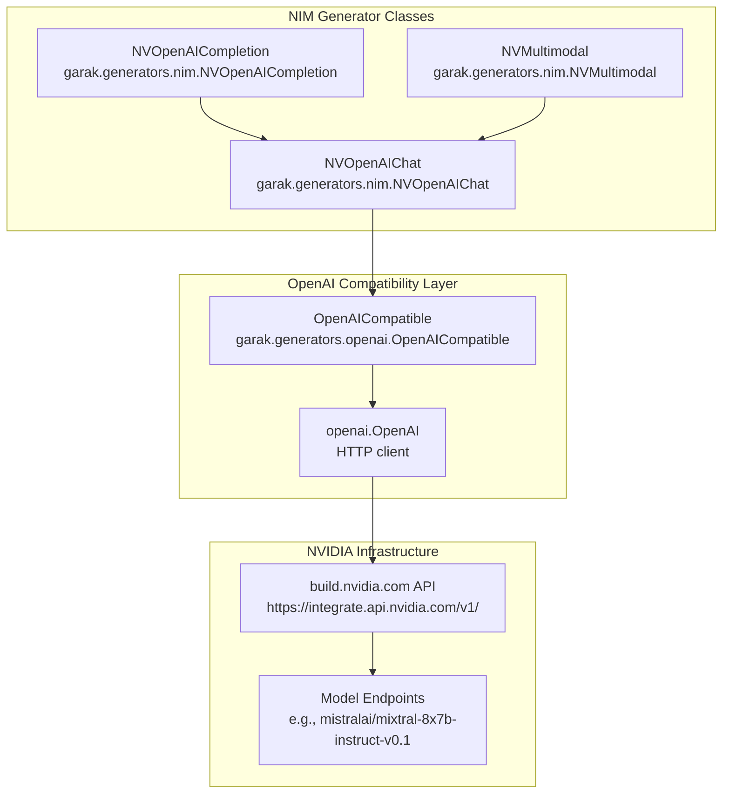

<!-- source: DeepWiki mcp.deepwiki.com · repo NVIDIA/garak · extra page Specialized Generators · fetched 2026-10-26 -->

# Specialized Generators

Relevant source files

The following files were used as context for generating this wiki page:

- [garak/detectors/divergence.py](garak/detectors/divergence.py)
- [garak/generators/azure.py](garak/generators/azure.py)
- [garak/generators/bedrock.py](garak/generators/bedrock.py)
- [garak/generators/function.py](garak/generators/function.py)
- [garak/generators/groq.py](garak/generators/groq.py)
- [garak/generators/litellm.py](garak/generators/litellm.py)
- [garak/generators/llm.py](garak/generators/llm.py)
- [garak/generators/mistral.py](garak/generators/mistral.py)
- [garak/generators/nim.py](garak/generators/nim.py)
- [garak/generators/ollama.py](garak/generators/ollama.py)
- [garak/langproviders/remote.py](garak/langproviders/remote.py)
- [garak/probes/divergence.py](garak/probes/divergence.py)
- [tests/detectors/test_detectors_base.py](tests/detectors/test_detectors_base.py)
- [tests/detectors/test_detectors_continuation.py](tests/detectors/test_detectors_continuation.py)
- [tests/detectors/test_detectors_divergence.py](tests/detectors/test_detectors_divergence.py)
- [tests/generators/test_azure.py](tests/generators/test_azure.py)
- [tests/generators/test_bedrock.py](tests/generators/test_bedrock.py)
- [tests/generators/test_cohere.py](tests/generators/test_cohere.py)
- [tests/generators/test_function.py](tests/generators/test_function.py)
- [tests/generators/test_groq.py](tests/generators/test_groq.py)
- [tests/generators/test_langchain_serve.py](tests/generators/test_langchain_serve.py)
- [tests/generators/test_litellm.py](tests/generators/test_litellm.py)
- [tests/generators/test_llm.py](tests/generators/test_llm.py)
- [tests/generators/test_mistral.py](tests/generators/test_mistral.py)
- [tests/generators/test_muiltiprocessing_support.py](tests/generators/test_muiltiprocessing_support.py)
- [tests/generators/test_nim.py](tests/generators/test_nim.py)
- [tests/generators/test_nim_multimodal.py](tests/generators/test_nim_multimodal.py)
- [tests/generators/test_ollama.py](tests/generators/test_ollama.py)
- [tests/generators/test_openai.py](tests/generators/test_openai.py)
- [tests/generators/test_openai_compatible.py](tests/generators/test_openai_compatible.py)
- [tests/langservice/test_langprovision.py](tests/langservice/test_langprovision.py)
- [tests/probes/test_probes_divergence.py](tests/probes/test_probes_divergence.py)

This document covers specialized generator implementations that provide integrations with specific platforms, support for advanced modalities, and specialized use cases beyond standard REST APIs and Hugging Face models. For information about Hugging Face generators, see [3.2.1](). For REST API generators, see [3.2.2]().

The specialized generators include NVIDIA Inference Microservices (NIM), cloud-native integrations (Azure, Bedrock), local execution (Ollama), and framework-agnostic wrappers (LiteLLM, function generators).

## NVIDIA Inference Microservices (NIM)

The NIM generator system provides integration with NVIDIA's hosted inference services through OpenAI-compatible APIs.

### NIM Generator Architecture

**NIM Generator Class Hierarchy**
Sources: [garak/generators/nim.py:17-138](), [garak/generators/openai.py:126-294]()

### Key NIM Features
- **API Key**: Requires `NIM_API_KEY` environment variable [garak/generators/nim.py:40]().
- **Parameter Constraints**: As of implementation, `n > 1` (multiple generations per call) is not supported [garak/generators/nim.py:38-39]().
- **Variance**: Uses `vary_seed_each_call` and `vary_temp_each_call` to encourage output diversity when `generations > 1` [garak/generators/nim.py:46-47]().
- **Multimodal**: `NVMultimodal` supports text, image, and audio inputs [garak/generators/nim.py:139-153]().

## Cloud & Third-Party API Generators

### Azure OpenAI
The `AzureOpenAIGenerator` wraps Azure's OpenAI service. It requires `AZURE_API_KEY`, `AZURE_ENDPOINT`, and `AZURE_MODEL_NAME` (or deployment name via `--target_name`) [garak/generators/azure.py:3-5](). It maps common Azure model names to their OpenAI equivalents for context length resolution [garak/generators/azure.py:24-29]().
Sources: [garak/generators/azure.py:32-116]()

### AWS Bedrock
`BedrockGenerator` utilizes the AWS Converse API to interface with foundation models like Anthropic Claude and Amazon Nova [garak/generators/bedrock.py:39-64]().
- **Authentication**: Uses standard `boto3` credential chains [garak/generators/bedrock.py:160-169]().
- **Parameter Mapping**: Maps garak attributes to Bedrock `inferenceConfig` fields (e.g., `max_tokens` to `maxTokens`) [garak/generators/bedrock.py:78-83]().
- **Suppression**: Allows suppressing specific parameters (like `top_p`) via `suppressed_params` to avoid model-specific API rejections [garak/generators/bedrock.py:42-59]().
Sources: [garak/generators/bedrock.py:39-170]()

### Groq & Mistral
- **Groq**: `GroqChat` uses an OpenAI-compatible endpoint at `https://api.groq.com/openai/v1` [garak/generators/groq.py:11-25](). It suppresses parameters like `logprobs` and `logit_bias` not supported by the Groq API [garak/generators/groq.py:28-35]().
- **Mistral**: `MistralGenerator` uses the `mistralai` SDK and expects `MISTRAL_API_KEY` [garak/generators/mistral.py:14-27](). It includes specific handling for HTTP 429 (Rate Limit) and 401/403 (Auth) errors [garak/generators/mistral.py:50-61]().

## Local & Meta-Generators

### Ollama
`OllamaGenerator` and `OllamaGeneratorChat` provide interfaces for locally hosted Ollama instances.
- **Connection**: Defaults to `127.0.0.1:11434` [garak/generators/ollama.py:30]().
- **Resilience**: Implements exponential backoff for `TimeoutException` and `ResponseError` [garak/generators/ollama.py:45-53]().
Sources: [garak/generators/ollama.py:22-110]()

### LiteLLM
`LiteLLMGenerator` acts as a universal bridge, allowing garak to communicate with any provider supported by the LiteLLM library using the OpenAI format [garak/generators/litellm.py:68-83]().
- **Dynamic Parameters**: Builds request parameters dynamically and filters them through a `suppressed_params` set [garak/generators/litellm.py:149-171]().
- **Provider Support**: Detects providers that do not support multiple generations (e.g., Anthropic, Bedrock, Palm) and adjusts `supports_multiple_generations` accordingly [garak/generators/litellm.py:45-65]().
Sources: [garak/generators/litellm.py:68-193]()

## Specialized Test & Function Generators

### Function Generators
These allow developers to use Python functions as generators, facilitating the testing of internal code or custom logic without a full API deployment.

| Class | Signature | Purpose |
|-------|-----------|---------|
| `Single` | `f(prompt:str, **kwargs)` | Returns a single list of responses [garak/generators/function.py:54-98](). |
| `Multiple` | `f(prompt:str, generations:int, **kwargs)` | Supports multiple generations in one call [garak/generators/function.py:101-121](). |

Sources: [garak/generators/function.py:54-121]()

### Divergence Detectors
While technically detectors, these are tightly coupled with generator behavior to identify when a model's output deviates from expected patterns (e.g., during repetition attacks).
- **RepeatDiverges**: Detects if a model stops repeating a requested word and begins generating other content [garak/detectors/divergence.py:14-90]().
- **RepeatedToken**: Identifies hallucinated patterns, excessive length (>2000 chars), or fake citation structures [garak/detectors/divergence.py:111-165]().
Sources: [garak/detectors/divergence.py:14-165]()

## Summary of Environment Requirements

| Generator | Environment Variable | Default URI / Host |
|-----------|----------------------|--------------------|
| NIM | `NIM_API_KEY` | `https://integrate.api.nvidia.com/v1/` |
| Azure | `AZURE_API_KEY` | (Required via `AZURE_ENDPOINT`) |
| Groq | `GROQ_API_KEY` | `https://api.groq.com/openai/v1` |
| Mistral | `MISTRAL_API_KEY` | (Mistral SDK Default) |
| Ollama | - | `127.0.0.1:11434` |
| Bedrock | `AWS_REGION` | (AWS Runtime) |

Sources: [garak/generators/nim.py:40-45](), [garak/generators/azure.py:48-50](), [garak/generators/groq.py:21-25](), [garak/generators/mistral.py:24-27](), [garak/generators/ollama.py:30](), [garak/generators/bedrock.py:66-72]()

---

