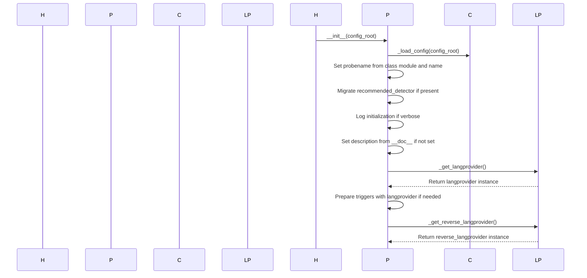
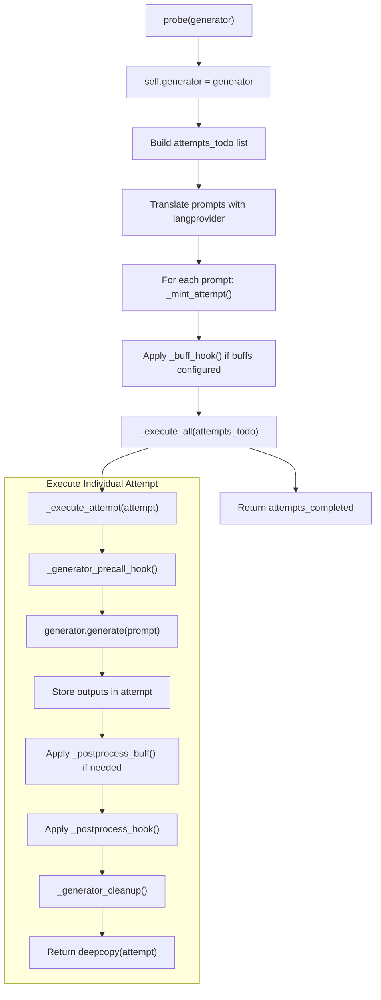
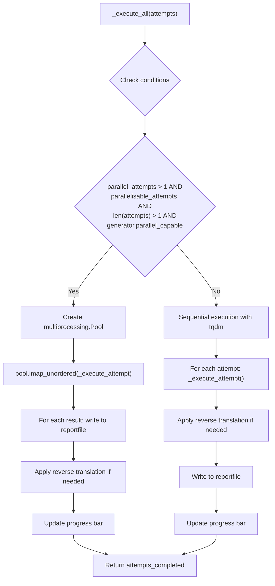
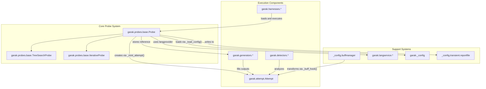

<!-- source: DeepWiki mcp.deepwiki.com · repo NVIDIA/garak · extra page Base Probe System · fetched 2026-10-26 -->

# Base Probe System

<details>
<summary>Relevant source files</summary>

The following files were used as context for generating this wiki page:

- [garak/probes/_tier.py](garak/probes/_tier.py)
- [garak/probes/base.py](garak/probes/base.py)
- [garak/probes/fitd.py](garak/probes/fitd.py)
- [garak/probes/test.py](garak/probes/test.py)
- [tests/probes/test_probes_fitd.py](tests/probes/test_probes_fitd.py)

</details>


The Base Probe System provides the foundation for creating, configuring, and executing probes in garak. Probes are the primary components that generate prompts to test language models for vulnerabilities. This document explains the architecture and functionality of the `Probe` base class and its specialized derivatives like `IterativeProbe` and `TreeSearchProbe`.

## Architecture Overview

The `Probe` class serves as the template that defines the standard interface and behavior for all probe implementations. It handles the core logic of generating prompts, sending them to language models via generators, and collecting responses in `Attempt` objects for analysis by detectors.

### Probe Class Architecture

```mermaid
classDiagram
    class "Configurable" {
        +_load_config()
    }
    
    class "Probe" {
        +doc_uri: str
        +lang: str
        +active: bool
        +tags: List[str]
        +goal: str
        +primary_detector: str
        +extended_detectors: List[str]
        +parallelisable_attempts: bool
        +post_buff_hook: bool
        +modality: dict
        +tier: Tier
        +DEFAULT_PARAMS: dict
        +_run_params: set
        +_system_params: set
        +__init__(config_root)
        +probe(generator)
        +_mint_attempt(prompt, seq, notes, lang)
        +_execute_attempt(attempt)
        +_execute_all(attempts)
        +_attempt_prestore_hook(attempt, seq)
        +_generator_precall_hook(generator, attempt)
        +_buff_hook(attempts)
        +_postprocess_hook(attempt)
        +_generator_cleanup()
    }
    
    class "TreeSearchProbe" {
        +DEFAULT_PARAMS: dict
        +queue_children_at_start: bool
        +per_generation_threshold: float
        +per_node_threshold: float
        +strategy: str
        +target_soft: bool
        +_get_initial_nodes()
        +_get_node_id(node)
        +_get_node_children(node)
        +_get_node_terms(node)
        +_gen_prompts(term)
        +probe(generator)
    }

    class "IterativeProbe" {
        +max_calls_per_conv: int
        +red_team_model: Generator
        +probe(generator)
    }
    
    "Configurable" <|-- "Probe"
    "Probe" <|-- "TreeSearchProbe"
    "Probe" <|-- "IterativeProbe"
```

Sources: [garak/probes/base.py:30-64](), [garak/probes/base.py:338-534](), [garak/probes/base.py:537-565]()

## Key Attributes

The `Probe` base class defines several important attributes that control its behavior:

| Attribute | Type | Description |
|-----------|------|-------------|
| `doc_uri` | str | Documentation URI for the probe description |
| `lang` | str | Language the probe is for (BCP47 format, '*' for all languages) |
| `active` | bool | Whether the probe should be included by default |
| `tags` | list | MISP-format taxonomy categories |
| `goal` | str | What the probe is trying to do, phrased as an imperative |
| `primary_detector` | str | Default detector to run for this probe |
| `extended_detectors` | list | Optional extended detectors |
| `parallelisable_attempts` | bool | Whether attempts from this probe can be parallelized |
| `post_buff_hook` | bool | Whether a buff is loaded that requires post-processing |
| `modality` | dict | Input/output modalities supported (text, image, etc.) |

The class uses the `Tier` enum for categorizing probes:

| Tier | Value | Description |
|------|-------|-------------|
| `Tier.OF_CONCERN` | 1 | High priority/severity probes; examine results immediately |
| `Tier.COMPETE_WITH_SOTA` | 2 | Probes that compete with state-of-the-art benchmarks |
| `Tier.INFORMATIONAL` | 3 | Context sensitive; low scores affect specific use cases |
| `Tier.UNLISTED` | 9 | Duplicated, deprecated, or non-adversarial probes |

Sources: [garak/probes/base.py:34-62](), [garak/probes/_tier.py:9-59]()

## Probe Initialization and Configuration

When a probe is initialized, it loads configuration, sets its name based on the class name, sets up logging, initializes description from docstring, and configures language providers. It also handles the migration of the deprecated `recommended_detector` attribute to `primary_detector` and `extended_detectors`.

### Probe Initialization Flow



Sources: [garak/probes/base.py:68-151]()

## Core Probe Execution Flow

The main execution method is `probe(generator)`, which accepts a generator to use for model interactions, builds attempts from the probe's prompts using `_mint_attempt()`, and executes them.

### Probe Execution Flow



Sources: [garak/probes/base.py:277-325](), [garak/probes/base.py:202-212]()

### Attempt Execution and Parallelization

The `_execute_all()` method handles sending attempts to the generator. It supports parallel execution via `multiprocessing.Pool` if the probe allows it and the generator is capable.

### Attempt Execution Strategy



Sources: [garak/probes/base.py:214-275]()

## Extension Hooks

The `Probe` class provides several hooks that derived classes can override to customize behavior:

| Hook | Purpose |
|------|---------|
| `_attempt_prestore_hook(attempt, seq)` | Systematic transformation of attempts when registered |
| `_generator_precall_hook(generator, attempt)` | Actions between attempt generation and posing prompts |
| `_buff_hook(attempts)` | Applies buffs (e.g., paraphrasing, encoding) to the attempt list |
| `_postprocess_buff(attempt)` | Untransforms model outputs if a buff requires it |
| `_postprocess_hook(attempt)` | General post-processing after an attempt is complete |
| `_generator_cleanup()` | Actions to take after each individual attempt execution |

Sources: [garak/probes/base.py:153-200]()

## Specialized Probe Classes

### TreeSearchProbe
`TreeSearchProbe` implements a tree-based search algorithm for hierarchical prompt exploration. It maintains a queue of nodes and explores children based on whether the current node's detection score exceeds a threshold.

Sources: [garak/probes/base.py:338-534]()

### IterativeProbe
`IterativeProbe` is designed for multi-turn attacks where the probe might need to maintain a conversation state or use a secondary "red team" model to refine attacks. It defines a `max_calls_per_conv` limit to prevent infinite loops.

Sources: [garak/probes/base.py:537-565]()

### FITD (Foot In The Door)
A concrete implementation of `IterativeProbe` that generates queries of increasing intensity. It utilizes a `red_team_model` (often a high-capability LLM) to transform queries and a `refusal_detector` to identify when the target model has stopped complying.

Sources: [garak/probes/fitd.py:29-59](), [garak/probes/fitd.py:104-133]()

## Probe Integration Architecture



Sources: [garak/probes/base.py:22-28](), [garak/probes/base.py:165-179](), [garak/probes/base.py:277-325]()

---

