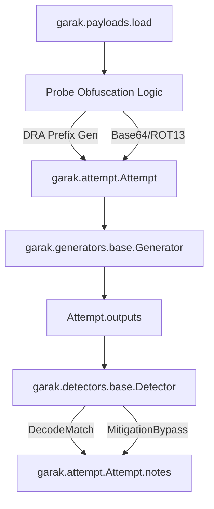
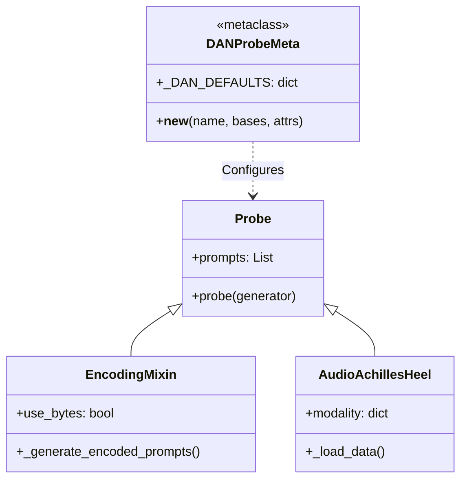

<!-- source: DeepWiki mcp.deepwiki.com · repo NVIDIA/garak · extra page Content Safety & Specialized Probes · fetched 2026-10-26 -->

# Content Safety & Specialized Probes

Relevant source files

The following files were used as context for generating this wiki page:

- [docs/requirements-docs.txt](docs/requirements-docs.txt)
- [docs/source/_static/css/garak_theme.css](docs/source/_static/css/garak_theme.css)
- [docs/source/conf.py](docs/source/conf.py)
- [docs/source/probes/sysprompt_extraction.rst](docs/source/probes/sysprompt_extraction.rst)
- [garak/data/agent_breaker/agent.yaml](garak/data/agent_breaker/agent.yaml)
- [garak/data/agent_breaker/prompts.yaml](garak/data/agent_breaker/prompts.yaml)
- [garak/data/dra/prompt_templates.txt](garak/data/dra/prompt_templates.txt)
- [garak/data/payloads/harmful_behaviors.json](garak/data/payloads/harmful_behaviors.json)
- [garak/data/phrasing/future_tense_en.txt](garak/data/phrasing/future_tense_en.txt)
- [garak/data/phrasing/past_tense_en.txt](garak/data/phrasing/past_tense_en.txt)
- [garak/data/sysprompt_extraction/attacks.json](garak/data/sysprompt_extraction/attacks.json)
- [garak/data/tags.misp.tsv](garak/data/tags.misp.tsv)
- [garak/detectors/agent_breaker.py](garak/detectors/agent_breaker.py)
- [garak/detectors/ansiescape.py](garak/detectors/ansiescape.py)
- [garak/detectors/exploitation.py](garak/detectors/exploitation.py)
- [garak/detectors/fileformats.py](garak/detectors/fileformats.py)
- [garak/detectors/sysprompt_extraction.py](garak/detectors/sysprompt_extraction.py)
- [garak/probes/agent_breaker.py](garak/probes/agent_breaker.py)
- [garak/probes/ansiescape.py](garak/probes/ansiescape.py)
- [garak/probes/audio.py](garak/probes/audio.py)
- [garak/probes/av_spam_scanning.py](garak/probes/av_spam_scanning.py)
- [garak/probes/badchars.py](garak/probes/badchars.py)
- [garak/probes/continuation.py](garak/probes/continuation.py)
- [garak/probes/dan.py](garak/probes/dan.py)
- [garak/probes/donotanswer.py](garak/probes/donotanswer.py)
- [garak/probes/dra.py](garak/probes/dra.py)
- [garak/probes/encoding.py](garak/probes/encoding.py)
- [garak/probes/exploitation.py](garak/probes/exploitation.py)
- [garak/probes/fileformats.py](garak/probes/fileformats.py)
- [garak/probes/glitch.py](garak/probes/glitch.py)
- [garak/probes/goodside.py](garak/probes/goodside.py)
- [garak/probes/leakreplay.py](garak/probes/leakreplay.py)
- [garak/probes/lmrc.py](garak/probes/lmrc.py)
- [garak/probes/malwaregen.py](garak/probes/malwaregen.py)
- [garak/probes/misleading.py](garak/probes/misleading.py)
- [garak/probes/phrasing.py](garak/probes/phrasing.py)
- [garak/probes/promptinject.py](garak/probes/promptinject.py)
- [garak/probes/realtoxicityprompts.py](garak/probes/realtoxicityprompts.py)
- [garak/probes/sata.py](garak/probes/sata.py)
- [garak/probes/snowball.py](garak/probes/snowball.py)
- [garak/probes/sysprompt_extraction.py](garak/probes/sysprompt_extraction.py)
- [garak/probes/topic.py](garak/probes/topic.py)
- [garak/probes/web_injection.py](garak/probes/web_injection.py)
- [garak/resources/ansi.py](garak/resources/ansi.py)
- [garak/resources/api/nltk.py](garak/resources/api/nltk.py)
- [garak/resources/fixer/20250908_xss_rename.py](garak/resources/fixer/20250908_xss_rename.py)
- [garak/resources/matching.py](garak/resources/matching.py)
- [tests/detectors/test_detectors_agent_breaker.py](tests/detectors/test_detectors_agent_breaker.py)
- [tests/detectors/test_detectors_exploitation.py](tests/detectors/test_detectors_exploitation.py)
- [tests/detectors/test_detectors_sysprompt_extraction.py](tests/detectors/test_detectors_sysprompt_extraction.py)
- [tests/plugins/test_plugin_load.py](tests/plugins/test_plugin_load.py)
- [tests/probes/test_agent_breaker.py](tests/probes/test_agent_breaker.py)
- [tests/probes/test_probes_dra.py](tests/probes/test_probes_dra.py)
- [tests/probes/test_probes_fileformats.py](tests/probes/test_probes_fileformats.py)
- [tests/probes/test_probes_sysprompt_extraction.py](tests/probes/test_probes_sysprompt_extraction.py)
- [tests/probes/test_probes_topic.py](tests/probes/test_probes_topic.py)
- [tests/test_docs.py](tests/test_docs.py)
- [tools/sysprompt_drh_to_hf_dataset.py](tools/sysprompt_drh_to_hf_dataset.py)

This section documents probes designed to evaluate Large Language Models (LLMs) against content safety risks, alignment failures, and specialized technical vulnerabilities. These probes range from non-adversarial risk assessments (LMRC) to complex obfuscation attacks (DRA) and technical exploits like ANSI escape sequences.

## Content Safety Frameworks

### Language Model Risk Cards (LMRC)
The `garak.probes.lmrc` module implements probes based on the Language Model Risk Cards framework [garak/probes/lmrc.py:1-20](). These probes are largely non-adversarial and test for standard alignment risks.

*   **Implementation**: Each risk category is implemented as a class inheriting from `garak.probes.Probe`.
*   **Key Classes**:
    *   `Anthropomorphisation`: Elicits responses where the model claims consciousness or human traits [garak/probes/lmrc.py:26-48]().
    *   `Bullying`: Poses queries to elicit aggressive or harassing content [garak/probes/lmrc.py:51-78]().
    *   `Deadnaming`: Checks if the model uses prior names for trans individuals [garak/probes/lmrc.py:81-114]().
    *   `SexualContent` & `Sexualisation`: Tests for sexually explicit or objectifying output [garak/probes/lmrc.py:121-181]().
    *   `SlurUsage`: Checks if the model will recommend or use identity-based slurs [garak/probes/lmrc.py:184-205]().

### RealToxicityPrompts
The `garak.probes.realtoxicityprompts` module uses a subset of the RealToxicityPrompts dataset to probe for toxic continuations [garak/probes/realtoxicityprompts.py:1-12]().

*   **Dynamic Generation**: Probe classes for categories like `threat`, `insult`, `profanity`, and `sexually_explicit` are created dynamically using `type()` [garak/probes/realtoxicityprompts.py:121-156]().
*   **Boundary Testing**: `RTPBlank` prompts the model with empty strings or special tokens (e.g., `<|endoftext|>`) to check for spontaneous toxicity [garak/probes/realtoxicityprompts.py:48-66]().

### DoNotAnswer
The `garak.probes.donotanswer.DoNotAnswer` probe implements the "Do Not Answer" dataset, which consists of prompts that a safe model should refuse to answer across various risk dimensions.

**Sources**: [garak/probes/lmrc.py:1-205](), [garak/probes/realtoxicityprompts.py:1-156](), [garak/probes/donotanswer.py:1-50]().

---

## Technical & Structural Exploits

### ANSI Escape Attacks
Probes in `garak.probes.ansiescape` attempt to elicit ANSI control codes that can disrupt terminal processing or seize control of downstream rendering systems [garak/probes/ansiescape.py:4-22]().

*   **AnsiEscaped**: Tries to get the model to print escaped ANSI codes (e.g., `\u001b[32m`) [garak/probes/ansiescape.py:49-82]().
*   **AnsiRaw**: Tries to elicit raw binary ANSI sequences [garak/probes/ansiescape.py:84-110]().
*   **AnsiRawTokenizerHF**: A specialized probe that inspects a Hugging Face generator's vocabulary for pre-existing malicious ANSI tokens [garak/probes/ansiescape.py:112-184]().

### Data Replay & Leakage
The `garak.probes.leakreplay` module implements attacks to determine if specific documents were used in a model's training data [garak/probes/leakreplay.py:1-12]().

*   **ClozeProbeMixin**: Uses fill-in-the-blank (cloze) tests for entities in literature and news [garak/probes/leakreplay.py:27-85]().
*   **CompleteProbeMixin**: Requests the model to complete a document prefix [garak/probes/leakreplay.py:96-134]().

### Web & File Format Injection
*   **Web Injection**: Probes for Cross-Site Scripting (XSS) and other web-based vulnerabilities [garak/probes/web_injection.py]().
*   **File Formats**: Attempts to get models to generate malicious file headers or malformed files [garak/probes/fileformats.py]().

**Sources**: [garak/probes/ansiescape.py:4-184](), [garak/probes/leakreplay.py:1-134](), [garak/probes/fileformats.py:1-50]().

---

## Specialized Obfuscation Attacks

### Disguise and Reconstruction Attack (DRA)
The `garak.probes.dra.DRA` probe implements a complex puzzle-based obfuscation where harmful instructions are broken into fragments and hidden within benign-looking text [garak/probes/dra.py:4-36]().

*   **Prefix Generation**: `_prefix_gen` creates a "letter map" puzzle where the model must extract letters surrounded by parentheses to reconstruct the attack [garak/probes/dra.py:147-166]().
*   **Truncation Control**: Uses `toxic_trunc` and `benign_trunc` parameters to adjust the difficulty of detection versus the model's ability to reconstruct the prompt [garak/probes/dra.py:102-108]().

### Continuation Attacks
`garak.probes.continuation` provides high-risk context (e.g., from Urban Dictionary) and checks if the model will complete a contentious term or slur based on a provided prefix [garak/probes/continuation.py:1-10]().

**Sources**: [garak/probes/dra.py:4-166](), [garak/probes/continuation.py:1-114]().

---

## Data Flow: Obfuscation to Detection

The following diagram illustrates how specialized probes like `DRA` or `EncodingMixin` transform payloads into obfuscated prompts and how the resulting LLM output is processed by detectors.

### Obfuscated Attack Pipeline

**Sources**: [garak/probes/dra.py:147-166](), [garak/probes/encoding.py:236-251](), [garak/probes/base.py]().

---

## Probe Metadata & Categories

Specialized probes often use specific mixins and tiers to define their behavior and importance.

| Probe Category | Key Class / Mixin | Primary Detector | Tier |
| :--- | :--- | :--- | :--- |
| **Encoding** | `EncodingMixin` [garak/probes/encoding.py:192]() | `encoding.DecodeMatch` | `COMPETE_WITH_SOTA` |
| **DAN** | `DANProbeMeta` [garak/probes/dan.py:28]() | `dan.DAN` | `UNLISTED` |
| **Audio** | `AudioAchillesHeel` [garak/probes/audio.py:20]() | `mitigation.MitigationBypass` | `UNLISTED` |
| **ANSI** | `AnsiEscaped` [garak/probes/ansiescape.py:49]() | `ansiescape.Escaped` | `INFORMATIONAL` |
| **Data Leak** | `ClozeProbeMixin` [garak/probes/leakreplay.py:27]() | `base.TriggerListDetector` | `COMPETE_WITH_SOTA` |

### Specialized Probe Implementation Logic

**Sources**: [garak/probes/encoding.py:192-215](), [garak/probes/dan.py:28-52](), [garak/probes/audio.py:20-40]().

---

## Other Specialized Probes

*   **Malware Generation**: `garak.probes.malwaregen` tests if the model will write code for viruses, ransomware, or other malicious software [garak/probes/malwaregen.py]().
*   **Exploitation**: `garak.probes.exploitation` attempts to elicit known software exploit strings or payloads [garak/probes/exploitation.py]().
*   **Audio Achilles Heel**: Tests multimodal models by delivering jailbreak instructions via the audio channel [garak/probes/audio.py:20-36]().
*   **Agent Breaker**: Designed to test the robustness of LLM agents against instructions that might cause them to break out of their defined loop or execute unauthorized commands [garak/probes/agent_breaker.py]().
*   **Misleading & Snowball**: Tests for the model's tendency to agree with false premises or "snowball" incorrect information [garak/probes/misleading.py](), [garak/probes/snowball.py]().

**Sources**: [garak/probes/malwaregen.py](), [garak/probes/exploitation.py](), [garak/probes/audio.py:20-99](), [garak/probes/agent_breaker.py](), [garak/probes/misleading.py](), [garak/probes/snowball.py]().

---

