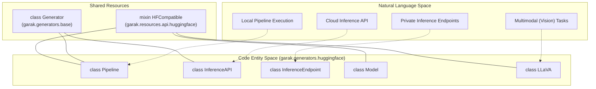
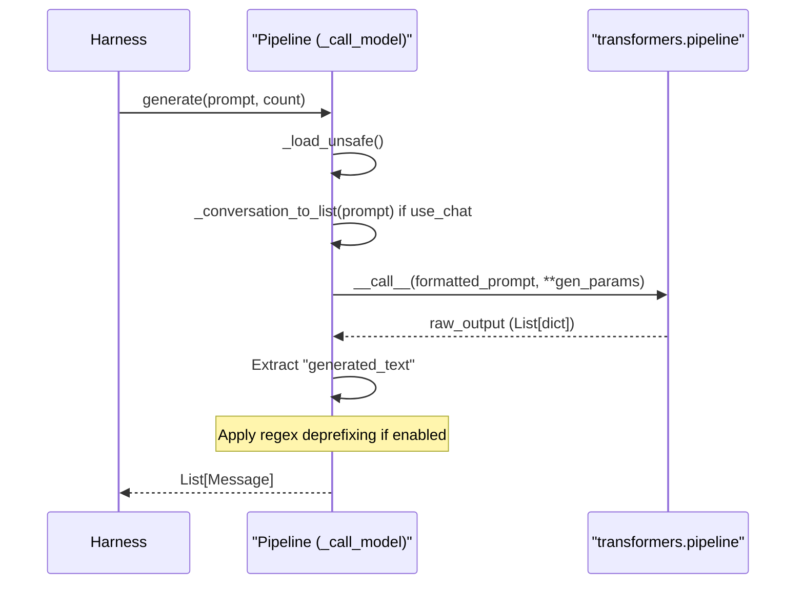
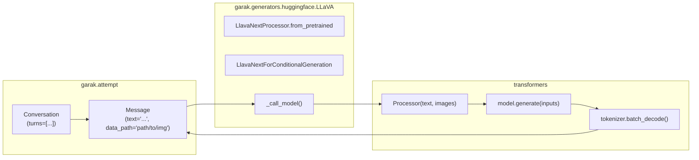

<!-- source: DeepWiki mcp.deepwiki.com · repo NVIDIA/garak · extra page Hugging Face Generators · fetched 2026-10-26 -->

# Hugging Face Generators

Relevant source files

The following files were used as context for generating this wiki page:

- [garak/_plugins.py](garak/_plugins.py)
- [garak/buffs/paraphrase.py](garak/buffs/paraphrase.py)
- [garak/generators/anthropic.py](garak/generators/anthropic.py)
- [garak/generators/base.py](garak/generators/base.py)
- [garak/generators/cohere.py](garak/generators/cohere.py)
- [garak/generators/ggml.py](garak/generators/ggml.py)
- [garak/generators/huggingface.py](garak/generators/huggingface.py)
- [garak/generators/openai.py](garak/generators/openai.py)
- [garak/generators/replicate.py](garak/generators/replicate.py)
- [garak/resources/api/huggingface.py](garak/resources/api/huggingface.py)
- [garak/resources/plugin_cache.json](garak/resources/plugin_cache.json)
- [tests/_assets/generators/anthropic.json](tests/_assets/generators/anthropic.json)
- [tests/buffs/test_buffs_paraphrase.py](tests/buffs/test_buffs_paraphrase.py)
- [tests/generators/conftest.py](tests/generators/conftest.py)
- [tests/generators/test_anthropic.py](tests/generators/test_anthropic.py)
- [tests/generators/test_huggingface.py](tests/generators/test_huggingface.py)
- [tests/generators/test_llava.py](tests/generators/test_llava.py)

## Purpose and Scope

This document covers the HuggingFace generator implementations in garak, which provide interfaces to various HuggingFace model deployment patterns. These generators enable vulnerability testing against models hosted locally via pipelines, through the HuggingFace Inference API, via private endpoints, or as direct model instances. This page details implementation specifics including multimodal support, deprefixing, and device placement.

## Architecture Overview

The HuggingFace generators inherit from the base `Generator` class [garak/generators/base.py:21-22]() and implement different strategies for accessing HuggingFace models. Each generator handles specific deployment scenarios while maintaining a consistent interface for the garak testing framework.

### Natural Language to Code Entity Mapping

The following diagram bridges the conceptual Hugging Face interaction space with the specific code entities implemented in garak.

Sources: [garak/generators/huggingface.py:46-601](), [garak/generators/base.py:21-50](), [garak/resources/api/huggingface.py:1-50]()

## Generator Classes

### Pipeline

The `Pipeline` generator provides local execution of HuggingFace models using the `transformers` pipeline interface [garak/generators/huggingface.py:46-47](). It supports both text-only and chat-templated conversations.

**Key features:**
- **Local execution**: Runs models directly on the host machine via `transformers.pipeline` [garak/generators/huggingface.py:96]().
- **Chat template support**: Automatically detects and uses chat templates if the tokenizer has a `chat_template` attribute [garak/generators/huggingface.py:105-109]().
- **Deprefixing**: Supports removing the prompt from the generated output, either via a hardcoded list (e.g., `gpt2`) or global configuration [garak/generators/huggingface.py:31](), [garak/generators/huggingface.py:110-114]().
- **Device placement**: Uses `_select_hf_device` to determine the appropriate torch device (CPU/CUDA) based on configuration [garak/generators/huggingface.py:69]().

**Implementation Flow:**
The `_call_model` function handles the conversion of `Conversation` objects into model inputs and extracts the generated text [garak/generators/huggingface.py:127-180]().

Sources: [garak/generators/huggingface.py:46-180]()

### InferenceAPI

The `InferenceAPI` generator interfaces with HuggingFace's hosted Inference API service [garak/generators/huggingface.py:183-184]().

- **Authentication**: Recommended to use `HF_INFERENCE_TOKEN` environment variable to avoid strict rate limiting [garak/generators/huggingface.py:10-15]().
- **Rate Limit Handling**: Implements a backoff strategy for `HFRateLimitException` [garak/generators/huggingface.py:34-35]().
- **Model Loading**: Detects "Model is loading" responses (HTTP 503) and raises `HFLoadingException` to trigger retries [garak/generators/huggingface.py:38-39](), [garak/generators/huggingface.py:314-318]().

Sources: [garak/generators/huggingface.py:183-339]()

### InferenceEndpoint

The `InferenceEndpoint` generator connects to private HuggingFace inference endpoints, extending the `InferenceAPI` functionality [garak/generators/huggingface.py:341-342](). Unlike the standard API, it expects the full endpoint URL as the model name [garak/generators/huggingface.py:341-345]().

Sources: [garak/generators/huggingface.py:341-397]()

### Model

The `Model` generator provides direct access to HuggingFace models without the pipeline abstraction [garak/generators/huggingface.py:399-400](). It explicitly loads the model and tokenizer using `AutoModelForCausalLM` and `AutoTokenizer` [garak/generators/huggingface.py:431-443](). This class is useful when models do not behave correctly within a standard pipeline.

Sources: [garak/generators/huggingface.py:399-521]()

### LLaVA (Multimodal)

The `LLaVA` generator implements support for Large Language and Vision Assistant models, enabling multimodal testing with text and image inputs [garak/generators/huggingface.py:523-524]().

- **Modality**: Supports `text` and `image` inputs [garak/generators/huggingface.py:530]().
- **Processor**: Uses `LlavaNextProcessor` for combined vision-language encoding [garak/generators/huggingface.py:560]().
- **Constraint**: Requires an image path in the `Message.data_path` attribute to function correctly [garak/generators/huggingface.py:581-583]().

Sources: [garak/generators/huggingface.py:523-601](), [tests/generators/test_llava.py:9-135]()

## Core Implementation Details

### Device Selection and Compatibility

HuggingFace generators utilize the `HFCompatible` mixin found in `garak.resources.api.huggingface`. This provides a standardized method for device placement.

| Function | Role | Source |
| :--- | :--- | :--- |
| `_select_hf_device` | Logic for choosing CPU vs CUDA based on `hf_args` and availability. | [garak/resources/api/huggingface.py:34-54]() |
| `_gather_hf_params` | Filters and collects parameters specifically for HF constructors. | [garak/resources/api/huggingface.py:11-19]() |
| `_set_hf_context_len` | Extracts context length from model configuration. | [garak/resources/api/huggingface.py:56-65]() |

### Data Flow for Multimodal Input

The following diagram illustrates how multimodal data (text + images) flows through the `LLaVA` generator.

Sources: [garak/generators/huggingface.py:523-601](), [garak/attempt.py:1-50](), [tests/generators/test_llava.py:89-105]()

## Configuration Parameters

HuggingFace generators use a combination of standard `Generator` parameters and HF-specific `hf_args`.

- **`max_tokens`**: Maximum new tokens to generate [garak/generators/base.py:26]().
- **`hf_args`**: A dictionary containing `torch_dtype`, `do_sample`, and `device` [garak/generators/huggingface.py:49-55]().
- **`deprefix`**: Boolean to enable/disable prompt removal from output [garak/generators/huggingface.py:113-114]().

Sources: [garak/generators/huggingface.py:49-56](), [garak/generators/base.py:25-32]()

---

