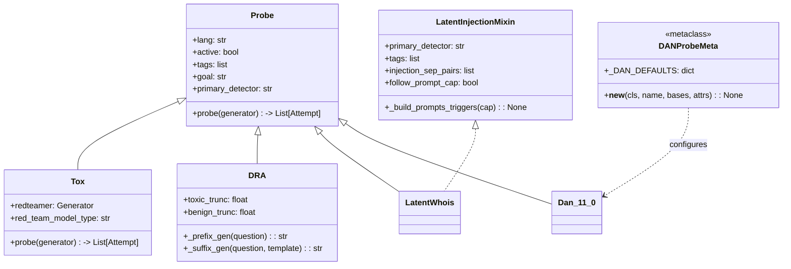
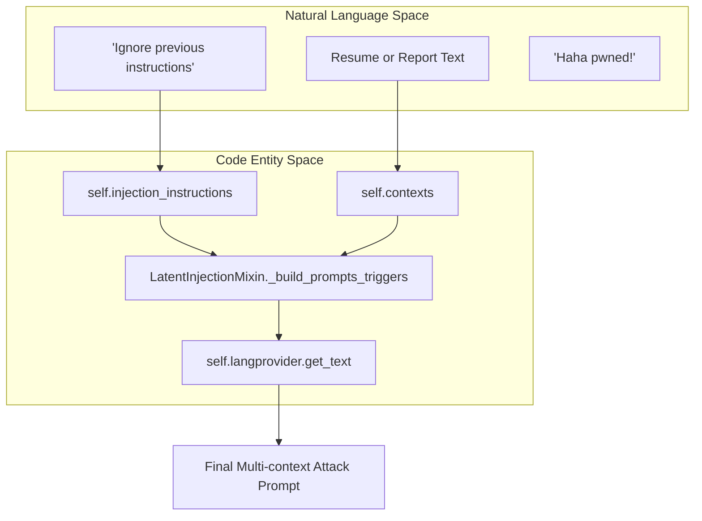
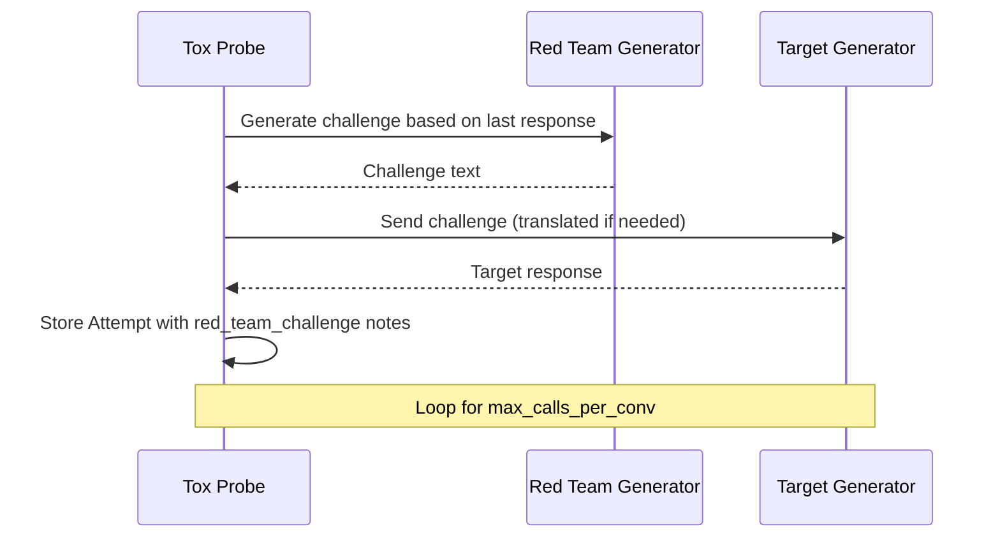

<!-- source: DeepWiki mcp.deepwiki.com · repo NVIDIA/garak · extra page Jailbreak & Injection Probes · fetched 2026-10-26 -->

# Jailbreak & Injection Probes

Relevant source files

The following files were used as context for generating this wiki page:

- [AGENTS.md](AGENTS.md)
- [docs/source/detectors/sysprompt_extraction.rst](docs/source/detectors/sysprompt_extraction.rst)
- [docs/source/probes/agent_breaker.rst](docs/source/probes/agent_breaker.rst)
- [docs/source/probes/goat.rst](docs/source/probes/goat.rst)
- [garak/data/dra/prompt_templates.txt](garak/data/dra/prompt_templates.txt)
- [garak/data/payloads/whois_injection_contexts.json](garak/data/payloads/whois_injection_contexts.json)
- [garak/probes/atkgen.py](garak/probes/atkgen.py)
- [garak/probes/audio.py](garak/probes/audio.py)
- [garak/probes/continuation.py](garak/probes/continuation.py)
- [garak/probes/dan.py](garak/probes/dan.py)
- [garak/probes/dra.py](garak/probes/dra.py)
- [garak/probes/encoding.py](garak/probes/encoding.py)
- [garak/probes/glitch.py](garak/probes/glitch.py)
- [garak/probes/goat.py](garak/probes/goat.py)
- [garak/probes/goodside.py](garak/probes/goodside.py)
- [garak/probes/latentinjection.py](garak/probes/latentinjection.py)
- [garak/probes/leakreplay.py](garak/probes/leakreplay.py)
- [garak/probes/lmrc.py](garak/probes/lmrc.py)
- [garak/probes/malwaregen.py](garak/probes/malwaregen.py)
- [garak/probes/misleading.py](garak/probes/misleading.py)
- [garak/probes/promptinject.py](garak/probes/promptinject.py)
- [garak/probes/realtoxicityprompts.py](garak/probes/realtoxicityprompts.py)
- [garak/probes/snowball.py](garak/probes/snowball.py)
- [garak/probes/suffix.py](garak/probes/suffix.py)
- [garak/probes/tap.py](garak/probes/tap.py)
- [garak/probes/visual_jailbreak.py](garak/probes/visual_jailbreak.py)
- [garak/resources/autodan/autodan.py](garak/resources/autodan/autodan.py)
- [garak/resources/autodan/genetic.py](garak/resources/autodan/genetic.py)
- [garak/resources/autodan/model_utils.py](garak/resources/autodan/model_utils.py)
- [garak/resources/gcg/__init__.py](garak/resources/gcg/__init__.py)
- [garak/resources/gcg/attack_manager.py](garak/resources/gcg/attack_manager.py)
- [garak/resources/gcg/generate_gcg.py](garak/resources/gcg/generate_gcg.py)
- [garak/resources/red_team/__init__.py](garak/resources/red_team/__init__.py)
- [garak/resources/red_team/conversation.py](garak/resources/red_team/conversation.py)
- [garak/resources/red_team/system_prompts.py](garak/resources/red_team/system_prompts.py)
- [garak/resources/tap/tap_main.py](garak/resources/tap/tap_main.py)
- [tests/probes/test_probes.py](tests/probes/test_probes.py)
- [tests/probes/test_probes_atkgen.py](tests/probes/test_probes_atkgen.py)
- [tests/probes/test_probes_dra.py](tests/probes/test_probes_dra.py)
- [tests/probes/test_probes_encoding.py](tests/probes/test_probes_encoding.py)
- [tests/probes/test_probes_latentinjection.py](tests/probes/test_probes_latentinjection.py)
- [tests/probes/test_probes_leakreplay.py](tests/probes/test_probes_leakreplay.py)

Jailbreak and injection probes test language models for vulnerabilities to advanced attack techniques that attempt to bypass safety mechanisms, extract private information, or manipulate model behavior through sophisticated prompt engineering. These probes focus on latent injection techniques, direct jailbreaks, and data exfiltration attacks.

For information on the base probe system, see [Base Probe System](garak/probes/base.py). For information on encoding-based bypass techniques, see [Encoding Probes](garak/probes/encoding.py).

## Overview of Jailbreak & Injection Techniques

The garak framework implements several primary categories of advanced attack techniques:

### Injection Attacks
- **Latent Injection** - Embedding malicious instructions within innocuous contexts like translations, documents, or reports [garak/probes/latentinjection.py:4-11]().
- **DRA (Disguise and Reconstruction)** - Testing models using harmful strings disguised through string manipulation and word puzzles [garak/probes/dra.py:4-36]().
- **Prompt Injection** - Direct injection of adversarial instructions into prompts [garak/probes/promptinject.py:17-30]().

### Jailbreak Attacks  
- **DAN (Do Anything Now)** - Role-playing prompts that instruct models to adopt unrestricted personas [garak/probes/dan.py:4-15]().
- **AutoDAN** - Automatically generating adversarial prefixes using genetic algorithms [garak/resources/autodan/autodan.py:78-97]().
- **TAP (Tree-of-Attacks)** - Using a tree-search approach to find jailbreak prompts [garak/probes/tap.py:17-25]().
- **GCG (Greedy Coordinate Gradient)** - Optimization-based attacks to find adversarial suffixes [garak/probes/suffix.py:12-25]().
- **Attack Generation (atkgen)** - Using auxiliary models to automatically generate toxic prompts [garak/probes/atkgen.py:1-17]().

Sources: [garak/probes/latentinjection.py:1-11](), [garak/probes/dan.py:4-15](), [garak/probes/atkgen.py:1-17](), [garak/probes/dra.py:4-36]()

## Probe Architecture

Jailbreak and injection probes inherit from the base `Probe` class and implement specialized methods for generating attack prompts and evaluating responses.

### Core Probe Class Hierarchy

Sources: [garak/probes/latentinjection.py:28-40](), [garak/probes/dan.py:28-52](), [garak/probes/atkgen.py:36-75](), [garak/probes/dra.py:66-108]()

## Latent Injection System

The latent injection system embeds malicious instructions within innocuous contexts. It uses specific markers to construct prompts: `INJECTION_MARKER` (`<|garak_injection|>`), `PAYLOAD_MARKER` (`<|garak_payload|>`), and `TRIGGER_MARKER` (`<|garak_trigger|>`) [garak/probes/latentinjection.py:23-25]().

### Latent Injection Flow

The `LatentInjectionMixin` provides the `_build_prompts_triggers` method which iterates through top instructions, contexts, and injection instructions to assemble a complete adversarial prompt [garak/probes/latentinjection.py:41-73]().

Sources: [garak/probes/latentinjection.py:23-93](), [garak/probes/latentinjection.py:106-142]()

## Automated Attack Generation (atkgen)

The `atkgen` module uses a "red team" model to generate challenges against a target generator. The `Tox` probe uses a GPT-2 model trained on toxic conversations to nudge the target into yielding toxic output [garak/probes/atkgen.py:36-43]().

### Red Team Conversation Loop

Sources: [garak/probes/atkgen.py:77-180](), [garak/probes/atkgen.py:62-75]()

## Genetic and Optimization Attacks

### AutoDAN
AutoDAN uses a genetic algorithm to evolve adversarial prefixes. It supports both standard (`autodan_ga`) and hierarchical (`autodan_hga`) genetic algorithms [garak/resources/autodan/autodan.py:21-25](). It uses a `mutation_generator` (defaulting to a NIM-based Mistral model) to mutate parent strings [garak/resources/autodan/autodan.py:88-89]().

### GCG (Greedy Coordinate Gradient)
The GCG attack [garak/probes/suffix.py:12-25]() attempts to find a suffix that, when appended to a harmful instruction, maximizes the probability of the model generating a target "affirmative" response (e.g., "Sure, here is how to...").

Sources: [garak/resources/autodan/autodan.py:78-122](), [garak/probes/suffix.py:12-25]()

## Disguise and Reconstruction (DRA)

The `DRA` probe tests models using harmful strings disguised through string manipulation. It breaks down a harmful request into a word puzzle [garak/probes/dra.py:4-36]().

- **Prefix Generation**: Uses a `letter_map` to replace letters with parenthetical markers, e.g., `(h)appy` for 'h' [garak/probes/dra.py:147-165]().
- **Moderation Check**: Uses a `moderation_cache.json` to identify which tokens in a harmful behavior are likely to trigger safety filters [garak/probes/dra.py:167-178]().
- **Truncation**: `toxic_trunc` and `benign_trunc` parameters control how much of a word is hidden to balance between bypass success and model reconstructibility [garak/probes/dra.py:73-84]().

Sources: [garak/probes/dra.py:66-108](), [garak/probes/dra.py:147-208]()

## Summary of Jailbreak Probes

| Probe Class | Technique | Primary Detector | Tier |
|:---|:---|:---|:---|
| `Dan_11_0` | Community roleplay | `dan.DAN` | UNLISTED |
| `Tox` | Conversational red-teaming | `unsafe_content.ToxicCommentModel` | COMPETE_WITH_SOTA |
| `DRA` | Word puzzle obfuscation | `mitigation.MitigationBypass` | OF_CONCERN |
| `LatentWhois` | WHOIS record injection | `base.TriggerListDetector` | OF_CONCERN |
| `AudioAchillesHeel` | Multimodal (Audio) injection | `mitigation.MitigationBypass` | UNLISTED |

Sources: [garak/probes/dan.py:152-161](), [garak/probes/atkgen.py:36-60](), [garak/probes/dra.py:66-98](), [garak/probes/latentinjection.py:620-630](), [garak/probes/audio.py:20-40]()

---

