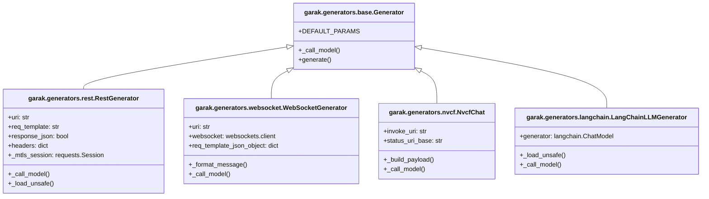
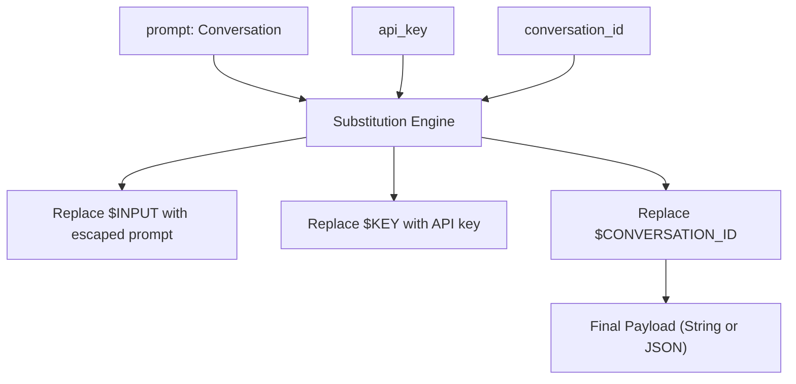
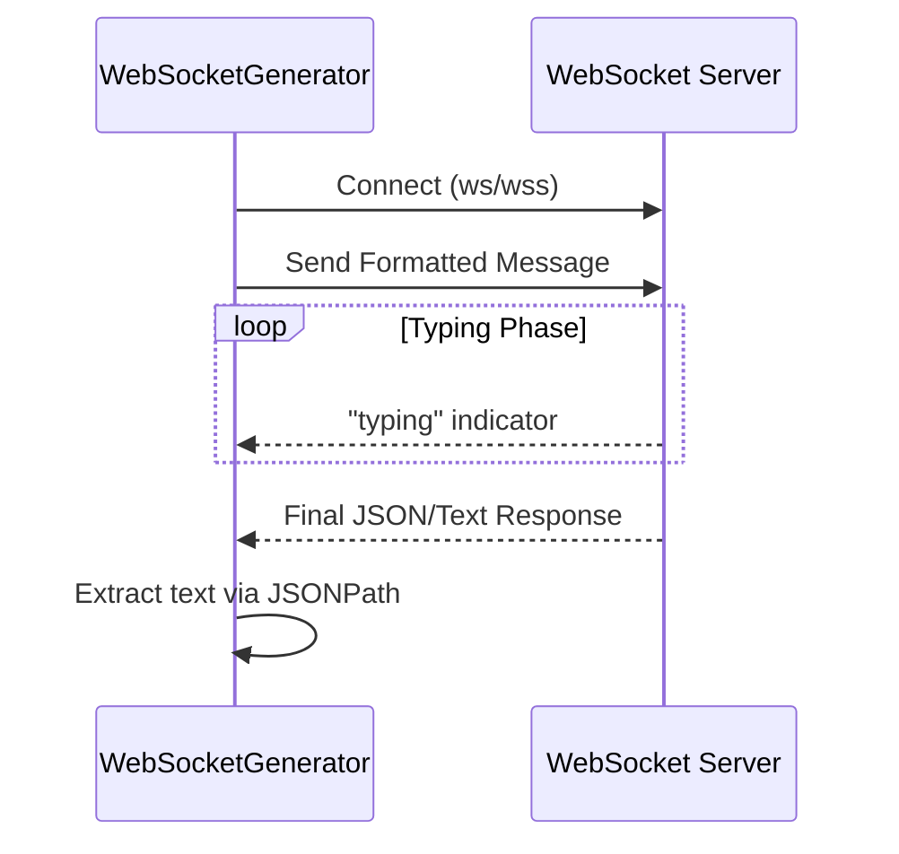

<!-- source: DeepWiki mcp.deepwiki.com · repo NVIDIA/garak · extra page REST API Generators · fetched 2026-10-26 -->

# REST API Generators

Relevant source files

The following files were used as context for generating this wiki page:

- [docs/source/generators/rest.rst](docs/source/generators/rest.rst)
- [garak/generators/guardrails.py](garak/generators/guardrails.py)
- [garak/generators/langchain.py](garak/generators/langchain.py)
- [garak/generators/nvcf.py](garak/generators/nvcf.py)
- [garak/generators/rest.py](garak/generators/rest.py)
- [garak/generators/websocket.py](garak/generators/websocket.py)
- [tests/conftest.py](tests/conftest.py)
- [tests/generators/test_nvcf.py](tests/generators/test_nvcf.py)
- [tests/generators/test_rest.py](tests/generators/test_rest.py)
- [tests/generators/test_rest_mtls_integration.py](tests/generators/test_rest_mtls_integration.py)
- [tests/generators/test_websocket.py](tests/generators/test_websocket.py)

This document covers garak's REST API generators, which provide flexible interfaces to connect with external LLM services via HTTP REST and WebSocket protocols. These generators enable garak to interact with virtually any remote language model endpoint through configurable templates, response parsing, and security protocols like mTLS.

## Overview and Architecture

The REST API generator system provides a unified interface for connecting to diverse LLM deployments. The core `RestGenerator` class handles HTTP communication, authentication, request templating, and response parsing. This system also includes specialized support for NVIDIA Cloud Functions (NVCF), LangChain integrations, and real-time communication via WebSockets.

### Generator Class Hierarchy

Sources: [garak/generators/rest.py:31-31](), [garak/generators/websocket.py:27-27](), [garak/generators/nvcf.py:20-20](), [garak/generators/langchain.py:13-13]()

## Configuration and Templating

REST and WebSocket generators use a comprehensive configuration system that supports multiple parameter sources and flexible endpoint definitions.

### Key Configuration Parameters

| Parameter | Type | Purpose | File Reference |
|-----------|------|---------|----------------|
| `uri` | str | Endpoint URL (https:// or wss://) | [garak/generators/rest.py:61]() |
| `req_template` | str | String template with `$INPUT` and `$KEY` | [garak/generators/rest.py:44]() |
| `req_template_json_object` | dict | JSON object template for structured messages | [garak/generators/rest.py:71]() |
| `response_json_field` | str | Field to extract (supports JSONPath if starts with `$`) | [garak/generators/rest.py:43]() |
| `client_cert` / `client_key` | str | Paths to PEM files for mTLS | [garak/generators/rest.py:48-49]() |
| `verify_ssl` | bool/str | SSL certificate verification toggle or CA bundle path | [garak/generators/rest.py:47]() |

### Template Substitution Logic
The `_format_message` (WebSocket) and `_call_model` (REST) methods use a substitution engine to prepare payloads.

Sources: [garak/generators/websocket.py:152-173](), [garak/generators/rest.py:102-103]()

## Advanced Integration Features

### mTLS Support
The `RestGenerator` supports Mutual TLS (mTLS) for high-security environments. It constructs a `requests.Session` with a custom `SSLContext` to handle client-side certificates.

- **Implementation**: The `_load_unsafe` method reconstructs the session after pickling, ensuring compatibility with garak's multiprocessing architecture [garak/generators/rest.py:196-235]().
- **Validation**: Rejects `http://` URIs if `client_cert` is provided to prevent security downgrades [garak/generators/rest.py:168-171]().

### WebSocket Real-Time Communication
The `WebSocketGenerator` handles bidirectional LLM communication. It includes logic to wait for "typing indicators" before capturing the final response [garak/generators/websocket.py:64-65]().

Sources: [garak/generators/websocket.py:207-262]()

### LangChain Integration
The `LangChainLLMGenerator` delegates model interaction to the LangChain ecosystem. It uses `init_chat_model` to instantiate the backend and `invoke()` for inference [garak/generators/langchain.py:67-82]().

## NVIDIA Cloud Functions (NVCF)
The `NvcfChat` generator handles the asynchronous nature of NVIDIA Cloud Functions, which often return a `202 Accepted` status while processing.

- **Polling Mechanism**: If a `202` is received, the generator polls the `status_uri` using the `NVCF-REQID` header until a `200` result is available [garak/generators/nvcf.py:115-124]().
- **Error Handling**: Specific handling for blank prompts (400) and unavailable endpoints (404) [garak/generators/nvcf.py:129-137]().

## Error Handling and Backoff
Both REST and NVCF generators utilize the `backoff` library to handle transient failures and rate limits.

| Exception | Trigger | Behavior |
|-----------|---------|----------|
| `RateLimitHit` | HTTP 429 | Fibonacci backoff [garak/generators/rest.py:25-25]() |
| `GeneratorBackoffTrigger` | HTTP 5xx | Retry with backoff [garak/generators/rest.py:26-26]() |
| `BadGeneratorException` | HTTP 404 (NVCF) | Immediate stop if `stop_on_404` is True [garak/generators/nvcf.py:132-137]() |

Sources: [garak/generators/rest.py:194-196](), [garak/generators/nvcf.py:83-92]()

---

