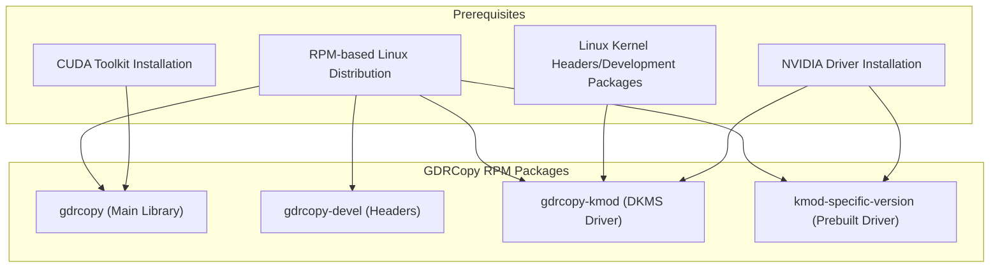
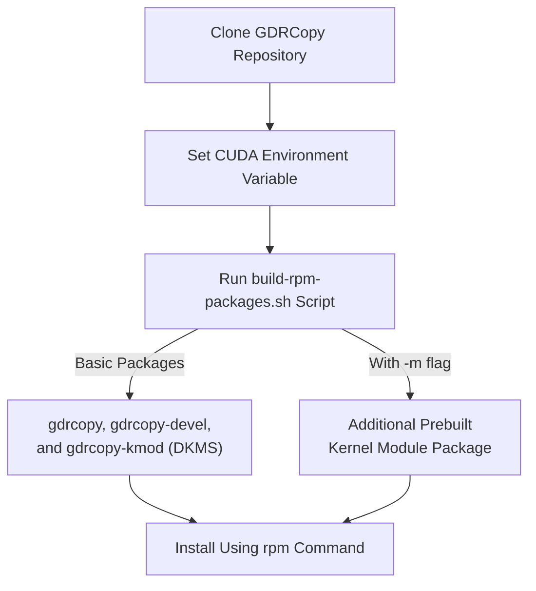

<!-- source: DeepWiki mcp.deepwiki.com · repo NVIDIA/gdrcopy · page 4.1 RPM Installation · fetched 2026-10-26 -->

# RPM Installation

<details>
<summary>Relevant source files</summary>

The following files were used as context for generating this wiki page:

- [packages/build-rpm-packages.sh](packages/build-rpm-packages.sh)
- [packages/debian-tests/rules](packages/debian-tests/rules)
- [packages/gdrcopy.spec](packages/gdrcopy.spec)

</details>


This document provides instructions for installing GDRCopy using RPM packages on RPM-based Linux distributions such as RHEL, CentOS, and SUSE. For Debian-based installations, see [Debian Installation](#4.2), and for building from source, see [Source Installation](#4.3).

## Overview of Available Packages

GDRCopy provides the following RPM packages:

| Package | Description |
|---------|-------------|
| `gdrcopy` | Main package containing the library and test applications |
| `gdrcopy-devel` | Development package with headers needed for building applications that use GDRCopy |
| `gdrcopy-kmod` | Kernel module package with DKMS support (dynamically builds the driver for your kernel) |
| `kmod-$(kernel-version)-$(nvidia-version)` | Prebuilt kernel module for specific kernel and NVIDIA driver versions (optional) |

The installation typically requires the main `gdrcopy` package and either the DKMS-based `gdrcopy-kmod` package (recommended) or a prebuilt kernel module package.

Sources: [packages/gdrcopy.spec:101-139]()

## Prerequisites

Before installing GDRCopy via RPM, ensure the following requirements are met:

1. **CUDA Toolkit**: A compatible CUDA installation is required
2. **NVIDIA GPU Driver**: A supported NVIDIA driver must be installed
3. **Root access**: Required for installation
4. **RPM-based Linux distribution**: RHEL 7/8/9, CentOS 7/8/Stream, Rocky Linux 8/9, or SUSE



Sources: [packages/gdrcopy.spec:1-8](), [packages/build-rpm-packages.sh:77-85]()

## Installing Pre-built RPM Packages

If you're using a supported distribution, you can install pre-built packages:

1. Download the appropriate RPM packages from the [GDRCopy GitHub releases page](https://github.com/NVIDIA/gdrcopy/releases)
2. Install the packages using the following commands:

```bash
# Install the main library and development headers
sudo rpm -i gdrcopy-[version].[distro].[arch].rpm
sudo rpm -i gdrcopy-devel-[version].[distro].[arch].rpm

# Install the DKMS kernel module (recommended for most users)
sudo rpm -i gdrcopy-kmod-[version].[distro].noarch.rpm
```

After installation, the GDRCopy service will be automatically started on RHEL systems. On SUSE systems, you'll need to load the driver manually using `modprobe gdrdrv`.

Sources: [packages/gdrcopy.spec:214-230](), [packages/gdrcopy.spec:70-74]()

## Building Custom RPM Packages

If pre-built packages aren't available for your distribution or you need custom configurations, you can build the RPM packages yourself:

### Building Process



### Steps to Build RPM Packages

1. Clone the GDRCopy repository:
   ```bash
   git clone https://github.com/NVIDIA/gdrcopy.git
   cd gdrcopy
   ```

2. Run the build script with the CUDA environment variable set:
   ```bash
   # Basic package build (recommended for most users)
   CUDA=/usr/local/cuda ./packages/build-rpm-packages.sh
   
   # To also build a prebuilt kernel module package
   CUDA=/usr/local/cuda ./packages/build-rpm-packages.sh -m
   ```

   Note: For building with the `-m` flag, the NVIDIA driver source must be available. The script attempts to locate it automatically but you can specify it explicitly:
   ```bash
   CUDA=/usr/local/cuda NVIDIA_SRC_DIR=/usr/src/nvidia-driver-version/nvidia ./packages/build-rpm-packages.sh -m
   ```

3. Install the generated RPM packages:
   ```bash
   sudo rpm -i gdrcopy-*.rpm gdrcopy-devel-*.rpm gdrcopy-kmod-*.rpm
   ```

Sources: [packages/build-rpm-packages.sh:1-186]()

## Package Components

### Main Package (`gdrcopy`)

The main package includes:
- Shared library (`libgdrapi.so`)
- Test and benchmark applications:
  - `gdrcopy_sanity` - Functionality tests
  - `gdrcopy_copybw` - Bandwidth benchmark
  - `gdrcopy_copylat` - Latency benchmark
  - `gdrcopy_apiperf` - API performance tests
  - `gdrcopy_pplat` - Pin/unpin latency tests

Sources: [packages/gdrcopy.spec:307-319]()

### Development Package (`gdrcopy-devel`)

Contains:
- Header files (`gdrapi.h`, `gdrconfig.h`)
- Documentation

Sources: [packages/gdrcopy.spec:322-325]()

### Kernel Module Package (`gdrcopy-kmod`)

Includes:
- DKMS configuration
- Kernel module source files
- Service scripts for starting/stopping the driver

The kernel module package uses DKMS (Dynamic Kernel Module Support) to automatically build the kernel module for your current kernel. When a kernel update occurs, DKMS will automatically rebuild the module for the new kernel.

Sources: [packages/gdrcopy.spec:328-345]()

## Service Management

GDRCopy includes a service that manages the loading of the kernel module:

### RHEL 9 and later (systemd)

```bash
# Start the service
sudo systemctl start gdrcopy

# Enable automatic start at boot
sudo systemctl enable gdrcopy

# Check status
sudo systemctl status gdrcopy
```

### RHEL 8 and earlier (init.d)

```bash
# Start the service
sudo service gdrcopy start

# Enable automatic start at boot
sudo chkconfig --add gdrcopy
sudo chkconfig gdrcopy on

# Check status
sudo service gdrcopy status
```

### SUSE

On SUSE systems, the kernel module is loaded via a modprobe configuration rather than a service:

```bash
# Load the module manually
sudo modprobe gdrdrv

# Unload the module
sudo modprobe -r gdrdrv
```

Sources: [packages/gdrcopy.spec:29-67](), [packages/gdrcopy.spec:187-212]()

## Verification

To verify the installation:

1. Check that the kernel module is loaded:
   ```bash
   lsmod | grep gdrdrv
   ```

2. Verify library installation:
   ```bash
   ldconfig -p | grep libgdrapi
   ```

3. Run the sanity test:
   ```bash
   /usr/bin/gdrcopy_sanity
   ```

## Uninstallation

To uninstall GDRCopy:

```bash
# Stop the service first
sudo systemctl stop gdrcopy  # For RHEL 9+
sudo service gdrcopy stop    # For RHEL 8 or earlier

# Remove packages
sudo rpm -e gdrcopy gdrcopy-devel gdrcopy-kmod
```

During uninstallation, the service is automatically stopped, and the kernel module is unloaded.

Sources: [packages/gdrcopy.spec:239-250]()

## Package Variables and Configuration

The RPM packages support several build-time variables that may be useful for advanced configurations:

| Variable | Description | Default |
|----------|-------------|---------|
| `CUDA` | Path to CUDA installation | /usr/local/cuda |
| `NVIDIA_SRC_DIR` | Path to NVIDIA driver source | Auto-detected |
| `KVERSION` | Kernel version | Current kernel |

Sources: [packages/gdrcopy.spec:1-8](), [packages/build-rpm-packages.sh:76-117]()

---

