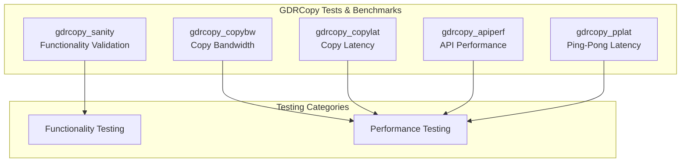
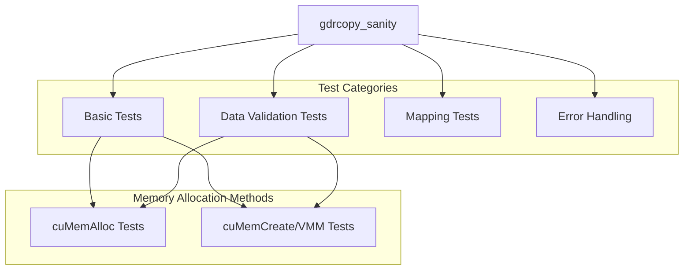
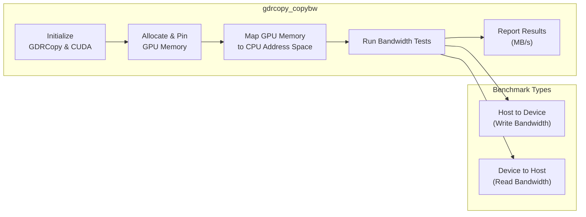
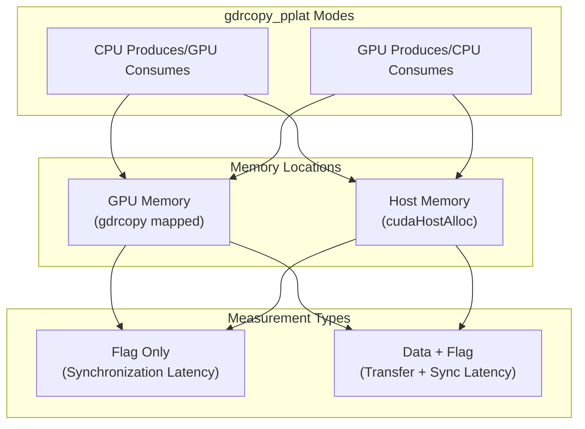
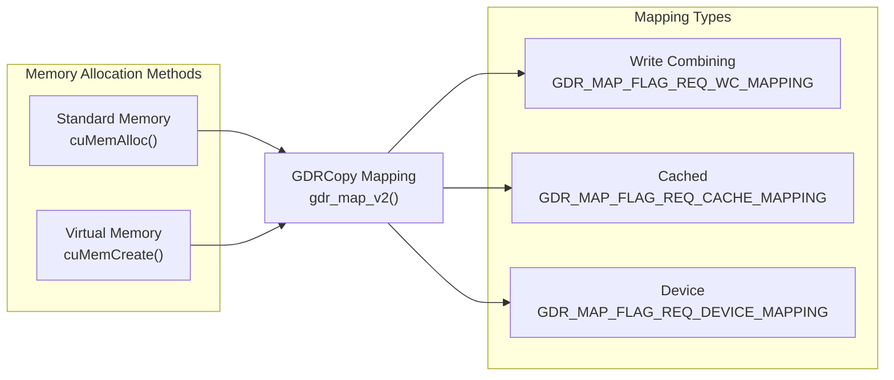

<!-- source: DeepWiki mcp.deepwiki.com · repo NVIDIA/gdrcopy · page 5 Tests and Benchmarks · fetched 2026-10-26 -->

# Tests and Benchmarks

<details>
<summary>Relevant source files</summary>

The following files were used as context for generating this wiki page:

- [scripts/get_cuda_gencode.sh](scripts/get_cuda_gencode.sh)
- [tests/Makefile](tests/Makefile)
- [tests/common.hpp](tests/common.hpp)
- [tests/copybw.cpp](tests/copybw.cpp)
- [tests/pplat.cu](tests/pplat.cu)
- [tests/sanity.cpp](tests/sanity.cpp)

</details>


GDRCopy provides a comprehensive suite of test applications and performance benchmarks designed to validate functionality and measure the performance characteristics of GPU-CPU data transfers. These tools help users verify correct operation and understand the performance profile of GDRCopy on their systems.

## Overview of Test Applications

GDRCopy includes several specialized test applications, each focused on a different aspect of functionality or performance:



Sources: [tests/Makefile:24-25](), [tests/Makefile:38-51]()

## Functionality Validation (gdrcopy_sanity)

The `gdrcopy_sanity` utility is a comprehensive test suite that validates the core functionality of GDRCopy through multiple test cases. It ensures that all components work correctly across different GPU memory allocation methods and access patterns.



Sources: [tests/sanity.cpp:288-318](), [tests/sanity.cpp:728-742]()

The sanity tests verify:

1. **Basic functionality**: GPU memory pinning, mapping, and unmapping
2. **Data validation**: Data integrity during transfers between GPU and CPU
3. **Buffer alignment**: Correct handling of aligned and unaligned buffers
4. **Memory mapping types**: Write Combining, Cached, and Device mappings
5. **Error handling**: Correct behavior after resource deallocation

## Performance Benchmarks

GDRCopy includes several benchmarking utilities to measure different performance aspects of the library.

### Copy Bandwidth (gdrcopy_copybw)

Measures the throughput of data transfers between CPU and GPU memory using GDRCopy mappings.



Sources: [tests/copybw.cpp:106-120](), [tests/copybw.cpp:125-138]()

Key features of the copy bandwidth test:
- Measures both read (device-to-host) and write (host-to-device) bandwidth
- Supports configurable copy sizes from 1 byte to multiple megabytes
- Supports different GPU memory allocation methods
- Reports throughput in MB/s

### Ping-Pong Latency (gdrcopy_pplat)

Measures the round-trip latency of small transfers and synchronization between CPU and GPU.



Sources: [tests/pplat.cu:190-198](), [tests/pplat.cu:220-222](), [tests/pplat.cu:605-627]()

The ping-pong latency test features:
- Multiple benchmark modes for different producer/consumer patterns
- Configurable memory locations for flags and data
- Can measure pure synchronization latency or combined transfer and sync latency
- Reports latency in microseconds per round-trip

## Test Implementation Details

### Test Framework

The tests are implemented using a custom testing framework that provides assertions, timing functions, and GPU memory management utilities.

| Component | Purpose |
|-----------|---------|
| `ASSERT_*` macros | Validation of expected conditions |
| `CHECK_*` macros | Non-fatal condition checking |
| `time_diff()` | Precise timing measurements |
| `gpu_mem_alloc()` | GPU memory allocation via cuMemAlloc |
| `gpu_vmm_alloc()` | GPU memory allocation via virtual memory management |
| `compare_buf()` | Data validation between buffers |

Sources: [tests/common.hpp:84-107](), [tests/common.hpp:186-189]()

### Memory Types and Mapping Support

The tests validate different memory allocation and mapping types:



Sources: [tests/sanity.cpp:301-317](), [tests/sanity.cpp:801-802]()

## Running the Tests

Each test application accepts specific command-line arguments to configure its behavior.

### Sanity Tests

The sanity tests automatically run a series of test cases to validate functionality:

```bash
./gdrcopy_sanity
```

No command-line arguments are needed for standard testing.

### Copy Bandwidth Test

```bash
./gdrcopy_copybw [-s <size>] [-c <copy_size>] [-o <offset>] [-d <gpu_id>] 
                 [-w <write_iters>] [-r <read_iters>] [-a <alloc_fn>] [-l]
```

| Option | Description | Default |
|--------|-------------|---------|
| `-s <size>` | Buffer allocation size | 128KB |
| `-c <copy_size>` | Data copy size | Same as buffer size |
| `-o <offset>` | Copy offset in buffer | 0 |
| `-d <gpu_id>` | GPU device ID | 0 |
| `-w <iters>` | Number of write iterations | 10000 |
| `-r <iters>` | Number of read iterations | 100 |
| `-a <fn>` | Allocation function (cuMemAlloc, cuMemCreate) | cuMemAlloc |
| `-l` | Run with varying copy sizes from 1B to copy_size | Off |

Sources: [tests/copybw.cpp:49-65](), [tests/copybw.cpp:159-206]()

### Ping-Pong Latency Test

```bash
./gdrcopy_pplat [-d <gpu_id>] [-t <iters>] [-s <data_size>] [-m <mode>]
                [-G <gpu_flag_loc>] [-C <cpu_flag_loc>] [-D <data_buf_loc>]
```

| Option | Description | Default |
|--------|-------------|---------|
| `-d <gpu_id>` | GPU device ID | 0 |
| `-t <iters>` | Number of iterations | 1000 |
| `-s <data_size>` | Data size (0 for flag-only) | 0 |
| `-m <mode>` | Benchmark mode (0=CPU→GPU, 1=GPU→CPU) | 0 |
| `-G <loc>` | GPU flag location (gpumem, hostmem) | gpumem |
| `-C <loc>` | CPU flag location (gpumem, hostmem) | hostmem |
| `-D <loc>` | Data buffer location (gpumem, hostmem) | gpumem |

Sources: [tests/pplat.cu:324-351](), [tests/pplat.cu:375-458]()

## Performance Metrics and Interpretation

The GDRCopy benchmarks provide several key metrics to understand performance:

| Metric | Test Application | Interpretation |
|--------|-----------------|----------------|
| Write Bandwidth | gdrcopy_copybw | Higher is better; affected by mapping type (WC typically best) |
| Read Bandwidth | gdrcopy_copybw | Higher is better; affected by mapping type (Cached typically best) |
| Copy Latency | gdrcopy_copylat | Lower is better; measures overhead of individual transfers |
| API Performance | gdrcopy_apiperf | Lower is better; measures overhead of API calls |
| Ping-Pong Latency | gdrcopy_pplat | Lower is better; measures round-trip notification time |

Sources: [tests/copybw.cpp:112-119](), [tests/copybw.cpp:131-138](), [tests/pplat.cu:771]()

### Expected Performance Characteristics

- **Write Combining (WC) Mappings**: Typically 6-8 GB/s for host-to-device transfers
- **Cached Mappings**: Better for device-to-host transfers due to CPU caching
- **Small Transfer Latency**: Sub-microsecond latency for small transfers after mapping
- **API Overhead**: Initial setup (pin, map) has higher overhead but is amortized over many transfers

## Common Issues and Troubleshooting

When running the tests, you might encounter some common issues:

1. **Unsupported Platform**: Tests may be waived if running on unsupported hardware
2. **Driver Compatibility**: Older driver versions may not support all features
3. **Compute Mode Restrictions**: Some tests require the GPU to be in default compute mode
4. **Buffer Alignment**: Tests may fail if buffer alignment requirements aren't met

Sources: [tests/sanity.cpp:71-77](), [tests/sanity.cpp:231-247]()

For more details on specific test components, see the following related pages:
- For specific sanity test details, see [Sanity Tests](#5.1)
- For in-depth performance benchmark information, see [Performance Benchmarks](#5.2)
- For comprehensive testing instructions, see [Running Tests](#5.3)

---

