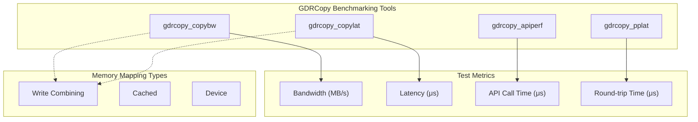
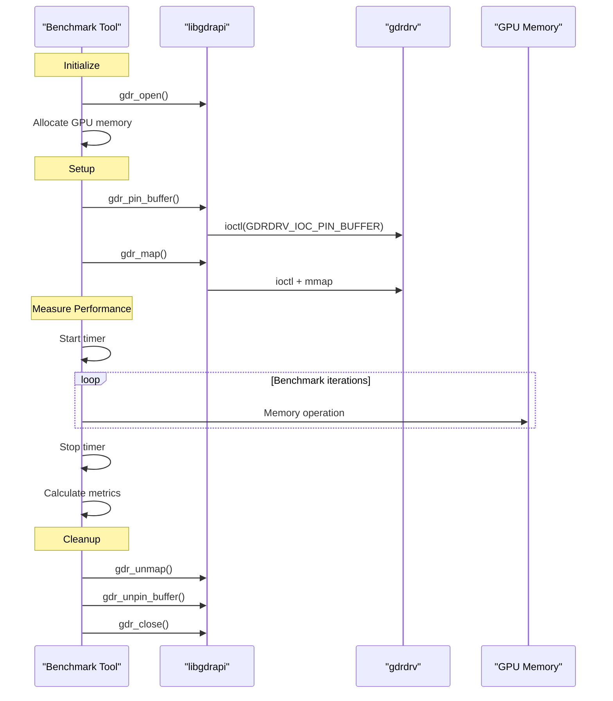
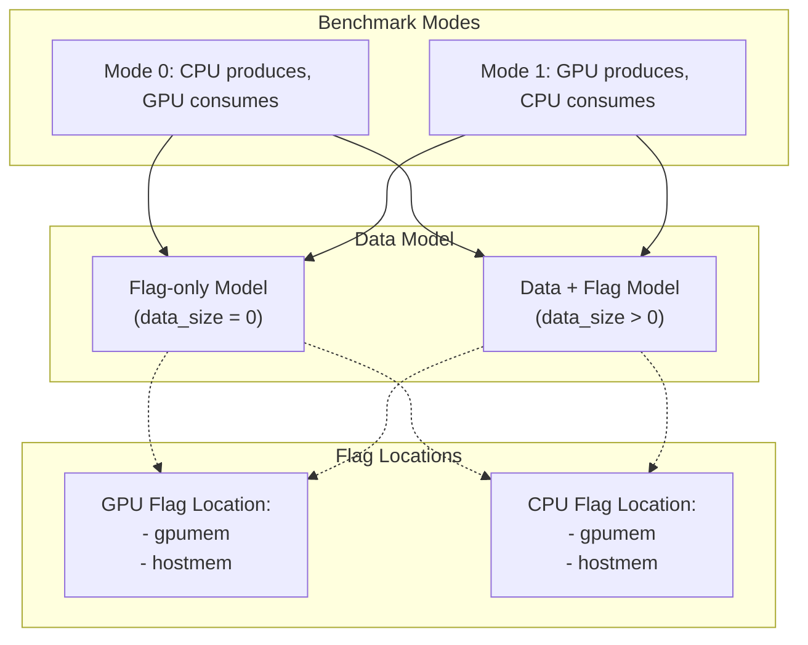
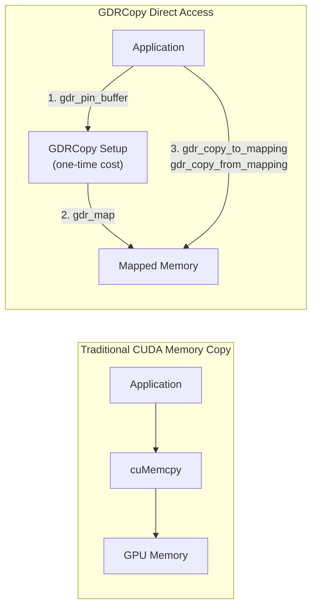

<!-- source: DeepWiki mcp.deepwiki.com · repo NVIDIA/gdrcopy · page 5.2 Performance Benchmarks · fetched 2026-10-26 -->

# Performance Benchmarks

<details>
<summary>Relevant source files</summary>

The following files were used as context for generating this wiki page:

- [scripts/get_cuda_gencode.sh](scripts/get_cuda_gencode.sh)
- [tests/Makefile](tests/Makefile)
- [tests/apiperf.cpp](tests/apiperf.cpp)
- [tests/common.cpp](tests/common.cpp)
- [tests/common.hpp](tests/common.hpp)
- [tests/copybw.cpp](tests/copybw.cpp)
- [tests/pplat.cu](tests/pplat.cu)

</details>


This document describes the performance benchmarking tools included with GDRCopy, their functionality, and how to interpret their results. These tools help evaluate the bandwidth and latency characteristics of GDRCopy operations compared to traditional CUDA memory transfers. For information about running the test suite, see [Running Tests](#5.3).

## Benchmark Tools Overview

GDRCopy provides four main benchmark utilities:

1. **gdrcopy_copybw**: Measures copy bandwidth between host and GPU memory
2. **gdrcopy_copylat**: Measures copy latency between host and GPU memory
3. **gdrcopy_apiperf**: Measures the performance of GDRCopy API functions
4. **gdrcopy_pplat**: Measures ping-pong latency between CPU and GPU



Sources: [tests/Makefile:22-25](), [tests/copybw.cpp:22-309](), [tests/apiperf.cpp:22-288](), [tests/pplat.cu:22-797]()

## Benchmark Methodology

Each benchmark tool measures different aspects of GDRCopy performance. All tools support multiple GPU memory allocation methods, configurable buffer sizes, and iteration counts for statistical validity.



Sources: [tests/common.hpp:35-191](), [tests/copybw.cpp:66-150](), [tests/apiperf.cpp:60-174]()

## Copy Bandwidth (gdrcopy_copybw)

The `gdrcopy_copybw` utility measures the bandwidth of memory copy operations between host and GPU memory using GDRCopy.

### Functionality

1. Allocates and pins GPU memory
2. Maps GPU memory to CPU address space
3. Performs repeated write (host to device) and read (device to host) operations
4. Calculates and reports bandwidth in MB/s

### Command Line Options

| Option | Description | Default |
|--------|-------------|---------|
| `-s <size>` | Buffer allocation size | 128 KB |
| `-c <size>` | Copy size | Same as buffer size |
| `-o <offset>` | Copy offset | 0 |
| `-l` | Run with copy sizes from 1B to specified size | Not set |
| `-d <gpu>` | GPU ID | 0 |
| `-w <iters>` | Number of write iterations | 10000 |
| `-r <iters>` | Number of read iterations | 100 |
| `-a <fn>` | GPU buffer allocation function | cuMemAlloc |

### Sample Output Interpretation

The tool reports:
- Write bandwidth (MB/s): How fast data can be copied from host to GPU
- Read bandwidth (MB/s): How fast data can be copied from GPU to host

Higher values indicate better performance.

Sources: [tests/copybw.cpp:49-64](), [tests/copybw.cpp:103-139]()

## API Performance (gdrcopy_apiperf)

The `gdrcopy_apiperf` utility measures the performance of individual GDRCopy API functions.

### Functionality

1. Measures execution time of key API functions:
   - `gdr_pin_buffer`
   - `gdr_map`
   - `gdr_get_info`
   - `gdr_unmap`
   - `gdr_unpin_buffer`
2. Tests with increasing buffer sizes
3. Generates histograms of latency distribution

### Command Line Options

| Option | Description | Default |
|--------|-------------|---------|
| `-s <max-size>` | Max buffer size to benchmark | 16 MB |
| `-d <gpu>` | GPU ID | 0 |
| `-n <iters>` | Number of benchmark iterations | 100 |
| `-w <iters>` | Number of warmup iterations | 10 |
| `-a <fn>` | GPU buffer allocation function | cuMemAlloc |

### Sample Output Interpretation

The tool reports the average execution time (in microseconds) for each API function at different buffer sizes. The histogram shows the distribution of `gdr_pin_buffer` latency, which is typically the most variable and impactful operation.

Sources: [tests/apiperf.cpp:46-58](), [tests/apiperf.cpp:78-165]()

## Ping-Pong Latency (gdrcopy_pplat)

The `gdrcopy_pplat` utility measures round-trip latency between CPU and GPU using different communication patterns.

### Functionality



### Command Line Options

| Option | Description | Default |
|--------|-------------|---------|
| `-d <gpu>` | GPU ID | 0 |
| `-t <iters>` | Number of iterations | 1000 |
| `-u <timeout>` | Timeout in seconds (0 to disable) | 10 |
| `-a <fn>` | GPU buffer allocation function | cuMemAlloc |
| `-s <size>` | Data size | 0 |
| `-m <mode>` | Benchmark mode (0: CPU→GPU→CPU, 1: GPU→CPU→GPU) | 0 |
| `-G <loc>` | GPU flag location (gpumem, hostmem) | gpumem |
| `-C <loc>` | CPU flag location (gpumem, hostmem) | hostmem |
| `-D <loc>` | Data buffer location (gpumem, hostmem) | gpumem |

### Sample Output Interpretation

The tool reports the round-trip latency per iteration in microseconds. Lower values indicate better performance. The tool supports two main modes:

1. **Flag-only mode** (when data_size = 0):
   - Measures visibility latency of flag values between CPU and GPU
   
2. **Data + Flag mode** (when data_size > 0):
   - Measures round-trip latency when transferring both data and flags

Sources: [tests/pplat.cu:190-198](), [tests/pplat.cu:324-349](), [tests/pplat.cu:605-633]()

## Copy Latency (gdrcopy_copylat)

The `gdrcopy_copylat` utility measures the latency of individual copy operations between host and GPU memory.

### Functionality

1. Allocates and pins GPU memory
2. Maps GPU memory to CPU address space
3. Performs timed copy operations of various sizes
4. Calculates and reports latency statistics

This tool is particularly useful for understanding the performance characteristics of small transfers, which are often latency-bound rather than bandwidth-bound.

## Performance Comparison With Traditional CUDA



### Key Performance Characteristics

| Metric | GDRCopy | Traditional CUDA | Notes |
|--------|---------|-----------------|-------|
| Setup Time | ~100-1000 μs | None | One-time cost for pin/map |
| Small Transfer Latency | ~0.5-2 μs | ~5-7 μs | GDRCopy has significant advantage |
| Large Transfer Bandwidth | ~6-8 GB/s | ~10-12 GB/s | CUDA may be faster for large transfers |
| CPU Overhead | Low | High | GDRCopy reduces CPU usage |
| Direction Asymmetry | Yes | Less | Write combining mapping favors H→D |

Sources: [tests/copybw.cpp:103-139](), [tests/pplat.cu:605-633]()

## Factors Affecting Performance

Several factors can affect the performance of GDRCopy operations:

1. **Mapping Type**: Write combining (WC) vs. cached vs. device mapping
2. **Transfer Size**: Small transfers benefit more from reduced latency
3. **Transfer Direction**: Host→Device vs. Device→Host
4. **Memory Location**: Where flags and data are stored
5. **GPU Architecture**: Newer GPUs may have better performance
6. **System Configuration**: PCIe generation, CPU architecture, etc.

## Running the Benchmarks

To build and run the benchmarks:

```bash
# Build the benchmarks
cd tests
make

# Run bandwidth benchmark
./gdrcopy_copybw -s 1048576 -w 1000 -r 100

# Run API performance benchmark
./gdrcopy_apiperf -s 16777216 -n 100

# Run ping-pong latency benchmark
./gdrcopy_pplat -t 1000 -s 4096 -m 0

# Run copy latency benchmark
./gdrcopy_copylat -s 4096 -n 10000
```

For more detailed usage information, run each benchmark with the `-h` option.

Sources: [tests/Makefile:25-71]()

---

