# Page: Overview

# Overview

<details>
<summary>Relevant source files</summary>

The following files were used as context for generating this wiki page:

- [CHANGELOG.md](CHANGELOG.md)
- [README.md](README.md)
- [packages/rhel/gdrcopy.service](packages/rhel/gdrcopy.service)
- [tests/copylat.cpp](tests/copylat.cpp)

</details>


GDRCopy is a low-latency GPU memory copy library built on NVIDIA's GPUDirect RDMA technology. It enables direct access to GPU memory from the CPU, providing significantly lower latency for data transfers compared to traditional CUDA memory operations. This document provides a high-level overview of GDRCopy's architecture, components, and functionality.

For detailed information about the kernel driver implementation, see [Kernel Driver (gdrdrv)](#2). For in-depth coverage of the user-space library API, refer to [User-Space Library (libgdrapi)](#3).

## Purpose and Benefits

GDRCopy leverages GPUDirect RDMA technology to create user-space mappings of GPU memory, which can then be manipulated as if it were regular host memory. This approach offers several advantages:

- **Very low overhead**: GDRCopy operations are CPU-driven, with typical operations having an overhead of just 0.1-0.2μs compared to 6-7μs for a traditional `cudaMemcpy`.
- **High bandwidth**: Write operations (host-to-device) can achieve 6-8 GB/s on supported platforms.
- **Direct memory access**: Applications can directly read from and write to GPU memory without intermediate copies.

These characteristics make GDRCopy particularly well-suited for applications where low latency is critical, such as high-performance computing, real-time data processing, and communication middleware.

Sources: [README.md:1-15](), [README.md:18-36]()

## System Components

GDRCopy consists of three main components:

1. **Kernel Driver (gdrdrv)**: A Linux kernel module that facilitates direct memory access between GPUs and the CPU.
2. **User-Space Library (libgdrapi)**: A C library that provides the API for applications to interact with the kernel driver.
3. **Test and Benchmark Utilities**: Tools for verifying functionality and measuring performance, including sanity tests and bandwidth/latency benchmarks.

The following diagram illustrates the system architecture:

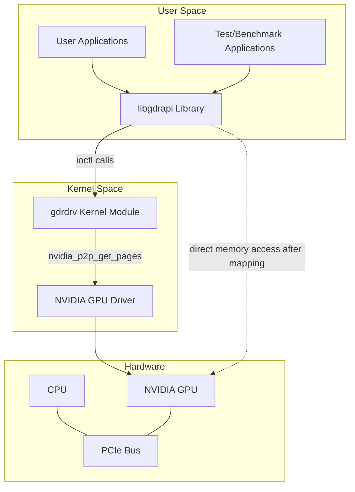

Sources: [README.md:18-36](), [README.md:44-53]()

## Core Workflow

The typical workflow when using GDRCopy involves:

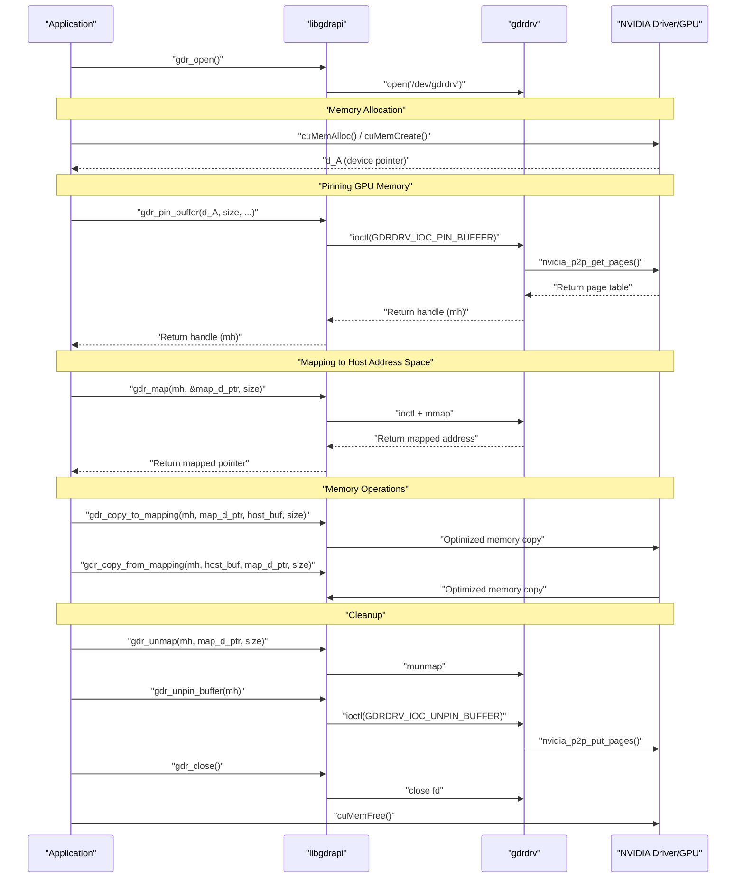

1. **Initialization**: Open a connection to the GDRCopy driver using `gdr_open()`
2. **Memory Allocation**: Allocate GPU memory using CUDA functions like `cuMemAlloc()`
3. **Pinning**: Make GPU memory resident and prevent swapping with `gdr_pin_buffer()`
4. **Mapping**: Create a CPU-accessible mapping of the GPU memory with `gdr_map()`
5. **Memory Operations**: Copy data to/from the mapped memory using `gdr_copy_to_mapping()` and `gdr_copy_from_mapping()`
6. **Cleanup**: Unmap, unpin, and release resources with `gdr_unmap()`, `gdr_unpin_buffer()`, `gdr_close()`, and `cuMemFree()`

Sources: [README.md:18-36](), [tests/copylat.cpp:221-374]()

## Performance Comparison

GDRCopy provides significant performance advantages over traditional CUDA memory copies, particularly for small transfers and latency-sensitive applications:

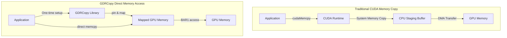

The key differences are:

| Characteristic | Traditional CUDA Memory Copy | GDRCopy Direct Memory Access |
|----------------|------------------------------|------------------------------|
| Setup Cost | Low (simple API call) | High (pinning and mapping, 10μs-1ms) |
| Transfer Overhead | High (6-7μs per transfer) | Low (~0.1μs per transfer) |
| Small Transfer Efficiency | Poor (overhead dominates) | Excellent (minimal overhead) |
| Host-to-Device Bandwidth | Medium | High (6-8 GB/s on supported hardware) |
| Device-to-Host Bandwidth | Medium | Low (limited by PCIe read characteristics) |
| Use Case | Large, infrequent transfers | Small, frequent transfers; latency-sensitive applications |

As shown in the benchmark results from `gdrcopy_copylat`, GDRCopy operations maintain very low latencies for small data sizes, while traditional CUDA operations have a higher fixed overhead regardless of the transfer size.

Sources: [README.md:23-35](), [tests/copylat.cpp:249-302]()

## Memory Mapping Types

GDRCopy provides multiple memory mapping types to optimize for different access patterns:

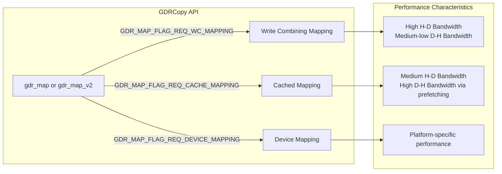

1. **Write Combining (WC) Mapping**:
   - Default mapping type
   - Optimized for host-to-device (H-D) transfers
   - Uses write-combining to batch writes for better performance
   - Achieves 6-8 GB/s for H-D transfers
   - Slower for device-to-host (D-H) transfers due to lack of prefetching

2. **Cached Mapping**:
   - CPU caches the contents of GPU memory
   - Better for frequent reads from GPU memory
   - Provides more balanced performance between H-D and D-H transfers
   - Available on specific platforms like POWER9 with NVLink

3. **Device Mapping**:
   - Direct device memory mapping
   - Performance characteristics vary by platform
   - Used in specific hardware configurations

The mapping type is specified when calling `gdr_map()` or `gdr_map_v2()` and can be verified through `gdr_get_info()` or `gdr_get_info_v2()`.

Sources: [README.md:30-35](), [CHANGELOG.md:10-14]()

## Requirements and Compatibility

GDRCopy requires:

- NVIDIA Data Center GPU or NVIDIA RTX GPU based on Kepler or newer generations
- GPU display driver ≥ 418.40 on ppc64le and ≥ 331.14 on other platforms
- CUDA ≥ 6.0
- DKMS for installing the kernel module package (optional on RHEL/SLE where kmod can be used instead)

Supported architectures:
- Linux x86_64
- ppc64le
- arm64

Supported platforms:
- RHEL8, RHEL9
- Ubuntu 20.04, Ubuntu 22.04
- SLE-15 (any SP) and Leap 15.x

Root privileges are necessary to load/install the kernel-mode device driver.

Sources: [README.md:44-86](), [CHANGELOG.md:77-81]()

## Restrictions and Known Issues

- GDRCopy works with regular CUDA device memory only (as returned by `cudaMalloc`), not with CUDA managed memory.
- `gdr_map()` requires that the pinned address is aligned to the GPU page size.
- CUDA memory allocation functions don't guarantee aligned addresses; users must ensure proper alignment.
- Multiple pinning of the same GPU address may consume additional BAR1 space in some GPU driver versions.
- On POWER9 with NVLink, CUDA 9.2 and GPU Driver v396.37 are minimum requirements for full performance.
- There are compatibility issues with Linux confidential computing (CC) configurations on Intel CPUs when gdrdrv is compiled with the proprietary NVIDIA driver.

Sources: [README.md:438-472]()

## Service Management

GDRCopy can be installed as a system service that loads the kernel driver at boot time. On systems using systemd (such as RHEL9), this is handled through a service unit file.

The service:
- Starts the GDRCopy driver after the multi-user target is reached
- Remains active after initialization (RemainAfterExit=yes)
- Can be controlled through standard systemd commands like `systemctl start/stop/restart gdrcopy`

Sources: [packages/rhel/gdrcopy.service:1-14]()

---

# Page: Architecture

# Architecture

<details>
<summary>Relevant source files</summary>

The following files were used as context for generating this wiki page:

- [README.md](README.md)
- [packages/rhel/gdrcopy.service](packages/rhel/gdrcopy.service)
- [scripts/test_gdrdrv_HAVE_PROC_OPS.sh](scripts/test_gdrdrv_HAVE_PROC_OPS.sh)
- [src/gdrapi.c](src/gdrapi.c)
- [src/gdrdrv/gdrdrv.c](src/gdrdrv/gdrdrv.c)
- [tests/copylat.cpp](tests/copylat.cpp)

</details>


This document provides a comprehensive overview of the GDRCopy system architecture, explaining how different components interact to enable low-latency memory copies between CPUs and GPUs. For details about specific APIs, see [API Reference](#3.1), and for information about building the kernel driver, see [Building the Driver](#2.3).

## System Overview

GDRCopy enables direct access to GPU memory from the CPU by leveraging NVIDIA's GPUDirect RDMA technology. While GPUDirect RDMA was primarily designed for direct access from third-party devices, GDRCopy uses these APIs to create valid CPU mappings of GPU memory, significantly reducing the overhead compared to traditional CUDA memory transfers.

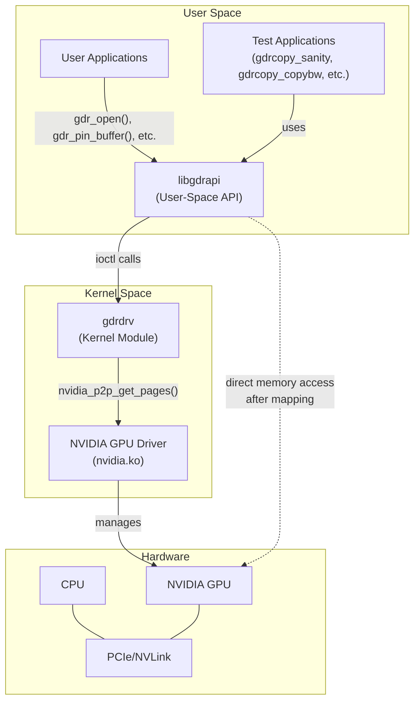

Sources: [src/gdrdrv/gdrdrv.c:380-402](], [src/gdrapi.c:124-200](), [README.md:1-36]()

## Key Components

### User Space Components

1. **libgdrapi Library**: The primary interface for applications using GDRCopy
   - Provides the API for pinning, mapping, and accessing GPU memory
   - Implements optimized memory copy routines
   - Manages communication with the kernel driver via ioctl calls

2. **Test and Benchmark Applications**:
   - `gdrcopy_sanity`: Unit tests for the library and driver
   - `gdrcopy_copybw`: Measures read/write bandwidth
   - `gdrcopy_copylat`: Measures latency for various buffer sizes
   - `gdrcopy_apiperf`: Benchmarks API call latency
   - `gdrcopy_pplat`: Measures round-trip ping-pong latency

Sources: [README.md:37-43](), [src/gdrapi.c:123-167]()

### Kernel Space Components

1. **gdrdrv Kernel Module**:
   - Enables direct CPU access to GPU memory
   - Interfaces with NVIDIA's driver via P2P APIs
   - Creates memory mappings for userspace applications
   - Handles buffer pinning to ensure memory remains resident

2. **NVIDIA GPU Driver**:
   - Provides access to GPU resources
   - Manages physical memory on the GPU
   - Offers P2P APIs used by gdrdrv (`nvidia_p2p_get_pages`, etc.)

Sources: [src/gdrdrv/gdrdrv.c:92-107](), [src/gdrdrv/gdrdrv.c:285-316]()

## Memory Mapping Process

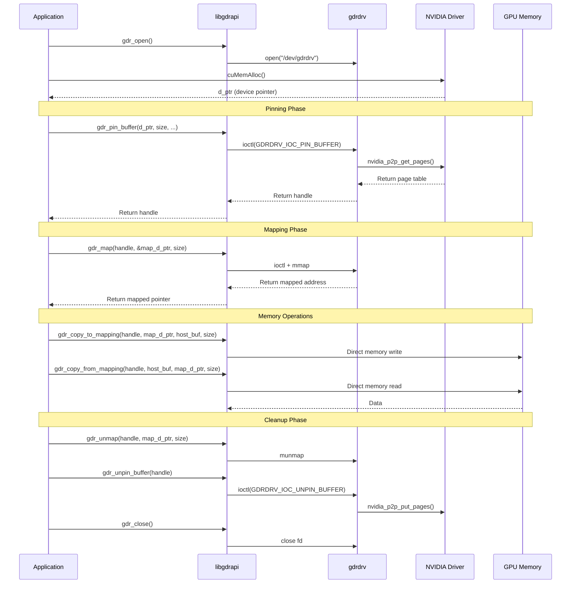

Sources: [src/gdrapi.c:124-200](), [src/gdrapi.c:231-356](), [src/gdrapi.c:410-513](), [src/gdrdrv/gdrdrv.c:760-935]()

## Buffer Pinning and Mapping

### Buffer Pinning

The pinning process makes GPU memory resident and accessible to the CPU:

1. Application calls `gdr_pin_buffer()` with a GPU memory pointer obtained from CUDA
2. libgdrapi makes an ioctl call to the kernel driver
3. The driver calls `nvidia_p2p_get_pages()` to get physical pages from NVIDIA driver
4. A handle is returned to the application for subsequent operations

Key data structures involved:
- `gdr_mr_t`: Memory region structure in kernel driver
- `GDRDRV_IOC_PIN_BUFFER_PARAMS`: ioctl parameters for pinning

Sources: [src/gdrdrv/gdrdrv.c:352-373](), [src/gdrdrv/gdrdrv.c:760-935](), [src/gdrapi.c:231-265]()

### Buffer Mapping

After pinning, the GPU memory must be mapped to the userspace address space:

1. Application calls `gdr_map()` with the handle from pinning
2. libgdrapi requests a specific mapping type (WC, cached, or device)
3. The driver establishes the appropriate mapping via `mmap`
4. A mapped pointer is returned, which the application can use for direct access

Key aspects:
- Mappings must be aligned to GPU page boundaries (64KB)
- Various mapping types provide different performance characteristics
- The mapped region can be used with standard memcpy or specialized GDRCopy functions

Sources: [src/gdrapi.c:410-513](), [src/gdrdrv/gdrdrv.c:375-402]()

## Memory Transfer Pathways

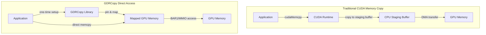

GDRCopy provides two key advantages over traditional CUDA memory transfers:

1. **Reduced Latency**: By eliminating intermediate buffers and complex runtime logic, GDRCopy achieves much lower latency (0.1-1μs vs. 6-7μs for small transfers).

2. **Direct Memory Access**: After the initial setup, applications can directly access GPU memory as if it were regular system memory, using either standard memory operations or optimized GDRCopy functions.

| Transfer Method | Initialization Overhead | Transfer Latency | Best Use Case |
|-----------------|-------------------------|------------------|---------------|
| CUDA Memory Copy | Low (1-2μs) | Medium (6-7μs) | Large transfers, simplicity |
| GDRCopy | High (10μs-1ms) | Very Low (0.1-1μs) | Small transfers, latency-sensitive applications |

Sources: [README.md:23-36](), [tests/copylat.cpp:260-364]()

## Memory Mapping Types

GDRCopy supports three different memory mapping types, each with different performance characteristics:

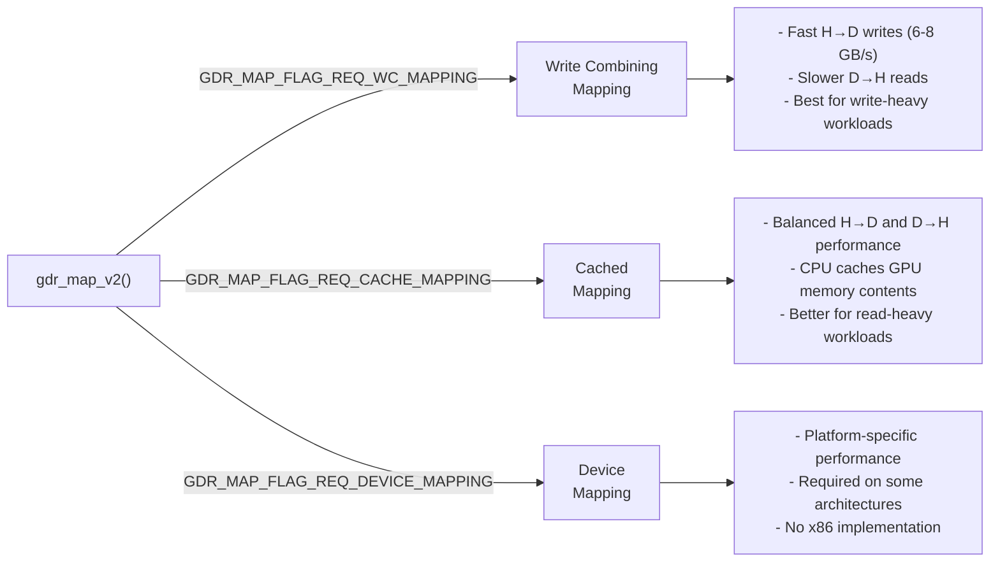

### Write Combining (WC) Mapping

The default mapping type on most platforms:
- Stores are combined (batched) before being sent to the device
- Provides excellent performance for host-to-device transfers
- Device-to-host transfers are slower due to lack of prefetching
- Implemented differently on x86, POWER, and ARM64 platforms

### Cached Mapping

Used on platforms with coherent CPU-GPU memory access:
- CPU can cache the contents of GPU memory
- More balanced performance between reads and writes
- Particularly useful on systems like NVIDIA Grace-Hopper

### Device Mapping

Specialized mapping for certain platforms:
- Used on ARM64 platforms
- Not implemented on x86 systems
- Performance characteristics vary by platform

Sources: [src/gdrapi.c:410-449](), [src/gdrdrv/gdrdrv.c:165-237](), [tests/copylat.cpp:253-257]()

## Platform-Specific Considerations

GDRCopy includes various optimizations for different CPU architectures:

### x86_64
- Uses AVX/SSE extensions for optimized memory copies when available
- Implements specialized write-combining operations
- Fence operations use x86-specific instructions (`_mm_sfence()`, `_mm_mfence()`)

### POWER
- Uses POWER-specific sync operations
- Optimized for different memory access patterns
- Requires specific NVIDIA driver versions for optimal performance

### ARM64
- Support for device mappings specific to ARM platforms
- Platform-specific fence operations
- Different memory ordering semantics

NUMA effects can significantly impact performance. For optimal results, applications should ensure that the CPU accessing GPU memory is the one physically connected to the GPU.

Sources: [src/gdrapi.c:548-631](), [README.md:360-434]()

## Integration with NVIDIA Stack

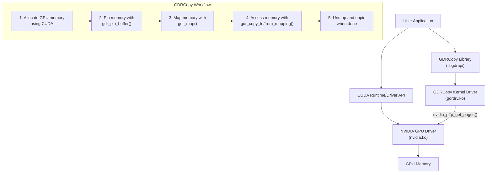

GDRCopy integrates with NVIDIA's software stack at multiple levels:

1. **Application Level**: 
   - Applications use both CUDA for GPU memory allocation and GDRCopy for low-latency access

2. **Driver Level**:
   - The gdrdrv kernel module interacts with the NVIDIA kernel driver through P2P APIs
   - Uses NVIDIA's `nvidia_p2p_get_pages()` to get physical pages for mapping
   - Supports both persistent and non-persistent mapping approaches

3. **Version Compatibility**:
   - Requires specific minimum versions of NVIDIA drivers (≥ 418.40 on ppc64le, ≥ 331.14 on other platforms)
   - Support for persistent mapping depends on driver version
   - Some features are only available with newer NVIDIA driver releases

Sources: [src/gdrdrv/gdrdrv.c:241-276](), [src/gdrdrv/gdrdrv.c:445-459](), [README.md:44-53]()

## Key Implementation Details

### Memory Protection and Fencing

GDRCopy implements various mechanisms to ensure correct memory access:

1. **Callback Mechanism**:
   - NVIDIA driver can reclaim GPU memory at any time
   - GDRCopy registers a callback (`gdrdrv_get_pages_free_callback`) to handle this
   - When triggered, all mappings are destroyed and resources freed

2. **Memory Fencing**:
   - Write combining requires explicit fences to ensure memory operations complete
   - Different fencing operations based on architecture and mapping type
   - Stronger fences when multiple mapping types are used concurrently

3. **Process Isolation**:
   - GPU driver does not support sharing allocations between processes
   - GDRCopy tracks the process that opened the driver and prevents others from using it

Sources: [src/gdrdrv/gdrdrv.c:693-716](), [src/gdrapi.c:856-868](), [src/gdrdrv/gdrdrv.c:430-441]()

### Optimized Memory Copy Implementations

GDRCopy includes specialized memory copy routines optimized for different scenarios:

1. **Architecture-specific optimizations**:
   - AVX/SSE implementations for x86_64
   - Optimized routines for POWER and ARM64

2. **Transfer-specific optimizations**:
   - Different implementations for host-to-device vs device-to-host
   - Specific handling for various data sizes and alignment requirements

3. **Mapping-specific optimizations**:
   - Special handling for device mappings requiring aligned access
   - Different strategies for write-combining vs cached mappings

The library automatically selects the most appropriate implementation based on the platform capabilities and the mapping type in use.

Sources: [src/gdrapi.c:635-707](), [src/gdrapi.c:800-869](), [src/gdrapi.c:759-798]()

## Summary

GDRCopy's architecture enables low-latency, direct access to GPU memory from the CPU by leveraging NVIDIA's GPUDirect RDMA technology. The system consists of a kernel driver that interacts with the NVIDIA GPU driver and a user-space library that provides a simple API for applications. Different mapping types and platform-specific optimizations allow GDRCopy to achieve excellent performance across various hardware configurations and use cases.

The main trade-off is between the higher initial setup cost (pinning and mapping) versus the significantly lower per-transfer latency compared to traditional CUDA memory copies. This makes GDRCopy particularly valuable for applications requiring frequent small transfers between CPU and GPU.

---

# Page: Kernel Driver (gdrdrv)

# Kernel Driver (gdrdrv)

<details>
<summary>Relevant source files</summary>

The following files were used as context for generating this wiki page:

- [scripts/test_gdrdrv_HAVE_PROC_OPS.sh](scripts/test_gdrdrv_HAVE_PROC_OPS.sh)
- [src/gdrdrv/gdrdrv.c](src/gdrdrv/gdrdrv.c)
- [src/gdrdrv/gdrdrv.h](src/gdrdrv/gdrdrv.h)

</details>


The gdrdrv kernel module is a critical component of the GDRCopy system, serving as the bridge between user-space applications and NVIDIA GPU memory. It provides the infrastructure necessary to establish direct memory access between the CPU and GPU memory by interfacing with the NVIDIA GPU driver. This page details the architecture, interfaces, and functionality of the gdrdrv kernel driver.

## Purpose and Overview

The gdrdrv driver enables low-latency memory copies between the CPU and GPU by:

1. Creating memory mappings that allow user-space applications to directly access GPU memory
2. Managing GPU memory resources through pinning/unpinning
3. Providing different memory mapping types optimized for various access patterns
4. Interfacing with the NVIDIA driver to handle GPU page tables

Sources: [src/gdrdrv/gdrdrv.c:1-21](), [src/gdrdrv/gdrdrv.h:1-21]()

## Driver Architecture

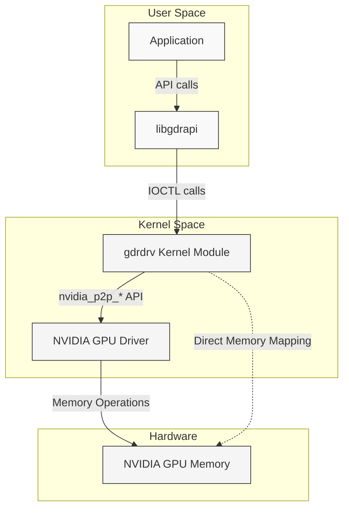

The gdrdrv kernel driver is integrated into the system through standard Linux kernel mechanisms and communicates with the NVIDIA driver through the NVIDIA P2P (peer-to-peer) API. It exposes its functionality to user-space applications through a character device interface with IOCTL commands.

Sources: [src/gdrdrv/gdrdrv.c:1841-1914](), [src/gdrdrv/gdrdrv.c:1322-1388]()

## Data Structures

### Core Structures

The driver maintains several key data structures:

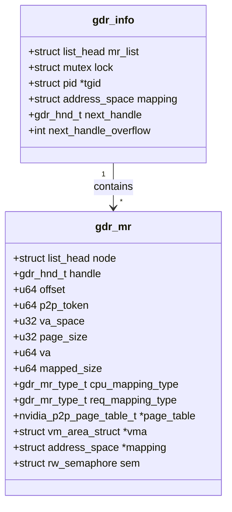

1. **gdr_info**: Represents an opened file descriptor to the driver
2. **gdr_mr**: Represents a memory region that has been pinned for GPU direct access

Sources: [src/gdrdrv/gdrdrv.c:352-372](), [src/gdrdrv/gdrdrv.c:406-425]()

## Memory Registration Process

The driver implements a memory registration process that enables direct access to GPU memory:

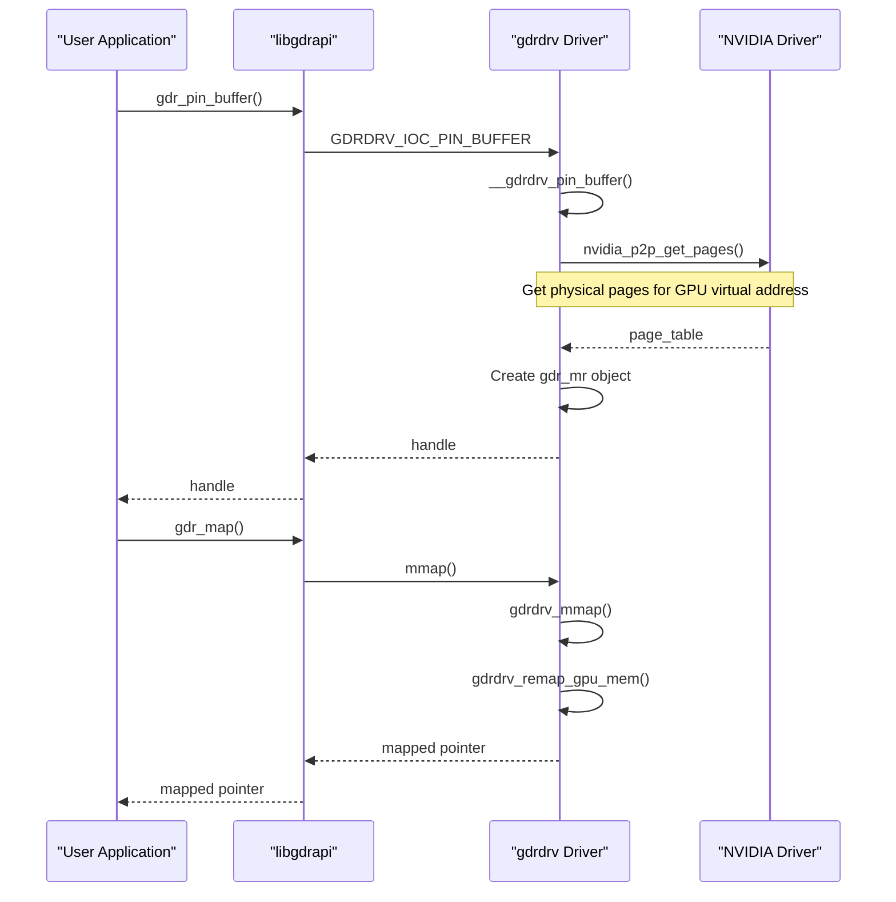

Sources: [src/gdrdrv/gdrdrv.c:760-935](), [src/gdrdrv/gdrdrv.c:1549-1717]()

## IOCTL Interface

The driver exposes its functionality through a set of IOCTL commands that allow user-space applications to:

| IOCTL Command | Description | Structure |
|---------------|-------------|-----------|
| `GDRDRV_IOC_PIN_BUFFER` | Pin GPU memory for access | `GDRDRV_IOC_PIN_BUFFER_PARAMS` |
| `GDRDRV_IOC_PIN_BUFFER_V2` | Enhanced version with additional flags | `GDRDRV_IOC_PIN_BUFFER_V2_PARAMS` |
| `GDRDRV_IOC_UNPIN_BUFFER` | Unpin GPU memory | `GDRDRV_IOC_UNPIN_BUFFER_PARAMS` |
| `GDRDRV_IOC_GET_CB_FLAG` | Check if callback was triggered | `GDRDRV_IOC_GET_CB_FLAG_PARAMS` |
| `GDRDRV_IOC_GET_INFO` | Get memory region info | `GDRDRV_IOC_GET_INFO_PARAMS` |
| `GDRDRV_IOC_GET_INFO_V2` | Enhanced version with more details | `GDRDRV_IOC_GET_INFO_V2_PARAMS` |
| `GDRDRV_IOC_GET_ATTR` | Get driver attributes | `GDRDRV_IOC_GET_ATTR_PARAMS` |
| `GDRDRV_IOC_REQ_MAPPING_TYPE` | Request specific mapping type | `GDRDRV_IOC_REQ_MAPPING_TYPE_PARAMS` |
| `GDRDRV_IOC_GET_VERSION` | Get driver version | `GDRDRV_IOC_GET_VERSION_PARAMS` |

The driver validates these calls and ensures that the caller process is the same as the one that opened the file descriptor.

Sources: [src/gdrdrv/gdrdrv.h:63-184](), [src/gdrdrv/gdrdrv.c:1322-1388]()

## Memory Mapping Types

The driver supports different memory mapping types to optimize for various access patterns:

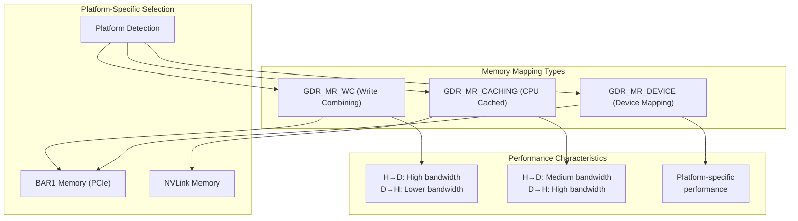

1. **Write Combining (WC)**: Optimized for host-to-device transfers by batching writes
2. **CPU Cached**: Allows CPU to cache GPU memory contents for faster read operations
3. **Device Mapping**: Platform-specific mapping used on certain ARM64 platforms

The appropriate mapping type is selected based on hardware capabilities and specific requirements.

Sources: [src/gdrdrv/gdrdrv.c:164-233](), [src/gdrdrv/gdrdrv.h:47-52](), [src/gdrdrv/gdrdrv.c:1499-1544]()

## Pinning and Mapping Process

The driver implements a two-step process to access GPU memory:

1. **Pinning**: Makes GPU memory resident and obtains its physical address mapping
   - Calls `nvidia_p2p_get_pages()` or `nvidia_p2p_get_pages_persistent()`
   - Creates a mapping handle for future reference
   
2. **Mapping**: Maps the pinned memory into user-space virtual address space
   - Uses `gdrdrv_mmap()` to establish the memory mapping
   - Applies the appropriate memory attributes (WC, cached, device)

This separation allows applications to pin memory once and map/unmap it multiple times as needed.

Sources: [src/gdrdrv/gdrdrv.c:760-935](), [src/gdrdrv/gdrdrv.c:1549-1717]()

## Interaction with NVIDIA Driver

The driver interacts with the NVIDIA driver through the P2P API:

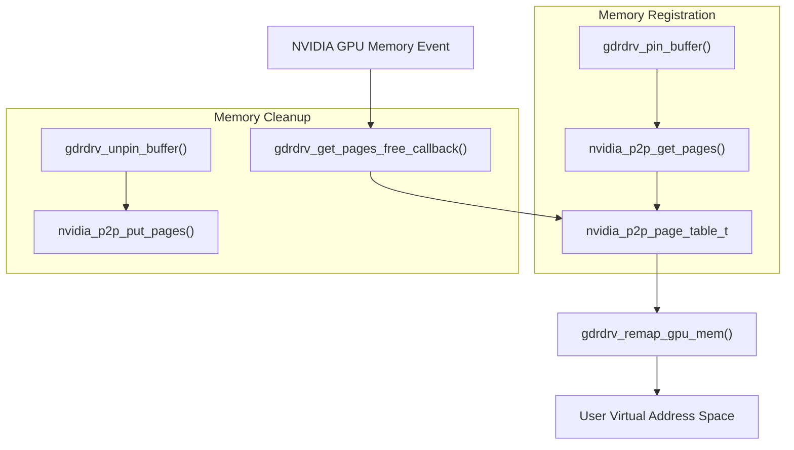

The driver uses:
1. `nvidia_p2p_get_pages()` to obtain mappings of GPU virtual addresses to physical addresses
2. `nvidia_p2p_put_pages()` to release these mappings
3. A callback mechanism (`gdrdrv_get_pages_free_callback()`) to handle GPU memory invalidation events

The driver supports both traditional and persistent mapping modes, with the latter being more efficient for long-term mappings.

Sources: [src/gdrdrv/gdrdrv.c:694-716](), [src/gdrdrv/gdrdrv.c:445-459]()

## Platform Compatibility

The driver includes special handling for different platforms:

| Platform | Features |
|----------|----------|
| x86_64 | Write Combining (WC) mappings |
| PPC64 (POWER9) | Can use CPU cached mappings for NVLink-connected GPUs |
| ARM64 | Supports both WC and Device mappings |

The driver detects platform capabilities at initialization and adapts its behavior accordingly.

Sources: [src/gdrdrv/gdrdrv.c:164-233](), [src/gdrdrv/gdrdrv.c:1872-1908]()

## Error Handling and Safety

The driver implements several safety mechanisms:

1. **Process Isolation**: Only the process that opened the driver can use its file descriptor
2. **Reference Counting**: Tracks outstanding NVIDIA P2P mappings to prevent leaks
3. **Callback Mechanism**: Handles GPU memory invalidation events properly
4. **Resource Cleanup**: Automatically frees resources when applications terminate

Sources: [src/gdrdrv/gdrdrv.c:430-441](), [src/gdrdrv/gdrdrv.c:584-623]()

## Lifecycle Management

The driver carefully manages the lifecycle of memory regions:

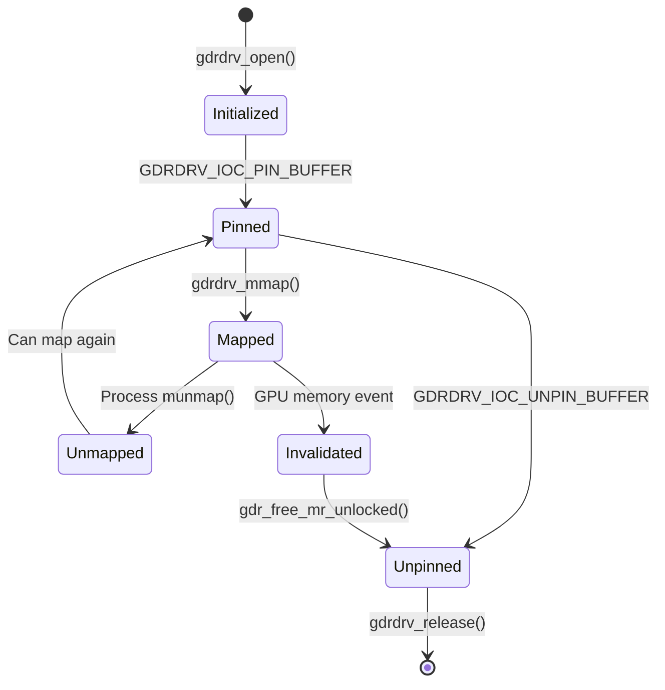

Each state transition is protected by appropriate locking mechanisms to ensure consistency.

Sources: [src/gdrdrv/gdrdrv.c:527-579](), [src/gdrdrv/gdrdrv.c:1401-1424]()

## Driver Configuration

The driver can be configured through module parameters:

| Parameter | Description |
|-----------|-------------|
| `dbg_enabled` | Enable debug output |
| `info_enabled` | Enable informational output |
| `use_persistent_mapping` | Use persistent mapping mode |

These settings can be viewed and monitored through the `/proc` filesystem interface.

Sources: [src/gdrdrv/gdrdrv.c:317-322](), [src/gdrdrv/gdrdrv.c:1789-1830]()

## Version Compatibility

The driver implements version checking to ensure compatibility between the user-space library and kernel driver. It also adapts to different Linux kernel versions through preprocessor conditionals.

Sources: [src/gdrdrv/gdrdrv.h:29-43](), [src/gdrdrv/gdrdrv.c:1305-1319]()

---

# Page: Driver Internals

# Driver Internals

<details>
<summary>Relevant source files</summary>

The following files were used as context for generating this wiki page:

- [scripts/test_gdrdrv_HAVE_PROC_OPS.sh](scripts/test_gdrdrv_HAVE_PROC_OPS.sh)
- [src/gdrdrv/gdrdrv.c](src/gdrdrv/gdrdrv.c)

</details>


This document provides a detailed explanation of the GDRCopy kernel driver's internal architecture, memory management mechanisms, and its interaction with NVIDIA GPUs. For information about the driver's interface and API, see [Driver Interface](#2.2), and for build instructions, see [Building the Driver](#2.3).

## 1. Driver Architecture Overview

The `gdrdrv` kernel module serves as the bridge between the user-space GDRCopy library and NVIDIA's GPU driver. It enables direct memory operations between CPU and GPU memory by leveraging NVIDIA's GPUDirect RDMA technology.

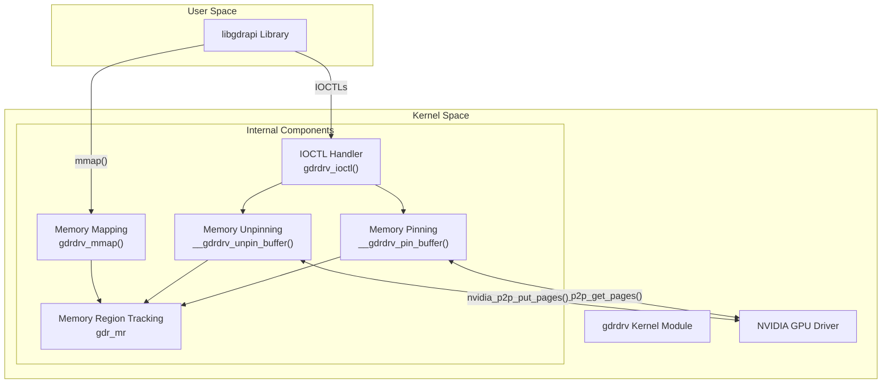

Sources: [src/gdrdrv/gdrdrv.c:1323-1388](), [src/gdrdrv/gdrdrv.c:760-935](), [src/gdrdrv/gdrdrv.c:939-972](), [src/gdrdrv/gdrdrv.c:1499-1717]()

## 2. Core Data Structures

### 2.1 Memory Region (gdr_mr)

The `gdr_mr` structure represents a pinned GPU memory region and tracks all associated information:

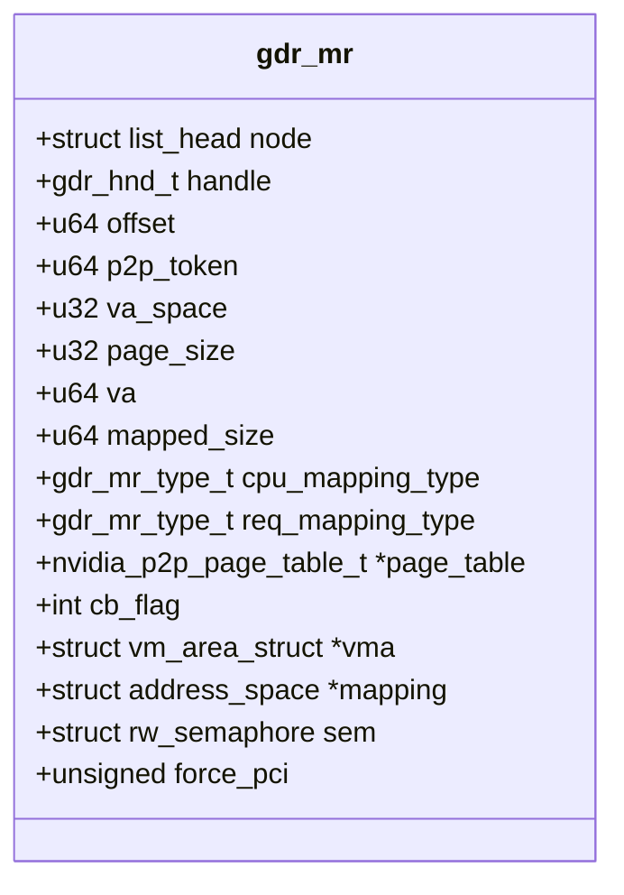

Key fields:
- `handle`: Unique identifier for the memory region
- `va`: GPU virtual address
- `mapped_size`: Size of the mapped region
- `page_table`: Reference to NVIDIA's page table
- `cpu_mapping_type`: Current mapping type (None, WC, Cached, Device)
- `sem`: Semaphore for thread synchronization

Sources: [src/gdrdrv/gdrdrv.c:352-372]()

### 2.2 Driver Information (gdr_info)

The `gdr_info` structure manages driver context for each file descriptor:

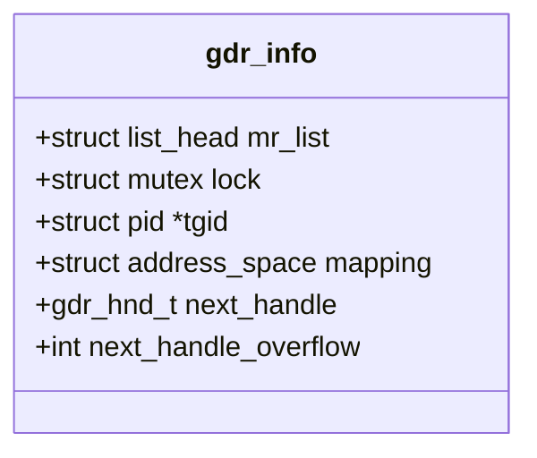

Key fields:
- `mr_list`: List of memory regions
- `tgid`: Task group ID to ensure same-process access
- `mapping`: Address space for memory mappings
- `next_handle`: Handle counter for memory regions

Sources: [src/gdrdrv/gdrdrv.c:406-426]()

## 3. Memory Management Workflow

### 3.1 Memory Region Lifecycle

The following diagram illustrates the lifecycle of a GPU memory region in GDRCopy:

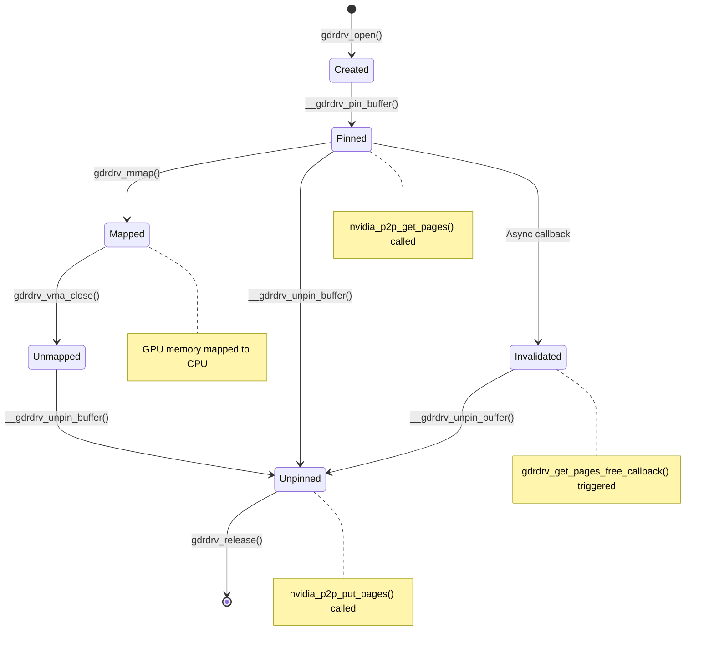

Sources: [src/gdrdrv/gdrdrv.c:474-623](), [src/gdrdrv/gdrdrv.c:760-935](), [src/gdrdrv/gdrdrv.c:939-972](), [src/gdrdrv/gdrdrv.c:1499-1717](), [src/gdrdrv/gdrdrv.c:695-716]()

### 3.2 Memory Pinning Process

Memory pinning is a critical operation that makes GPU memory accessible to the CPU:

1. Align address and size to GPU page boundaries (64KB by default)
2. Initialize a new memory region (`gdr_mr`) 
3. Call NVIDIA's `nvidia_p2p_get_pages` API to pin GPU memory
4. Validate page table returned by NVIDIA
5. Generate and assign a handle for the memory region
6. Add memory region to the tracked list

Sources: [src/gdrdrv/gdrdrv.c:760-935]()

### 3.3 Memory Mapping Process

The memory mapping process makes pinned GPU memory accessible to user-space applications:

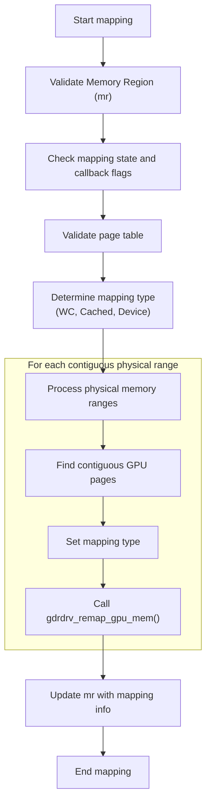

Key mapping implementation details:
- Memory is mapped range by range if physically non-contiguous
- Different mapping types (WC, Cached, Device) use different page protection flags
- The system automatically selects the appropriate mapping type based on hardware capabilities

Sources: [src/gdrdrv/gdrdrv.c:1499-1717](), [src/gdrdrv/gdrdrv.c:1433-1495]()

## 4. Memory Mapping Types

The driver supports three types of memory mappings, each with different performance characteristics:

| Mapping Type | Description | Implementation | Best Use Case |
|--------------|-------------|----------------|---------------|
| Write Combining (WC) | Non-cached mapping with write combining | `pgprot_modify_writecombine()` | Host-to-device transfers |
| Cached | CPU can cache GPU memory contents | Uses default page protection | Device-to-host transfers |
| Device | Device-specific mapping for certain architectures | `pgprot_modify_device()` | ARM64 architectures (like BlueField) |

The driver selects the mapping type based on:
1. User request through `GDRDRV_IOC_REQ_MAPPING_TYPE`
2. Hardware platform capabilities (`gdrdrv_cpu_can_cache_gpu_mappings`, `gdrdrv_cpu_must_use_device_mapping`)
3. Memory characteristics (determined by `gdr_pfn_is_ram()`)

Sources: [src/gdrdrv/gdrdrv.c:1232-1301](), [src/gdrdrv/gdrdrv.c:1527-1535](), [src/gdrdrv/gdrdrv.c:164-236]()

## 5. Callback Handling

GDRCopy uses a callback mechanism to handle asynchronous GPU memory invalidation:

```mermaid
sequenceDiagram
    participant App as User Application
    participant GDRLIB as libgdrapi
    participant DRIVER as gdrdrv
    participant NVIDIA as NVIDIA Driver
    
    App->>GDRLIB: gdr_pin_buffer()
    GDRLIB->>DRIVER: IOCTL_PIN_BUFFER
    
    DRIVER->>NVIDIA: nvidia_p2p_get_pages(..., callback, ...)
    NVIDIA-->>DRIVER: Page table
    
    Note over NVIDIA: GPU memory invalidation event
    
    NVIDIA->>DRIVER: gdrdrv_get_pages_free_callback()
    activate DRIVER
    
    DRIVER->>DRIVER: down_write(mr->sem)
    DRIVER->>DRIVER: mr->cb_flag = 1
    DRIVER->>NVIDIA: nvidia_p2p_free_page_table()
    
    DRIVER->>DRIVER: Destroy mappings if exist
    DRIVER->>DRIVER: mr->page_table = NULL
    DRIVER->>DRIVER: up_write(mr->sem)
    deactivate DRIVER
    
    App->>GDRLIB: gdr_get_cb_flag()
    GDRLIB->>DRIVER: IOCTL_GET_CB_FLAG
    DRIVER-->>GDRLIB: cb_flag = 1
    GDRLIB-->>App: Invalidation detected
```

The callback mechanism works as follows:
1. When pinning memory, a callback function is registered with NVIDIA's driver
2. If GPU memory becomes invalid (e.g., GPU reset, process termination), the callback is triggered
3. The callback marks the memory region as invalidated and cleans up resources
4. Applications can check for invalidation using `gdr_get_cb_flag()`

Sources: [src/gdrdrv/gdrdrv.c:695-716](), [src/gdrdrv/gdrdrv.c:1089-1118]()

## 6. Platform-Specific Optimizations

GDRCopy adapts its behavior based on the hardware platform:

1. **x86_64 Systems**:
   - Uses Write Combining mappings by default
   - Handles PAT (Page Attribute Table) for proper memory-type management

2. **PowerPC Systems (POWER8/9)**:
   - Enables cached mappings when GPUs are connected via NVLink
   - Uses Write Combining otherwise

3. **ARM64 Systems**:
   - Supports device mappings for BlueField adapters
   - Can use cached mappings on Grace-Hopper architectures

For newer architectures with CPU-GPU coherence (like POWER9 with NVLink or Grace-Hopper), the driver can enable cached mappings for higher performance.

Sources: [src/gdrdrv/gdrdrv.c:164-236](), [src/gdrdrv/gdrdrv.c:1872-1884](), [src/gdrdrv/gdrdrv.c:1889-1904]()

## 7. Persistent vs. Non-Persistent Mapping

GDRCopy supports two modes of operation with NVIDIA's driver:

```mermaid
flowchart TD
    Start["Memory Pinning\n__gdrdrv_pin_buffer()"] --> IsPersistent{"Is persistent mapping\nenabled?"}
    
    IsPersistent -->|"Yes"| PersistentPath["Use nvidia_p2p_get_pages_persistent()\nNo callback required"]
    IsPersistent -->|"No"| NonPersistentPath["Use nvidia_p2p_get_pages()\nRegister callback"]
    
    PersistentPath --> CleanupPersistent["Call nvidia_p2p_put_pages_persistent()\nduring cleanup"]
    NonPersistentPath --> CleanupNonPersistent["Call nvidia_p2p_put_pages()\nduring cleanup\nMay have been called by callback"]
```

Key differences:
- **Persistent Mapping**: Uses newer NVIDIA API that maintains pinned memory even during GPU context switches
- **Non-Persistent Mapping**: Older method where GPU context switches can invalidate pinned memory (handled via callbacks)

The mode is controlled by the `use_persistent_mapping` module parameter and NVIDIA driver support.

Sources: [src/gdrdrv/gdrdrv.c:445-459](), [src/gdrdrv/gdrdrv.c:790-820](), [src/gdrdrv/gdrdrv.c:837-857]()

## 8. IOCTL Interface Implementation

The driver exposes its functionality to user-space through the following IOCTL commands:

| IOCTL Command | Function | Purpose |
|---------------|----------|---------|
| `GDRDRV_IOC_PIN_BUFFER` | `gdrdrv_pin_buffer()` | Pin GPU memory |
| `GDRDRV_IOC_PIN_BUFFER_V2` | `gdrdrv_pin_buffer_v2()` | Pin GPU memory (extended version) |
| `GDRDRV_IOC_UNPIN_BUFFER` | `gdrdrv_unpin_buffer()` | Unpin GPU memory |
| `GDRDRV_IOC_GET_CB_FLAG` | `gdrdrv_get_cb_flag()` | Get callback flag status |
| `GDRDRV_IOC_GET_INFO` | `gdrdrv_get_info()` | Get memory region info |
| `GDRDRV_IOC_GET_INFO_V2` | `gdrdrv_get_info_v2()` | Get extended memory region info |
| `GDRDRV_IOC_GET_ATTR` | `gdrdrv_get_attr()` | Get driver attributes |
| `GDRDRV_IOC_REQ_MAPPING_TYPE` | `gdrdrv_req_mapping_type()` | Request specific mapping type |
| `GDRDRV_IOC_GET_VERSION` | `gdrdrv_get_version()` | Get driver version |

The IOCTL handler validates the calling process to ensure only the original opener can access the file descriptor, providing security against unauthorized access.

Sources: [src/gdrdrv/gdrdrv.c:1323-1388](), [src/gdrdrv/gdrdrv.c:976-1017](), [src/gdrdrv/gdrdrv.c:1072-1085](), [src/gdrdrv/gdrdrv.c:1089-1118]()

## 9. Error Handling and Resource Management

The driver implements robust error handling and resource management:

1. **Reference Counting**:
   - Tracks `nvidia_p2p_get_pages` calls with atomic counter
   - Verifies all references are released during driver unload

2. **Semaphore Protection**:
   - Reader-writer semaphore (`mr->sem`) protects memory regions
   - Prevents race conditions with asynchronous callbacks

3. **Resource Cleanup**:
   - Releases all GPU resources on driver close
   - Handles partial failures during pinning

4. **Process Validation**:
   - Ensures only the process that opened the device can access it
   - Prevents issues with fork() or unauthorized access

Sources: [src/gdrdrv/gdrdrv.c:104](), [src/gdrdrv/gdrdrv.c:378-402](), [src/gdrdrv/gdrdrv.c:584-620](), [src/gdrdrv/gdrdrv.c:430-441]()

## 10. Driver Initialization

The driver performs the following steps during initialization:

1. Register character device (`register_chrdev`)
2. Detect platform capabilities:
   - CPU-GPU coherence for cached mappings
   - Need for device mappings on ARM64
3. Set up module parameters and default configurations
4. Initialize procfs entries for debugging and monitoring

During cleanup, the driver:
1. Unregisters the character device
2. Removes procfs entries
3. Verifies all reference counts are zero

Sources: [src/gdrdrv/gdrdrv.c:1857-1915](), [src/gdrdrv/gdrdrv.c:1919-1934]()

---

# Page: Driver Interface

# Driver Interface

<details>
<summary>Relevant source files</summary>

The following files were used as context for generating this wiki page:

- [scripts/test_gdrdrv_HAVE_PROC_OPS.sh](scripts/test_gdrdrv_HAVE_PROC_OPS.sh)
- [src/gdrdrv/gdrdrv.c](src/gdrdrv/gdrdrv.c)
- [src/gdrdrv/gdrdrv.h](src/gdrdrv/gdrdrv.h)

</details>


This page documents the kernel driver's interface for GDRCopy, including IOCTL commands, data structures, and memory mapping functions. The driver interface serves as the communication layer between user applications and the GDRCopy kernel module, providing mechanisms to pin, map, and access GPU memory directly from the CPU.

For information about the internal implementation of the driver, see [Driver Internals](#2.1).

## IOCTL Commands Overview

The GDRCopy driver exposes functionality to user applications through IOCTL commands. These commands allow applications to perform operations such as pinning GPU memory, requesting specific mapping types, and querying driver information.

### IOCTL Command Flow

```mermaid
sequenceDiagram
    participant "User Application" as App
    participant "libgdrapi" as Lib
    participant "gdrdrv_ioctl()" as IOCTL
    participant "Handler Functions" as Handler
    
    App->>Lib: Call GDRCopy API function
    Lib->>IOCTL: Issue ioctl() system call
    IOCTL->>IOCTL: Check IOCTL code in switch statement
    
    alt GDRDRV_IOC_PIN_BUFFER
        IOCTL->>Handler: Call gdrdrv_pin_buffer()
    else GDRDRV_IOC_PIN_BUFFER_V2
        IOCTL->>Handler: Call gdrdrv_pin_buffer_v2()
    else GDRDRV_IOC_UNPIN_BUFFER
        IOCTL->>Handler: Call gdrdrv_unpin_buffer()
    else GDRDRV_IOC_GET_CB_FLAG
        IOCTL->>Handler: Call gdrdrv_get_cb_flag()
    else GDRDRV_IOC_GET_INFO / V2
        IOCTL->>Handler: Call gdrdrv_get_info() / v2()
    else GDRDRV_IOC_GET_ATTR
        IOCTL->>Handler: Call gdrdrv_get_attr()
    else GDRDRV_IOC_REQ_MAPPING_TYPE
        IOCTL->>Handler: Call gdrdrv_req_mapping_type()
    else GDRDRV_IOC_GET_VERSION
        IOCTL->>Handler: Call gdrdrv_get_version()
    end
    
    Handler-->>IOCTL: Return result
    IOCTL-->>Lib: Return status code
    Lib-->>App: Return API result
```

Sources: [src/gdrdrv/gdrdrv.c:1323-1388]()

### Supported IOCTL Commands

The driver supports the following IOCTL commands:

| IOCTL Command | Code | Description | Added in Version |
|---------------|------|-------------|------------------|
| GDRDRV_IOC_PIN_BUFFER | 1 | Pin a GPU memory buffer | Initial |
| GDRDRV_IOC_UNPIN_BUFFER | 2 | Unpin a previously pinned buffer | Initial |
| GDRDRV_IOC_GET_CB_FLAG | 3 | Check if callback flag is set | Initial |
| GDRDRV_IOC_GET_INFO | 4 | Get information about a pinned region | Initial |
| GDRDRV_IOC_GET_INFO_V2 | 5 | Enhanced version of GET_INFO | 2.4 |
| GDRDRV_IOC_GET_ATTR | 6 | Query driver attributes | 2.5 |
| GDRDRV_IOC_PIN_BUFFER_V2 | 7 | Enhanced PIN_BUFFER with flags | 2.5 |
| GDRDRV_IOC_REQ_MAPPING_TYPE | 8 | Request specific mapping type | 2.5 |
| GDRDRV_IOC_GET_VERSION | 255 | Query driver version | Initial |

Sources: [src/gdrdrv/gdrdrv.h:45-184]()

## Data Structures and Types

The driver interface defines several data structures and types used for communication between user space and kernel space.

### Memory Region Types

```mermaid
graph LR
    subgraph "gdr_mr_type_t enum"
        NONE["GDR_MR_NONE (0)"]
        WC["GDR_MR_WC (1)"]
        CACHE["GDR_MR_CACHING (2)"]
        DEVICE["GDR_MR_DEVICE (3)"]
    end
    
    NONE -->|"No mapping"| DESC1["Memory not mapped"]
    WC -->|"Write Combining"| DESC2["Optimized for host-to-device transfers"]
    CACHE -->|"Cached"| DESC3["Better for device-to-host transfers"]
    DEVICE -->|"Device mapping"| DESC4["Platform-specific mapping (e.g., ARM64)"]
```

Sources: [src/gdrdrv/gdrdrv.h:47-52]()

### Driver Attributes

The driver exposes attributes that can be queried through the `GDRDRV_IOC_GET_ATTR` command:

| Attribute | Value | Description |
|-----------|-------|-------------|
| GDRDRV_ATTR_USE_PERSISTENT_MAPPING | 1 | Indicates if persistent mapping is being used |
| GDRDRV_ATTR_SUPPORT_PIN_FLAG_FORCE_PCIE | 2 | Indicates if forcing PCIe mapping is supported |

Sources: [src/gdrdrv/gdrdrv.h:54-57]()

### Key IOCTL Parameter Structures

Below are the main data structures used for IOCTL communication:

#### Pin Buffer Parameters

```c
struct GDRDRV_IOC_PIN_BUFFER_PARAMS {
    // in
    __u64 addr;        // GPU memory address to pin
    __u64 size;        // Size of the memory region
    __u64 p2p_token;   // P2P token from NVIDIA driver
    __u32 va_space;    // Virtual address space
    // out
    gdr_hnd_t handle;  // Handle to the pinned memory region
};
```

#### Pin Buffer V2 Parameters

```c
struct GDRDRV_IOC_PIN_BUFFER_V2_PARAMS {
    // in
    __u64 addr;        // GPU memory address to pin
    __u64 size;        // Size of the memory region
    __u32 flags;       // Additional flags
    __u32 pad;         // Padding for alignment
    // out
    gdr_hnd_t handle;  // Handle to the pinned memory region
};
```

Sources: [src/gdrdrv/gdrdrv.h:63-156]()

## IOCTL Command Details

### Memory Region Operations

```mermaid
graph TD
    subgraph "User Application"
        CuMemAlloc["cuMemAlloc()"]
        PinBuffer["gdr_pin_buffer()"]
        Map["gdr_map()"]
        Copy["gdr_copy_to/from_mapping()"]
        Unmap["gdr_unmap()"]
        UnpinBuffer["gdr_unpin_buffer()"]
        CuMemFree["cuMemFree()"]
    end
    
    subgraph "GDRCopy Driver Interface"
        PIN_BUFFER["GDRDRV_IOC_PIN_BUFFER / V2"]
        GET_INFO["GDRDRV_IOC_GET_INFO / V2"]
        REQ_MAPPING["GDRDRV_IOC_REQ_MAPPING_TYPE"]
        MMAP["mmap() system call"]
        UNPIN_BUFFER["GDRDRV_IOC_UNPIN_BUFFER"]
    end
    
    subgraph "Driver Internal Structures"
        MR["gdr_mr_t struct"]
    end
    
    CuMemAlloc -->|"1. Allocate GPU memory"| PinBuffer
    PinBuffer -->|"2. Pin buffer"| PIN_BUFFER
    PIN_BUFFER -->|"Create"| MR
    
    PIN_BUFFER -->|"3. Return handle"| Map
    Map -->|"4. Request mapping type"| REQ_MAPPING
    REQ_MAPPING -->|"Set mr->req_mapping_type"| MR
    Map -->|"5. Memory map"| MMAP
    MMAP -->|"Set mr->cpu_mapping_type"| MR
    
    MMAP -->|"6. Return mapped pointer"| Copy
    
    Copy -->|"7. Direct memory access"| MR
    
    Copy -->|"8. When done"| Unmap
    Unmap -->|"9. Unmap memory"| MR
    Unmap -->|"10. Unpin buffer"| UnpinBuffer
    UnpinBuffer -->|"Free resources"| UNPIN_BUFFER
    UNPIN_BUFFER -->|"Remove"| MR
    
    UnpinBuffer -->|"11. Free GPU memory"| CuMemFree
```

Sources: [src/gdrdrv/gdrdrv.c:760-935](), [src/gdrdrv/gdrdrv.c:939-972]()

### GDRDRV_IOC_PIN_BUFFER / GDRDRV_IOC_PIN_BUFFER_V2

These commands pin a GPU memory buffer to make it accessible to the CPU.

**Processing Steps:**
1. Validate user parameters
2. Align address and size to GPU page boundaries (64KB)
3. Call `nvidia_p2p_get_pages` or `nvidia_p2p_get_pages_persistent` to get page information
4. Create a memory region (`gdr_mr_t`) structure to track the pinned buffer
5. Return a handle to the pinned buffer

**Differences Between Versions:**
- Original version uses `p2p_token` and `va_space` parameters
- V2 version replaces these with a `flags` parameter that supports options like `GDRDRV_PIN_BUFFER_FLAG_FORCE_PCIE`

Sources: [src/gdrdrv/gdrdrv.c:976-1068]()

### GDRDRV_IOC_UNPIN_BUFFER

Unpins a previously pinned GPU memory buffer.

**Processing Steps:**
1. Find the memory region associated with the handle
2. Destroy any mappings associated with the region
3. Call `nvidia_p2p_put_pages` to release GPU resources
4. Free the memory region structure

Sources: [src/gdrdrv/gdrdrv.c:1072-1085]()

### GDRDRV_IOC_GET_CB_FLAG

Checks if the callback flag is set, which indicates if a pinned memory region has been invalidated by the GPU.

**Processing Steps:**
1. Find the memory region associated with the handle
2. Return the current state of the callback flag

Sources: [src/gdrdrv/gdrdrv.c:1089-1118]()

### GDRDRV_IOC_GET_INFO / GDRDRV_IOC_GET_INFO_V2

Gets information about a pinned memory region.

**Information Returned:**
- GPU virtual address
- Mapped size
- Page size
- Timing information (cycles and frequency)
- Mapping status (mapped/unmapped)
- Mapping type

**Differences Between Versions:**
- Original version returns `mapped` and `wc_mapping` flags
- V2 version returns a single `mapping_type` enum value with more options

Sources: [src/gdrdrv/gdrdrv.c:1122-1195]()

### GDRDRV_IOC_GET_ATTR

Queries driver attributes.

**Supported Attributes:**
- `GDRDRV_ATTR_USE_PERSISTENT_MAPPING`: Whether persistent mapping is used
- `GDRDRV_ATTR_SUPPORT_PIN_FLAG_FORCE_PCIE`: Whether forcing PCIe mapping is supported

Sources: [src/gdrdrv/gdrdrv.c:1199-1228]()

### GDRDRV_IOC_REQ_MAPPING_TYPE

Requests a specific mapping type for a pinned memory region before mapping it.

**Processing Steps:**
1. Validate the requested mapping type
2. Check if the mapping type is supported on the current platform
3. If the memory region is already mapped, return an error
4. Set the requested mapping type for the memory region

Sources: [src/gdrdrv/gdrdrv.c:1232-1301]()

### GDRDRV_IOC_GET_VERSION

Gets driver version information.

**Information Returned:**
- Current driver version
- Minimum compatible API version

Sources: [src/gdrdrv/gdrdrv.c:1305-1319]()

## Memory Mapping Interface

The GDRCopy driver also provides a memory mapping interface through the standard `mmap` system call. When an application calls `mmap` on the driver's file descriptor, the driver maps the pinned GPU memory into the application's address space.

### Memory Mapping Process

```mermaid
sequenceDiagram
    participant App as "Application"
    participant Lib as "libgdrapi"
    participant Kernel as "Kernel mmap"
    participant Gdrdrv as "gdrdrv_mmap()"
    participant Remap as "gdrdrv_remap_gpu_mem()"
    participant MR as "Memory Region (gdr_mr_t)"
    
    App->>Lib: gdr_map(handle, ...)
    Lib->>Kernel: mmap(fd, size, offset=handle)
    Kernel->>Gdrdrv: Call driver's mmap handler
    
    Gdrdrv->>MR: Lookup memory region from handle
    Gdrdrv->>Gdrdrv: Validate mapping parameters
    
    Note over Gdrdrv: Determine mapping type based on:
    Note over Gdrdrv: - Requested type (req_mapping_type)
    Note over Gdrdrv: - Platform capabilities
    Note over Gdrdrv: - Memory characteristics
    
    loop For each GPU page
        Gdrdrv->>Gdrdrv: Check physical continuity
        Gdrdrv->>Remap: Map physically contiguous range
        
        alt Write Combining Mapping
            Remap->>Remap: Set pgprot_modify_writecombine()
        else Cached Mapping
            Remap->>Remap: Use default page protection
        else Device Mapping
            Remap->>Remap: Set pgprot_modify_device()
        end
        
        Remap->>Kernel: Call io_remap_pfn_range()
    end
    
    Gdrdrv->>MR: Update mapping info (mr->vma, mr->mapping, mr->cpu_mapping_type)
    Gdrdrv-->>Kernel: Return success
    Kernel-->>Lib: Return mapped address
    Lib-->>App: Return mapped pointer
```

Sources: [src/gdrdrv/gdrdrv.c:1499-1717]()

### Mapping Types and Selection

The driver supports three types of memory mappings:

1. **Write Combining (WC)**: 
   - Optimized for host-to-device transfers
   - Uses write-combining to batch writes for better performance
   - Default for most GPU memory on x86 platforms

2. **Cached Mapping**:
   - CPU caches the contents of GPU memory
   - Better for frequent reads from GPU memory
   - Available on platforms with coherent GPU memory (e.g., Power9 with NVLink, Grace Hopper)

3. **Device Mapping**:
   - Direct device memory mapping
   - Required on some ARM64 platforms (e.g., BlueField)

The driver automatically selects the appropriate mapping type based on platform capabilities and memory characteristics, but applications can request a specific type using `GDRDRV_IOC_REQ_MAPPING_TYPE`.

Sources: [src/gdrdrv/gdrdrv.c:1622-1677]()

## Version Compatibility

The GDRCopy driver interface has evolved over time, with new features added in different versions. Applications should use `GDRDRV_IOC_GET_VERSION` to check compatibility before using newer features.

| Feature | Minimum Version | Macro |
|---------|----------------|-------|
| GET_INFO_V2 | 2.4 | GDRDRV_MINIMUM_VERSION_WITH_GET_INFO_V2 |
| GET_ATTR | 2.5 | GDRDRV_MINIMUM_VERSION_WITH_GET_ATTR |
| PIN_BUFFER_V2 | 2.5 | GDRDRV_MINIMUM_VERSION_WITH_PIN_BUFFER_V2 |
| REQ_MAPPING_TYPE | 2.5 | GDRDRV_MINIMUM_VERSION_WITH_REQ_MAPPING_TYPE |

The version number is encoded as `(major << 16) | minor`, so version 2.5 is represented as 0x20005.

Sources: [src/gdrdrv/gdrdrv.h:29-43]()

## Platform-Specific Behaviors

The GDRCopy driver has different behaviors on different platforms:

1. **x86-64**:
   - Write Combining (WC) mapping is the default
   - Cached mapping is not supported
   - Device mapping is not supported

2. **Power9 with NVLink**:
   - Both WC and Cached mappings are supported
   - Driver detects NVLink connection and enables cached mappings

3. **ARM64**:
   - WC mapping is the default
   - Some platforms (BlueField) require Device mapping
   - Grace Hopper supports Cached mapping

The driver automatically detects the platform capabilities and behaves accordingly.

Sources: [src/gdrdrv/gdrdrv.c:164-236](), [src/gdrdrv/gdrdrv.c:1872-1907]()

---

# Page: Building the Driver

# Building the Driver

<details>
<summary>Relevant source files</summary>

The following files were used as context for generating this wiki page:

- [packages/dkms.conf](packages/dkms.conf)
- [packages/dkms/Makefile](packages/dkms/Makefile)
- [packages/dkms/debian/prerm](packages/dkms/debian/prerm)
- [scripts/test_gdrdrv_HAVE_VM_FLAGS_SET.sh](scripts/test_gdrdrv_HAVE_VM_FLAGS_SET.sh)
- [src/gdrdrv/Makefile](src/gdrdrv/Makefile)

</details>


This document provides detailed instructions for building the GDRCopy kernel driver (gdrdrv) from source. The driver is a critical component of the GDRCopy system that enables direct memory access between GPU memory and CPU. For information about the driver's internal architecture, see [Driver Internals](#2.1), and for details about its interface, see [Driver Interface](#2.2).

## Overview

The GDRCopy kernel driver consists of two kernel modules:
- `gdrdrv.ko`: The main GDRCopy kernel driver
- `nv-p2p-dummy.ko`: A helper module for NVIDIA P2P functionality

```mermaid
graph TD
    subgraph "GDRCopy Driver Build System"
        Build["make build"] --> KernelBuild["Kernel Build Process"]
        KernelBuild --> OutputModules["Output Kernel Modules"]
        OutputModules --> GDRDrv["gdrdrv.ko"]
        OutputModules --> NVP2PDummy["nv-p2p-dummy.ko"]
        
        Install["make install"] --> CopyModules["Copy to Kernel Modules Directory"]
        CopyModules --> RunDepmod["Update Module Dependencies"]
        
        GDRDrv --> Install
    end
```

Sources: [src/gdrdrv/Makefile:25-26](), [src/gdrdrv/Makefile:60-70]()

## Prerequisites

Before building the GDRCopy driver, ensure you have the following prerequisites:

| Requirement | Description |
|-------------|-------------|
| Linux Kernel Headers | Headers corresponding to your running kernel |
| GCC Compiler | Compatible with your kernel version |
| Make | Build automation tool |
| NVIDIA GPU Driver | Installed and working properly |

The driver build process requires the NVIDIA driver source files to locate and use the NVIDIA P2P headers. The build system will automatically detect the NVIDIA driver source directory.

Sources: [src/gdrdrv/Makefile:51-52]()

## Build Process

### Standard Build

The build process for the GDRCopy driver is managed through a Makefile located in the `src/gdrdrv` directory. The following steps outline how to build the driver:

1. Navigate to the gdrdrv directory:
   ```bash
   cd src/gdrdrv
   ```

2. Run the build command:
   ```bash
   make build
   ```

During the build process, the system will:
- Automatically detect the NVIDIA driver source directory
- Determine if the NVIDIA driver is open source
- Check for kernel compatibility features
- Compile the kernel modules against your current kernel

```mermaid
flowchart TD
    Start["Start Build Process"] --> DetectNVIDIA["Detect NVIDIA Source Directory"]
    DetectNVIDIA --> CheckOpen["Check if NVIDIA Driver is Open Source"]
    CheckOpen --> CheckVMFlags["Check for VM_FLAGS_SET Support"]
    CheckVMFlags --> CheckProcOps["Check for PROC_OPS Support"]
    CheckProcOps --> CompileModules["Compile Kernel Modules"]
    CompileModules --> End["Build Complete"]
```

Sources: [src/gdrdrv/Makefile:51-65]()

### Build Configuration Options

The GDRCopy driver build system detects several features and sets compilation flags accordingly:

| Configuration | Description | Detection Method |
|---------------|-------------|-----------------|
| NVIDIA_SRC_DIR | Directory containing NVIDIA driver sources | Automatic detection |
| NVIDIA_IS_OPENSOURCE | Whether NVIDIA driver is open source | Checks for GPL license in source |
| HAVE_VM_FLAGS_SET | If kernel supports vm_flags_set function | Kernel feature test |
| HAVE_PROC_OPS | If kernel supports proc_ops structure | Kernel feature test |

You can manually specify these options if needed:

```bash
make NVIDIA_SRC_DIR=/path/to/nvidia/src build
```

Sources: [src/gdrdrv/Makefile:51-56](), [scripts/test_gdrdrv_HAVE_VM_FLAGS_SET.sh:1-80]()

## Installation

After successfully building the driver, you can install it using:

```bash
sudo make install
```

This will:
1. Copy the built kernel module to the appropriate kernel modules directory
2. Update the module dependencies with depmod

You can specify an alternative destination directory with:

```bash
sudo make DESTDIR=/path/to/destdir install
```

To load the driver after installation:

```bash
sudo modprobe gdrdrv
```

Sources: [src/gdrdrv/Makefile:67-70]()

## DKMS Support

GDRCopy supports DKMS (Dynamic Kernel Module Support), which automatically rebuilds the kernel module when the kernel is updated. This is especially useful in environments where kernel updates are frequent.

```mermaid
flowchart TD
    DKMS["DKMS System"] -- "Kernel Update" --> Rebuild["Rebuild gdrdrv Module"]
    Rebuild --> Install["Install Updated Module"]
    Install --> Load["Load Module Automatically"]
```

### Installing with DKMS

The DKMS configuration file (`dkms.conf`) defines how the module should be built:

```
PACKAGE_NAME="gdrdrv"
PACKAGE_VERSION="<version>"
BUILT_MODULE_NAME[0]="gdrdrv"
DEST_MODULE_LOCATION[0]="<module_location>"
AUTOINSTALL="yes"
MAKE[0]="cd $dkms_tree/gdrdrv/<version>/build && make CONF_SCRIPT_DIR=scripts KVER=$kernelver"
```

This configuration ensures that:
- The module is named "gdrdrv"
- DKMS will automatically install the module
- The build command is properly configured to use the correct scripts

To install using DKMS:

```bash
sudo dkms add -m gdrdrv -v <version>
sudo dkms build -m gdrdrv -v <version>
sudo dkms install -m gdrdrv -v <version>
```

Sources: [packages/dkms.conf:1-6](), [packages/dkms/Makefile:1-33]()

## Troubleshooting

### Common Build Issues

| Issue | Cause | Solution |
|-------|-------|----------|
| NVIDIA source not found | NVIDIA driver source files cannot be located | Install NVIDIA driver development package or specify NVIDIA_SRC_DIR manually |
| Kernel version mismatch | Driver is being built against wrong kernel headers | Ensure correct kernel headers are installed |
| Module load failure | Incompatible kernel or NVIDIA driver | Check dmesg for detailed error messages |

### Checking Build Configuration

To verify the detected build configuration:

```bash
make build
```

This will output the detected NVIDIA source directory and configuration options before compiling.

Sources: [src/gdrdrv/Makefile:60-65]()

## Clean Build

To clean previous build artifacts:

```bash
make clean
```

This removes all generated files and allows for a fresh build.

Sources: [src/gdrdrv/Makefile:75-76]()

## Platform-Specific Notes

### Note on Kernel Compatibility

The GDRCopy driver uses compatibility tests to adapt to different kernel versions. Two key features are tested:

1. VM_FLAGS_SET support: Used for proper virtual memory management
2. PROC_OPS support: Used for file operations in /proc

These tests ensure the driver builds correctly across different kernel versions.

Sources: [scripts/test_gdrdrv_HAVE_VM_FLAGS_SET.sh:37-80](), [src/gdrdrv/Makefile:34-40]()

---

# Page: User-Space Library (libgdrapi)

# User-Space Library (libgdrapi)

<details>
<summary>Relevant source files</summary>

The following files were used as context for generating this wiki page:

- [include/gdrapi.h](include/gdrapi.h)
- [src/gdrapi.c](src/gdrapi.c)

</details>


The User-Space Library (libgdrapi) provides the application programming interface for accessing NVIDIA GPUDirect RDMA functionality within GDRCopy. It serves as the intermediary layer between user applications and the kernel driver (gdrdrv), offering a set of functions to establish low-latency, direct memory access between CPU and GPU memory.

For information about the kernel driver implementation, see [Kernel Driver (gdrdrv)](#2).

## Architecture Overview

The libgdrapi library follows a handle-based design pattern where operations are performed through opaque handles that represent GPU memory mappings.

```mermaid
graph TD
    subgraph "Application Layer"
        App["User Application"]
    end
    
    subgraph "libgdrapi Components"
        GDRHandle["gdr_t\nLibrary Handle"]
        MemHandle["gdr_mh_t\nMemory Handle"]
        MapFuncs["Mapping Functions\ngdr_map/unmap"]
        PinFuncs["Pinning Functions\ngdr_pin/unpin_buffer"]
        CopyFuncs["Copy Functions\ngdr_copy_to/from_mapping"]
        InfoFuncs["Info Functions\ngdr_get_info_v2"]
    end
    
    subgraph "Kernel Interface"
        IOCTLs["ioctl() Calls"]
        MMAP["mmap() Calls"]
    end
    
    subgraph "Kernel Driver"
        GDRDrv["gdrdrv"]
    end
    
    App -->|"gdr_open()"| GDRHandle
    App -->|"Use"| MemHandle
    App -->|"Call"| MapFuncs & PinFuncs & CopyFuncs & InfoFuncs
    
    GDRHandle -.->|"Contains"| MemHandle
    
    MapFuncs & PinFuncs & InfoFuncs -->|"Issue"| IOCTLs
    MapFuncs -->|"Memory Map"| MMAP
    
    IOCTLs & MMAP -->|"Communicate with"| GDRDrv
    
    classDef comp fill:#f9f9f9,stroke:#333,stroke-width:1px;
    class GDRHandle,MemHandle,MapFuncs,PinFuncs,CopyFuncs,InfoFuncs comp;
```

Sources: [include/gdrapi.h:63-77](), [src/gdrapi.c:63-115]()

## Core Data Structures

The library uses several key data structures to manage GPU memory access:

1. **Library Handle (`gdr_t`)**: 
   - Represents a connection to the gdrdrv kernel module
   - Contains file descriptor and state information

2. **Memory Handle (`gdr_mh_t`)**: 
   - Opaque handle representing a pinned GPU memory region
   - Used in all memory operations

3. **Memory Mapping Types**: 
   - Defined by `gdr_mapping_type_t` enumeration
   - Controls the memory access characteristics

```mermaid
classDiagram
    class gdr_t {
        int fd
        list~gdr_memh_t~ memhs
        size_t page_size
        size_t page_mask
        int page_shift
        uint32_t gdrdrv_version
    }
    
    class gdr_mh_t {
        unsigned long h
    }
    
    class gdr_memh_t {
        uint32_t handle
        gdr_mapping_type_t mapping_type
    }
    
    class gdr_mapping_type_t {
        <<enumeration>>
        GDR_MAPPING_TYPE_NONE
        GDR_MAPPING_TYPE_WC
        GDR_MAPPING_TYPE_CACHING
        GDR_MAPPING_TYPE_DEVICE
    }
    
    gdr_t --* gdr_memh_t : contains list of
    gdr_mh_t ..> gdr_memh_t : converts to/from
    gdr_memh_t --> gdr_mapping_type_t : has
```

Sources: [include/gdrapi.h:63-77](), [include/gdrapi.h:111-117](), [src/gdrapi.c:107-115]()

## API Workflow

The typical workflow for using libgdrapi follows this sequence:

```mermaid
sequenceDiagram
    participant App as Application
    participant Lib as libgdrapi
    participant Drv as gdrdrv

    Note over App,Drv: Library Initialization
    App->>Lib: gdr_open()
    Lib->>Drv: open("/dev/gdrdrv")
    Drv-->>Lib: file descriptor
    Lib-->>App: gdr_t handle

    Note over App,Drv: Pinning GPU Memory
    App->>Lib: gdr_pin_buffer(_v2)(addr, size, ...)
    Lib->>Drv: ioctl(GDRDRV_IOC_PIN_BUFFER(_V2))
    Drv-->>Lib: kernel handle
    Lib-->>App: gdr_mh_t handle

    Note over App,Drv: Mapping to User Space
    App->>Lib: gdr_map(_v2)(handle, ...)
    Lib->>Drv: ioctl(GDRDRV_IOC_REQ_MAPPING_TYPE)
    Lib->>Drv: mmap(fd, offset)
    Drv-->>Lib: user virtual address
    Lib-->>App: mapped pointer

    Note over App,Drv: Memory Operations
    App->>Lib: gdr_copy_to_mapping(handle, map_ptr, host_ptr, size)
    Lib->>App: (optimized memory copy performed)
    App->>Lib: gdr_copy_from_mapping(handle, host_ptr, map_ptr, size)
    Lib->>App: (optimized memory copy performed)

    Note over App,Drv: Cleanup
    App->>Lib: gdr_unmap(handle, ptr, size)
    Lib->>Drv: munmap(ptr, size)
    App->>Lib: gdr_unpin_buffer(handle)
    Lib->>Drv: ioctl(GDRDRV_IOC_UNPIN_BUFFER)
    App->>Lib: gdr_close()
    Lib->>Drv: close(fd)
```

Sources: [src/gdrapi.c:124-228](), [src/gdrapi.c:231-319](), [src/gdrapi.c:410-546]()

## API Reference

### Initialization and Cleanup

```c
gdr_t gdr_open(void);
int gdr_close(gdr_t g);
```

These functions establish and terminate the connection to the gdrdrv kernel module.

- `gdr_open()`: Opens the device file `/dev/gdrdrv`, verifies driver version compatibility, and initializes a library handle.
- `gdr_close()`: Unpins any remaining buffers, releases all resources, and closes the driver connection.

Sources: [src/gdrapi.c:124-228]()

### Memory Pinning and Mapping

```c
int gdr_pin_buffer(gdr_t g, unsigned long addr, size_t size, uint64_t p2p_token, uint32_t va_space, gdr_mh_t *handle);
int gdr_pin_buffer_v2(gdr_t g, unsigned long addr, size_t size, uint32_t flags, gdr_mh_t *handle);
int gdr_unpin_buffer(gdr_t g, gdr_mh_t handle);
int gdr_map(gdr_t g, gdr_mh_t handle, void **va, size_t size);
int gdr_map_v2(gdr_t g, gdr_mh_t handle, void **ptr_va, size_t size, int flags);
int gdr_unmap(gdr_t g, gdr_mh_t handle, void *va, size_t size);
```

These functions manage pinning (making resident) and mapping GPU memory into the CPU address space:

- **Pinning**: Makes GPU memory resident and prevents it from being swapped out, using `nvidia_p2p_get_pages` in the kernel driver
- **Mapping**: Creates a user-space virtual memory mapping of the pinned GPU memory
- **Unpinning/Unmapping**: Releases the mapping and marks memory as unpinable again

The `_v2` variants provide additional functionality:
- `gdr_pin_buffer_v2` supports flags like `GDR_PIN_FLAG_FORCE_PCIE` to force BAR1 mapping
- `gdr_map_v2` supports selecting the mapping type via flags like `GDR_MAP_FLAG_REQ_WC_MAPPING`

Sources: [src/gdrapi.c:231-319](), [src/gdrapi.c:321-338](), [src/gdrapi.c:410-546]()

### Memory Copy Operations

```c
int gdr_copy_to_mapping(gdr_mh_t handle, void *map_d_ptr, const void *h_ptr, size_t size);
int gdr_copy_from_mapping(gdr_mh_t handle, void *h_ptr, const void *map_d_ptr, size_t size);
```

These functions provide optimized memory copies between host memory and mapped GPU memory:

- `gdr_copy_to_mapping`: Copies from host memory to mapped GPU memory (H→D)
- `gdr_copy_from_mapping`: Copies from mapped GPU memory to host memory (D→H)

The implementation includes platform-specific optimizations:
- x86: Uses SSE, AVX, or AVX2 instructions when available
- POWER: Uses optimized unrolled copy routines
- ARM64: Uses platform-specific memory ordering instructions

Sources: [src/gdrapi.c:800-953]()

### Information and Attribute Querying

```c
int gdr_get_info_v2(gdr_t g, gdr_mh_t handle, gdr_info_v2_t *info);
void gdr_runtime_get_version(int *major, int *minor);
int gdr_driver_get_version(gdr_t g, int *major, int *minor);
int gdr_get_attribute(gdr_t g, gdr_attr_t attr, int *v);
```

These functions retrieve information about mappings and system capabilities:

- `gdr_get_info_v2`: Gets detailed information about a pinned memory region
- `gdr_runtime_get_version`: Gets the libgdrapi version
- `gdr_driver_get_version`: Gets the gdrdrv kernel module version
- `gdr_get_attribute`: Queries system-wide attributes like persistent mapping support

Sources: [src/gdrapi.c:358-408](), [src/gdrapi.c:956-1024]()

## Memory Mapping Types

GDRCopy supports different types of memory mappings, each with different performance characteristics:

```mermaid
flowchart TD
    subgraph "Mapping Types"
        direction TB
        WC["Write Combining\nGDR_MAPPING_TYPE_WC"]
        CACHE["Cached\nGDR_MAPPING_TYPE_CACHING"]
        DEV["Device\nGDR_MAPPING_TYPE_DEVICE"]
    end
    
    subgraph "Request Methods"
        MAP["gdr_map_v2() with flags:"]
        WC_FLAG["GDR_MAP_FLAG_REQ_WC_MAPPING"]
        CACHE_FLAG["GDR_MAP_FLAG_REQ_CACHE_MAPPING"]
        DEV_FLAG["GDR_MAP_FLAG_REQ_DEVICE_MAPPING"]
    end
    
    subgraph "Performance Characteristics"
        WC_PERF["- Fast host→device writes\n- Slower device→host reads\n- Requires sfence for ordering"]
        CACHE_PERF["- Moderate host→device writes\n- Fast device→host reads\n- CPU caches GPU memory"]
        DEV_PERF["- Platform-specific behavior\n- Special alignment requirements\n- Used on select platforms"]
    end
    
    MAP -->|Requests| WC_FLAG & CACHE_FLAG & DEV_FLAG
    WC_FLAG -->|Creates| WC
    CACHE_FLAG -->|Creates| CACHE
    DEV_FLAG -->|Creates| DEV
    
    WC --> WC_PERF
    CACHE --> CACHE_PERF
    DEV --> DEV_PERF
```

### Write Combining (WC) Mapping

- Default mapping type in earlier versions
- Uses CPU write-combining buffers to optimize host-to-device transfers
- Performs well for writes but poorer for reads
- Requires memory barriers (`_mm_sfence()` on x86) for write ordering

### Cached Mapping

- CPU caches GPU memory contents
- Better balanced performance for both reads and writes
- Leverages CPU cache prefetching for improved read performance
- Suitable for workloads with frequent reads from GPU memory

### Device Mapping

- Platform-specific behavior
- Has special alignment requirements
- Used in special configurations
- Performance characteristics vary by platform

Sources: [include/gdrapi.h:111-117](), [src/gdrapi.c:410-508]()

## Copy Implementation Details

The memory copy operations use different implementations based on the mapping type and available CPU features:

```mermaid
flowchart TD
    START["gdr_copy_to/from_mapping()"]
    
    START --> CHECK_SMALL["Small size check\n(<= 8 bytes)"]
    CHECK_SMALL -->|Yes| DIRECT["Direct store/load\nappropriate for size"]
    
    CHECK_SMALL -->|No| CHECK_CPU["CPU Feature Detection"]
    
    subgraph "Platform-specific copy implementations"
        X86["x86 Implementations"]
        POWER["POWER Implementations"]
        ARM["ARM64 Implementations"]
    end
    
    CHECK_CPU -->|x86 with AVX| X86_AVX["memcpy_uncached_store_avx()\nmemcpy_cached_store_avx()"]
    CHECK_CPU -->|x86 with SSE| X86_SSE["memcpy_uncached_store_sse()\nmemcpy_cached_store_sse()"]
    CHECK_CPU -->|POWER| POWER_IMPL["unroll4_memcpy()\nunroll8_memcpy()"]
    CHECK_CPU -->|ARM64| ARM_IMPL["Standard memcpy with\nDMB instructions"]
    CHECK_CPU -->|Device mapping| DEV_MAP["memcpy_to/from_device_mapping()"]
    CHECK_CPU -->|Other| FALLBACK["Standard memcpy()"]
    
    X86_AVX & X86_SSE --> X86
    POWER_IMPL --> POWER
    ARM_IMPL --> ARM
    
    DIRECT & X86 & POWER & ARM & DEV_MAP & FALLBACK --> FENCE["Memory fencing\n(if needed)"]
    
    FENCE --> END["Return"]
```

Key optimization strategies:

1. **Small transfers**: Direct stores/loads with proper alignment checks
2. **SIMD Acceleration**: Uses AVX/SSE on x86 platforms when available
3. **Platform-specific optimizations**:
   - x86: Uses AVX, SSE4.1, or SSE based on CPU capabilities
   - POWER: Uses unrolled copies with 4-byte or 8-byte accesses
   - ARM64: Uses appropriate DMB (Data Memory Barrier) instructions
4. **Memory barriers**:
   - WC mapping: Uses `wc_store_fence()` to ensure visibility
   - Mixed mappings: Uses `memory_fence()` for full ordering
   - Device mapping: Uses aligned accesses with `READ_ONCE`/`WRITE_ONCE` macros

Sources: [src/gdrapi.c:547-798](), [src/gdrapi.c:800-953]()

## Version Compatibility

The library implements version checking to ensure compatibility between components:

```mermaid
flowchart LR
    subgraph "Version Components"
        API_VER["libgdrapi version\nGDR_API_VERSION\nMajor: 2, Minor: 5"]
        DRV_VER["gdrdrv version\nqueried at runtime"]
        MIN_DRV["Minimum required\ngdrdrv version\n2.0"]
    end
    
    subgraph "Version Checks"
        OPEN_CHECK["gdr_open() checks:"]
        FEAT_CHECK["Feature availability\nchecks:"]
    end
    
    OPEN_CHECK -->|"Verifies"| DRV_COMPAT["Driver compatibility:\n- Current driver version ≥ minimum\n- Driver minimum API requirement ≤ current API"]
    
    FEAT_CHECK -->|"Determines"| FEAT_COMPAT["Feature compatibility:\n- PIN_V2 support\n- REQ_MAPPING_TYPE support\n- GET_INFO_V2 support\n- GET_ATTR support"]
    
    API_VER --> OPEN_CHECK
    DRV_VER --> OPEN_CHECK
    MIN_DRV --> OPEN_CHECK
    
    DRV_VER --> FEAT_CHECK
```

The library checks for compatibility in several areas:

1. **API Version**: The user-space library (libgdrapi) has its own version:
   - Major: 2, Minor: 5 (as of the current version)
   - Used to indicate feature availability to applications

2. **Driver Version Compatibility**:
   - Minimum required gdrdrv version: 2.0
   - Checks are performed when opening the library
   - Returns error if driver is too old

3. **Feature Availability**:
   - Different features require specific minimum driver versions
   - The library contains fallbacks for older drivers when possible
   - Version-dependent features include:
     - `gdr_pin_buffer_v2` (requires version with `PIN_BUFFER_V2` support)
     - Custom mapping types (requires version with `REQ_MAPPING_TYPE` support)
     - Extended information queries (requires version with `GET_INFO_V2` support)

Sources: [include/gdrapi.h:29-38](), [src/gdrapi.c:124-199](), [src/gdrapi.c:303-319]()

## Building the Library

The libgdrapi library is built as a shared library. It includes:

1. Core implementation in `src/gdrapi.c`
2. Architecture-specific optimizations for x86, POWER, and ARM64
3. Public headers in `include/gdrapi.h`

For build instructions, see [Building the Library](#3.4) wiki page.

Sources: [src/gdrapi.c:1-1103](), [include/gdrapi.h:1-205]()

---

# Page: API Reference

# API Reference

<details>
<summary>Relevant source files</summary>

The following files were used as context for generating this wiki page:

- [include/gdrapi.h](include/gdrapi.h)
- [src/gdrapi.c](src/gdrapi.c)
- [tests/sanity.cpp](tests/sanity.cpp)

</details>


This document provides a comprehensive reference for the GDRCopy API, a low-latency GPU memory copy library leveraging NVIDIA's GPUDirect RDMA technology. It covers all public functions, data structures, and enumerations available in the libgdrapi user-space library. For information about the kernel driver, see [Kernel Driver (gdrdrv)](#2) and for memory mapping types, see [Memory Mapping Types](#3.2).

## API Overview

```mermaid
graph TD
    subgraph "API Categories"
        Init["Initialization & Cleanup"]
        MemMgmt["Memory Management"]
        MemOps["Memory Operations"]
        Info["Information & Attributes"]
    end

    subgraph "Initialization & Cleanup"
        Open["gdr_open()"]
        Close["gdr_close()"]
    end

    subgraph "Memory Management"
        Pin["gdr_pin_buffer()\ngdr_pin_buffer_v2()"]
        Unpin["gdr_unpin_buffer()"]
        Map["gdr_map()\ngdr_map_v2()"]
        Unmap["gdr_unmap()"]
    end

    subgraph "Memory Operations"
        ToMap["gdr_copy_to_mapping()"]
        FromMap["gdr_copy_from_mapping()"]
    end

    subgraph "Information & Attributes"
        GetInfo["gdr_get_info_v2()"]
        GetFlag["gdr_get_callback_flag()"]
        GetVer1["gdr_runtime_get_version()"]
        GetVer2["gdr_driver_get_version()"]
        GetAttr["gdr_get_attribute()"]
        GetMapStr["gdr_get_mapping_type_string()"]
    end

    Init --> Open
    Init --> Close
    MemMgmt --> Pin
    MemMgmt --> Unpin
    MemMgmt --> Map
    MemMgmt --> Unmap
    MemOps --> ToMap
    MemOps --> FromMap
    Info --> GetInfo
    Info --> GetFlag
    Info --> GetVer1
    Info --> GetVer2
    Info --> GetAttr
    Info --> GetMapStr

    classDef default stroke:#333,stroke-width:1px;
```

Sources: [include/gdrapi.h:22-202](), [src/gdrapi.c:22-1103]()

## Data Types and Structures

### Primary Structures

```mermaid
classDiagram
    class "gdr_t" {
        Library handle
        Opaque pointer to internal state
    }
    
    class "gdr_mh_t" {
        unsigned long h
        Opaque memory handle
    }
    
    class "gdr_info_v2_t" {
        uint64_t va
        uint64_t mapped_size
        uint32_t page_size
        uint64_t tm_cycles
        uint32_t cycles_per_ms
        unsigned mapped:1
        unsigned wc_mapping:1
        gdr_mapping_type_t mapping_type
    }
    
    "gdr_t" -- "gdr_mh_t" : manages
    "gdr_mh_t" -- "gdr_info_v2_t" : describes
```

Sources: [include/gdrapi.h:63-137]()

### Enumerations

The API defines several enumerations to control behavior:

#### Mapping Types

```c
typedef enum gdr_mapping_type {
    GDR_MAPPING_TYPE_NONE = 0,    // No mapping
    GDR_MAPPING_TYPE_WC = 1,      // Write Combining mapping
    GDR_MAPPING_TYPE_CACHING = 2, // Cached mapping
    GDR_MAPPING_TYPE_DEVICE = 3,  // Device mapping
    GDR_MAPPING_TYPE_MAX          // Not an actual type (internal use)
} gdr_mapping_type_t;
```

#### Pin Flags

```c
typedef enum gdr_pin_flags {
    GDR_PIN_FLAG_DEFAULT = 0,     // Default mapping mechanism
    GDR_PIN_FLAG_FORCE_PCIE = 1   // Force creation of a GPU BAR1 mapping
} gdr_pin_flags_t;
```

#### Map Flags

```c
typedef enum gdr_map_flags {
    GDR_MAP_FLAG_DEFAULT = 0,          // Default mapping
    GDR_MAP_FLAG_REQ_WC_MAPPING = 1,   // Request Write Combining mapping
    GDR_MAP_FLAG_REQ_CACHE_MAPPING = 2, // Request Cached mapping
    GDR_MAP_FLAG_REQ_DEVICE_MAPPING = 3 // Request Device mapping
} gdr_map_flags_t;
```

#### Attributes

```c
typedef enum gdr_attr {
    GDR_ATTR_USE_PERSISTENT_MAPPING = 1,     // Query persistent mapping usage
    GDR_ATTR_SUPPORT_PIN_FLAG_FORCE_PCIE = 2, // Check FORCE_PCIE support
    GDR_ATTR_MAX                             // Internal use only
} gdr_attr_t;
```

Sources: [include/gdrapi.h:83-189]()

## Initialization and Cleanup

### gdr_open

```c
gdr_t gdr_open(void);
```

**Description**: Initializes the library by opening a connection to the kernel-mode driver.

**Returns**: A handle to the library state object or NULL on failure.

**Example Usage**:
```c
gdr_t g = gdr_open();
if (!g) {
    // Handle error
}
```

Sources: [src/gdrapi.c:124-200]()

### gdr_close

```c
int gdr_close(gdr_t g);
```

**Description**: Destroys the library state object and closes the connection to the kernel-mode driver. Will also automatically unpin any memory handles that weren't explicitly unpinned.

**Parameters**:
- `g`: The library handle returned by `gdr_open()`

**Returns**: 0 on success, or an error code on failure.

Sources: [src/gdrapi.c:202-229]()

## Memory Management

### Buffer Pinning and Unpinning

```mermaid
sequenceDiagram
    participant App as "Application"
    participant API as "GDRCopy API"
    participant KMD as "Kernel Module Driver"
    participant GPU as "NVIDIA GPU Driver"
    
    Note over App,GPU: Step 1: Pin GPU Memory
    App->>API: gdr_pin_buffer_v2(g, addr, size, flags, &handle)
    API->>KMD: ioctl(GDRDRV_IOC_PIN_BUFFER_V2)
    KMD->>GPU: nvidia_p2p_get_pages()
    GPU-->>KMD: Return page table
    KMD-->>API: Return handle
    API-->>App: Return handle (mh)
    
    Note over App,GPU: Step 2: Unpin GPU Memory
    App->>API: gdr_unpin_buffer(g, handle)
    API->>KMD: ioctl(GDRDRV_IOC_UNPIN_BUFFER)
    KMD->>GPU: nvidia_p2p_put_pages()
    KMD-->>API: Success
    API-->>App: Return status
```

Sources: [src/gdrapi.c:231-338]()

#### gdr_pin_buffer

```c
int gdr_pin_buffer(gdr_t g, unsigned long addr, size_t size, uint64_t p2p_token, uint32_t va_space, gdr_mh_t *handle);
```

**Description**: Creates a peer-to-peer mapping of the device memory buffer, returning an opaque handle. The memory is pinned (made resident) but not yet accessible to user-space.

**Parameters**:
- `g`: Library handle returned by `gdr_open()`
- `addr`: GPU memory address to pin
- `size`: Size of the memory area to pin
- `p2p_token`: CUDA P2P token (can be 0 for newer CUDA versions)
- `va_space`: CUDA VA space (can be 0 for newer CUDA versions)
- `handle`: Output parameter that will contain the memory handle

**Returns**: 0 on success, or an error code on failure.

Sources: [src/gdrapi.c:231-264]()

#### gdr_pin_buffer_v2

```c
int gdr_pin_buffer_v2(gdr_t g, unsigned long addr, size_t size, uint32_t flags, gdr_mh_t *handle);
```

**Description**: Enhanced version of `gdr_pin_buffer()` that accepts flags to control the mapping behavior. P2P tokens are deprecated, so they've been removed from this version.

**Parameters**:
- `g`: Library handle returned by `gdr_open()`
- `addr`: GPU memory address to pin
- `size`: Size of the memory area to pin
- `flags`: Control flags (GDR_PIN_FLAG_DEFAULT or GDR_PIN_FLAG_FORCE_PCIE)
- `handle`: Output parameter that will contain the memory handle

**Returns**: 0 on success, or an error code on failure.

**Notes**:
- GDR_PIN_FLAG_FORCE_PCIE forces creation of a GPU BAR1 mapping
- Requires a supported coherent platform
- Persistent mappings must be enabled
- Requires GPU driver r570+ and a sufficiently new gdrdrv version

Sources: [src/gdrapi.c:266-319]()

#### gdr_unpin_buffer

```c
int gdr_unpin_buffer(gdr_t g, gdr_mh_t handle);
```

**Description**: Destroys the peer-to-peer mapping and frees the handle.

**Parameters**:
- `g`: Library handle
- `handle`: Memory handle to unpin

**Returns**: 0 on success, or an error code on failure.

**Notes**: If there exists a corresponding user-space mapping, `gdr_unmap()` should be called before this function.

Sources: [src/gdrapi.c:321-338]()

### Memory Mapping and Unmapping

```mermaid
sequenceDiagram
    participant App as "Application"
    participant API as "GDRCopy API"
    participant KMD as "Kernel Module Driver"
    
    Note over App,KMD: Step 1: Map GPU Memory to User Space
    App->>API: gdr_map_v2(g, handle, &ptr, size, flags)
    API->>KMD: ioctl(GDRDRV_IOC_REQ_MAPPING_TYPE)
    KMD-->>API: Set mapping type
    API->>KMD: mmap(fd, offset, size)
    KMD-->>API: Return mapped address
    API->>API: gdr_get_info_v2() to verify mapping
    API-->>App: Return mapped pointer
    
    Note over App,KMD: Step 2: Unmap GPU Memory
    App->>API: gdr_unmap(g, handle, ptr, size)
    API->>KMD: munmap(ptr, size)
    KMD-->>API: Success
    API-->>App: Return status
```

Sources: [src/gdrapi.c:410-546]()

#### gdr_map

```c
int gdr_map(gdr_t g, gdr_mh_t handle, void **va, size_t size);
```

**Description**: Creates a user-space mapping of the memory handle.

**Parameters**:
- `g`: Library handle
- `handle`: Memory handle returned by `gdr_pin_buffer()`
- `va`: Output parameter that will contain the user-space virtual address
- `size`: Size of the memory area to map

**Returns**: 0 on success, or an error code on failure.

**Warning**: The address could be potentially aligned to the boundary of the page size before being mapped in user-space, so the pointer returned might be affected by an offset. `gdr_get_info_v2()` can be used to calculate that offset.

Sources: [src/gdrapi.c:510-513]()

#### gdr_map_v2

```c
int gdr_map_v2(gdr_t g, gdr_mh_t handle, void **ptr_va, size_t size, int flags);
```

**Description**: Enhanced version of `gdr_map()` that accepts flags to control the mapping type.

**Parameters**:
- `g`: Library handle
- `handle`: Memory handle returned by `gdr_pin_buffer()`
- `ptr_va`: Output parameter that will contain the user-space virtual address
- `size`: Size of the memory area to map
- `flags`: Mapping type flags:
  - `GDR_MAP_FLAG_DEFAULT`: Default mapping
  - `GDR_MAP_FLAG_REQ_WC_MAPPING`: Request Write Combining mapping
  - `GDR_MAP_FLAG_REQ_CACHE_MAPPING`: Request Cached mapping
  - `GDR_MAP_FLAG_REQ_DEVICE_MAPPING`: Request Device mapping

**Returns**: 0 on success, or an error code on failure.

Sources: [src/gdrapi.c:410-508]()

#### gdr_unmap

```c
int gdr_unmap(gdr_t g, gdr_mh_t handle, void *va, size_t size);
```

**Description**: Gets rid of a user-space mapping.

**Parameters**:
- `g`: Library handle
- `handle`: Memory handle
- `va`: User-space virtual address returned by `gdr_map()`
- `size`: Size of the mapped area

**Returns**: 0 on success, or an error code on failure.

Sources: [src/gdrapi.c:515-546]()

## Memory Operations

```mermaid
graph LR
    subgraph "Host Memory"
        HostBuf["Host Buffer"]
    end
    
    subgraph "Mapped GPU Memory"
        MappedGPU["Mapped GPU Buffer"]
    end
    
    HostBuf -- "gdr_copy_to_mapping()" --> MappedGPU
    MappedGPU -- "gdr_copy_from_mapping()" --> HostBuf
    
    classDef default stroke:#333,stroke-width:1px;
```

Sources: [src/gdrapi.c:800-953]()

### gdr_copy_to_mapping

```c
int gdr_copy_to_mapping(gdr_mh_t handle, void *map_d_ptr, const void *h_ptr, size_t size);
```

**Description**: Copies data from host memory to mapped GPU memory.

**Parameters**:
- `handle`: Memory handle
- `map_d_ptr`: Destination pointer in mapped GPU memory
- `h_ptr`: Source pointer in host memory
- `size`: Size of data to copy

**Returns**: 0 on success, or an error code on failure.

**Warning**: Both integrity and ordering of data as observed by pre-launched GPU work is not guaranteed by this API. For more information, see the NVIDIA GPUDirect RDMA documentation.

Sources: [src/gdrapi.c:931-941]()

### gdr_copy_from_mapping

```c
int gdr_copy_from_mapping(gdr_mh_t handle, void *h_ptr, const void *map_d_ptr, size_t size);
```

**Description**: Copies data from mapped GPU memory to host memory.

**Parameters**:
- `handle`: Memory handle
- `h_ptr`: Destination pointer in host memory
- `map_d_ptr`: Source pointer in mapped GPU memory
- `size`: Size of data to copy

**Returns**: 0 on success, or an error code on failure.

Sources: [src/gdrapi.c:943-953]()

## Information and Status Functions

### gdr_get_info_v2

```c
int gdr_get_info_v2(gdr_t g, gdr_mh_t handle, gdr_info_v2_t *info);
```

**Description**: Gets information about the mapped area.

**Parameters**:
- `g`: Library handle
- `handle`: Memory handle
- `info`: Output parameter that will be filled with information about the mapping

**Returns**: 0 on success, or an error code on failure.

**Notes**: After pinning, the info struct contains details of the mapped area. Both `info->va` and `info->mapped_size` might be different from the original address passed to `gdr_pin_buffer()` due to alignment in the kernel-mode driver.

Sources: [src/gdrapi.c:358-408]()

### gdr_get_callback_flag

```c
int gdr_get_callback_flag(gdr_t g, gdr_mh_t handle, int *flag);
```

**Description**: Checks if the kernel callback (relative to the nvidia_p2p_get_pages) was invoked, e.g., when `cuMemFree()` is called before `gdr_unpin_buffer()`.

**Parameters**:
- `g`: Library handle
- `handle`: Memory handle
- `flag`: Output parameter that will be set to the callback flag value

**Returns**: 0 on success, or an error code on failure.

Sources: [src/gdrapi.c:340-356]()

### gdr_runtime_get_version

```c
void gdr_runtime_get_version(int *major, int *minor);
```

**Description**: Returns the version of the libgdrapi runtime.

**Parameters**:
- `major`: Output parameter for the major version number
- `minor`: Output parameter for the minor version number

Sources: [src/gdrapi.c:956-960]()

### gdr_driver_get_version

```c
int gdr_driver_get_version(gdr_t g, int *major, int *minor);
```

**Description**: Returns the version of the gdrdrv driver.

**Parameters**:
- `g`: Library handle
- `major`: Output parameter for the major version number
- `minor`: Output parameter for the minor version number

**Returns**: 0 on success, or an error code on failure.

Sources: [src/gdrapi.c:962-979]()

### gdr_get_attribute

```c
int gdr_get_attribute(gdr_t g, gdr_attr_t attr, int *v);
```

**Description**: Queries a system-wide attribute of GDRCopy.

**Parameters**:
- `g`: Library handle
- `attr`: Attribute to query:
  - `GDR_ATTR_USE_PERSISTENT_MAPPING`: Check if gdrdrv uses persistent mapping
  - `GDR_ATTR_SUPPORT_PIN_FLAG_FORCE_PCIE`: Check if FORCE_PCIE is supported
- `v`: Output parameter that will be set to the attribute value

**Returns**: 0 on success, or an error code on failure.

**Note**: This is for querying system-wide attributes. To query attributes associated with a memory handle, use `gdr_get_info_v2()` instead.

Sources: [src/gdrapi.c:981-1024]()

### gdr_get_mapping_type_string

```c
int gdr_get_mapping_type_string(gdr_mapping_type_t mapping_type, const char **pstr);
```

**Description**: Gets a string representation of the mapping type.

**Parameters**:
- `mapping_type`: The mapping type
- `pstr`: Output parameter that will be set to a string describing the mapping type

**Returns**: 0 on success, or an error code on failure.

Sources: [src/gdrapi.c:1073-1092]()

## Usage Patterns

### Basic Usage Pattern

```mermaid
sequenceDiagram
    participant App as "Application"
    participant CUDA as "CUDA Runtime"
    participant GDR as "GDRCopy API"
    participant GPU as "GPU Memory"
    
    App->>GDR: gdr_open()
    App->>CUDA: cuMemAlloc(&d_ptr, size)
    CUDA-->>App: Return device pointer
    
    App->>GDR: gdr_pin_buffer(g, d_ptr, size, ...)
    GDR-->>App: Return handle (mh)
    
    App->>GDR: gdr_map(g, mh, &map_ptr, size)
    GDR-->>App: Return mapped pointer
    
    App->>GDR: gdr_copy_to_mapping(mh, map_ptr, host_data, size)
    App->>CUDA: Launch kernel using d_ptr
    App->>GDR: gdr_copy_from_mapping(mh, host_result, map_ptr, size)
    
    App->>GDR: gdr_unmap(g, mh, map_ptr, size)
    App->>GDR: gdr_unpin_buffer(g, mh)
    App->>CUDA: cuMemFree(d_ptr)
    App->>GDR: gdr_close(g)
```

Sources: [tests/sanity.cpp:228-287](), [tests/sanity.cpp:544-727]()

### Using Different Mapping Types

```mermaid
flowchart TD
    subgraph "Mapping Type Selection"
        Start["Create mapping"]
        Decision{"Choose mapping type"}
        WC["GDR_MAP_FLAG_REQ_WC_MAPPING\nWrite Combining\nOptimized for H→D"]
        Cache["GDR_MAP_FLAG_REQ_CACHE_MAPPING\nCached\nOptimized for D→H"]
        Device["GDR_MAP_FLAG_REQ_DEVICE_MAPPING\nDevice\nPlatform-specific"]
        
        Start --> Decision
        Decision -->|"For best H→D performance"| WC
        Decision -->|"For best D→H performance"| Cache
        Decision -->|"For specific platforms"| Device
    end
    
    classDef default stroke:#333,stroke-width:1px;
```

Sources: [include/gdrapi.h:148-153](), [src/gdrapi.c:410-450]()

## Common Error Handling Patterns

Most GDRCopy API functions return an integer error code (0 for success, non-zero for failure). Error codes are typically POSIX error codes (defined in errno.h). Here's a common pattern for error handling:

```c
gdr_t g = gdr_open();
if (!g) {
    fprintf(stderr, "Failed to open GDRCopy device\n");
    return -1;
}

int ret;
gdr_mh_t mh;
ret = gdr_pin_buffer(g, d_ptr, size, 0, 0, &mh);
if (ret) {
    fprintf(stderr, "Failed to pin buffer: %s\n", strerror(ret));
    gdr_close(g);
    return -1;
}

// Continue with error handling for other operations...
```

Sources: [tests/sanity.cpp:228-287]()

## Version Compatibility

GDRCopy maintains version compatibility between the library and driver. The API provides functions to check versions:

```c
int major, minor;
gdr_runtime_get_version(&major, &minor);
printf("GDRCopy runtime version: %d.%d\n", major, minor);

gdr_driver_get_version(g, &major, &minor);
printf("GDRCopy driver version: %d.%d\n", major, minor);
```

The current minimum required driver version is 2.0.

Sources: [include/gdrapi.h:32-38](), [src/gdrapi.c:143-169]()

## Thread Safety

GDRCopy API is not thread-safe. Applications need to implement their own synchronization when using GDRCopy from multiple threads.

Sources: [src/gdrapi.c:499]()

---

# Page: Memory Mapping Types

# Memory Mapping Types

<details>
<summary>Relevant source files</summary>

The following files were used as context for generating this wiki page:

- [README.md](README.md)
- [include/gdrapi.h](include/gdrapi.h)
- [packages/rhel/gdrcopy.service](packages/rhel/gdrcopy.service)
- [src/gdrapi.c](src/gdrapi.c)
- [tests/copylat.cpp](tests/copylat.cpp)

</details>


This page documents the different memory mapping types available in GDRCopy and their performance characteristics. These mapping types determine how CPU accesses GPU memory through the mappings created by the GDRCopy library. For general information about the GDRCopy API, see [API Reference](#3.1).

## Introduction to Memory Mapping Types

GDRCopy provides different memory mapping types that control how the CPU accesses GPU memory through PCI Express (PCIe). Each mapping type has specific performance characteristics, making some better for writes (host-to-device transfers) and others better for reads (device-to-host transfers).

```mermaid
flowchart TD
    subgraph "GDRCopy Mapping Flow"
        pin["gdr_pin_buffer()"] --> map["gdr_map_v2()"]
        map --> |"GDR_MAP_FLAG_REQ_WC_MAPPING"| wc["Write Combining Mapping"]
        map --> |"GDR_MAP_FLAG_REQ_CACHE_MAPPING"| cache["Cached Mapping"]
        map --> |"GDR_MAP_FLAG_REQ_DEVICE_MAPPING"| device["Device Mapping"]
        map --> |"GDR_MAP_FLAG_DEFAULT"| default["Default Mapping (driver decides)"]
    end
```

Sources: [include/gdrapi.h:148-153](), [include/gdrapi.h:111-117](), [src/gdrapi.c:410-508]()

## Types of Memory Mappings

GDRCopy supports several memory mapping types, each designed for specific use cases:

### Write Combining (WC) Mapping

Write Combining mapping is optimized for host-to-device (CPU to GPU) transfers. It uses the x86 Write Combining feature (or equivalent on other architectures) to batch writes, reducing PCIe transaction overhead.

**Key characteristics:**
- Fast write performance (host-to-device)
- Relatively slow read performance (device-to-host)
- Does not use CPU cache for reading GPU memory
- Suitable for workloads dominated by writes to GPU

```mermaid
sequenceDiagram
    participant CPU as "CPU"
    participant WCBuffer as "Write Combining Buffer"
    participant PCIe as "PCIe Bus" 
    participant GPU as "GPU Memory"
    
    Note over CPU,GPU: Write (H→D) with Write Combining
    CPU->>WCBuffer: Write data in chunks
    WCBuffer->>PCIe: Combine writes into efficient transactions
    PCIe->>GPU: Transfer combined data
    
    Note over CPU,GPU: Read (D→H) with Write Combining
    CPU->>PCIe: Request data
    PCIe->>GPU: Forward request
    GPU->>PCIe: Return data (no prefetching)
    PCIe->>CPU: Single transaction per read
```

Sources: [README.md:30-35](), [src/gdrapi.c:800-870]()

### Cached Mapping

Cached mapping allows the CPU to cache the contents of GPU memory in the CPU cache hierarchy. This improves read performance but may introduce cache coherency issues.

**Key characteristics:**
- Medium write performance (host-to-device)
- Good read performance due to CPU prefetching
- Uses CPU cache for reading GPU memory
- Suitable for read-heavy workloads

```mermaid
sequenceDiagram
    participant CPU as "CPU"
    participant Cache as "CPU Cache"
    participant PCIe as "PCIe Bus" 
    participant GPU as "GPU Memory"
    
    Note over CPU,GPU: Read (D→H) with Cached Mapping
    CPU->>Cache: Request data
    opt Cache Miss
        Cache->>PCIe: Request data
        PCIe->>GPU: Forward request
        GPU->>PCIe: Return data
        PCIe->>Cache: Store data + prefetch adjacent data
    end
    Cache->>CPU: Return data (fast if cached)
    
    Note over CPU,GPU: Write (H→D) with Cached Mapping
    CPU->>Cache: Write data
    Cache->>PCIe: Flush cache line
    PCIe->>GPU: Write data to GPU memory
```

Sources: [tests/copylat.cpp:254-257](), [src/gdrapi.c:872-929]()

### Device Mapping

Device mapping provides direct memory mapping specific to certain hardware platforms. Its performance characteristics depend on the underlying hardware.

**Key characteristics:**
- Performance varies by platform
- May have special hardware-specific optimizations
- Used for specific hardware configurations

Sources: [src/gdrapi.c:846-848](), [src/gdrapi.c:906-908]()

## Selecting a Mapping Type

You can select a mapping type when calling `gdr_map_v2()` by passing one of the following flags:

| Flag | Mapping Type | Description |
|------|--------------|-------------|
| `GDR_MAP_FLAG_REQ_WC_MAPPING` | Write Combining | Optimized for host-to-device transfers |
| `GDR_MAP_FLAG_REQ_CACHE_MAPPING` | Cached | Better balance between read and write performance |
| `GDR_MAP_FLAG_REQ_DEVICE_MAPPING` | Device | Platform-specific direct mapping |
| `GDR_MAP_FLAG_DEFAULT` | Default | Let the driver decide the optimal mapping |

Example usage:

```c
void *map_d_ptr = NULL;
// Request a write combining mapping
gdr_map_v2(g, mh, &map_d_ptr, size, GDR_MAP_FLAG_REQ_WC_MAPPING);
```

The mapping type can be verified by checking the `mapping_type` field in the information structure:

```c
gdr_info_t info;
gdr_get_info(g, mh, &info);
if (info.mapping_type == GDR_MAPPING_TYPE_WC) {
    // Using write combining mapping
}
```

Sources: [include/gdrapi.h:148-153](), [src/gdrapi.c:410-508]()

## Performance Characteristics

The different mapping types have significantly different performance characteristics, especially for read and write operations.

### Benchmark Results

Below is a typical performance comparison between the different memory mapping types:

| Operation | Mapping Type | Typical Bandwidth |
|-----------|--------------|-------------------|
| Write (H→D) | Write Combining | 6-8 GB/s |
| Read (D→H) | Write Combining | 0.5-1 GB/s |
| Write (H→D) | Cached | 3-5 GB/s |
| Read (D→H) | Cached | 2-4 GB/s |
| Write/Read | Device | Platform-dependent |

```mermaid
graph LR
    subgraph "Performance Comparison"
        direction TB
        subgraph "Write Combining Mapping"
            direction LR
            WC_Write["Host to Device"] --- WC_Write_BW["6-8 GB/s"]
            WC_Read["Device to Host"] --- WC_Read_BW["0.5-1 GB/s"]
        end
        
        subgraph "Cached Mapping"
            direction LR
            C_Write["Host to Device"] --- C_Write_BW["3-5 GB/s"]
            C_Read["Device to Host"] --- C_Read_BW["2-4 GB/s"]
        end
    end
```

Sources: [README.md:30-35](), [README.md:224-302]()

### NUMA Effects

Performance of all mapping types can be affected by NUMA (Non-Uniform Memory Access) topology. If the CPU accessing the GPU memory is not on the same NUMA node as the PCIe controller connecting to the GPU, performance may be reduced.

```mermaid
graph TD
    subgraph "NUMA Node 0"
        CPU0["CPU Cores"]
        PCIe0["PCIe Controller"]
    end
    
    subgraph "NUMA Node 1"
        CPU1["CPU Cores"]
        PCIe1["PCIe Controller"]
    end
    
    GPU0["GPU 0"] --- PCIe0
    GPU1["GPU 1"] --- PCIe1
    
    CPU0 -->|"Optimal Access"| GPU0
    CPU0 -->|"Suboptimal Access"| GPU1
    CPU1 -->|"Optimal Access"| GPU1
    CPU1 -->|"Suboptimal Access"| GPU0
```

To achieve the best performance, use `numactl` to bind the process to the same NUMA node as the GPU:

```bash
numactl -N 0 -l ./your_application  # For a GPU connected to NUMA node 0
```

Sources: [README.md:360-434]()

## Implementation Details

### Memory Mapping Process

The process of mapping GPU memory involves several steps:

```mermaid
sequenceDiagram
    participant App as "Application"
    participant GDRLib as "libgdrapi"
    participant KMod as "gdrdrv Kernel Module"
    participant NVDrv as "NVIDIA Driver"
    participant GPU as "GPU"
    
    App->>GDRLib: gdr_pin_buffer()
    GDRLib->>KMod: ioctl(GDRDRV_IOC_PIN_BUFFER)
    KMod->>NVDrv: nvidia_p2p_get_pages()
    NVDrv->>GPU: Get physical pages
    NVDrv-->>KMod: Return page info
    KMod-->>GDRLib: Return handle
    
    App->>GDRLib: gdr_map_v2(handle, GDR_MAP_FLAG_*)
    GDRLib->>KMod: ioctl(GDRDRV_IOC_REQ_MAPPING_TYPE)
    KMod-->>GDRLib: Acknowledge request
    GDRLib->>KMod: mmap() with offset
    KMod-->>GDRLib: Return mapping
    GDRLib-->>App: Return user-space pointer
```

Sources: [src/gdrapi.c:410-508]()

### Memory Copy Implementation

GDRCopy implements optimized memory copy functions for different architectures:

1. **X86 Architecture:**
   - Uses AVX, SSE, and SSE4.1 instructions when available
   - Different implementations for cached/uncached and read/write operations

2. **POWER Architecture:**
   - Specialized implementations optimized for the Power architecture
   - Uses different unroll strategies for better performance

3. **ARM64 Architecture:**
   - Architecture-specific memory operations
   - Custom memory barriers

The implementation automatically selects the most efficient method based on the CPU capabilities and mapping type:

```mermaid
flowchart TD
    start["gdr_copy_to/from_mapping()"] --> check["Check CPU features"]
    
    check --> |"AVX available"| avx["Use AVX implementation"]
    check --> |"SSE4.1 available"| sse41["Use SSE4.1 implementation"]
    check --> |"SSE available"| sse["Use SSE implementation"]
    check --> |"Basic"| basic["Use platform-optimized basic implementation"]
    
    avx & sse41 & sse & basic --> fence["Apply memory fence if needed"]
    fence --> done["Return"]
```

Sources: [src/gdrapi.c:548-999]()

### Memory Fencing

Different memory mapping types require different memory fencing strategies:

- **Write Combining mapping:** Requires a `wc_store_fence()` after writes to ensure data is flushed
- **Mixed mapping types:** Uses a full `memory_fence()` to ensure proper ordering
- **Cached mapping:** May not require explicit fences for certain operations

Sources: [src/gdrapi.c:65-76](), [src/gdrapi.c:854-868](), [src/gdrapi.c:920-927]()

## Best Practices

To get the best performance from GDRCopy memory mappings:

1. **Choose the right mapping type:**
   - Use Write Combining for write-heavy workloads
   - Use Cached mapping for read-heavy workloads
   - Test Device mapping on specific platforms

2. **Mind NUMA topology:**
   - Use `numactl` to bind your process to the same NUMA node as the GPU
   - Performance can vary significantly across NUMA nodes

3. **Buffer alignment:**
   - Ensure buffers are aligned to GPU page boundaries (typically 64KB)
   - Unaligned accesses might cause performance issues

4. **Consider buffer size:**
   - Small transfers benefit more from GDRCopy compared to standard CUDA transfers
   - For large transfers, the initialization overhead becomes less significant

5. **Cold cache considerations:**
   - For cached mappings, be aware of cold cache effects
   - First access to GPU memory will be slower due to cache misses

Sources: [tests/copylat.cpp:252-257](), [README.md:439-458]()

## Mapping Type Compatibility

Not all mapping types may be available on all systems or GPU generations:

```mermaid
graph TD
    subgraph "Mapping Type vs. Hardware Compatibility"
        WC["Write Combining Mapping"] --- WC_Support["Supported on all platforms"]
        Cache["Cached Mapping"] --- Cache_Support["Optimal on Grace-Hopper and coherent platforms"]
        Device["Device Mapping"] --- Device_Support["Platform-specific availability"]
    end
```

To get the string representation of a mapping type for debugging or logging:

```c
const char *mapping_type_str;
gdr_get_mapping_type_string(info.mapping_type, &mapping_type_str);
printf("Using mapping type: %s\n", mapping_type_str);
```

Sources: [src/gdrapi.c:1073-1092]()

---

# Page: Library Internals

# Library Internals

<details>
<summary>Relevant source files</summary>

The following files were used as context for generating this wiki page:

- [insmod.sh](insmod.sh)
- [src/gdrapi.c](src/gdrapi.c)
- [src/gdrapi_internal.h](src/gdrapi_internal.h)

</details>


This page documents the internal implementation of the GDRCopy user-space library (libgdrapi) and its interaction with the kernel driver (gdrdrv). For information about the public API, see [API Reference](#3.1), and for details about the kernel driver implementation, see [Driver Internals](#2.1).

## Core Data Structures

The GDRCopy library uses two main data structures to manage GPU memory:

```mermaid
classDiagram
    class "gdr_t" {
        int fd
        linked_list memhs
        size_t page_size
        size_t page_mask
        uint8_t page_shift
        uint32_t gdrdrv_version
    }
    
    class "gdr_memh_t" {
        uint32_t handle
        LIST_ENTRY entries
        gdr_mapping_type_t mapping_type
    }
    
    "gdr_t" --> "gdr_memh_t" : contains list of
```

1. **GDR Context (`gdr_t`)**: Represents a connection to the GDRCopy driver
   - `fd`: File descriptor for the open driver device
   - `memhs`: Linked list of memory handles
   - `page_size`, `page_mask`, `page_shift`: Page-related information for memory operations
   - `gdrdrv_version`: Version of the kernel driver

2. **Memory Handle (`gdr_memh_t`)**: Represents a pinned GPU memory region
   - `handle`: Driver-assigned identifier
   - `entries`: Linked list entry for tracking in the GDR context
   - `mapping_type`: Type of CPU mapping (none, write combining, cached, device)

Sources: [src/gdrapi_internal.h:55-68]()

## Library Initialization Flow

The library follows a specific initialization and cleanup flow:

```mermaid
sequenceDiagram
    participant "Application" as app
    participant "libgdrapi" as lib
    participant "gdrdrv" as drv
    
    app->>lib: gdr_open()
    lib->>drv: open("/dev/gdrdrv")
    lib->>drv: ioctl(GDRDRV_IOC_GET_VERSION)
    drv-->>lib: Return version info
    lib->>lib: Initialize page_size, page_shift
    lib->>lib: gdr_init_cpu_flags()
    lib-->>app: Return gdr_t handle
    
    Note over app,drv: Later, during cleanup
    
    app->>lib: gdr_close()
    loop For each memory handle
        lib->>lib: gdr_unpin_buffer()
    end
    lib->>drv: close(fd)
    lib->>lib: Free resources
```

The initialization process in `gdr_open()` includes:
1. Memory allocation for the GDR context
2. Opening the driver device file `/dev/gdrdrv`
3. Checking the driver version compatibility
4. Detecting CPU features for optimized memory operations
5. Calculating page size parameters

During `gdr_close()`, the library:
1. Automatically unpins any remaining memory handles
2. Closes the driver connection
3. Frees allocated resources

Sources: [src/gdrapi.c:124-229]()

## Memory Management

### Pinning and Mapping

GDRCopy uses a two-step process to access GPU memory from the CPU:

```mermaid
flowchart TD
    A["Application allocates\nGPU memory (cuMemAlloc)"] --> B
    B["gdr_pin_buffer()\nor gdr_pin_buffer_v2()"] --> C["Driver pins\nGPU memory pages"]
    C --> D["gdr_map_v2()"]
    D --> E["Driver maps memory\nin CPU address space"]
    E --> F["Application accesses\nGPU memory directly"]
    
    subgraph "User Space"
        A
        B
        D
        F
    end
    
    subgraph "Kernel Space"
        C
        E
    end
```

The pinning process:
1. Creates a new memory handle object
2. Sends the GPU memory address to the driver via ioctl
3. The driver ensures the memory is resident and won't be swapped out
4. Adds the handle to the GDR context's linked list

The mapping process:
1. Checks if the memory handle is already mapped
2. Requests a specific mapping type (if supported by the driver)
3. Uses `mmap()` to map the memory region into the CPU address space
4. Verifies the mapping was successful
5. Updates the memory handle's mapping type

Sources: [src/gdrapi.c:231-301](), [src/gdrapi.c:410-513]()

### Unmapping and Unpinning

```mermaid
flowchart TD
    A["gdr_unmap()"] --> B["munmap() CPU mapping"]
    B --> C["Update mapping_type_counters"]
    C --> D["gdr_unpin_buffer()"]
    D --> E["ioctl UNPIN_BUFFER"]
    E --> F["Remove handle from list"]
    F --> G["Free memory handle"]
```

The cleanup process is the reverse of the setup:
1. Unmap the memory from CPU address space
2. Update the mapping type counters
3. Tell the driver to unpin the memory
4. Remove the handle from the linked list
5. Free the memory handle structure

Sources: [src/gdrapi.c:321-338](), [src/gdrapi.c:515-546]()

## Memory Copying Mechanisms

GDRCopy provides optimized functions for copying data between CPU and GPU memory:

```mermaid
flowchart TD
    App["Application"] --> FromMap["gdr_copy_from_mapping()"]
    App --> ToMap["gdr_copy_to_mapping()"]
    
    ToMap --> Check1{"mapping\ntype?"}
    FromMap --> Check2{"mapping\ntype?"}
    
    Check1 -->|WC| WCOpt["WC-optimized copy\n(AVX/SSE if available)"]
    Check1 -->|Device| DevToMap["memcpy_to_device_mapping()"]
    Check1 -->|Cached| DefaultCopy1["memcpy()"]
    
    Check2 -->|WC| WCFromOpt["WC-optimized load\n(SSE4.1/AVX if available)"]
    Check2 -->|Device| DevFromMap["memcpy_from_device_mapping()"]
    Check2 -->|Cached| DefaultCopy2["memcpy()"]
    
    WCOpt --> Fence1["wc_store_fence()"]
    DevToMap --> MixCheck1{"mix mapping?"}
    DefaultCopy1 --> MixCheck1
    
    WCFromOpt --> MixCheck2{"mix mapping?"}
    DevFromMap --> MixCheck2
    DefaultCopy2 --> MixCheck2
    
    MixCheck1 -->|Yes| MemFence1["memory_fence()"]
    MixCheck1 -->|No| Conditional1{"WC mapping?"}
    
    MixCheck2 -->|Yes| MemFence2["memory_fence()"]
    MixCheck2 -->|No| Done2[Return]
    
    Conditional1 -->|Yes| Fence2["wc_store_fence()"]
    Conditional1 -->|No| Done1[Return]
```

Key aspects of the memory copying implementation:

1. **Platform-specific optimizations**:
   - x86: Uses AVX, SSE4.1, or SSE instructions if available
   - POWER: Optimized for the POWER architecture
   - ARM64: Basic implementation with proper memory barriers

2. **Mapping type handling**:
   - Write Combining (WC) mappings: Uses specialized copy functions
   - Device mappings: Uses aligned access functions to ensure correctness
   - Cached mappings: Uses standard memcpy

3. **Memory ordering**:
   - WC mappings require explicit store fences
   - Mixed mapping types require full memory fences
   - Tracks mapping types using global counters

Sources: [src/gdrapi.c:718-957]()

## CPU Feature Detection

The library detects CPU features to select the most efficient memory copy implementation:

```mermaid
flowchart TD
    Init["gdr_init_cpu_flags()"] 
    
    subgraph "x86 Architecture"
        CPUID["__get_cpuid()"] --> Features
        Features["Check for:\n- SSE\n- SSE2\n- SSE4.1\n- AVX\n- AVX2"]
    end
    
    subgraph "POWER Architecture"
        PowerCheck["Altivec/SMX detection\n(placeholder)"]
    end
    
    subgraph "ARM64 Architecture"
        ARMCheck["ARM NEON detection\n(placeholder)"]
    end
    
    Init --> Arch{"architecture?"}
    Arch -->|x86| CPUID
    Arch -->|POWER| PowerCheck
    Arch -->|ARM64| ARMCheck
```

The detected CPU features determine which memory copy implementation is used:
- For x86: AVX, SSE4.1, or SSE implementations
- For POWER: Custom unrolled implementations
- For ARM64: Generic implementations with proper memory barriers

Sources: [src/gdrapi.c:547-631]()

## Driver Interaction

The library interacts with the kernel driver through the following ioctl commands:

| IOCTL Command | Purpose | Data Structure |
|---------------|---------|----------------|
| `GDRDRV_IOC_GET_VERSION` | Get driver version | `GDRDRV_IOC_GET_VERSION_PARAMS` |
| `GDRDRV_IOC_PIN_BUFFER` | Pin GPU memory | `GDRDRV_IOC_PIN_BUFFER_PARAMS` |
| `GDRDRV_IOC_PIN_BUFFER_V2` | Pin GPU memory (v2) | `GDRDRV_IOC_PIN_BUFFER_V2_PARAMS` |
| `GDRDRV_IOC_UNPIN_BUFFER` | Unpin GPU memory | `GDRDRV_IOC_UNPIN_BUFFER_PARAMS` |
| `GDRDRV_IOC_GET_CB_FLAG` | Get callback flag | `GDRDRV_IOC_GET_CB_FLAG_PARAMS` |
| `GDRDRV_IOC_GET_INFO` | Get memory info | `GDRDRV_IOC_GET_INFO_PARAMS` |
| `GDRDRV_IOC_GET_INFO_V2` | Get memory info (v2) | `GDRDRV_IOC_GET_INFO_V2_PARAMS` |
| `GDRDRV_IOC_REQ_MAPPING_TYPE` | Request mapping type | `GDRDRV_IOC_REQ_MAPPING_TYPE_PARAMS` |

The library handles version compatibility by:
1. Checking the driver version during initialization
2. Using conditional logic to call the appropriate version of functions
3. Implementing fallbacks for older drivers when possible

Sources: [src/gdrapi.c:144-169](), [src/gdrapi.c:307-318](), [src/gdrapi.c:359-408](), [src/gdrapi.c:450-495]()

## Mapping Type Tracking

GDRCopy tracks the different mapping types used across all memory handles:

```mermaid
flowchart LR
    Create["gdr_map_v2()"] --> Check{"requested\ntype supported?"}
    Check -->|Yes| Request["Request mapping type\nthrough driver"]
    Check -->|No| Fail["Return error"]
    Request --> Map["mmap() memory"]
    Map --> Update["Update mapping_type\nin handle"]
    Update --> Counter["Increment\nmapping_type counter"]
    Counter --> Track["Track if multiple\nmapping types in use"]
    Track --> Done["Return mapped pointer"]
```

The library maintains counters for each mapping type to detect when multiple types are in use simultaneously. This information is used to determine the appropriate memory barriers when copying data:

- When using a single mapping type: Only requires type-specific fences (e.g., WC store fence)
- When using multiple mapping types: Requires full memory fences to ensure memory ordering

Sources: [src/gdrapi.c:63-77](), [src/gdrapi.c:856-869](), [src/gdrapi.c:920-927]()

## Logging and Debugging

The library includes a flexible logging system:

```mermaid
flowchart TD
    Log["gdr_msg()"] --> CheckInit{"logging\ninitialized?"}
    CheckInit -->|No| Init["Read environment variables:\n- GDRCOPY_ENABLE_LOGGING\n- GDRCOPY_LOG_LEVEL"]
    CheckInit -->|Yes| CheckLevel{"message level ≥\nthreshold?"}
    Init --> CheckLevel
    CheckLevel -->|Yes| Output["Output message\nto stderr"]
    CheckLevel -->|No| Skip["Skip message"]
```

Logging levels:
- DEBUG: Detailed debugging information
- INFO: Informational messages
- WARN: Warning conditions
- ERROR: Error conditions

The logging behavior can be controlled through environment variables:
- `GDRCOPY_ENABLE_LOGGING`: Enable or disable logging
- `GDRCOPY_LOG_LEVEL`: Set the minimum logging level

Sources: [src/gdrapi.c:53-105]()

---

# Page: Building the Library

# Building the Library

<details>
<summary>Relevant source files</summary>

The following files were used as context for generating this wiki page:

- [.gitignore](.gitignore)
- [Makefile](Makefile)
- [src/Makefile](src/Makefile)

</details>


This page provides detailed instructions for building the GDRCopy user-space library (`libgdrapi`). For information about building the kernel driver component, see [Building the Driver](#2.3).

## Overview

The GDRCopy library (`libgdrapi`) is the user-space component that provides the API for applications to perform efficient GPU-CPU data transfers. Building the library creates the shared library files that applications can link against to use GDRCopy functionality.

```mermaid
graph TD
    subgraph "Build Process"
        Config["Configuration & Version Detection"]
        CompileSrc["Compile Source Files"]
        LinkLib["Link Shared Library"]
        SymLinks["Create Symbolic Links"]
    end

    Config --> CompileSrc
    CompileSrc --> LinkLib
    LinkLib --> SymLinks

    subgraph "Output Artifacts"
        DynLib["libgdrapi.so.x.y\n(Dynamic Library)"]
        SoLink["libgdrapi.so.x\n(SONAME Link)"]
        BaseLink["libgdrapi.so\n(Base Link)"]
    end

    SymLinks --> DynLib
    SymLinks --> SoLink
    SymLinks --> BaseLink
```

Sources: [Makefile:57-62](). [src/Makefile:58-62]()

## Prerequisites

Before building the library, ensure you have the following:

1. GCC compiler and standard development tools
2. Development headers for your system
3. Libraries for threading (`pthread`) and dynamic loading (`dl`)

## Build Configuration Options

The build process can be customized with several environment variables:

| Variable | Description | Default |
|----------|-------------|---------|
| `prefix` | Installation prefix | `/usr/local` |
| `exec_prefix` | Executable installation prefix | `$(prefix)` |
| `libdir` | Library installation directory | `$(exec_prefix)/lib` |
| `includedir` | Header files installation directory | `$(prefix)/include` |
| `DESTDIR` | Root directory for installation (for packaging) | Empty |
| `GDRAPI_ARCH` | Target architecture (detected automatically) | Result of `./config_arch` |

Sources: [Makefile:21-37](). [src/Makefile:24-25]()

## Library Versioning

The library uses semantic versioning derived from the header file:

```mermaid
graph TD
    Header["include/gdrapi.h\nContains Version Macros"]
    MajorVer["GDR_API_MAJOR_VERSION"]
    MinorVer["GDR_API_MINOR_VERSION"]
    LibVer["libgdrapi.so.major.minor"]
    
    Header --> MajorVer
    Header --> MinorVer
    MajorVer --> LibVer
    MinorVer --> LibVer
```

The version is automatically extracted from the header file during the build process:

| Library Artifact | Naming Convention | Example |
|------------------|-------------------|---------|
| Dynamic Library | `libgdrapi.so.$(LIB_MAJOR_VER).$(LIB_MINOR_VER)` | `libgdrapi.so.2.3` |
| SONAME Link | `libgdrapi.so.$(LIB_MAJOR_VER)` | `libgdrapi.so.2` |
| Base Link | `libgdrapi.so` | `libgdrapi.so` |

Sources: [Makefile:34-43](). [src/Makefile:21-38]()

## Building the Library

### Basic Build

To build the library with default settings, simply run:

```bash
make lib
```

This will:
1. Detect the architecture using `./config_arch`
2. Extract library version from header files
3. Compile the source files with appropriate flags
4. Create the shared library and symbolic links

### Architecture-Specific Optimizations

On x86 architectures, the library automatically includes specialized memory copy implementations:

| Source File | Optimization | Compiler Flag |
|-------------|--------------|---------------|
| `memcpy_avx.c` | AVX instructions | `-mavx` |
| `memcpy_sse.c` | SSE instructions | `-msse` |
| `memcpy_sse41.c` | SSE 4.1 instructions | `-msse4.1` |

These optimized implementations are conditionally included based on the detected architecture:

```mermaid
graph TD
    Arch["Architecture Detection\n(GDRAPI_ARCH)"]
    Cond{"Is X86?"}
    Basic["Basic Sources:\ngdrapi.c"]
    X86Opt["X86 Optimized Sources:\nmemcpy_avx.c\nmemcpy_sse.c\nmemcpy_sse41.c"]
    
    Arch --> Cond
    Cond -->|"Yes"| X86Opt
    Cond -->|"No"| Basic
    X86Opt --> Compile["Compile with\nArchitecture-Specific Flags"]
    Basic --> Compile
    Compile --> Link["Link Library"]
```

Sources: [src/Makefile:40-43](). [src/Makefile:65-72]()

## Installing the Library

After building the library, you can install it with:

```bash
make lib_install
```

This will:
1. Create the necessary installation directories
2. Install the dynamic library in `$(DESTLIB)`
3. Install the header files in `$(DESTINC)`
4. Create the required symbolic links

You can customize installation paths using the variables described in the configuration section.

```mermaid
graph TD
    Build["Build Library"]
    MkDirs["Create Directories:\n$(DESTLIB)\n$(DESTINC)"]
    InstLib["Install libgdrapi.so.x.y\nto $(DESTLIB)"]
    InstHeaders["Install Headers\nto $(DESTINC)"]
    CreateLinks["Create Symbolic Links:\nlibgdrapi.so.x\nlibgdrapi.so"]
    
    Build --> MkDirs
    MkDirs --> InstLib
    MkDirs --> InstHeaders
    InstLib --> CreateLinks
```

Sources: [Makefile:67-75]()

## Building the Complete GDRCopy System

To build both the library and other components of GDRCopy:

| Target | Command | Description |
|--------|---------|-------------|
| Everything | `make all` | Builds configuration, driver, library and tests |
| Library Only | `make lib` | Builds only the library |
| Driver | `make driver` | Builds only the kernel driver |
| Examples/Tests | `make exes` | Builds example programs (requires library) |
| Install All | `make install` | Installs library and executables |
| Clean | `make clean` | Removes build artifacts |

Sources: [Makefile:45-93]()

## Troubleshooting

Common issues when building the library:

1. **Missing dependencies**: Ensure you have all required development packages installed
2. **Architecture detection failure**: If `./config_arch` fails, you can set `GDRAPI_ARCH` manually
3. **Installation permission issues**: Use `sudo` for system-wide installation or set custom paths with `prefix`

For advanced installation methods including package-based installation, refer to [Installation](#4) and its subsections.

---

# Page: Installation

# Installation

<details>
<summary>Relevant source files</summary>

The following files were used as context for generating this wiki page:

- [README.md](README.md)
- [packages/build-deb-packages.sh](packages/build-deb-packages.sh)
- [packages/debian-tests/rules](packages/debian-tests/rules)
- [packages/dkms/debian/postinst](packages/dkms/debian/postinst)
- [packages/gdrcopy.spec](packages/gdrcopy.spec)
- [packages/rhel/gdrcopy.service](packages/rhel/gdrcopy.service)
- [tests/copylat.cpp](tests/copylat.cpp)

</details>


This page provides comprehensive instructions for installing GDRCopy on supported platforms. GDRCopy installation includes three main components: the user-space library (`libgdrapi`), the kernel-mode driver (`gdrdrv`), and test/benchmark applications. For information about GDRCopy's architecture, see [Architecture](#1.1).

## Prerequisites

Before installing GDRCopy, ensure your system meets the following requirements:

```mermaid
graph TD
    subgraph "Requirements"
        GPU["NVIDIA Data Center GPU or RTX GPU\n(Kepler or newer)"]
        DRIVER["NVIDIA GPU Driver\n≥418.40 on ppc64le\n≥331.14 on other platforms"]
        CUDA["CUDA ≥ 6.0"]
        DKMS["DKMS (for kernel module package)"]
        OS["Supported OS:\nRHEL8, RHEL9\nUbuntu 20.04, 22.04\nSLE-15, Leap 15.x"]
        ARCH["Supported Architectures:\nx86_64, ppc64le, arm64"]
    end

    ROOT["Root privileges\n(for kernel driver installation)"]

    GPU --> DRIVER
    DRIVER --> PREREQ
    CUDA --> PREREQ
    DKMS --> PREREQ
    OS --> PREREQ
    ARCH --> PREREQ
    PREREQ --> GDRCOPY["GDRCopy Installation"]
    ROOT --> GDRCOPY
```

Sources: [README.md:44-87]()

### Required Packages

Install these prerequisite packages before proceeding:

#### For RHEL/SLE:
```bash
# On RHEL
sudo yum install dkms
# On SLE/Leap
sudo zypper install dkms rpmbuild
```

#### For Debian/Ubuntu:
```bash
sudo apt install build-essential devscripts debhelper fakeroot pkg-config dkms
```

### NVIDIA Driver Headers

The NVIDIA driver headers must be installed. These are usually included with the driver installation from the NVIDIA runfile, but if you installed via package management:

```bash
# On RHEL
sudo dnf module install nvidia-driver:latest-dkms
# On Debian/Ubuntu
sudo apt install nvidia-dkms-<your-nvidia-driver-version>
# On SLE
sudo zypper install nvidia-gfx<your-nvidia-driver-version>-kmp
```

## Installation Methods

GDRCopy can be installed using three different methods:

```mermaid
flowchart TD
    subgraph "GDRCopy Installation Methods"
        direction LR
        RPM["RPM Package\nFor RHEL, SLE"]
        DEB["Debian Package\nFor Ubuntu"]
        SRC["Source Installation\nFor any Linux distribution"]
    end

    subgraph "Components Installed"
        LIB["libgdrapi\n(User-space library)"]
        MOD["gdrdrv\n(Kernel module)"]
        TEST["Test Applications\n(Benchmarks & Utilities)"]
        DEV["Development Headers"]
    end

    RPM --> LIB & MOD & TEST & DEV
    DEB --> LIB & MOD & TEST & DEV
    SRC --> LIB & MOD & TEST & DEV

    style RPM fill:white
    style DEB fill:white
    style SRC fill:white
    style LIB fill:white
    style MOD fill:white
    style TEST fill:white
    style DEV fill:white
```

Sources: [README.md:89-91]()

### RPM Package Installation

The RPM installation method is recommended for RHEL and SLE/Leap systems.

```mermaid
flowchart TD
    subgraph "RPM Package Installation"
        direction TB
        DEVTOOLS["Install development tools"]
        PKG["Build RPM packages"]
        KMOD["Install kernel module package"]
        MAIN["Install main package"]
        DEV["Install development package"]
    end

    DEVTOOLS --> PKG --> KMOD --> MAIN --> DEV

    subgraph "Installed RPM Packages"
        META["gdrcopy\nMeta-package"]
        KMODPKG["gdrcopy-kmod\nKernel driver (DKMS)"]
        DEVPKG["gdrcopy-devel\nDevelopment headers"]
    end

    MAIN --> META
    KMOD --> KMODPKG
    DEV --> DEVPKG

    style DEVTOOLS fill:white
    style PKG fill:white
    style KMOD fill:white
    style MAIN fill:white
    style DEV fill:white
    style META fill:white
    style KMODPKG fill:white
    style DEVPKG fill:white
```

#### Installation Steps:

1. Install development tools:
   ```bash
   # For RHEL:
   sudo yum groupinstall 'Development Tools'
   sudo yum install dkms rpm-build make

   # For SLE:
   sudo zypper in dkms rpmbuild
   ```

2. Build and install RPM packages:
   ```bash
   cd packages
   CUDA=<cuda-install-top-dir> ./build-rpm-packages.sh
   sudo rpm -Uvh gdrcopy-kmod-<version>dkms.noarch.<platform>.rpm
   sudo rpm -Uvh gdrcopy-<version>.<arch>.<platform>.rpm
   sudo rpm -Uvh gdrcopy-devel-<version>.noarch.<platform>.rpm
   ```

3. Verify installation:
   ```bash
   # Check if the module is loaded
   lsmod | grep gdrdrv
   # Run a sanity test
   gdrcopy_sanity
   ```

#### Notes for RPM Installation:

- By default, `build-rpm-packages.sh` generates a DKMS package for the kernel module.
- To create a prebuilt kernel module package instead of DKMS, use the `-m` option with `build-rpm-packages.sh`.
- On SLE, you may need to set `allow_unsupported_modules 1` in `/etc/modprobe.d/unsupported-modules` to allow loading third-party modules.

Sources: [README.md:93-114](), [packages/gdrcopy.spec:12-140]()

### Debian Package Installation

The Debian installation method is recommended for Ubuntu systems.

```mermaid
flowchart TD
    subgraph "Debian Package Installation"
        direction TB
        DEPS["Install build dependencies"]
        BUILD["Build DEB packages"]
        KMOD["Install kernel module package"]
        LIB["Install library package"]
        TEST["Install test package"]
        META["Install meta-package"]
    end

    DEPS --> BUILD --> KMOD --> LIB --> TEST --> META

    subgraph "Installed DEB Packages"
        GDRDRV["gdrdrv-dkms\nKernel driver (DKMS)"]
        LIBGDR["libgdrapi\nShared library"]
        GDRTEST["gdrcopy-tests\nTest applications"]
        GDRMETA["gdrcopy\nMeta-package"]
    end

    KMOD --> GDRDRV
    LIB --> LIBGDR
    TEST --> GDRTEST
    META --> GDRMETA

    style DEPS fill:white
    style BUILD fill:white
    style KMOD fill:white
    style LIB fill:white
    style TEST fill:white
    style META fill:white
    style GDRDRV fill:white
    style LIBGDR fill:white
    style GDRTEST fill:white
    style GDRMETA fill:white
```

#### Installation Steps:

1. Install build dependencies:
   ```bash
   sudo apt install build-essential devscripts debhelper fakeroot pkg-config dkms
   ```

2. Build and install Debian packages:
   ```bash
   cd packages
   CUDA=<cuda-install-top-dir> ./build-deb-packages.sh
   sudo dpkg -i gdrdrv-dkms_<version>_<arch>.<platform>.deb
   sudo dpkg -i libgdrapi_<version>_<arch>.<platform>.deb
   sudo dpkg -i gdrcopy-tests_<version>_<arch>.<platform>.deb
   sudo dpkg -i gdrcopy_<version>_<arch>.<platform>.deb
   ```

3. Verify installation:
   ```bash
   # Check if the module is loaded
   lsmod | grep gdrdrv
   # Run a sanity test
   gdrcopy_sanity
   ```

#### Notes for Debian Installation:

- The `build-deb-packages.sh` script has several options:
  - `-d`: Skip build dependency checks
  - `-t`: Skip building the gdrcopy-tests package
  - `-k`: Skip building the gdrdrv-dkms package

Sources: [README.md:116-126](), [packages/build-deb-packages.sh:49-60]()

### Installation from Source

Building from source allows installation on any supported Linux distribution.

```mermaid
flowchart TD
    subgraph "Source Installation"
        direction TB
        CLONE["Clone/Download source"]
        MAKE["Build with make"]
        INSTALL["Install with make install"]
        INSMOD["Load kernel module"]
    end

    CLONE --> MAKE --> INSTALL --> INSMOD

    subgraph "Components Built"
        USRLIB["libgdrapi.so\n/usr/local/lib"]
        USRINC["gdrapi.h\n/usr/local/include"]
        USRBIN["Test Applications\n/usr/local/bin"]
        KMOD["gdrdrv.ko\nKernel module"]
    end

    MAKE --> USRLIB & USRINC & USRBIN & KMOD
    INSTALL --> INSTALLED
    INSMOD --> LOADED["Kernel module loaded"]

    style CLONE fill:white
    style MAKE fill:white
    style INSTALL fill:white
    style INSMOD fill:white
    style USRLIB fill:white
    style USRINC fill:white
    style USRBIN fill:white
    style KMOD fill:white
    style INSTALLED fill:white
    style LOADED fill:white
```

#### Installation Steps:

1. Download and extract the source code:
   ```bash
   git clone https://github.com/NVIDIA/gdrcopy.git
   cd gdrcopy
   ```

2. Build and install:
   ```bash
   make prefix=<install-to-this-location> CUDA=<cuda-install-top-dir> all install
   sudo ./insmod.sh
   ```

3. Verify installation:
   ```bash
   # Check if the module is loaded
   lsmod | grep gdrdrv
   # Run a sanity test
   <install-location>/bin/gdrcopy_sanity
   ```

#### Notes for Source Installation:

- By default, GDRCopy will be installed to `/usr/local` if no prefix is specified.
- The `insmod.sh` script automates the loading of the kernel module.
- When compiling the kernel driver (`gdrdrv`), the build system will automatically try to find the NVIDIA driver source code at `/usr/src/nvidia-<version>`.
- You can specify the path manually using the `NVIDIA_SRC_DIR` environment variable:
  ```bash
  export NVIDIA_SRC_DIR=/usr/src/nvidia-520.61.05/nvidia
  ```

Sources: [README.md:128-152]()

## NVIDIA Driver Flavors and Compatibility

GDRCopy supports two major flavors of NVIDIA drivers:

| Driver Flavor | Features and Restrictions |
|---------------|---------------------------|
| Proprietary | - Can be loaded with any NVIDIA driver<br>- May have suboptimal performance on coherent platforms (Grace-Hopper)<br>- Does not work correctly on Intel CPUs with Linux kernel built with confidential compute (CC) support |
| Open Source | - Provides full functionality and high performance on all platforms<br>- Cannot be loaded when the proprietary NVIDIA driver is loaded |

Sources: [README.md:137-152]()

## Service Configuration

After installation, GDRCopy will configure a service that loads the kernel module at boot:

```mermaid
flowchart LR
    subgraph "Service Configuration"
        direction TB
        subgraph "RHEL9"
            SYSTEMD["systemd service\n/usr/lib/systemd/system/gdrcopy.service"]
        end
        
        subgraph "RHEL8 or Earlier"
            INIT["init.d script\n/etc/init.d/gdrcopy"]
        end
        
        subgraph "SUSE"
            MODPROBE["modprobe configuration\n/etc/modprobe.d/50-gdrdrv.conf"]
        end
    end

    SYSTEMD --> LOAD["Load gdrdrv\nat boot"]
    INIT --> LOAD
    MODPROBE --> LOAD

    style SYSTEMD fill:white
    style INIT fill:white
    style MODPROBE fill:white
    style LOAD fill:white
```

For RHEL9, the service is managed with systemd:
```bash
# Enable and start the service
sudo systemctl enable gdrcopy
sudo systemctl start gdrcopy

# Check service status
sudo systemctl status gdrcopy
```

For RHEL8 or earlier, the service is managed with the traditional init system:
```bash
# Start the service
sudo service gdrcopy start

# Check if module is loaded
lsmod | grep gdrdrv
```

For SUSE, the module is loaded through modprobe configuration.

Sources: [packages/gdrcopy.spec:187-212](), [packages/rhel/gdrcopy.service:1-14]()

## Troubleshooting Installation Issues

### Common Issues and Solutions

1. **Module not loading after installation**:
   - Check kernel logs: `dmesg | grep gdrdrv`
   - Verify NVIDIA driver is loaded: `lsmod | grep nvidia`
   - Ensure NVIDIA driver version meets minimum requirements

2. **Build errors related to NVIDIA driver source**:
   - Set the correct NVIDIA source directory:
     ```bash
     export NVIDIA_SRC_DIR=/usr/src/nvidia-<your-driver-version>/nvidia
     ```

3. **Permission issues with device file**:
   - Check if `/dev/gdrdrv` has the correct permissions
   - Add your user to the appropriate group (usually "video")

4. **Conflicts with existing NVIDIA installations**:
   - If you compiled with the opensource flavor but have the proprietary driver loaded, you'll need to recompile

5. **Test applications fail**:
   - Verify CUDA installation: `nvcc --version`
   - Check GPU visibility: `nvidia-smi`
   - Make sure libraries are in the search path: `ldconfig -p | grep gdrapi`

### Verifying Installation

To verify a successful installation, run the sanity test:

```bash
gdrcopy_sanity
```

A successful output will show a series of passed tests without failures.

You can also check the bandwidth performance with:

```bash
gdrcopy_copybw
```

And latency with:

```bash
gdrcopy_copylat
```

Sources: [README.md:154-190](), [tests/copylat.cpp:63-78]()

## Uninstallation

To uninstall GDRCopy:

### RPM Packages
```bash
sudo rpm -e gdrcopy-devel gdrcopy gdrcopy-kmod
```

### Debian Packages
```bash
sudo dpkg -r gdrcopy gdrcopy-tests libgdrapi gdrdrv-dkms
```

### Source Installation
```bash
# Stop the module
sudo rmmod gdrdrv
# Remove files from installation directory
sudo rm -f <install-location>/lib/libgdrapi.so*
sudo rm -f <install-location>/include/gdrapi.h
sudo rm -f <install-location>/include/gdrconfig.h
sudo rm -f <install-location>/bin/gdrcopy_*
```

Sources: [packages/gdrcopy.spec:239-251]()

---

# Page: RPM Installation

# RPM Installation

<details>
<summary>Relevant source files</summary>

The following files were used as context for generating this wiki page:

- [packages/build-rpm-packages.sh](packages/build-rpm-packages.sh)
- [packages/debian-tests/rules](packages/debian-tests/rules)
- [packages/gdrcopy.spec](packages/gdrcopy.spec)

</details>


This document provides instructions for installing GDRCopy using RPM packages on RPM-based Linux distributions such as RHEL, CentOS, and SUSE. For Debian-based installations, see [Debian Installation](#4.2), and for building from source, see [Source Installation](#4.3).

## Overview of Available Packages

GDRCopy provides the following RPM packages:

| Package | Description |
|---------|-------------|
| `gdrcopy` | Main package containing the library and test applications |
| `gdrcopy-devel` | Development package with headers needed for building applications that use GDRCopy |
| `gdrcopy-kmod` | Kernel module package with DKMS support (dynamically builds the driver for your kernel) |
| `kmod-$(kernel-version)-$(nvidia-version)` | Prebuilt kernel module for specific kernel and NVIDIA driver versions (optional) |

The installation typically requires the main `gdrcopy` package and either the DKMS-based `gdrcopy-kmod` package (recommended) or a prebuilt kernel module package.

Sources: [packages/gdrcopy.spec:101-139]()

## Prerequisites

Before installing GDRCopy via RPM, ensure the following requirements are met:

1. **CUDA Toolkit**: A compatible CUDA installation is required
2. **NVIDIA GPU Driver**: A supported NVIDIA driver must be installed
3. **Root access**: Required for installation
4. **RPM-based Linux distribution**: RHEL 7/8/9, CentOS 7/8/Stream, Rocky Linux 8/9, or SUSE

```mermaid
graph TD
    subgraph "Prerequisites"
        cuda["CUDA Toolkit Installation"]
        nvidia["NVIDIA Driver Installation"]
        kernel["Linux Kernel Headers/Development Packages"]
        rpm["RPM-based Linux Distribution"]
    end
    
    subgraph "GDRCopy RPM Packages"
        main["gdrcopy (Main Library)"]
        devel["gdrcopy-devel (Headers)"]
        kmod["gdrcopy-kmod (DKMS Driver)"]
        prebuilt["kmod-specific-version (Prebuilt Driver)"]
    end
    
    cuda --> main
    nvidia --> kmod
    nvidia --> prebuilt
    kernel --> kmod
    rpm --> main
    rpm --> devel
    rpm --> kmod
    rpm --> prebuilt
```

Sources: [packages/gdrcopy.spec:1-8](), [packages/build-rpm-packages.sh:77-85]()

## Installing Pre-built RPM Packages

If you're using a supported distribution, you can install pre-built packages:

1. Download the appropriate RPM packages from the [GDRCopy GitHub releases page](https://github.com/NVIDIA/gdrcopy/releases)
2. Install the packages using the following commands:

```bash
# Install the main library and development headers
sudo rpm -i gdrcopy-[version].[distro].[arch].rpm
sudo rpm -i gdrcopy-devel-[version].[distro].[arch].rpm

# Install the DKMS kernel module (recommended for most users)
sudo rpm -i gdrcopy-kmod-[version].[distro].noarch.rpm
```

After installation, the GDRCopy service will be automatically started on RHEL systems. On SUSE systems, you'll need to load the driver manually using `modprobe gdrdrv`.

Sources: [packages/gdrcopy.spec:214-230](), [packages/gdrcopy.spec:70-74]()

## Building Custom RPM Packages

If pre-built packages aren't available for your distribution or you need custom configurations, you can build the RPM packages yourself:

### Building Process

```mermaid
flowchart TD
    A["Clone GDRCopy Repository"] --> B["Set CUDA Environment Variable"]
    B --> C["Run build-rpm-packages.sh Script"]
    C -->|"Basic Packages"| D["gdrcopy, gdrcopy-devel,\nand gdrcopy-kmod (DKMS)"]
    C -->|"With -m flag"| E["Additional Prebuilt\nKernel Module Package"]
    D --> F["Install Using rpm Command"]
    E --> F
```

### Steps to Build RPM Packages

1. Clone the GDRCopy repository:
   ```bash
   git clone https://github.com/NVIDIA/gdrcopy.git
   cd gdrcopy
   ```

2. Run the build script with the CUDA environment variable set:
   ```bash
   # Basic package build (recommended for most users)
   CUDA=/usr/local/cuda ./packages/build-rpm-packages.sh
   
   # To also build a prebuilt kernel module package
   CUDA=/usr/local/cuda ./packages/build-rpm-packages.sh -m
   ```

   Note: For building with the `-m` flag, the NVIDIA driver source must be available. The script attempts to locate it automatically but you can specify it explicitly:
   ```bash
   CUDA=/usr/local/cuda NVIDIA_SRC_DIR=/usr/src/nvidia-driver-version/nvidia ./packages/build-rpm-packages.sh -m
   ```

3. Install the generated RPM packages:
   ```bash
   sudo rpm -i gdrcopy-*.rpm gdrcopy-devel-*.rpm gdrcopy-kmod-*.rpm
   ```

Sources: [packages/build-rpm-packages.sh:1-186]()

## Package Components

### Main Package (`gdrcopy`)

The main package includes:
- Shared library (`libgdrapi.so`)
- Test and benchmark applications:
  - `gdrcopy_sanity` - Functionality tests
  - `gdrcopy_copybw` - Bandwidth benchmark
  - `gdrcopy_copylat` - Latency benchmark
  - `gdrcopy_apiperf` - API performance tests
  - `gdrcopy_pplat` - Pin/unpin latency tests

Sources: [packages/gdrcopy.spec:307-319]()

### Development Package (`gdrcopy-devel`)

Contains:
- Header files (`gdrapi.h`, `gdrconfig.h`)
- Documentation

Sources: [packages/gdrcopy.spec:322-325]()

### Kernel Module Package (`gdrcopy-kmod`)

Includes:
- DKMS configuration
- Kernel module source files
- Service scripts for starting/stopping the driver

The kernel module package uses DKMS (Dynamic Kernel Module Support) to automatically build the kernel module for your current kernel. When a kernel update occurs, DKMS will automatically rebuild the module for the new kernel.

Sources: [packages/gdrcopy.spec:328-345]()

## Service Management

GDRCopy includes a service that manages the loading of the kernel module:

### RHEL 9 and later (systemd)

```bash
# Start the service
sudo systemctl start gdrcopy

# Enable automatic start at boot
sudo systemctl enable gdrcopy

# Check status
sudo systemctl status gdrcopy
```

### RHEL 8 and earlier (init.d)

```bash
# Start the service
sudo service gdrcopy start

# Enable automatic start at boot
sudo chkconfig --add gdrcopy
sudo chkconfig gdrcopy on

# Check status
sudo service gdrcopy status
```

### SUSE

On SUSE systems, the kernel module is loaded via a modprobe configuration rather than a service:

```bash
# Load the module manually
sudo modprobe gdrdrv

# Unload the module
sudo modprobe -r gdrdrv
```

Sources: [packages/gdrcopy.spec:29-67](), [packages/gdrcopy.spec:187-212]()

## Verification

To verify the installation:

1. Check that the kernel module is loaded:
   ```bash
   lsmod | grep gdrdrv
   ```

2. Verify library installation:
   ```bash
   ldconfig -p | grep libgdrapi
   ```

3. Run the sanity test:
   ```bash
   /usr/bin/gdrcopy_sanity
   ```

## Uninstallation

To uninstall GDRCopy:

```bash
# Stop the service first
sudo systemctl stop gdrcopy  # For RHEL 9+
sudo service gdrcopy stop    # For RHEL 8 or earlier

# Remove packages
sudo rpm -e gdrcopy gdrcopy-devel gdrcopy-kmod
```

During uninstallation, the service is automatically stopped, and the kernel module is unloaded.

Sources: [packages/gdrcopy.spec:239-250]()

## Package Variables and Configuration

The RPM packages support several build-time variables that may be useful for advanced configurations:

| Variable | Description | Default |
|----------|-------------|---------|
| `CUDA` | Path to CUDA installation | /usr/local/cuda |
| `NVIDIA_SRC_DIR` | Path to NVIDIA driver source | Auto-detected |
| `KVERSION` | Kernel version | Current kernel |

Sources: [packages/gdrcopy.spec:1-8](), [packages/build-rpm-packages.sh:76-117]()

---

# Page: Debian Installation

# Debian Installation

<details>
<summary>Relevant source files</summary>

The following files were used as context for generating this wiki page:

- [packages/build-deb-packages.sh](packages/build-deb-packages.sh)
- [packages/debian-lib/control](packages/debian-lib/control)
- [packages/debian-tests/control](packages/debian-tests/control)
- [packages/dkms/debian/changelog](packages/dkms/debian/changelog)
- [packages/dkms/debian/postinst](packages/dkms/debian/postinst)

</details>


This page provides instructions for installing GDRCopy on Debian-based systems (including Ubuntu). It covers both installing pre-built Debian packages and building the packages from source code. For installation using RPM packages, see [RPM Installation](#4.1).

## Package Structure

GDRCopy is distributed as a set of Debian packages, each serving a specific function in the system:

- **libgdrapi** - The core user-space library that provides the GDRCopy API
- **gdrdrv-dkms** - The kernel module packaged as a DKMS module
- **gdrcopy-tests** - Test and benchmark utilities for verifying functionality
- **gdrcopy** - A meta-package that depends on all the above components

### Package Relationships Diagram

```mermaid
flowchart TD
    subgraph "GDRCopy Debian Packages"
        gdrcopy["gdrcopy (meta-package)"]
        libgdrapi["libgdrapi (user-space library)"]
        gdrdrv["gdrdrv-dkms (kernel module)"]
        tests["gdrcopy-tests (test utilities)"]
    end
    
    gdrcopy --> libgdrapi
    gdrcopy --> gdrdrv
    gdrcopy --> tests
    tests --> libgdrapi
```

Sources: [packages/debian-lib/control](), [packages/debian-tests/control](), [packages/build-deb-packages.sh]()

## Installation Prerequisites

Before installing GDRCopy, ensure your system meets these requirements:

1. A compatible NVIDIA GPU with the NVIDIA driver installed
2. CUDA Toolkit (required for running tests and benchmarks)
3. Required build tools if building from source:
   - `build-essential`
   - `dkms` (Dynamic Kernel Module Support)
   - `debhelper`

## Installation Methods

### Method 1: Installing Pre-built Packages

If you have pre-built Debian packages (`.deb` files), you can install them directly:

```bash
# Install the kernel module first
sudo dpkg -i gdrdrv-dkms_<version>.deb

# Install the library and tests
sudo dpkg -i libgdrapi_<version>.deb
sudo dpkg -i gdrcopy-tests_<version>.deb

# Or simply install the meta-package which depends on all components
sudo dpkg -i gdrcopy_<version>.deb
```

If you encounter dependency errors, you can resolve them with:

```bash
sudo apt-get install -f
```

### Method 2: Building and Installing from Source

#### Debian Package Building Process

```mermaid
flowchart TD
    src["Source Code"]
    script["build-deb-packages.sh"]
    tmp["Temporary Build Directory"]
    pkgs["Generated .deb Packages"]
    
    src --> script
    script -->|"Creates temporary files"| tmp
    tmp -->|"Builds packages"| pkgs
    pkgs -->|"Ready for installation"| install["dpkg -i *.deb"]
    
    subgraph "Main Building Steps"
        s1["Extract Version Information"]
        s2["Prepare Source Files"]
        s3["Build libgdrapi Package"]
        s4["Build gdrcopy-tests Package"]
        s5["Build gdrdrv-dkms Package"]
        s6["Build gdrcopy Meta-package"]
    end
    
    script --> s1 --> s2 --> s3 --> s4 --> s5 --> s6
```

Sources: [packages/build-deb-packages.sh:22-105]()

To build and install GDRCopy from source:

1. Clone the repository and navigate to it:
   ```bash
   git clone https://github.com/NVIDIA/gdrcopy.git
   cd gdrcopy
   ```

2. Run the Debian package build script:
   ```bash
   CUDA=/path/to/cuda ./packages/build-deb-packages.sh
   ```
   
   The script supports several options:
   - `-d`: Skip build dependency checks
   - `-t`: Skip building the gdrcopy-tests package
   - `-k`: Skip building the gdrdrv-dkms package
   - `-h`: Show help text

3. Install the generated packages:
   ```bash
   sudo dpkg -i *.deb
   sudo apt-get install -f  # Fix any dependencies if needed
   ```

Sources: [packages/build-deb-packages.sh:49-59]()

## Package Details

### libgdrapi Package

This package contains the user-space library that provides the GDRCopy API. It includes:

- Shared library files (`libgdrapi.so`) 
- Development headers
- pkg-config files

The library provides the interface between user applications and the kernel module.

Sources: [packages/debian-lib/control:12-19]()

### gdrdrv-dkms Package

The kernel module is packaged using the Dynamic Kernel Module Support (DKMS) framework, which automatically rebuilds the module when the kernel is updated.

Upon installation, the DKMS package:
1. Copies the module source to `/usr/src/gdrdrv-<version>/`
2. Builds the module for the current kernel
3. Installs the built module
4. Sets up automatic rebuilding for kernel updates

Sources: [packages/dkms/debian/postinst:9-28]()

### gdrcopy-tests Package

This package contains test utilities for verifying GDRCopy functionality:

- `gdrcopy_sanity`: Basic functionality test
- `gdrcopy_copybw`: Bandwidth measurement tool
- `gdrcopy_copylat`: Latency measurement tool
- `gdrcopy_pplat`: Pin & copy latency measurement

These tests require CUDA and the NVIDIA driver to be installed.

Sources: [packages/debian-tests/control:12-18]()

### gdrcopy Meta-Package

This is a virtual package that depends on all the component packages. Installing this package will ensure all required components are installed.

## Post-Installation Steps

After installing the packages, the kernel module should be loaded automatically. If not, you can load it manually:

```bash
sudo modprobe gdrdrv
```

Verify that the module is loaded:

```bash
lsmod | grep gdrdrv
```

Check that the device node is created:

```bash
ls -l /dev/gdrdrv
```

## Version and Changelog Information

The GDRCopy Debian packages follow a version numbering scheme with format `MAJOR.MINOR-DEBIAN_VERSION`. The current version information is extracted from the source files during package building:

- Major version from `GDR_API_MAJOR_VERSION` in `include/gdrapi.h`
- Minor version from `GDR_API_MINOR_VERSION` in `include/gdrapi.h`
- Debian version is set in the build script

Sources: [packages/build-deb-packages.sh:97-104](), [packages/dkms/debian/changelog:1-91]()

## Troubleshooting

### Common Issues

1. **Missing CUDA installation**:
   If building the test package fails with "CUDA environment variable is not defined", ensure you have:
   - CUDA installed
   - Specified the CUDA path: `CUDA=/path/to/cuda ./packages/build-deb-packages.sh`

2. **Module build failures**:
   If the kernel module fails to build after installation:
   ```bash
   sudo dkms status
   sudo dkms build gdrdrv/<version>
   sudo dkms install gdrdrv/<version>
   ```

3. **Permission issues with /dev/gdrdrv**:
   Ensure your user has permissions to access the device:
   ```bash
   sudo chmod 666 /dev/gdrdrv  # Or add your user to the appropriate group
   ```

### Checking Installation Status

To verify all components are properly installed:

```bash
dpkg -l | grep -E 'gdrcopy|gdrdrv|libgdrapi'
```

All packages should show `ii` status in the output.

---

# Page: Source Installation

# Source Installation

<details>
<summary>Relevant source files</summary>

The following files were used as context for generating this wiki page:

- [Makefile](Makefile)
- [README.md](README.md)
- [packages/rhel/gdrcopy.service](packages/rhel/gdrcopy.service)
- [scripts/test_gdrdrv_HAVE_VM_FLAGS_SET.sh](scripts/test_gdrdrv_HAVE_VM_FLAGS_SET.sh)
- [src/gdrdrv/Makefile](src/gdrdrv/Makefile)
- [tests/copylat.cpp](tests/copylat.cpp)

</details>


This page provides step-by-step instructions for building and installing GDRCopy from source code. For package-based installation methods, see [RPM Installation](#4.1) or [Debian Installation](#4.2).

## Prerequisites

Before installing GDRCopy from source, ensure your system meets the following requirements:

| Component | Requirement |
|-----------|-------------|
| Hardware | NVIDIA Data Center GPU or NVIDIA RTX GPU (formerly Tesla and Quadro) based on Kepler or newer |
| GPU Driver | ≥ 418.40 on ppc64le and ≥ 331.14 on other platforms |
| CUDA | ≥ 6.0 |
| Architecture | Linux x86_64, ppc64le, or arm64 |
| Platforms | RHEL8, RHEL9, Ubuntu20_04, Ubuntu22_04, SLE-15 (any SP), Leap 15.x |

Additionally, you need:

- NVIDIA driver source code (typically found at `/usr/src/nvidia-<version>`)
- Root privileges (for loading the kernel module)
- Build tools (gcc, make)

Sources: [README.md:44-86]()

## Installation Workflow

```mermaid
flowchart TD
    subgraph "1_Requirements"
        prereq["Check Prerequisites"]
        nv_src["Locate NVIDIA Driver Sources"]
        cuda_path["Identify CUDA Path"]
    end
    
    subgraph "2_Build_Process"
        make_all["make all"]
        make_all --> make_config["make config"]
        make_all --> make_driver["make driver"]
        make_all --> make_lib["make lib"]
        make_all --> make_exes["make exes"]
    end
    
    subgraph "3_Installation"
        make_install["make install"]
        make_install --> lib_install["lib_install"]
        make_install --> exes_install["exes_install"]
        drv_install["make drv_install"]
        load_mod["Load Kernel Module (insmod.sh)"]
    end
    
    prereq --> nv_src
    prereq --> cuda_path
    nv_src --> make_driver
    cuda_path --> make_exes
    "1_Requirements" --> "2_Build_Process"
    "2_Build_Process" --> "3_Installation"
```

Sources: [Makefile:45-93](), [README.md:128-134]()

## Source Components and Build Products

```mermaid
flowchart LR
    subgraph "Source_Components"
        gdrdrv_src["src/gdrdrv/"]
        libgdr_src["src/"]
        tests_src["tests/"]
        include_dir["include/"]
    end
    
    subgraph "Build_Products"
        kernel_mod["gdrdrv.ko
        (Kernel Module)"]
        
        library["libgdrapi.so.X.Y
        (User-space Library)"]
        
        test_apps["Test Applications:
        - gdrcopy_sanity
        - gdrcopy_copybw
        - gdrcopy_copylat
        - gdrcopy_apiperf
        - gdrcopy_pplat"]
    end
    
    gdrdrv_src -->|"make driver"| kernel_mod
    libgdr_src -->|"make lib"| library
    include_dir --> library
    tests_src -->|"make exes"| test_apps
    library --> test_apps
```

Sources: [Makefile:44-93](), [README.md:17-42]()

## Step-by-Step Installation

### 1. Clone the Repository (if needed)

```bash
git clone https://github.com/NVIDIA/gdrcopy.git
cd gdrcopy
```

### 2. Building from Source

The main build command combines building the kernel module, library, and test applications:

```bash
make prefix=<install-to-this-location> CUDA=<cuda-install-top-dir> all
```

Where:
- `prefix`: Specifies the installation directory (default: `/usr/local`)
- `CUDA`: Path to your CUDA installation (default: `/usr/local/cuda`)

You can also build components individually:

```bash
# Build only the kernel driver
make driver

# Build only the library
make lib

# Build only the test applications
make exes
```

Sources: [Makefile:45-63](), [README.md:128-130]()

### 3. Installing Components

```bash
# Install library and test executables
make prefix=<install-to-this-location> install

# Install the kernel driver (requires root privileges)
sudo make drv_install
```

The `install` target installs both the library and test executables. It:
- Creates needed directories
- Installs library files to `$(prefix)/lib`
- Installs header files to `$(prefix)/include`
- Installs executables to `$(prefix)/bin`

Sources: [Makefile:65-83](), [README.md:131-133]()

### 4. Loading the Kernel Module

After installation, load the kernel module with:

```bash
sudo ./insmod.sh
```

This script loads the `gdrdrv` kernel module, which provides the necessary kernel-level functionality for GDRCopy.

Sources: [README.md:134]()

## Build System Details

### Makefile Hierarchy

GDRCopy's build system is organized as follows:

| Makefile | Purpose |
|----------|---------|
| `/Makefile` | Main makefile that coordinates the build process |
| `/src/gdrdrv/Makefile` | Builds the kernel driver module |
| `/src/Makefile` | Builds the libgdrapi shared library |
| `/tests/Makefile` | Builds the test applications |

### Driver Compilation Notes

When compiling the kernel driver (`gdrdrv`), the build system:

1. Automatically detects the NVIDIA driver source code location
2. Determines whether the NVIDIA driver is open-source or proprietary
3. Sets appropriate compiler flags based on platform characteristics

You can specify the NVIDIA driver source directory explicitly with:

```bash
export NVIDIA_SRC_DIR=/usr/src/nvidia-520.61.05/nvidia
make driver
```

Sources: [src/gdrdrv/Makefile:21-66](), [README.md:137-151]()

### NVIDIA Driver Flavor Considerations

There are two major flavors of NVIDIA driver, with different features and restrictions:

| Driver Flavor | Features | Limitations |
|---------------|----------|-------------|
| **Open-source** | - Full functionality<br>- High performance on all platforms | Cannot be loaded when proprietary NVIDIA driver is loaded |
| **Proprietary** | - Compatible with both proprietary and open-source NVIDIA drivers | - Suboptimal performance on coherent platforms (e.g., Grace-Hopper)<br>- Doesn't work on Intel CPUs with Linux kernel built with confidential compute support |

The build system automatically detects the driver flavor based on the source code.

Sources: [README.md:142-151](), [src/gdrdrv/Makefile:29-32]()

## Verifying the Installation

After installation, you can verify that GDRCopy works correctly by running the included tests:

```bash
# Basic sanity test
gdrcopy_sanity

# Bandwidth test
gdrcopy_copybw

# Latency test
gdrcopy_copylat
```

The tests will output detailed information about the functionality and performance of GDRCopy on your system.

Sources: [README.md:154-306]()

## Troubleshooting

### Common Issues

1. **NVIDIA Driver Source Not Found**: 
   - Ensure NVIDIA driver is installed
   - Check if the driver source is available at `/usr/src/nvidia-*`
   - Set `NVIDIA_SRC_DIR` manually if needed

2. **Build Failures**:
   - Check that you have the correct build dependencies
   - Ensure you have the appropriate kernel development packages for your system

3. **Platform-Specific Issues**:
   - For SLE/Leap, you may need to set `allow_unsupported_modules 1` in `/etc/modprobe.d/unsupported-modules`

4. **Performance Issues**:
   - For POWER9 with NVLink, ensure you have CUDA 9.2+ and GPU Driver v396.37+ for optimal performance
   - Consider NUMA effects when running on multi-socket systems

Sources: [README.md:360-473]()

## Usage After Installation

After installing GDRCopy, you can:

1. Use the provided test applications to measure performance
2. Link against the installed library in your own applications
3. Include the GDRCopy headers to access the API

For API details and usage patterns, refer to [API Reference](#3.1).

---

# Page: Tests and Benchmarks

# Tests and Benchmarks

<details>
<summary>Relevant source files</summary>

The following files were used as context for generating this wiki page:

- [scripts/get_cuda_gencode.sh](scripts/get_cuda_gencode.sh)
- [tests/Makefile](tests/Makefile)
- [tests/common.hpp](tests/common.hpp)
- [tests/copybw.cpp](tests/copybw.cpp)
- [tests/pplat.cu](tests/pplat.cu)
- [tests/sanity.cpp](tests/sanity.cpp)

</details>


GDRCopy provides a comprehensive suite of test applications and performance benchmarks designed to validate functionality and measure the performance characteristics of GPU-CPU data transfers. These tools help users verify correct operation and understand the performance profile of GDRCopy on their systems.

## Overview of Test Applications

GDRCopy includes several specialized test applications, each focused on a different aspect of functionality or performance:

```mermaid
flowchart TD
    subgraph "GDRCopy Tests & Benchmarks"
        sanity["gdrcopy_sanity\nFunctionality Validation"]
        copybw["gdrcopy_copybw\nCopy Bandwidth"]
        copylat["gdrcopy_copylat\nCopy Latency"]
        apiperf["gdrcopy_apiperf\nAPI Performance"]
        pplat["gdrcopy_pplat\nPing-Pong Latency"]
    end
    
    subgraph "Testing Categories"
        functionality["Functionality Testing"]
        performance["Performance Testing"]
    end
    
    sanity --> functionality
    copybw --> performance
    copylat --> performance
    apiperf --> performance
    pplat --> performance
```

Sources: [tests/Makefile:24-25](), [tests/Makefile:38-51]()

## Functionality Validation (gdrcopy_sanity)

The `gdrcopy_sanity` utility is a comprehensive test suite that validates the core functionality of GDRCopy through multiple test cases. It ensures that all components work correctly across different GPU memory allocation methods and access patterns.

```mermaid
flowchart TD
    sanity["gdrcopy_sanity"]
    
    subgraph "Test Categories"
        basic["Basic Tests"]
        validation["Data Validation Tests"]
        mapping["Mapping Tests"]
        error["Error Handling"]
    end
    
    subgraph "Memory Allocation Methods"
        cuMemAlloc["cuMemAlloc Tests"]
        cuMemCreate["cuMemCreate/VMM Tests"]
    end
    
    sanity --> basic
    sanity --> validation
    sanity --> mapping
    sanity --> error
    
    basic --> cuMemAlloc
    basic --> cuMemCreate
    validation --> cuMemAlloc
    validation --> cuMemCreate
```

Sources: [tests/sanity.cpp:288-318](), [tests/sanity.cpp:728-742]()

The sanity tests verify:

1. **Basic functionality**: GPU memory pinning, mapping, and unmapping
2. **Data validation**: Data integrity during transfers between GPU and CPU
3. **Buffer alignment**: Correct handling of aligned and unaligned buffers
4. **Memory mapping types**: Write Combining, Cached, and Device mappings
5. **Error handling**: Correct behavior after resource deallocation

## Performance Benchmarks

GDRCopy includes several benchmarking utilities to measure different performance aspects of the library.

### Copy Bandwidth (gdrcopy_copybw)

Measures the throughput of data transfers between CPU and GPU memory using GDRCopy mappings.

```mermaid
flowchart LR
    subgraph "gdrcopy_copybw"
        direction TB
        init["Initialize\nGDRCopy & CUDA"]
        allocate["Allocate & Pin\nGPU Memory"]
        map["Map GPU Memory\nto CPU Address Space"]
        benchmark["Run Bandwidth Tests"]
        report["Report Results\n(MB/s)"]
    end
    
    init --> allocate
    allocate --> map
    map --> benchmark
    benchmark --> report
    
    subgraph "Benchmark Types"
        h2d["Host to Device\n(Write Bandwidth)"]
        d2h["Device to Host\n(Read Bandwidth)"]
    end
    
    benchmark --> h2d
    benchmark --> d2h
```

Sources: [tests/copybw.cpp:106-120](), [tests/copybw.cpp:125-138]()

Key features of the copy bandwidth test:
- Measures both read (device-to-host) and write (host-to-device) bandwidth
- Supports configurable copy sizes from 1 byte to multiple megabytes
- Supports different GPU memory allocation methods
- Reports throughput in MB/s

### Ping-Pong Latency (gdrcopy_pplat)

Measures the round-trip latency of small transfers and synchronization between CPU and GPU.

```mermaid
flowchart TD
    subgraph "gdrcopy_pplat Modes"
        cpgc["CPU Produces/GPU Consumes"]
        gpc["GPU Produces/CPU Consumes"]
    end
    
    subgraph "Memory Locations"
        gpumem["GPU Memory\n(gdrcopy mapped)"]
        hostmem["Host Memory\n(cudaHostAlloc)"]
    end
    
    subgraph "Measurement Types"
        flag["Flag Only\n(Synchronization Latency)"]
        data["Data + Flag\n(Transfer + Sync Latency)"]
    end
    
    cpgc --> gpumem
    cpgc --> hostmem
    gpc --> gpumem
    gpc --> hostmem
    
    gpumem --> flag
    gpumem --> data
    hostmem --> flag
    hostmem --> data
```

Sources: [tests/pplat.cu:190-198](), [tests/pplat.cu:220-222](), [tests/pplat.cu:605-627]()

The ping-pong latency test features:
- Multiple benchmark modes for different producer/consumer patterns
- Configurable memory locations for flags and data
- Can measure pure synchronization latency or combined transfer and sync latency
- Reports latency in microseconds per round-trip

## Test Implementation Details

### Test Framework

The tests are implemented using a custom testing framework that provides assertions, timing functions, and GPU memory management utilities.

| Component | Purpose |
|-----------|---------|
| `ASSERT_*` macros | Validation of expected conditions |
| `CHECK_*` macros | Non-fatal condition checking |
| `time_diff()` | Precise timing measurements |
| `gpu_mem_alloc()` | GPU memory allocation via cuMemAlloc |
| `gpu_vmm_alloc()` | GPU memory allocation via virtual memory management |
| `compare_buf()` | Data validation between buffers |

Sources: [tests/common.hpp:84-107](), [tests/common.hpp:186-189]()

### Memory Types and Mapping Support

The tests validate different memory allocation and mapping types:

```mermaid
flowchart LR
    subgraph "Memory Allocation Methods"
        standard["Standard Memory\ncuMemAlloc()"]
        vmm["Virtual Memory\ncuMemCreate()"]
    end
    
    subgraph "Mapping Types"
        wc["Write Combining\nGDR_MAP_FLAG_REQ_WC_MAPPING"]
        cache["Cached\nGDR_MAP_FLAG_REQ_CACHE_MAPPING"]
        device["Device\nGDR_MAP_FLAG_REQ_DEVICE_MAPPING"]
    end
    
    standard --> mapping
    vmm --> mapping
    
    mapping["GDRCopy Mapping\ngdr_map_v2()"]
    mapping --> wc
    mapping --> cache
    mapping --> device
```

Sources: [tests/sanity.cpp:301-317](), [tests/sanity.cpp:801-802]()

## Running the Tests

Each test application accepts specific command-line arguments to configure its behavior.

### Sanity Tests

The sanity tests automatically run a series of test cases to validate functionality:

```bash
./gdrcopy_sanity
```

No command-line arguments are needed for standard testing.

### Copy Bandwidth Test

```bash
./gdrcopy_copybw [-s <size>] [-c <copy_size>] [-o <offset>] [-d <gpu_id>] 
                 [-w <write_iters>] [-r <read_iters>] [-a <alloc_fn>] [-l]
```

| Option | Description | Default |
|--------|-------------|---------|
| `-s <size>` | Buffer allocation size | 128KB |
| `-c <copy_size>` | Data copy size | Same as buffer size |
| `-o <offset>` | Copy offset in buffer | 0 |
| `-d <gpu_id>` | GPU device ID | 0 |
| `-w <iters>` | Number of write iterations | 10000 |
| `-r <iters>` | Number of read iterations | 100 |
| `-a <fn>` | Allocation function (cuMemAlloc, cuMemCreate) | cuMemAlloc |
| `-l` | Run with varying copy sizes from 1B to copy_size | Off |

Sources: [tests/copybw.cpp:49-65](), [tests/copybw.cpp:159-206]()

### Ping-Pong Latency Test

```bash
./gdrcopy_pplat [-d <gpu_id>] [-t <iters>] [-s <data_size>] [-m <mode>]
                [-G <gpu_flag_loc>] [-C <cpu_flag_loc>] [-D <data_buf_loc>]
```

| Option | Description | Default |
|--------|-------------|---------|
| `-d <gpu_id>` | GPU device ID | 0 |
| `-t <iters>` | Number of iterations | 1000 |
| `-s <data_size>` | Data size (0 for flag-only) | 0 |
| `-m <mode>` | Benchmark mode (0=CPU→GPU, 1=GPU→CPU) | 0 |
| `-G <loc>` | GPU flag location (gpumem, hostmem) | gpumem |
| `-C <loc>` | CPU flag location (gpumem, hostmem) | hostmem |
| `-D <loc>` | Data buffer location (gpumem, hostmem) | gpumem |

Sources: [tests/pplat.cu:324-351](), [tests/pplat.cu:375-458]()

## Performance Metrics and Interpretation

The GDRCopy benchmarks provide several key metrics to understand performance:

| Metric | Test Application | Interpretation |
|--------|-----------------|----------------|
| Write Bandwidth | gdrcopy_copybw | Higher is better; affected by mapping type (WC typically best) |
| Read Bandwidth | gdrcopy_copybw | Higher is better; affected by mapping type (Cached typically best) |
| Copy Latency | gdrcopy_copylat | Lower is better; measures overhead of individual transfers |
| API Performance | gdrcopy_apiperf | Lower is better; measures overhead of API calls |
| Ping-Pong Latency | gdrcopy_pplat | Lower is better; measures round-trip notification time |

Sources: [tests/copybw.cpp:112-119](), [tests/copybw.cpp:131-138](), [tests/pplat.cu:771]()

### Expected Performance Characteristics

- **Write Combining (WC) Mappings**: Typically 6-8 GB/s for host-to-device transfers
- **Cached Mappings**: Better for device-to-host transfers due to CPU caching
- **Small Transfer Latency**: Sub-microsecond latency for small transfers after mapping
- **API Overhead**: Initial setup (pin, map) has higher overhead but is amortized over many transfers

## Common Issues and Troubleshooting

When running the tests, you might encounter some common issues:

1. **Unsupported Platform**: Tests may be waived if running on unsupported hardware
2. **Driver Compatibility**: Older driver versions may not support all features
3. **Compute Mode Restrictions**: Some tests require the GPU to be in default compute mode
4. **Buffer Alignment**: Tests may fail if buffer alignment requirements aren't met

Sources: [tests/sanity.cpp:71-77](), [tests/sanity.cpp:231-247]()

For more details on specific test components, see the following related pages:
- For specific sanity test details, see [Sanity Tests](#5.1)
- For in-depth performance benchmark information, see [Performance Benchmarks](#5.2)
- For comprehensive testing instructions, see [Running Tests](#5.3)

---

# Page: Sanity Tests

# Sanity Tests

<details>
<summary>Relevant source files</summary>

The following files were used as context for generating this wiki page:

- [tests/sanity.cpp](tests/sanity.cpp)

</details>


This document describes the sanity test suite included with GDRCopy. The sanity tests are designed to verify the correct functionality of the GDRCopy library and kernel driver components across various usage scenarios, edge cases, and potential security issues. For information about performance benchmarks, see [Performance Benchmarks](#5.2).

## Overview of the Sanity Test Suite

The GDRCopy sanity test suite consists of comprehensive unit tests that verify the functionality, reliability, and security of the GPU memory mapping and data transfer operations. These tests help ensure that GDRCopy behaves correctly on different hardware configurations and with various usage patterns.

### Test Architecture

```mermaid
flowchart TD
    subgraph "Test Organization"
        TestSuite["GDRCOPY_TEST Macros"]
        TestRunner["Test Runner"]
        TestSuite --> TestRunner
    end
    
    subgraph "Test Categories"
        Basic["Basic Functionality Tests"]
        DataVal["Data Validation Tests"]
        Mapping["Memory Mapping Tests"]
        Invalidation["Invalidation Tests"]
        Threading["Multithreading Tests"]
        Leakage["Memory Leakage Tests"]
        Attributes["Attribute Tests"]
    end
    
    subgraph "GDRCopy Components"
        LibGDR["libgdrapi"]
        KernelDriver["gdrdrv"]
        LibGDR --> KernelDriver
    end
    
    TestRunner --> Basic & DataVal & Mapping & Invalidation & Threading & Leakage & Attributes
    
    Basic --> LibGDR
    DataVal --> LibGDR
    Mapping --> LibGDR
    Invalidation --> LibGDR
    Invalidation --> KernelDriver
    Threading --> LibGDR
    Leakage --> KernelDriver
    Attributes --> LibGDR
```

Sources: [tests/sanity.cpp:2434-2493]()

## Test Categories

### Basic Functionality Tests

The basic functionality tests verify core operations of GDRCopy, particularly focusing on memory allocation, pinning, and unpinning. These tests ensure that the fundamental operations work correctly with different memory allocation methods.

```mermaid
sequenceDiagram
    participant Test as "Basic Test"
    participant CUDA as "CUDA Runtime"
    participant GDR as "GDRCopy API"
    participant Driver as "gdrdrv"
    
    Test->>CUDA: Initialize CUDA
    Test->>CUDA: Allocate GPU memory
    CUDA-->>Test: Return device pointer
    Test->>GDR: gdr_pin_buffer()
    GDR->>Driver: ioctl(GDRDRV_IOC_PIN_BUFFER)
    Driver-->>GDR: Return handle
    GDR-->>Test: Return handle
    Test->>GDR: gdr_unpin_buffer()
    GDR->>Driver: ioctl(GDRDRV_IOC_UNPIN_BUFFER)
    Test->>GDR: gdr_close()
    Test->>CUDA: Free GPU memory
```

These tests include:
- Basic tests with cuMemAlloc
- Basic tests with VMM allocation (CUDA 11.0+)
- Basic tests with tokens
- Tests using different API versions (v1 and v2)
- Tests with force PCI-e flags

Sources: [tests/sanity.cpp:289-318](), [tests/sanity.cpp:320-363]()

### Data Validation Tests

Data validation tests verify that data can be correctly copied to and from GPU memory using GDRCopy. These tests ensure that the contents of memory remain consistent throughout various copy operations.

The tests perform the following validations:
1. CPU initialization + readback via CUDA
2. Writing with gdr_copy_to_mapping + readback via CUDA
3. Writing with gdr_copy_to_mapping + readback via gdr_copy_from_mapping
4. Testing various offset patterns for both source and destination buffers

These tests also validate different memory mapping types (Write Combining, Cached) to ensure they behave correctly.

Sources: [tests/sanity.cpp:545-727](), [tests/sanity.cpp:729-749](), [tests/sanity.cpp:752-865]()

### Memory Mapping Tests

Memory mapping tests verify that GDRCopy correctly handles GPU memory mapping, especially in boundary conditions such as:

- Unaligned memory addresses
- Small buffer sizes
- Page boundary conditions

These tests are crucial for ensuring that GDRCopy properly enforces alignment requirements and correctly manages memory mappings across GPU page boundaries.

```mermaid
flowchart TD
    subgraph "Memory Mapping Tests"
        direction LR
        UnalignedTest["Unaligned Address Test"]
        SmallBufferTest["Small Buffer Test"]
        MixedMappingsTest["Mixed Mapping Types Test"]
    end
    
    subgraph "Memory Operations"
        Align["Memory Alignment"]
        Map["Memory Mapping"]
        Copy["Memory Copy"]
    end
    
    UnalignedTest -->|"tests"| Align
    UnalignedTest -->|"tests"| Map
    SmallBufferTest -->|"tests"| Map
    MixedMappingsTest -->|"tests"| Map
    MixedMappingsTest -->|"tests"| Copy
```

Sources: [tests/sanity.cpp:374-476](), [tests/sanity.cpp:489-543](), [tests/sanity.cpp:752-865]()

### Invalidation Tests

Invalidation tests ensure that GDRCopy correctly handles resource invalidation scenarios, which are critical for security and resource management. These tests verify:

1. Memory access after `gdr_close()` is properly prevented
2. Memory access after `cuMemFree()` is properly prevented
3. Processes cannot access each other's mappings
4. Child processes cannot access parent's mappings after fork
5. Mappings in one process are not affected by operations in another process

```mermaid
flowchart TD
    subgraph "Invalidation Scenarios"
        AfterClose["After gdr_close()"]
        AfterFree["After Memory Free"]
        BetweenProcs["Between Processes"]
        AfterFork["After Fork"]
    end
    
    subgraph "Security Aspects"
        AccessDenial["Access Denial"]
        ResourceRelease["Resource Release"]
        ProcessIsolation["Process Isolation"]
    end
    
    AfterClose -->|"ensures"| AccessDenial
    AfterClose -->|"ensures"| ResourceRelease
    AfterFree -->|"ensures"| AccessDenial
    AfterFree -->|"ensures"| ResourceRelease
    BetweenProcs -->|"ensures"| ProcessIsolation
    AfterFork -->|"ensures"| ProcessIsolation
```

Sources: [tests/sanity.cpp:882-950](), [tests/sanity.cpp:975-1064](), [tests/sanity.cpp:1092-1170](), [tests/sanity.cpp:1205-1353](), [tests/sanity.cpp:1384-1516](), [tests/sanity.cpp:1547-1606](), [tests/sanity.cpp:1639-1752](), [tests/sanity.cpp:1786-1873](), [tests/sanity.cpp:1896-2025](), [tests/sanity.cpp:2042-2120]()

### Multithreading Tests

Multithreading tests verify that GDRCopy operations can be safely performed in a multithreaded environment, ensuring that concurrent operations on the same or different buffers work correctly.

These tests include:
- Single thread performing setup and teardown
- Two threads splitting setup and teardown
- Two threads concurrently pinning and mapping the same buffer

Sources: [tests/sanity.cpp:2123-2252]()

### Memory Leakage Tests

Memory leakage tests verify that GDRCopy properly cleans up resources, especially in scenarios that could potentially lead to resource leaks. These tests are particularly important for long-running applications.

The main leakage test focuses on ensuring that pinned pages are properly released in complex process lifecycle scenarios, such as:
- After fork without execv
- When a file descriptor is closed without proper unpinning

Sources: [tests/sanity.cpp:2273-2406]()

### Attribute Tests

Attribute tests verify that GDRCopy correctly reports its configuration and capabilities through the attribute query system, ensuring that applications can properly adapt to the underlying hardware capabilities.

Sources: [tests/sanity.cpp:2408-2419]()

## Test Implementation

### Core Test Structure

The sanity tests are implemented using a custom test framework defined in the `GDRCOPY_TEST` macro, which provides setup, execution, and verification for each test. The tests are organized in a way that allows for selective execution and clear reporting of test results.

```mermaid
flowchart TD
    Main["main()"] -->|"parses arguments"| Args["Command Line Args"]
    Args -->|"-t test"| SingleTest["Run Single Test"]
    Args -->|"default"| AllTests["Run All Tests"]
    Args -->|"-e"| ExtendedTests["Include Extended Tests"]
    
    subgraph "Test Selection"
        SingleTest
        AllTests
        ExtendedTests
    end
    
    subgraph "Test Execution"
        Setup["Test Setup"]
        Execute["Execute Test"]
        Verify["Verify Results"]
        Teardown["Test Teardown"]
    end
    
    subgraph "Test Framework"
        TestMacro["GDRCOPY_TEST Macro"]
        TestSuite["gdrcopy::testsuite"]
    end
    
    TestSelection["Test Selection"] --> TestMacro
    TestSelection --> TestSuite
    
    TestMacro -->|"defines"| Setup
    TestMacro -->|"defines"| Execute
    TestMacro -->|"defines"| Verify
    TestMacro -->|"defines"| Teardown
    
    TestSuite -->|"runs"| Setup
    TestSuite -->|"runs"| Execute
    TestSuite -->|"runs"| Verify
    TestSuite -->|"runs"| Teardown
```

Sources: [tests/sanity.cpp:2422-2499]()

### Common Test Patterns

Many tests follow a common pattern:

1. Initialize CUDA and get a device context
2. Allocate GPU memory
3. Initialize GDRCopy by opening the driver
4. Pin GPU memory
5. Perform test-specific operations
6. Unpin GPU memory
7. Close GDRCopy
8. Free GPU memory
9. Finalize CUDA

This pattern is often templated to allow testing different memory allocation methods (e.g., cuMemAlloc vs. VMM allocation) and different API versions.

Sources: [tests/sanity.cpp:250-287](), [tests/sanity.cpp:289-318]()

### Template-Based Test Design

Many tests use C++ templates to reuse test logic with different memory allocation mechanisms, API versions, and flags:

```cpp
template <gpu_memalloc_fn_t galloc_fn, gpu_memfree_fn_t gfree_fn, filter_fn_t filter_fn,
          bool use_v2 = false, uint32_t pin_flags = GDR_PIN_FLAG_DEFAULT>
void basic() {
    // Test implementation that works with different allocators and configurations
}

// Test variations using the template
GDRCOPY_TEST(basic_cumemalloc) {
    basic<gpu_mem_alloc, gpu_mem_free, null_filter>();
}

GDRCOPY_TEST(basic_v2_cumemalloc) {
    basic<gpu_mem_alloc, gpu_mem_free, null_filter, true>();
}
```

This approach allows for comprehensive testing of different API combinations without duplicating code.

Sources: [tests/sanity.cpp:250-287](), [tests/sanity.cpp:289-318]()

## Running the Tests

The sanity test suite provides a command-line interface for running the tests with various options:

```
Usage: gdrcopy_sanity [-h][-v][-s][-l][-t <test>][-d <gpu>][-e]

Options:
   -h              Print help text.
   -v              Increase report verbosity.
   -s              DON'T print summary report.
   -l              List all available tests.
   -t <test>       Run the specified test only.
   -d <gpu>        GPU ID (default: 0)
   -e              Enable extended unit tests.
```

To run a specific test:
```
./gdrcopy_sanity -t basic_cumemalloc
```

To run all tests with verbose output:
```
./gdrcopy_sanity -v
```

The test runner reports success, failure, or waived status for each test. Tests may be waived when they require specific hardware features not available on the test system.

Sources: [tests/sanity.cpp:2422-2433](), [tests/sanity.cpp:2434-2493]()

## Adding New Tests

New tests can be added to the sanity test suite by:

1. Creating a test function following existing patterns
2. Registering it using the `GDRCOPY_TEST` macro for normal tests or `GDRCOPY_EXTENDED_TEST` for extended tests
3. Ensuring it properly reports success, failure, or waived status

Extended tests are only run when specifically requested with the `-e` flag and typically test edge cases or scenarios that might affect system stability.

Sources: [tests/sanity.cpp:289-318](), [tests/sanity.cpp:2403-2406]()

## Test Helper Functions

The test suite provides several helper functions to simplify test implementation:

- `init_cuda()`: Initializes CUDA for testing
- `finalize_cuda()`: Cleans up CUDA resources
- `check_gdr_support()`: Verifies GPU supports GDRCopy
- Filtering functions (e.g., `null_filter()`, `vmm_filter()`) to waive tests on unsupported platforms
- Exception handling functions to detect expected access violations

Sources: [tests/sanity.cpp:55-91](), [tests/sanity.cpp:95-136]()

## Test Validation Methods

The test suite uses several methods to validate test results:

1. Assertion macros (e.g., `ASSERT`, `ASSERT_EQ`, `ASSERT_NEQ`) to verify conditions
2. Error counting to track data validation failures
3. Signal handlers to detect expected memory access violations
4. Process coordination using pipes and sockets for multi-process tests

These validation methods ensure thorough testing of both expected functionality and proper error handling.

Sources: [tests/sanity.cpp:55-62](), [tests/sanity.cpp:600-617](), [tests/sanity.cpp:934-945]()

---

# Page: Performance Benchmarks

# Performance Benchmarks

<details>
<summary>Relevant source files</summary>

The following files were used as context for generating this wiki page:

- [scripts/get_cuda_gencode.sh](scripts/get_cuda_gencode.sh)
- [tests/Makefile](tests/Makefile)
- [tests/apiperf.cpp](tests/apiperf.cpp)
- [tests/common.cpp](tests/common.cpp)
- [tests/common.hpp](tests/common.hpp)
- [tests/copybw.cpp](tests/copybw.cpp)
- [tests/pplat.cu](tests/pplat.cu)

</details>


This document describes the performance benchmarking tools included with GDRCopy, their functionality, and how to interpret their results. These tools help evaluate the bandwidth and latency characteristics of GDRCopy operations compared to traditional CUDA memory transfers. For information about running the test suite, see [Running Tests](#5.3).

## Benchmark Tools Overview

GDRCopy provides four main benchmark utilities:

1. **gdrcopy_copybw**: Measures copy bandwidth between host and GPU memory
2. **gdrcopy_copylat**: Measures copy latency between host and GPU memory
3. **gdrcopy_apiperf**: Measures the performance of GDRCopy API functions
4. **gdrcopy_pplat**: Measures ping-pong latency between CPU and GPU

```mermaid
graph TD
    subgraph "GDRCopy Benchmarking Tools"
        CopyBw["gdrcopy_copybw"]
        CopyLat["gdrcopy_copylat"]
        ApiPerf["gdrcopy_apiperf"]
        PpLat["gdrcopy_pplat"]
    end

    subgraph "Test Metrics"
        BW["Bandwidth (MB/s)"]
        Lat["Latency (μs)"]
        ApiTime["API Call Time (μs)"]
        RoundTrip["Round-trip Time (μs)"]
    end

    CopyBw --> BW
    CopyLat --> Lat
    ApiPerf --> ApiTime
    PpLat --> RoundTrip

    subgraph "Memory Mapping Types"
        WC["Write Combining"]
        Cached["Cached"]
        Device["Device"]
    end
    
    CopyBw -.-> WC
    CopyLat -.-> WC
```

Sources: [tests/Makefile:22-25](), [tests/copybw.cpp:22-309](), [tests/apiperf.cpp:22-288](), [tests/pplat.cu:22-797]()

## Benchmark Methodology

Each benchmark tool measures different aspects of GDRCopy performance. All tools support multiple GPU memory allocation methods, configurable buffer sizes, and iteration counts for statistical validity.

```mermaid
sequenceDiagram
    participant App as "Benchmark Tool"
    participant GDR as "libgdrapi"
    participant Driver as "gdrdrv"
    participant GPU as "GPU Memory"
    
    Note over App: Initialize
    App->>GDR: gdr_open()
    App->>App: Allocate GPU memory
    
    Note over App: Setup
    App->>GDR: gdr_pin_buffer()
    GDR->>Driver: ioctl(GDRDRV_IOC_PIN_BUFFER)
    App->>GDR: gdr_map()
    GDR->>Driver: ioctl + mmap
    
    Note over App: Measure Performance
    App->>App: Start timer
    loop Benchmark iterations
        App->>GPU: Memory operation
    end
    App->>App: Stop timer
    App->>App: Calculate metrics
    
    Note over App: Cleanup
    App->>GDR: gdr_unmap()
    App->>GDR: gdr_unpin_buffer()
    App->>GDR: gdr_close()
```

Sources: [tests/common.hpp:35-191](), [tests/copybw.cpp:66-150](), [tests/apiperf.cpp:60-174]()

## Copy Bandwidth (gdrcopy_copybw)

The `gdrcopy_copybw` utility measures the bandwidth of memory copy operations between host and GPU memory using GDRCopy.

### Functionality

1. Allocates and pins GPU memory
2. Maps GPU memory to CPU address space
3. Performs repeated write (host to device) and read (device to host) operations
4. Calculates and reports bandwidth in MB/s

### Command Line Options

| Option | Description | Default |
|--------|-------------|---------|
| `-s <size>` | Buffer allocation size | 128 KB |
| `-c <size>` | Copy size | Same as buffer size |
| `-o <offset>` | Copy offset | 0 |
| `-l` | Run with copy sizes from 1B to specified size | Not set |
| `-d <gpu>` | GPU ID | 0 |
| `-w <iters>` | Number of write iterations | 10000 |
| `-r <iters>` | Number of read iterations | 100 |
| `-a <fn>` | GPU buffer allocation function | cuMemAlloc |

### Sample Output Interpretation

The tool reports:
- Write bandwidth (MB/s): How fast data can be copied from host to GPU
- Read bandwidth (MB/s): How fast data can be copied from GPU to host

Higher values indicate better performance.

Sources: [tests/copybw.cpp:49-64](), [tests/copybw.cpp:103-139]()

## API Performance (gdrcopy_apiperf)

The `gdrcopy_apiperf` utility measures the performance of individual GDRCopy API functions.

### Functionality

1. Measures execution time of key API functions:
   - `gdr_pin_buffer`
   - `gdr_map`
   - `gdr_get_info`
   - `gdr_unmap`
   - `gdr_unpin_buffer`
2. Tests with increasing buffer sizes
3. Generates histograms of latency distribution

### Command Line Options

| Option | Description | Default |
|--------|-------------|---------|
| `-s <max-size>` | Max buffer size to benchmark | 16 MB |
| `-d <gpu>` | GPU ID | 0 |
| `-n <iters>` | Number of benchmark iterations | 100 |
| `-w <iters>` | Number of warmup iterations | 10 |
| `-a <fn>` | GPU buffer allocation function | cuMemAlloc |

### Sample Output Interpretation

The tool reports the average execution time (in microseconds) for each API function at different buffer sizes. The histogram shows the distribution of `gdr_pin_buffer` latency, which is typically the most variable and impactful operation.

Sources: [tests/apiperf.cpp:46-58](), [tests/apiperf.cpp:78-165]()

## Ping-Pong Latency (gdrcopy_pplat)

The `gdrcopy_pplat` utility measures round-trip latency between CPU and GPU using different communication patterns.

### Functionality

```mermaid
graph TD
    subgraph "Benchmark Modes"
        CPU_GPU["Mode 0: CPU produces, GPU consumes"]
        GPU_CPU["Mode 1: GPU produces, CPU consumes"]
    end
    
    subgraph "Flag Locations"
        GpuFlag["GPU Flag Location:
        - gpumem
        - hostmem"]
        CpuFlag["CPU Flag Location:
        - gpumem
        - hostmem"]
    end
    
    subgraph "Data Model"
        FlagOnly["Flag-only Model
        (data_size = 0)"]
        DataFlag["Data + Flag Model
        (data_size > 0)"]
    end
    
    CPU_GPU --> FlagOnly
    CPU_GPU --> DataFlag
    GPU_CPU --> FlagOnly
    GPU_CPU --> DataFlag
    
    FlagOnly -.-> GpuFlag
    FlagOnly -.-> CpuFlag
    DataFlag -.-> GpuFlag
    DataFlag -.-> CpuFlag
```

### Command Line Options

| Option | Description | Default |
|--------|-------------|---------|
| `-d <gpu>` | GPU ID | 0 |
| `-t <iters>` | Number of iterations | 1000 |
| `-u <timeout>` | Timeout in seconds (0 to disable) | 10 |
| `-a <fn>` | GPU buffer allocation function | cuMemAlloc |
| `-s <size>` | Data size | 0 |
| `-m <mode>` | Benchmark mode (0: CPU→GPU→CPU, 1: GPU→CPU→GPU) | 0 |
| `-G <loc>` | GPU flag location (gpumem, hostmem) | gpumem |
| `-C <loc>` | CPU flag location (gpumem, hostmem) | hostmem |
| `-D <loc>` | Data buffer location (gpumem, hostmem) | gpumem |

### Sample Output Interpretation

The tool reports the round-trip latency per iteration in microseconds. Lower values indicate better performance. The tool supports two main modes:

1. **Flag-only mode** (when data_size = 0):
   - Measures visibility latency of flag values between CPU and GPU
   
2. **Data + Flag mode** (when data_size > 0):
   - Measures round-trip latency when transferring both data and flags

Sources: [tests/pplat.cu:190-198](), [tests/pplat.cu:324-349](), [tests/pplat.cu:605-633]()

## Copy Latency (gdrcopy_copylat)

The `gdrcopy_copylat` utility measures the latency of individual copy operations between host and GPU memory.

### Functionality

1. Allocates and pins GPU memory
2. Maps GPU memory to CPU address space
3. Performs timed copy operations of various sizes
4. Calculates and reports latency statistics

This tool is particularly useful for understanding the performance characteristics of small transfers, which are often latency-bound rather than bandwidth-bound.

## Performance Comparison With Traditional CUDA

```mermaid
graph LR
    subgraph "Traditional CUDA Memory Copy"
        App1["Application"] --> CUDA["cuMemcpy"]
        CUDA --> GPU1["GPU Memory"]
    end
    
    subgraph "GDRCopy Direct Access"
        App2["Application"] 
        App2 -->|"1. gdr_pin_buffer"| GDR["GDRCopy Setup<br>(one-time cost)"]
        GDR -->|"2. gdr_map"| MapPtr["Mapped Memory"]
        App2 -->|"3. gdr_copy_to_mapping<br>gdr_copy_from_mapping"| MapPtr
    end
    
    class App1,CUDA,GPU1 traditional
    class App2,GDR,MapPtr gdrcopy
```

### Key Performance Characteristics

| Metric | GDRCopy | Traditional CUDA | Notes |
|--------|---------|-----------------|-------|
| Setup Time | ~100-1000 μs | None | One-time cost for pin/map |
| Small Transfer Latency | ~0.5-2 μs | ~5-7 μs | GDRCopy has significant advantage |
| Large Transfer Bandwidth | ~6-8 GB/s | ~10-12 GB/s | CUDA may be faster for large transfers |
| CPU Overhead | Low | High | GDRCopy reduces CPU usage |
| Direction Asymmetry | Yes | Less | Write combining mapping favors H→D |

Sources: [tests/copybw.cpp:103-139](), [tests/pplat.cu:605-633]()

## Factors Affecting Performance

Several factors can affect the performance of GDRCopy operations:

1. **Mapping Type**: Write combining (WC) vs. cached vs. device mapping
2. **Transfer Size**: Small transfers benefit more from reduced latency
3. **Transfer Direction**: Host→Device vs. Device→Host
4. **Memory Location**: Where flags and data are stored
5. **GPU Architecture**: Newer GPUs may have better performance
6. **System Configuration**: PCIe generation, CPU architecture, etc.

## Running the Benchmarks

To build and run the benchmarks:

```bash
# Build the benchmarks
cd tests
make

# Run bandwidth benchmark
./gdrcopy_copybw -s 1048576 -w 1000 -r 100

# Run API performance benchmark
./gdrcopy_apiperf -s 16777216 -n 100

# Run ping-pong latency benchmark
./gdrcopy_pplat -t 1000 -s 4096 -m 0

# Run copy latency benchmark
./gdrcopy_copylat -s 4096 -n 10000
```

For more detailed usage information, run each benchmark with the `-h` option.

Sources: [tests/Makefile:25-71]()

---

# Page: Running Tests

# Running Tests

<details>
<summary>Relevant source files</summary>

The following files were used as context for generating this wiki page:

- [README.md](README.md)
- [packages/rhel/gdrcopy.service](packages/rhel/gdrcopy.service)
- [scripts/get_cuda_gencode.sh](scripts/get_cuda_gencode.sh)
- [tests/Makefile](tests/Makefile)
- [tests/copylat.cpp](tests/copylat.cpp)
- [tests/pplat.cu](tests/pplat.cu)

</details>


This page provides instructions for building and running the GDRCopy test suite. These tests help verify the functionality of the GDRCopy installation and measure its performance characteristics. For information about the specific test capabilities and their implementation details, see [Sanity Tests](#5.1) and [Performance Benchmarks](#5.2).

## Test Suite Overview

GDRCopy includes several test and benchmark programs designed to validate functionality and measure performance:

```mermaid
flowchart TD
    subgraph "GDRCopy Test Suite"
        sanity["gdrcopy_sanity
        Functionality tests"]
        copybw["gdrcopy_copybw
        Bandwidth measurement"]
        copylat["gdrcopy_copylat
        Latency measurement"]
        apiperf["gdrcopy_apiperf
        API call performance"]
        pplat["gdrcopy_pplat
        GPU-CPU ping-pong tests"]
    end
    
    subgraph "GDRCopy Components"
        lib["libgdrapi
        User-space library"]
        driver["gdrdrv
        Kernel driver"]
    end
    
    sanity --> lib
    sanity --> driver
    copybw --> lib
    copylat --> lib
    apiperf --> lib
    pplat --> lib
    
    lib --> driver
```

Sources: [README.md:37-42](), [tests/Makefile:23-25]()

## Building the Tests

The GDRCopy test suite is built using the Makefile in the `tests` directory. The build process automatically detects the CUDA compute capabilities of your system using a script that selects appropriate compiler flags.

### Prerequisites

Before building the tests, ensure you have:

1. CUDA Toolkit (version ≥ 6.0)
2. NVIDIA GPU driver (version ≥ 418.40 on ppc64le or ≥ 331.14 on other platforms)
3. GCC or compatible C/C++ compiler
4. GDRCopy kernel module loaded (as described in the [Installation](#4) page)

### Build Options

The test build process supports several options:

| Option | Description | Default |
|--------|-------------|---------|
| `CUDA` | Path to CUDA installation | `/usr/local/cuda` |
| `NVCC` | Path to NVCC compiler | `$(CUDA)/bin/nvcc` |
| `DESTBIN` | Installation destination | Current directory |

### Building All Tests

To build all test programs:

```bash
cd tests/
make CUDA=/path/to/cuda
```

The build process will compile five executable test programs:
- `gdrcopy_sanity`
- `gdrcopy_copybw`
- `gdrcopy_copylat`
- `gdrcopy_apiperf`
- `gdrcopy_pplat`

Sources: [tests/Makefile:1-31](), [README.md:70-73]()

### CUDA Compute Capabilities

The test build script automatically detects and sets the appropriate CUDA compute capabilities for your system based on the CUDA version and supported GPU architectures.

```mermaid
graph TD
    subgraph "Compute Capability Detection"
        nvcc["NVCC Compiler"]
        script["get_cuda_gencode.sh"]
        flags["Generate -gencode flags"]
        build["Build with appropriate flags"]
    end
    
    nvcc -->|"Detect CUDA version"| script
    script -->|"Determine supported architectures"| flags
    flags -->|"Set NVCCFLAGS"| build
```

Sources: [tests/Makefile:18-19](), [scripts/get_cuda_gencode.sh:1-76]()

## Running the Test Programs

Each test program serves a different purpose and accepts different command-line arguments. Below are instructions for running each program.

### gdrcopy_sanity

The sanity test verifies the basic functionality of the GDRCopy library and driver.

**Basic usage:**
```bash
./gdrcopy_sanity
```

**Output:** List of passed and failed tests, with a summary count at the end.

Sources: [README.md:158-190]()

### gdrcopy_copybw

This benchmark measures memory copy bandwidth between CPU and GPU.

**Basic usage:**
```bash
./gdrcopy_copybw [options]
```

**Common options:**
- `-d <gpu>`: GPU device ID (default: 0)
- `-s <size>`: Buffer size in bytes
- `-o <offset>`: Offset in bytes
- `-c <copy_size>`: Copy size in bytes
- `-a <alloc_fn>`: GPU buffer allocation function (cuMemAlloc or cuMemCreate)

**Example with NUMA optimization:**
```bash
numactl -N 0 -l ./gdrcopy_copybw -d 0 -s $((64 * 1024))
```

Sources: [README.md:191-222](), [README.md:372-400]()

### gdrcopy_copylat

This benchmark measures the latency of memory copy operations between CPU and GPU for different buffer sizes.

**Basic usage:**
```bash
./gdrcopy_copylat [options]
```

**Common options:**
- `-d <gpu>`: GPU device ID (default: 0)
- `-s <size>`: Maximum buffer size in bytes (default: 16MB)
- `-w <iters>`: Number of write iterations (default: 10000)
- `-r <iters>`: Number of read iterations (default: 100)
- `-a <alloc_fn>`: GPU buffer allocation function (cuMemAlloc or cuMemCreate)
- `-c`: Also run cuMemcpy benchmark
- `-C`: Use cold cache (effective with cache mapping, e.g., on Grace-Hopper)

Sources: [README.md:223-306](), [tests/copylat.cpp:47-62]()

### gdrcopy_apiperf

This benchmark measures the performance of individual GDRCopy API calls.

**Basic usage:**
```bash
./gdrcopy_apiperf [options]
```

**Common options:**
- `-s <size>`: Buffer size in bytes

Sources: [README.md:308-336]()

### gdrcopy_pplat

This benchmark measures the round-trip ping-pong latency between GPU and CPU.

**Basic usage:**
```bash
./gdrcopy_pplat [options]
```

**Common options:**
- `-d <gpu>`: GPU device ID (default: 0)
- `-t <iters>`: Number of iterations (default: 1000)
- `-s <size>`: Data size (default: 0, measures flag visibility latency only)
- `-m <mode>`: Benchmark mode (0: CPU produces/GPU consumes, 1: GPU produces/CPU consumes)
- `-G <loc>`: GPU flag location (gpumem or hostmem)
- `-C <loc>`: CPU flag location (gpumem or hostmem)
- `-D <loc>`: Data buffer location (gpumem or hostmem)

**Example with NUMA optimization:**
```bash
numactl -N 1 -l ./gdrcopy_pplat
```

Sources: [README.md:338-358](), [tests/pplat.cu:324-350]()

## Test Execution Workflow

The following diagram illustrates the typical workflow when running GDRCopy tests:

```mermaid
sequenceDiagram
    participant User
    participant Test as Test Program
    participant GDRLib as libgdrapi
    participant Driver as gdrdrv
    participant GPU as NVIDIA GPU

    User->>Test: Execute test program
    activate Test
    Test->>GDRLib: gdr_open()
    GDRLib->>Driver: open("/dev/gdrdrv")
    
    Test->>GPU: cuMemAlloc()
    GPU-->>Test: device_ptr
    
    Test->>GDRLib: gdr_pin_buffer(device_ptr)
    GDRLib->>Driver: ioctl(PIN_BUFFER)
    Driver->>GPU: nvidia_p2p_get_pages()
    GPU-->>Driver: page info
    Driver-->>GDRLib: handle
    GDRLib-->>Test: handle
    
    Test->>GDRLib: gdr_map(handle)
    GDRLib->>Driver: mmap
    Driver-->>GDRLib: mapped address
    GDRLib-->>Test: mapped address
    
    Note over Test,GPU: Test-specific operations
    
    Test->>GDRLib: gdr_unmap(handle)
    GDRLib->>Driver: munmap
    
    Test->>GDRLib: gdr_unpin_buffer(handle)
    GDRLib->>Driver: ioctl(UNPIN_BUFFER)
    
    Test->>GDRLib: gdr_close()
    GDRLib->>Driver: close fd
    
    Test->>GPU: cuMemFree()
    
    Test-->>User: Performance metrics
    deactivate Test
```

Sources: [tests/copylat.cpp:225-375](), [tests/pplat.cu:547-784]()

## Understanding Test Results

### Sanity Test Results

The `gdrcopy_sanity` test provides a list of passed and failed tests with a summary count. All tests should pass on a properly configured system. If any test fails, it indicates a problem with the installation or system configuration.

Sample output summary:
```
Total: 28, Passed: 28, Failed: 0, Waived: 0
```

### Copy Bandwidth Test Results

The `gdrcopy_copybw` test reports bandwidth measurements in MB/s for:
- **write BW**: CPU to GPU transfer speed (host to device)
- **read BW**: GPU to CPU transfer speed (device to host)

Write bandwidth is typically much higher than read bandwidth due to write combining optimizations.

### Copy Latency Test Results

The `gdrcopy_copylat` test reports latency measurements in microseconds for different buffer sizes. The output includes:
- **gdr_copy_to_mapping**: CPU to GPU copy latency
- **gdr_copy_from_mapping**: GPU to CPU copy latency

Latency generally increases with buffer size, with CPU to GPU transfers typically being faster than GPU to CPU transfers.

### API Performance Test Results

The `gdrcopy_apiperf` test reports the latency of each GDRCopy API call in microseconds, along with histograms showing the distribution of latencies. This helps identify potential bottlenecks in the API functions.

### Ping-Pong Latency Test Results

The `gdrcopy_pplat` test reports the round-trip latency in microseconds for communication between CPU and GPU. This test is useful for understanding the minimum achievable communication latency between host and device.

Sources: [README.md:158-358]()

## NUMA Considerations

Performance can be significantly affected by NUMA (Non-Uniform Memory Access) configurations in multi-socket systems. If the GPU is attached to a specific CPU socket, running tests from a different socket can result in lower performance due to additional memory transfer overhead.

To achieve optimal performance, use the `numactl` command to bind the test process to the CPU socket that hosts the GPU:

```bash
numactl -N <socket_id> -l ./gdrcopy_test [options]
```

The proper socket ID depends on your system's topology and how GPUs are connected to CPU sockets.

Sources: [README.md:360-434]()

## Troubleshooting

If you encounter issues when running the tests, check the following:

1. Ensure the GDRCopy kernel module is loaded
   ```bash
   lsmod | grep gdrdrv
   ```

2. Verify the GPU driver is working correctly
   ```bash
   nvidia-smi
   ```

3. Check that the test binaries were compiled for the correct CUDA version and GPU architecture
   ```bash
   ldd ./gdrcopy_sanity
   ```

4. For CUDA compatibility issues, inspect the compiler flags used:
   ```bash
   ./scripts/get_cuda_gencode.sh $(which nvcc)
   ```

If you encounter the error "CUDA_ERROR_NOT_READY" when running `gdrcopy_pplat`, check if your NVCC flags are appropriate for your GPU architecture. You might need to adjust the Makefile or provide specific compute capability flags.

Sources: [tests/pplat.cu:642-644]()