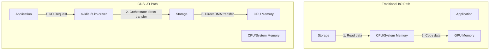
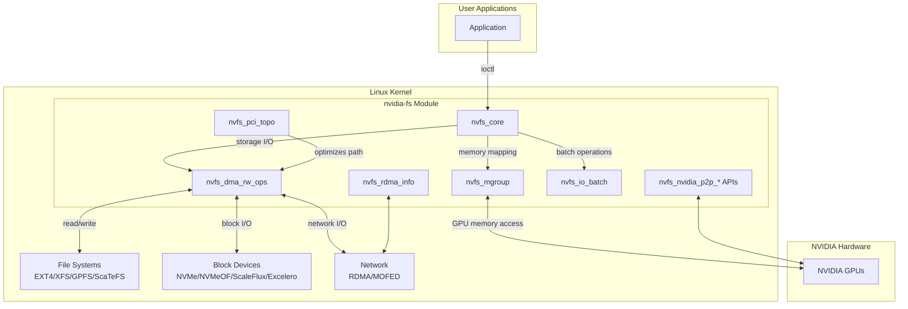
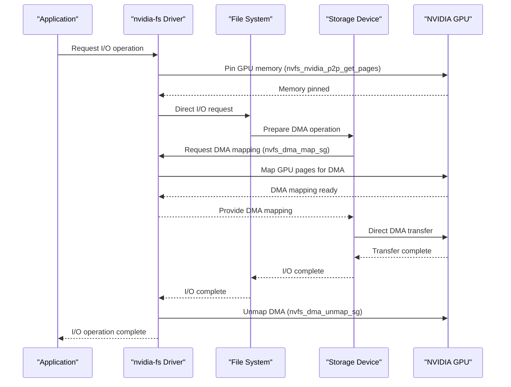

<!-- source: DeepWiki mcp.deepwiki.com · repo NVIDIA/gds-nvidia-fs · page 1 Overview · fetched 2026-10-26 -->

# Overview

Relevant source files

The following files were used as context for generating this wiki page:

- [ChangeLog](ChangeLog)
- [README.md](README.md)
- [src/GDS_VERSION](src/GDS_VERSION)
- [src/nvfs-vers.h](src/nvfs-vers.h)

NVIDIA GPUDirect Storage (GDS) is a technology that enables direct data transfers between GPU memory and storage devices, bypassing the CPU and system memory. The `nvidia-fs` kernel driver (located in this repository) orchestrates I/O operations directly from DMA/RDMA capable storage to user-allocated GPU memory on NVIDIA graphics cards.

This overview provides an introduction to the GDS kernel driver architecture, components, and capabilities. For detailed information about specific features and version history, see [Features and Version History](#1.1). For a deeper examination of the system architecture, see [System Architecture](#2).

## Purpose and Scope

The `nvidia-fs` kernel module is designed to accelerate data paths between storage and GPUs by eliminating unnecessary copies through host memory. This direct path improves I/O performance for GPU-accelerated applications that process large datasets, such as AI training, data analytics, and scientific computing.

Sources: [README.md:5-8]()

## System Architecture

The NVIDIA-FS driver consists of several key components that work together to enable direct data transfers between storage and GPU memory:

Sources: [README.md:7-14](), [ChangeLog:15-16](), [ChangeLog:127-132]()

## Core Components

The `nvidia-fs` driver consists of several interconnected components, each handling specific aspects of the GPUDirect Storage functionality:

### Core Module
The core module handles initialization, teardown, and IOCTL interfaces for applications. It provides the entry points for user applications to interact with the driver.

For detailed information about the core module, see [Core Module](#2.1).

### Memory Management
The memory management subsystem handles mapping and pinning of GPU memory. It establishes proper mappings between user space and GPU memory using NVIDIA's P2P APIs, such as `nvidia_p2p_get_pages_persistent` for modern drivers.

For detailed information about memory management, see [Memory Management](#2.2).

Sources: [ChangeLog:22-26]()

### DMA Operations
The DMA abstraction layer provides a unified interface for direct memory access operations across various storage technologies. It implements storage-specific optimizations, such as using `blk` based APIs to map NVMe DMA requests.

For detailed information about DMA operations, see [DMA Operations](#2.3).

Sources: [ChangeLog:3-3](), [ChangeLog:132-132](), [ChangeLog:138-139]()

### PCI Topology Management
The PCI topology manager optimizes data transfers by considering the physical layout of devices. It tracks peer affinity and distance, often exposed via `/proc/driver/nvidia-fs/peer_distance`.

For detailed information about PCI topology management, see [PCI Topology Management](#2.4).

Sources: [ChangeLog:101-101](), [ChangeLog:128-128]()

### RDMA Support
The RDMA support module enables direct memory access for distributed storage systems. It integrates with MOFED and supports protocols like NFS over RDMA.

For detailed information about RDMA support, see [RDMA Support](#2.5).

Sources: [README.md:12-13](), [ChangeLog:19-19](), [ChangeLog:89-89]()

### Batch I/O Operations
The batch I/O subsystem allows grouping multiple I/O operations to improve performance by reducing system call overhead and improving throughput.

For detailed information about batch I/O operations, see [Batch I/O Operations](#2.6).

Sources: [ChangeLog:84-84]()

## Supported Storage Technologies

The `nvidia-fs` driver supports a variety of storage technologies:

| Storage Type | Supported Technologies |
|--------------|------------------------|
| Local Filesystems | XFS, EXT4 (in ordered mode) |
| Block Devices | NVMe, NVMe-oF, ScaleFlux CSD, Excelero |
| Network Filesystems | NFS over RDMA (with MOFED 5.1+) |
| Distributed Filesystems | DDN Exascaler, WekaFS, VAST, IBM GPFS, ScaTeFS |

Sources: [README.md:9-15](), [ChangeLog:16-16](), [ChangeLog:97-97](), [ChangeLog:106-106]()

## Hardware and Software Requirements

For optimal performance with the `nvidia-fs` driver, the following requirements must be met:

### Hardware Requirements
- NVIDIA Tesla or Quadro class GPUs (Pascal, Volta, Turing, Ampere, or Hopper) [README.md:20-20](), [ChangeLog:47-47]()
- NVMe/NVMe-oF storage devices or supported distributed filesystem [README.md:21-21]()
- RDMA-capable network adapters for distributed storage [README.md:23-23]()

### Software Requirements
- Linux kernel 4.15.0 or later [README.md:22-22]()
- MOFED 5.1 or later [README.md:23-23]()
- CUDA toolkit 10.0 or later [README.md:24-24]()
- NVIDIA GPU display driver >= 418.40 [README.md:25-25]()

## Version Information

The current version of the `nvidia-fs` driver is 2.28.2. The underlying GDS version is 1.17.0.44.

Key capabilities added in recent versions include:
- Support for NEC Scalable Technology File System (ScaTeFS) [ChangeLog:16-16]()
- Support for Grace-Hopper platform with 4k and 64k page sizes [ChangeLog:47-47]()
- Persistent P2P API support for NVIDIA drivers >= 555 [ChangeLog:22-22]()
- Block-based API for NVMe DMA request mapping [ChangeLog:3-3]()

For a complete history of features and improvements, see [Features and Version History](#1.1).

Sources: [src/nvfs-vers.h:27-32](), [src/GDS_VERSION:1](), [ChangeLog:1-3]()

---

