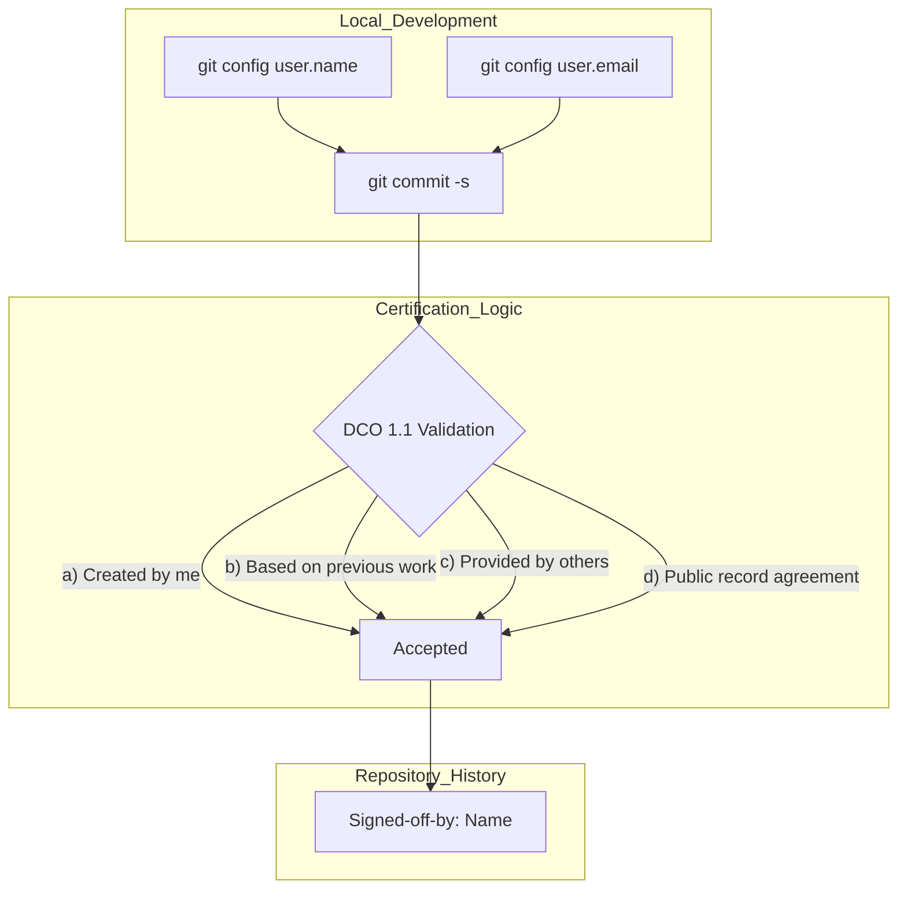
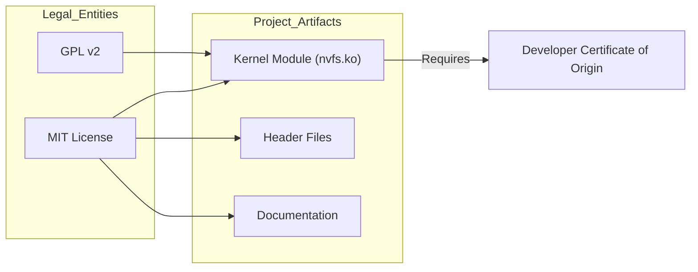

<!-- source: DeepWiki mcp.deepwiki.com · repo NVIDIA/gds-nvidia-fs · page 1.2 Contributing and Licensing · fetched 2026-10-26 -->

# Contributing and Licensing

Relevant source files

The following files were used as context for generating this wiki page:

- [CONTRIBUTING.md](CONTRIBUTING.md)
- [LICENSE](LICENSE)

This page outlines the protocols for contributing to the `gds-nvidia-fs` repository, the legal framework governing its distribution, and the requirements for certifying contributions via the Developer Certificate of Origin (DCO).

## Contribution Workflow

The `gds-nvidia-fs` project follows a standard GitHub-based fork and pull request (PR) model. Contributions are categorized by their impact on the system's public interfaces and supported filesystem backends.

### General Guidelines
*   **Issue First**: Before initiating code changes, contributors must file an issue for tracking and discussion to ensure alignment with the GPUDirect Storage (GDS) scope [CONTRIBUTING.md:10-16]().
*   **Branching**: The `master` branch contains the latest stable code [CONTRIBUTING.md:24-24]().
*   **Scope**: PRs should address a single feature or bug. Documentation updates related to code changes must be included in the same PR [CONTRIBUTING.md:41-45]().
*   **Commit Style**: All commit messages must adhere to [Conventional Commits](https://www.conventionalcommits.org/) [CONTRIBUTING.md:38-39]().
*   **Merging**: Most contributions are integrated via "Squash and Merge" [CONTRIBUTING.md:48-49]().

### Versioning Policy
The project utilizes [Semantic Versioning](https://semver.org/) [CONTRIBUTING.md:20-20](). Version increments are handled by maintainers in separate commits; contributors should not modify version strings in their PRs [CONTRIBUTING.md:27-28]().

| Release Type | Description |
| :--- | :--- |
| **MAJOR** | Aimed at maintaining backward compatibility; significant architectural shifts [CONTRIBUTING.md:34-34](). |
| **MINOR** | Re-evaluation of supported filesystems or addition of minor features without protocol changes [CONTRIBUTING.md:31-32](). |
| **PATCH** | Bug fixes and minor adjustments; not every change triggers a GitHub release [CONTRIBUTING.md:29-29](). |

**Sources:** [CONTRIBUTING.md:10-49]()

## Developer Certificate of Origin (DCO)

To ensure the legal integrity of the kernel driver, every contribution must be "signed off." This signifies that the contributor has the right to submit the code under the project's licenses [CONTRIBUTING.md:59-63]().

### Sign-off Requirement
Contributors must include a `Signed-off-by` line in every git commit message using their real name [CONTRIBUTING.md:104-108]().

**Mechanism: Contribution Certification**
The following diagram illustrates the relationship between the developer's local environment and the certification of the patch.

**Diagram: DCO Certification Flow**

**Sources:** [CONTRIBUTING.md:65-111]()

## Licensing Terms

The `gds-nvidia-fs` project is distributed under a dual-licensing structure to accommodate both the kernel-space requirements and the associated software components.

### License Components
1.  **GPL v2**: Software developed as part of this kernel module is released under the **GNU General Public License version 2** [LICENSE:23-24]().
2.  **MIT/X11**: The broader permission notice grants the right to use, copy, modify, and distribute the software without restriction, provided the copyright notice is included [LICENSE:3-11]().

### Liability and Warranty
The software is provided "AS IS," without any warranty of any kind, including but not limited to the warranties of merchantability or fitness for a particular purpose [LICENSE:13-19]().

**Diagram: License Mapping to Code Entities**
This diagram maps the licensing requirements to the resulting repository artifacts.

**Diagram: License Application**

**Sources:** [LICENSE:1-25](), [CONTRIBUTING.md:79-91]()

---

