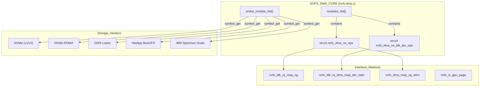
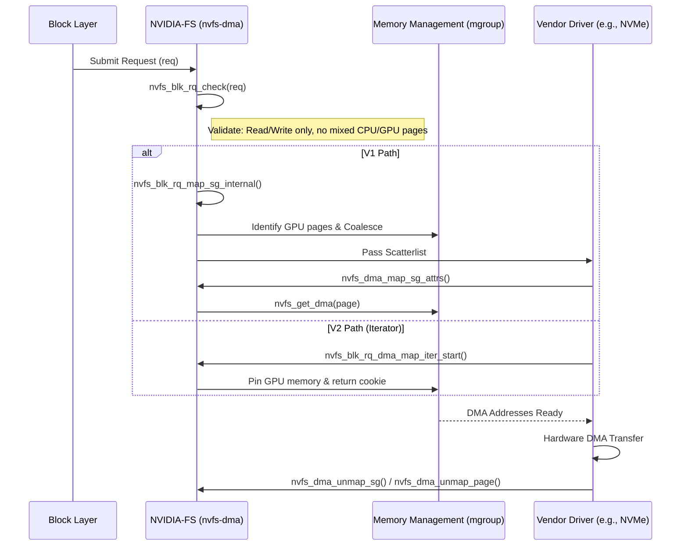

<!-- source: DeepWiki mcp.deepwiki.com · repo NVIDIA/gds-nvidia-fs · page 2.3 DMA Operations · fetched 2026-10-26 -->

# DMA Operations

Relevant source files

The following files were used as context for generating this wiki page:

- [src/nvfs-dma.c](src/nvfs-dma.c)
- [src/nvfs-dma.h](src/nvfs-dma.h)
- [src/nvfs-kernel-interface.h](src/nvfs-kernel-interface.h)
- [src/nvfs-mod.c](src/nvfs-mod.c)

The DMA Operations subsystem in NVIDIA GPUDirect Storage (GDS) provides a high-performance abstraction layer that enables direct data transfers between storage devices and GPU memory. By bypassing the CPU and system RAM, this layer facilitates unified Direct Memory Access (DMA) across diverse storage backends including NVMe, SCSI, ScaleFlux, and various RDMA-capable distributed filesystems.

## DMA Abstraction Layer

The DMA abstraction layer defines a standard interface (`nvfs_dma_rw_ops`) that allows the NVIDIA-FS kernel module to plug into the I/O paths of different storage drivers. This architecture ensures that regardless of the underlying storage technology, GPU memory can be mapped and accessed consistently.

Sources: [src/nvfs-dma.c:52-59](), [src/nvfs-dma.c:61-206](), [src/nvfs-dma.h:74-101](), [src/nvfs-dma.h:137-166]()

## Key Interfaces and Structures

### V1 and V2 Operation Sets
NVIDIA-FS supports two primary interface versions depending on the host kernel's capabilities (specifically the presence of `HAVE_BLK_RQ_DMA_MAP_ITER_START`).

*   **V1 Interface (`nvfs_dma_rw_ops`)**: Uses traditional scatter-gather list mapping. It is used for most legacy storage drivers and kernels without the iterator-based DMA API [src/nvfs-dma.h:74-101]().
*   **V2 Interface (`nvfs_dma_rw_blk_iter_ops`)**: Leverages the block layer DMA iterator API, providing more efficient mapping for modern NVMe drivers [src/nvfs-dma.h:137-166]().

| Method | Description |
| :--- | :--- |
| `nvfs_blk_rq_map_sg` | Maps a block `request` to a `scatterlist`. Handles GPU page identification and coalescing [src/nvfs-dma.h:77-79](). |
| `nvfs_dma_map_sg_attrs` | Performs the actual DMA mapping of the scatterlist to the storage device [src/nvfs-dma.h:81-85](). |
| `nvfs_is_gpu_page` | Callback to verify if a specific `struct page` resides in GPU memory [src/nvfs-dma.h:92](). |
| `nvfs_gpu_index` | Returns the ordinal index of the GPU owning the page [src/nvfs-dma.h:94](). |
| `nvfs_blk_rq_dma_map_iter_start` | (V2 Only) Initializes the DMA iterator for a block request [src/nvfs-dma.h:140-144](). |

Sources: [src/nvfs-dma.h:74-166]()

### Module Registration
The `modules_list` array serves as the registry for all supported storage backends. Each `module_entry` defines the module name, the registration/unregistration symbols to look for in the kernel symbol table, and the specific ops structure to be passed to the vendor driver [src/nvfs-dma.c:61-206]().

Sources: [src/nvfs-dma.c:61-206](), [src/nvfs-dma.h:172-185]()

## DMA Operation Flow

The DMA flow involves validating the block request, constructing a scatter-gather list (or iterator), and establishing the hardware-level DMA mapping.

Sources: [src/nvfs-dma.c:246-264](), [src/nvfs-dma.c:298-310](), [src/nvfs-dma.c:515-534](), [src/nvfs-mod.c:86-104]()

## Implementation Details

### Scatter-Gather List Construction
The function `nvfs_blk_rq_map_sg_internal` is the core of the V1 path. It iterates through the `bio_vec` entries of a request, distinguishes between CPU and GPU pages, and builds a `scatterlist` [src/nvfs-dma.c:403-499]().

*   **Coalescing**: It attempts to merge contiguous GPU physical addresses into a single SG entry to improve DMA efficiency [src/nvfs-dma.c:440-449]().
*   **Validation**: It enforces that a single request cannot contain a mix of CPU and GPU pages. If both are found, the request is rejected with `NVFS_IO_ERR` [src/nvfs-dma.c:425-430]().
*   **Size Limits**: Requests are capped by `NVME_MAX_SEGS` (127) to remain compatible with standard NVMe driver limits [src/nvfs-dma.c:38](), [src/nvfs-dma.c:266-275]().

Sources: [src/nvfs-dma.c:38](), [src/nvfs-dma.c:266-275](), [src/nvfs-dma.c:403-499]()

### Iterator-Based V2 Path
On newer kernels, NVIDIA-FS registers `nvfs_nvme_dma_rw_blk_iter_ops` [src/nvfs-dma.c:58](). This path avoids the overhead of intermediate scatter-gather list allocation by using the kernel's `blk_dma_iter` interface [src/nvfs-dma.h:137-150]().

*   **`nvfs_blk_rq_dma_map_iter_start`**: Sets up the mapping state and pins the underlying GPU memory [src/nvfs-dma.h:140-144]().
*   **`nvfs_blk_rq_dma_map_iter_next`**: Advances the iterator to the next DMA-contiguous segment [src/nvfs-dma.h:146-149]().

Sources: [src/nvfs-dma.c:58](), [src/nvfs-dma.h:137-150]()

### Module Probing and Registration
During driver initialization, `probe_module_list()` iterates through the supported modules. It uses `__symbol_get` to find the registration functions exported by vendor drivers (e.g., `nvme_v2_register_nvfs_dma_ops`) and passes the corresponding NVIDIA-FS ops structure to them [src/nvfs-mod.c:40-129]().

Sources: [src/nvfs-mod.c:40-129](), [src/nvfs-dma.c:61-206]()

## Performance and Constraints

*   **IOVA Boundaries**: The system handles SMMU/IOMMU discontinuities, specifically checking for 4GB boundaries that might affect GPU page contiguity [src/nvfs-dma.c:443-448]().
*   **Error Codes**: 
    *   `NVFS_IO_ERR (-1)`: Returned for mapping failures or invalid hardware states [src/nvfs-dma.h:49]().
    *   `NVFS_BAD_REQ (-2)`: Returned when a request is valid but cannot be handled via GDS (e.g., CPU-only pages in a path expecting GPU pages) [src/nvfs-dma.h:50]().
*   **Memory Groups**: DMA operations rely on the `nvfs_mgroup` to track the lifecycle of pinned GPU pages and their associated DMA addresses [src/nvfs-dma.c:44-49]().

Sources: [src/nvfs-dma.c:44-49](), [src/nvfs-dma.c:443-448](), [src/nvfs-dma.h:49-50]()

---

