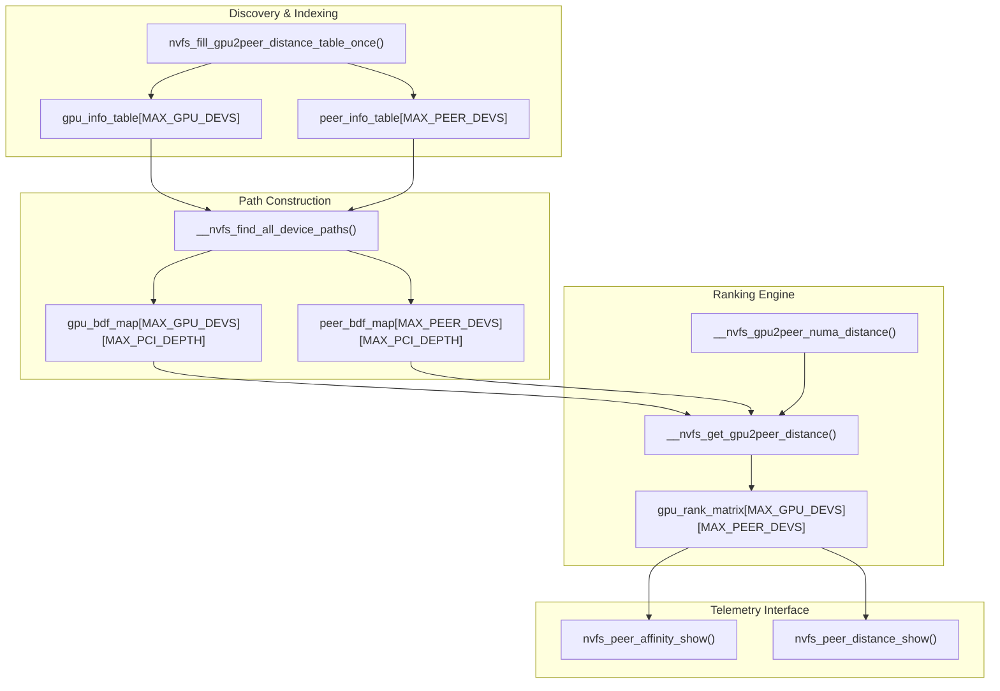
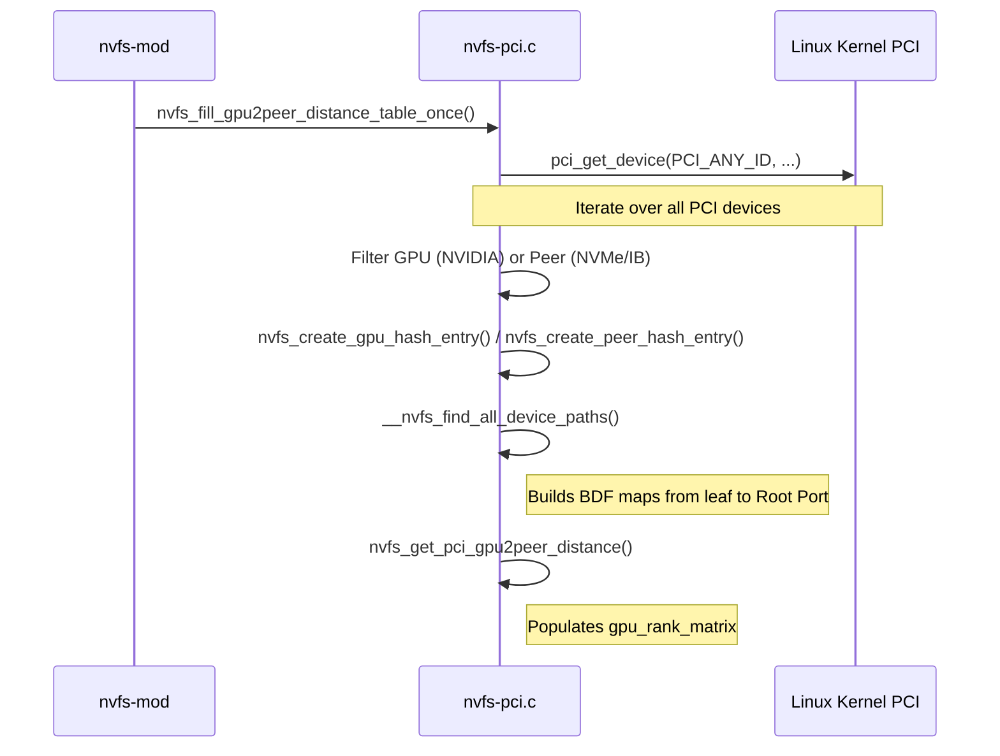

<!-- source: DeepWiki mcp.deepwiki.com · repo NVIDIA/gds-nvidia-fs · page 2.4 PCI Topology Management · fetched 2026-10-26 -->

# PCI Topology Management

Relevant source files

The following files were used as context for generating this wiki page:

- [src/Makefile](src/Makefile)
- [src/dkms.conf](src/dkms.conf)
- [src/nvfs-pci.c](src/nvfs-pci.c)
- [src/nvfs-pci.h](src/nvfs-pci.h)

## Purpose and Scope

The PCI Topology Management subsystem in NVIDIA GPUDirect Storage (GDS) optimizes direct data transfers between GPUs and storage or network devices by analyzing and leveraging the underlying PCI topology of the system. This subsystem discovers the PCI topology, calculates device-to-device distances, and provides intelligence for path selection to minimize data transfer latency and maximize bandwidth.

This page describes the architecture and operation of the PCI topology management capabilities in the NVIDIA-FS driver.

Sources: [src/nvfs-pci.h:25-251](), [src/nvfs-pci.c:25-47]()

## Key Concepts

### PCI Device Paths and Topology

The PCI Topology Management subsystem constructs a representation of the system's PCIe hierarchy by discovering all GPUs, NVMe devices, and network adapters (Ethernet and InfiniBand). Key attributes tracked include:

- **PCIe Bridges**: Identifying relationships between switches and root complexes [src/nvfs-pci.c:308-425]().
- **ACS Detection**: Access Control Services (ACS) can force P2P traffic up to the root complex, impacting performance. The driver detects this via `nvfs_pci_check_acs_enabled` [src/nvfs-pci.c:229-253]().
- **Link Capabilities**: Link speeds (e.g., 16GT/s) and widths (e.g., x16) are stored to calculate theoretical bandwidth [src/nvfs-pci.h:155-200]().
- **NUMA Affinity**: Proximity to CPU sockets is factored into the final distance metric [src/nvfs-pci.c:434-474]().

Sources: [src/nvfs-pci.c:229-253](), [src/nvfs-pci.c:308-425](), [src/nvfs-pci.h:44-52](), [src/nvfs-pci.h:155-200]()

### Device Distance and Ranking

The system computes a "distance" between GPU devices and potential peer devices (NVMe drives or network adapters). This distance is stored in `struct nvfs_rank_data` [src/nvfs-pci.c:91-97]():

1. **PCI Distance**: Number of hops or logical separation in the PCIe tree.
2. **Bandwidth Index**: A rank derived from `nvfs_pcie_link_speed_table` and `nvfs_pcie_link_width_table` [src/nvfs-pci.c:48-88]().
3. **Cross-Root Port**: A flag indicating if traffic must traverse the CPU's internal interconnect [src/nvfs-pci.c:93]().

Sources: [src/nvfs-pci.c:48-97](), [src/nvfs-pci.c:483-608](), [src/nvfs-pci.h:54-61]()

## System Architecture

### PCI Topology Management Data Model

The following diagram maps the logical flow of topology discovery to the specific C functions and data structures that handle them.

Sources: [src/nvfs-pci.c:90-110](), [src/nvfs-pci.c:308-425](), [src/nvfs-pci.c:645-665]()

### Core Data Structures

| Structure / Variable | File | Description |
|:---|:---|:---|
| `struct nvfs_rank_data` | [src/nvfs-pci.c:91]() | Stores rank, cross-RP flag, pci_dist, and bw_index for a GPU-Peer pair. |
| `gpu_info_table` | [src/nvfs-pci.c:105]() | Hash table for quick lookup of GPU BDF info. |
| `peer_info_table` | [src/nvfs-pci.c:107]() | Hash table for peer devices (NVMe/Network). |
| `gpu_bdf_map` | [src/nvfs-pci.c:100]() | Stores the full PCI path (ancestors) for each GPU. |
| `peer_bdf_map` | [src/nvfs-pci.c:102]() | Stores the full PCI path for each peer device. |
| `gpu_rank_matrix` | [src/nvfs-pci.c:110]() | The final computed matrix used for I/O path decisions. |

Sources: [src/nvfs-pci.c:90-110]()

## Initialization and Device Discovery

### PCI Device Discovery Process

The driver performs a one-time discovery of the PCI environment during module initialization or upon the first GDS I/O request via `nvfs_fill_gpu2peer_distance_table_once` [src/nvfs-pci.c:645]().

Sources: [src/nvfs-pci.c:645-665](), [src/nvfs-pci.c:308-425]()

### Device Path Discovery

The function `__nvfs_find_all_device_paths` [src/nvfs-pci.c:308]() traverses the PCI tree for each device. It uses `pci_upstream_bridge` to climb the hierarchy until it reaches a Root Port or a device with no parent. For each hop, it records the BDF and checks for ACS via `nvfs_pci_check_acs_enabled` [src/nvfs-pci.c:229]().

Sources: [src/nvfs-pci.c:308-425](), [src/nvfs-pci.c:229-253]()

## Distance Calculation Algorithm

### Path Comparison Logic

The core logic resides in `__nvfs_get_gpu2peer_distance` [src/nvfs-pci.c:483](). It compares the `gpu_bdf_map` and `peer_bdf_map` to find the "Lowest Common Ancestor" (LCA).

1.  **Top-Down Scan**: It iterates through the recorded paths of both devices starting from the root.
2.  **Common Ancestor Found**: If they share a bridge, the distance is the sum of hops from that bridge to each device.
3.  **Cross-Root Port**: If no common bridge exists, the devices are "Cross-RP". A penalty `BASE_PCI_DISTANCE_CROSSRP` (127) is applied [src/nvfs-pci.h:59]().
4.  **ACS Penalty**: If any bridge in the path has ACS enabled, the traffic is treated as if it must go through the Root Complex, increasing the effective distance [src/nvfs-pci.c:514-520]().

Sources: [src/nvfs-pci.c:483-608](), [src/nvfs-pci.h:59]()

### NUMA and Bandwidth Factors

-   **NUMA**: `__nvfs_gpu2peer_numa_distance` [src/nvfs-pci.c:434]() adds distance based on whether devices are on the same NUMA node or different nodes.
-   **Bandwidth Index**: Calculated using the minimum link speed and width found along the path [src/nvfs-pci.c:537-550]().

Sources: [src/nvfs-pci.c:434-474](), [src/nvfs-pci.c:537-550]()

## Runtime Operations and Statistics

### Usage Tracking

The driver tracks the number of P2P operations between specific GPU-Peer pairs to provide affinity telemetry.
-   **Update**: `nvfs_update_peer_usage(gpu_pdevinfo, peer_pdevinfo)` increments the `count` in the `gpu_rank_matrix` [src/nvfs-pci.c:709]().
-   **Retrieval**: Userspace can query these via the procfs interface.

Sources: [src/nvfs-pci.c:709-723]()

### Procfs Interface

The subsystem exposes topology and affinity data through `/proc/driver/nvidia-fs/`:
-   **`peer_distance`**: Shows the calculated `gpu_rank_matrix` via `nvfs_peer_distance_show` [src/nvfs-pci.c:804]().
-   **`peer_affinity`**: Shows usage statistics and cross-node traffic percentages via `nvfs_peer_affinity_show` [src/nvfs-pci.c:832]().

Sources: [src/nvfs-pci.c:804-865]()

## Configuration

System limits are defined in `nvfs-pci.h` but can be overridden at compile time via `ccflags-y` in the Makefile [src/Makefile:34-38]().

| Macro | Default | Description |
|:---|:---|:---|
| `MAX_PEER_DEVS` | 64 | Max number of storage/network peers tracked [src/nvfs-pci.h:48](). |
| `MAX_PCI_DEPTH` | 16 | Max depth of the PCI tree for path discovery [src/nvfs-pci.h:49](). |
| `MAX_GPU_DEVS` | 64 | Max number of NVIDIA GPUs supported [src/nvfs-pci.h:52](). |

Sources: [src/nvfs-pci.h:44-52](), [src/Makefile:34-38](), [src/dkms.conf:29-30]()

---

