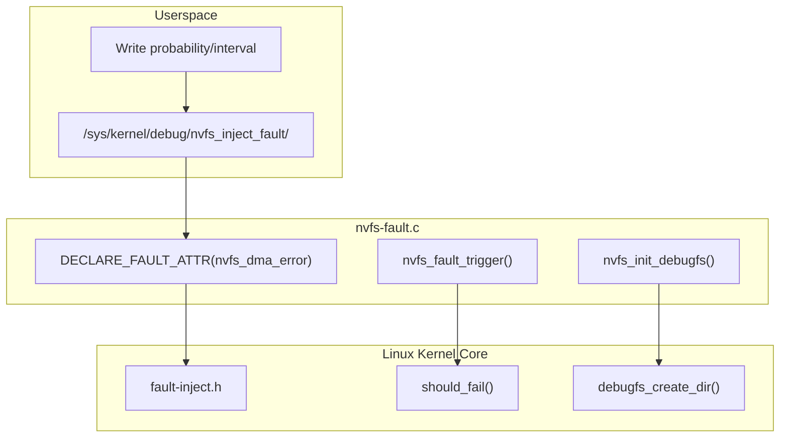
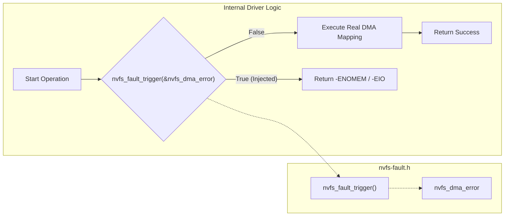

<!-- source: DeepWiki mcp.deepwiki.com · repo NVIDIA/gds-nvidia-fs · page 4.3 Fault Injection · fetched 2026-10-26 -->

# Fault Injection

<details>
<summary>Relevant source files</summary>

The following files were used as context for generating this wiki page:

- [src/nvfs-fault.c](src/nvfs-fault.c)
- [src/nvfs-fault.h](src/nvfs-fault.h)

</details>


The GDS-NVIDIA-FS driver includes a robust fault injection framework designed to simulate various error conditions within the kernel. This framework allows developers and QA engineers to verify the driver's error handling paths, state machine transitions, and resource cleanup logic by artificially triggering failures in critical operations such as DMA mapping, memory pinning, and VFS permission checks.

## Implementation Overview

The fault injection system is built upon the Linux kernel's standard `fault-injection` infrastructure. It is conditionally compiled based on the `CONFIG_FAULT_INJECTION` kernel configuration parameter [src/nvfs-fault.c:27]().

### Core Components

The framework defines several `fault_attr` structures that correspond to specific failure points within the driver's execution flow. These attributes are exposed via `debugfs`, allowing userspace to configure failure probabilities, intervals, and times for each specific fault type.

| Fault Attribute | Purpose |
| :--- | :--- |
| `nvfs_dma_error` | Simulates failures during DMA mapping or scatter-gather list operations. |
| `nvfs_rw_verify_area_error` | Simulates VFS-level permission or range verification failures. |
| `nvfs_io_transit_state_fail` | Forces failure in the I/O lifecycle state machine transitions. |
| `nvfs_pin_shadow_pages_error` | Simulates failures when pinning shadow buffer pages for CPU-mediated transfers. |
| `nvfs_vm_insert_page_error` | Simulates failures during the insertion of pages into a process's VMA. |
| `nvfs_invalid_p2p_get_page` | Simulates failures in the NVIDIA P2P page retrieval process. |
| `nvfs_end_fence_get_user_pages_fast_error` | Simulates failures in `get_user_pages_fast` during fence synchronization. |

**Sources:** [src/nvfs-fault.c:31-37](), [src/nvfs-fault.h:29-35]()

## Data Flow and Control

The framework initializes a directory in `debugfs` titled `nvfs_inject_fault` [src/nvfs-fault.c:41](). Each fault attribute is represented as a subdirectory within this root, containing files to control the fault behavior (e.g., `probability`, `interval`, `times`).

### Initialization and Cleanup

The lifecycle of the fault injection interface is managed during module load and unload:

1.  **Initialization**: `nvfs_init_debugfs()` creates the root directory and populates it with attributes using `fault_create_debugfs_attr` [src/nvfs-fault.c:49-62]().
2.  **Triggering**: The driver uses the inline helper `nvfs_fault_trigger(void *fault)` to check if a fault should be injected at a specific code site. This helper wraps the kernel's `should_fail()` function [src/nvfs-fault.h:37-40]().
3.  **Cleanup**: `nvfs_free_debugfs()` recursively removes the `debugfs` entries to prevent resource leaks [src/nvfs-fault.c:70]().

### Fault Injection Architecture

The following diagram illustrates how the `nvfs-fault` subsystem interacts with the Linux Kernel's fault injection core and exposes controls to Userspace.

**Fault Injection Control Flow**

**Sources:** [src/nvfs-fault.c:29-63](), [src/nvfs-fault.h:37-40]()

## Integration with Driver Operations

When `CONFIG_FAULT_INJECTION` is disabled, the fault injection calls are optimized out using no-op macros, ensuring zero performance overhead in production builds [src/nvfs-fault.h:47-48]().

When enabled, the driver logic incorporates checks at critical junctures. The following diagram shows how a generic driver function (e.g., a DMA mapping routine) utilizes the `nvfs_fault_trigger` to simulate a failure.

**Code Entity Space: Triggering a Fault**

**Sources:** [src/nvfs-fault.h:29-40](), [src/nvfs-fault.c:49-50]()

## Configuration and Usage

To use the fault injection framework:
1.  Ensure the kernel is compiled with `CONFIG_FAULT_INJECTION=y` and `CONFIG_FAULT_INJECTION_DEBUG_FS=y`.
2.  Mount debugfs: `mount -t debugfs none /sys/kernel/debug`.
3.  Configure a specific fault, for example, the DMA error:
    ```bash
    # Set 10% probability of failure
    echo 10 > /sys/kernel/debug/nvfs_inject_fault/dma_error/probability
    # Inject fault for the next 5 calls
    echo 5 > /sys/kernel/debug/nvfs_inject_fault/dma_error/times
    ```
4.  Run the GDS application. The driver will return errors as if the hardware or memory subsystem failed, allowing validation of the application's recovery logic.

**Sources:** [src/nvfs-fault.c:41-62](), [src/nvfs-fault.h:37-40]()

---

