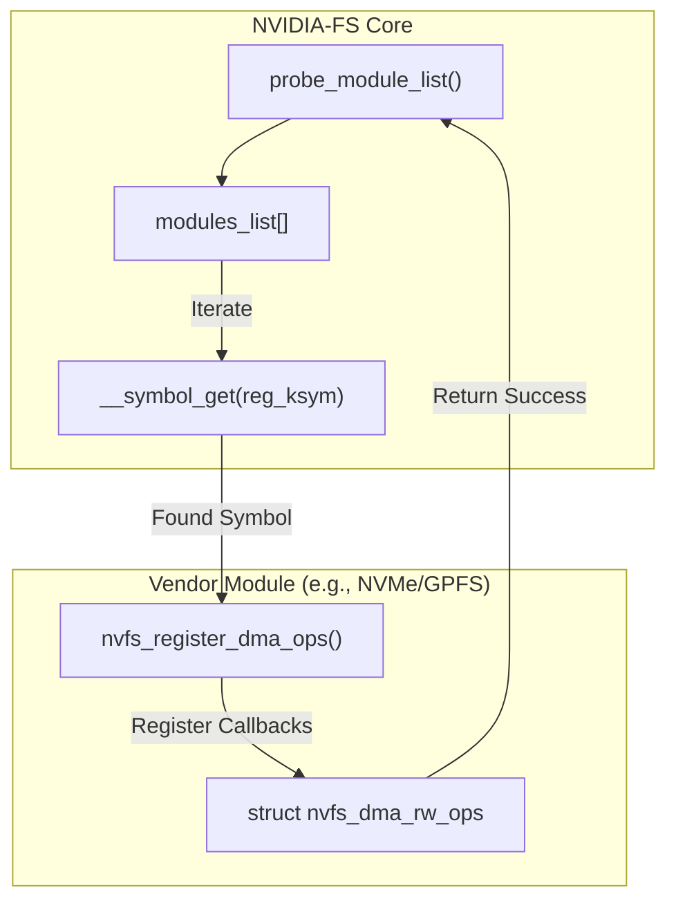
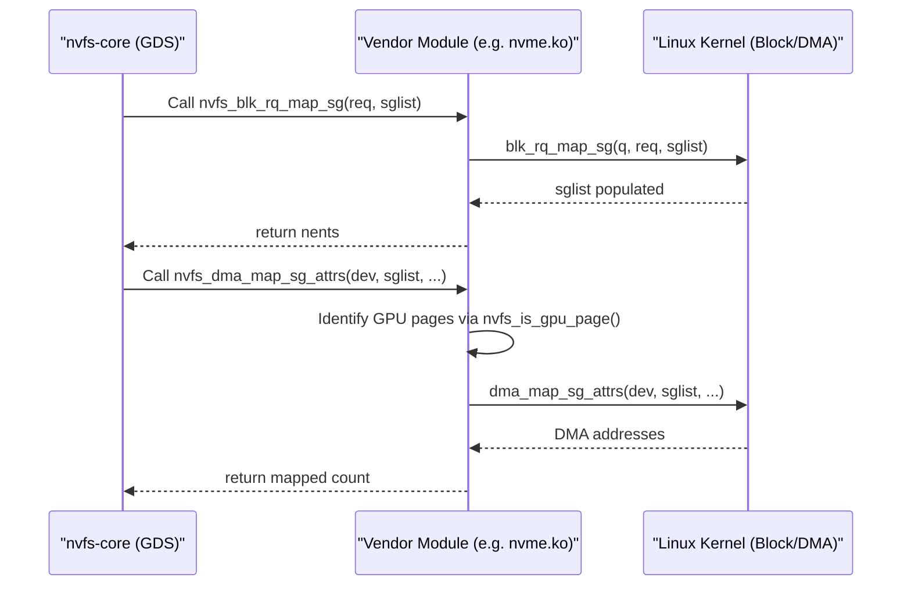

<!-- source: DeepWiki mcp.deepwiki.com · repo NVIDIA/gds-nvidia-fs · page 5.2 Vendor and Peer Device Integration · fetched 2026-10-26 -->

# Vendor and Peer Device Integration

Relevant source files

The following files were used as context for generating this wiki page:

- [src/nvfs-dma.h](src/nvfs-dma.h)
- [src/nvfs-kernel-interface.h](src/nvfs-kernel-interface.h)
- [src/nvfs-mod.c](src/nvfs-mod.c)

The NVIDIA-FS (GDS) driver provides a modular framework for third-party storage vendors and filesystem maintainers to integrate with the GPU Direct Storage pipeline. This integration is achieved through a registration mechanism where vendor-specific modules provide callbacks for DMA mapping, scatter-gather list construction, and GPU page identification.

## Module Registration Mechanism

The driver maintains a list of supported vendor modules and uses an auto-probing mechanism to link with them at runtime. This avoids hard dependencies and allows the GDS driver to load even if specific vendor drivers are absent.

### Probing and Symbol Resolution
The function `probe_module_list` iterates through a predefined `modules_list` [src/nvfs-mod.c:40-44](). For each entry, it attempts to resolve registration and de-registration symbols using `__symbol_get` [src/nvfs-mod.c:56-64](). 

If the symbols are found, the driver invokes the vendor's registration function, passing a structure of operation callbacks (`nvfs_dma_rw_ops` or `nvfs_dma_rw_blk_iter_ops`).

### Supported Vendor Keys
The driver identifies vendors using specific keys that correspond to their kernel module names or filesystem types:
*   **NVMe**: `nvme`, `nvme_rdma` [src/nvfs-dma.h:61-62]()
*   **SCSI**: `scsi_mod` [src/nvfs-dma.h:63]()
*   **Distributed/Network FS**: `lnet` (Lustre), `beegfs`, `mmfslinux` (GPFS), `rpcrdma` (NFS), `wekafsio` (Weka) [src/nvfs-dma.h:66-70]()
*   **Specialized Hardware**: `sfxvdriver` (ScaleFlux), `nvmeib_common` (Excelero/NVMesh) [src/nvfs-dma.h:64-65]()

**Module Registration Flow**
Title: GDS Vendor Module Registration Flow

Sources: [src/nvfs-mod.c:40-129](), [src/nvfs-dma.h:61-72]()

## The Callback Interface

Integration is defined by two primary versions of operation structures, depending on the kernel's support for DMA mapping iterators.

### Standard DMA Operations (v1)
The `struct nvfs_dma_rw_ops` is used for most storage integrations [src/nvfs-dma.h:74-101](). Key callbacks include:
*   `nvfs_blk_rq_map_sg`: Maps a block request to a scatter-gather list [src/nvfs-dma.h:77-79]().
*   `nvfs_dma_map_sg_attrs`: Performs the actual DMA mapping of the scatter-gather list to the device [src/nvfs-dma.h:81-85]().
*   `nvfs_is_gpu_page`: A critical callback used by the vendor driver to determine if a given `struct page` belongs to GPU memory [src/nvfs-dma.h:92]().

### Iterator-based Operations (v2)
For newer kernels supporting `HAVE_BLK_RQ_DMA_MAP_ITER_START`, the driver uses `struct nvfs_dma_rw_blk_iter_ops` [src/nvfs-dma.h:137-166](). This version is specifically utilized by the NVMe module [src/nvfs-mod.c:88-92]().
*   `nvfs_blk_rq_dma_map_iter_start`: Initializes the DMA mapping iterator for a request [src/nvfs-dma.h:140-144]().
*   `nvfs_blk_rq_dma_map_iter_next`: Fetches the next segment in the DMA iteration [src/nvfs-dma.h:146-149]().

### Feature Bitmaps
Vendors signal their capabilities using the `ft_bmap` field [src/nvfs-dma.h:75](). The driver provides macros to check these features:
*   `nvfs_ft_prep_sglist`: Support for preparing SG lists [src/nvfs-dma.h:105]().
*   `nvfs_ft_is_gpu_page`: Capability to identify GPU pages [src/nvfs-dma.h:107]().
*   `nvfs_ft_get_gpu_sglist_rdma_info`: Support for RDMA-specific GPU memory information [src/nvfs-dma.h:109]().

Sources: [src/nvfs-dma.h:74-169](), [src/nvfs-mod.c:86-104]()

## Peer Device Abstraction Layer

The peer device abstraction allows the GDS pipeline to interact with various storage controllers (NVMe, SCSI, RDMA NICs) uniformly.

### Data Flow Integration
When an I/O request is processed, the GDS driver uses the registered vendor callbacks to bridge the gap between the Linux Block Layer and NVIDIA's Peer Direct capabilities.

**Code Entity Interaction**
Title: Code Entity Interaction for DMA Mapping

### Peer Priority and Topology
Integration also includes topology awareness via the `nvfs_device_priority` callback [src/nvfs-dma.h:96](). This allows vendor drivers to report the "distance" or affinity between a specific storage device and a GPU index, which GDS uses to optimize data paths [src/nvfs-dma.h:118]().

### RDMA Integration
For network-based storage, the `nvfs_get_gpu_sglist_rdma_info` callback [src/nvfs-dma.h:98-100]() allows the vendor to retrieve RDMA-specific metadata for a scatter-gather list, enabling Peer Direct RDMA transfers where the NIC directly accesses GPU memory.

Sources: [src/nvfs-dma.h:74-124](), [src/nvfs-kernel-interface.h:38-40]()

---

