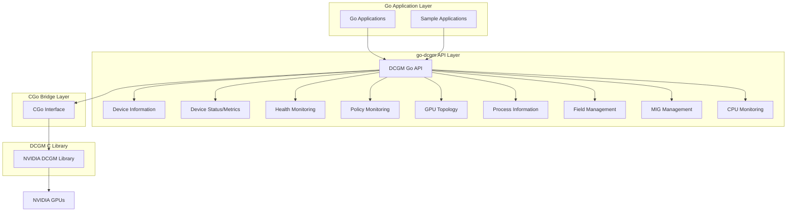
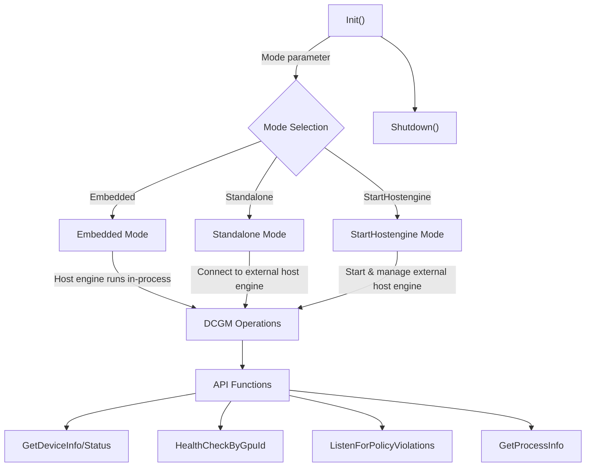
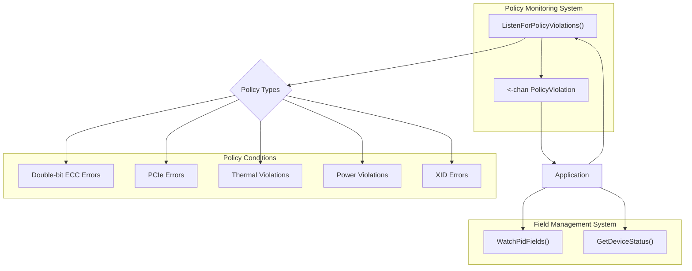
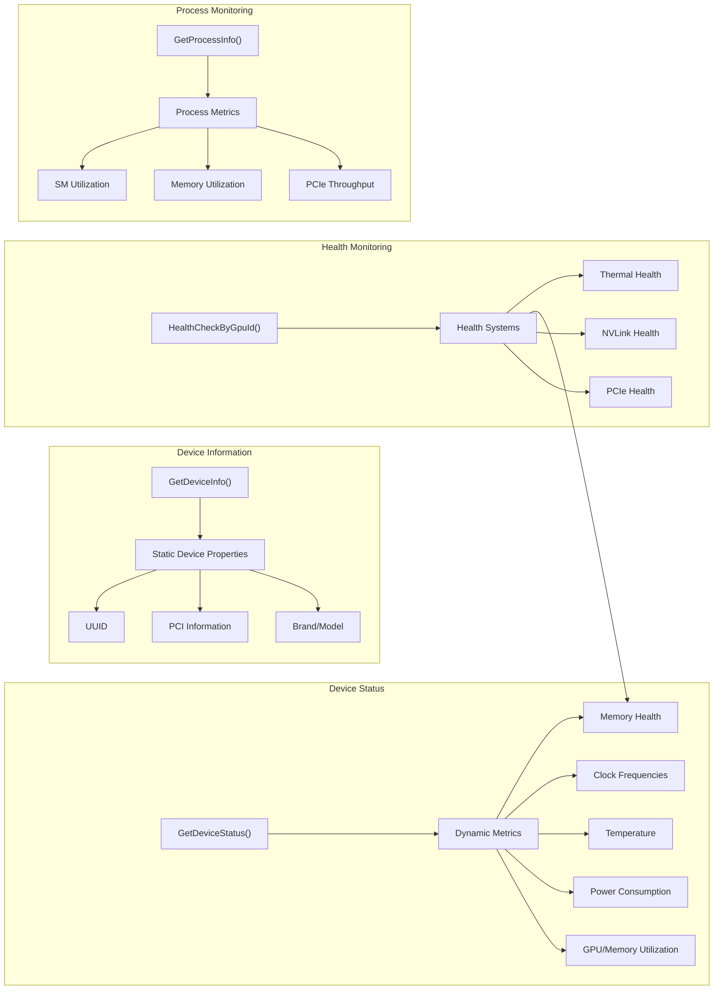
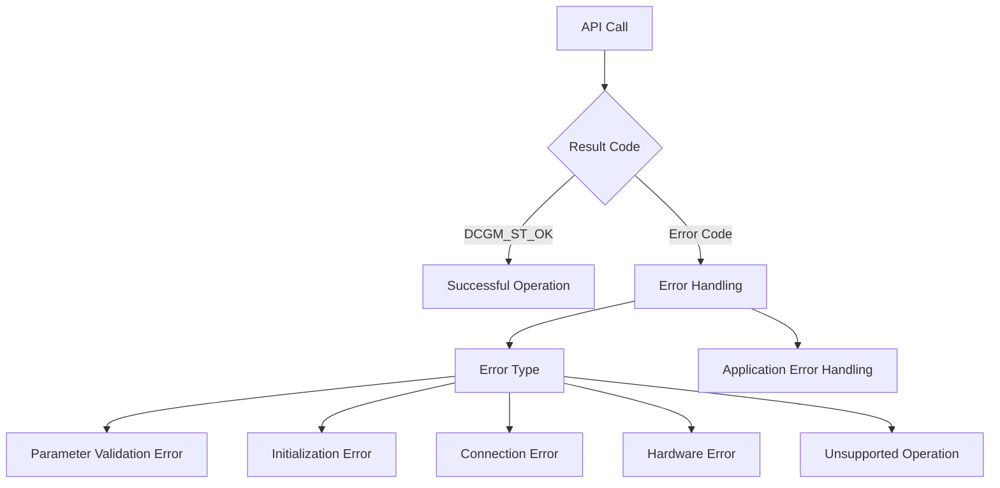
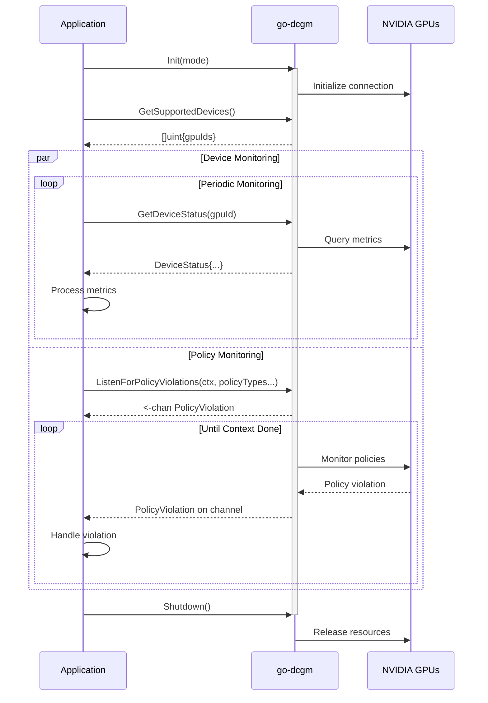
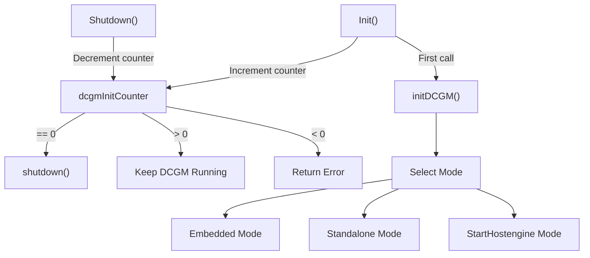

<!-- source: DeepWiki mcp.deepwiki.com · repo NVIDIA/go-dcgm · page 1 Overview · fetched 2026-10-26 -->

# Overview

<details>
<summary>Relevant source files</summary>

The following files were used as context for generating this wiki page:

- [README.md](README.md)
- [pkg/dcgm/api.go](pkg/dcgm/api.go)
- [pkg/dcgm/const.go](pkg/dcgm/const.go)
- [pkg/dcgm/dcgm_agent.h](pkg/dcgm/dcgm_agent.h)
- [pkg/dcgm/dcgm_errors.h](pkg/dcgm/dcgm_errors.h)
- [pkg/dcgm/dcgm_fields.h](pkg/dcgm/dcgm_fields.h)
- [pkg/dcgm/dcgm_structs.h](pkg/dcgm/dcgm_structs.h)
- [pkg/dcgm/profile.go](pkg/dcgm/profile.go)

</details>


The go-dcgm repository provides Go language bindings for NVIDIA's Data Center GPU Manager (DCGM), enabling Go applications to monitor and manage NVIDIA GPUs in data center environments. DCGM is a comprehensive toolkit for low-overhead management of NVIDIA GPUs, providing capabilities for health monitoring, diagnostics, system validation, policy management, and performance metrics collection.

This document serves as an introduction to the go-dcgm repository, explaining its architecture, core components, and operational modes. For detailed API usage patterns, see [API Usage Patterns](#5.2). For information about building and testing, see [Building and Testing](#4).

## Architecture Overview

The go-dcgm repository implements a layered architecture that bridges Go applications with the NVIDIA DCGM C library:



Sources: [pkg/dcgm/api.go:1-141](), [README.md:1-13]()

## Core Operational Modes

The library supports three primary operational modes, allowing flexibility in how DCGM is deployed and managed:



1. **Embedded Mode**: Starts the DCGM host engine within the same process as your application.
2. **Standalone Mode**: Connects to an already running DCGM host engine process.
3. **StartHostengine Mode**: Starts a separate host engine process, connects to it, and manages its lifecycle.

Sources: [pkg/dcgm/api.go:18-66](), [pkg/dcgm/dcgm_agent.h:83-119]()

## Core API Components

The go-dcgm API exposes the following key components:

```mermaid
graph LR
    subgraph "Lifecycle Management"
        Init["Init()"]
        Shutdown["Shutdown()"]
    end
    
    subgraph "Device Discovery"
        GetCount["GetAllDeviceCount()"]
        GetDevices["GetSupportedDevices()"] 
        GetEntities["GetEntityGroupEntities()"]
    end
    
    subgraph "Monitoring & Information"
        GetInfo["GetDeviceInfo()"]
        GetStatus["GetDeviceStatus()"]
        GetTopology["GetDeviceTopology()"]
        HealthCheck["HealthCheckByGpuId()"]
        ProcessInfo["GetProcessInfo()"]
    end
    
    subgraph "Event Handling"
        ListenPolicy["ListenForPolicyViolations()"]
        WatchPid["WatchPidFields()"]
    end
    
    Init --> GetCount
    GetCount --> GetDevices
    GetDevices --> GetInfo
    GetInfo --> GetStatus
    GetStatus --> HealthCheck
    
    Init --> WatchPid
    WatchPid --> ProcessInfo
    
    Init --> ListenPolicy
    
    Monitoring & Information --> Shutdown
    Event Handling --> Shutdown
```

Sources: [pkg/dcgm/api.go:68-140]()

## Field and Metric Management

DCGM operates on the concept of "fields" - individual metrics or properties that can be monitored. Go-dcgm allows grouping and monitoring of these fields:



Sources: [pkg/dcgm/api.go:99-125](), [pkg/dcgm/const.go:200-228](), [pkg/dcgm/const.go:244-487]()

## Device Monitoring Capabilities

Go-dcgm provides comprehensive monitoring capabilities for NVIDIA GPUs:



Sources: [pkg/dcgm/api.go:83-112](), [pkg/dcgm/const.go:34-76](), [pkg/dcgm/dcgm_fields.h:100-1185]()

## Data Types and Structures

Go-dcgm provides Go-native representations of DCGM data structures:

| Type Category | Description | Example Types |
|---------------|-------------|--------------|
| Core Types | Basic types for DCGM operations | `Short`, `FieldValue_v1`, `FieldValue_v2` |
| Field Constants | Constants for field identifiers | `DCGM_FI_DEV_NAME`, `DCGM_FI_DEV_GPU_TEMP` |
| Health Systems | Systems monitored for health | `HealthSystem`, `HealthResult`, `HealthCheckErrorCode` |
| Error Codes | Error codes returned by operations | `DCGM_ST_OK`, `DCGM_ST_BADPARAM` |
| Field Types | Data types for field values | `DCGM_FT_BINARY`, `DCGM_FT_DOUBLE`, `DCGM_FT_INT64` |

Sources: [pkg/dcgm/const.go:5-77](), [pkg/dcgm/const.go:200-228](), [pkg/dcgm/dcgm_structs.h:33-489]()

## Error Handling

Go-dcgm provides comprehensive error handling through error codes mapped to Go error types:



Major error categories include:
- Parameter validation errors (`DCGM_ST_BADPARAM`)
- Initialization errors (`DCGM_ST_INIT_ERROR`)
- Connection errors (`DCGM_ST_CONNECTION_NOT_VALID`)
- Unsupported operations (`DCGM_ST_NOT_SUPPORTED`)
- Hardware-related errors (`DCGM_ST_NVML_ERROR`)

Sources: [pkg/dcgm/dcgm_errors.h:33-159](), [pkg/dcgm/dcgm_structs.h:319-383]()

## Typical Usage Flow

A typical application using go-dcgm follows this pattern:



Sources: [pkg/dcgm/api.go:18-67](), [pkg/dcgm/api.go:116-125]()

## Resource Management

Go-dcgm uses a reference counting mechanism for initialization and shutdown to safely manage DCGM resources:



A mutex ensures thread-safe access to the initialization counter, allowing multiple components in an application to safely use DCGM.

Sources: [pkg/dcgm/api.go:13-66]()

## Summary

The go-dcgm library provides a comprehensive Go interface to NVIDIA's DCGM functionality, enabling Go applications to monitor and manage NVIDIA GPUs in data center environments. With support for multiple operational modes, extensive monitoring capabilities, and robust error handling, go-dcgm enables developers to build sophisticated GPU management solutions in Go.

---

