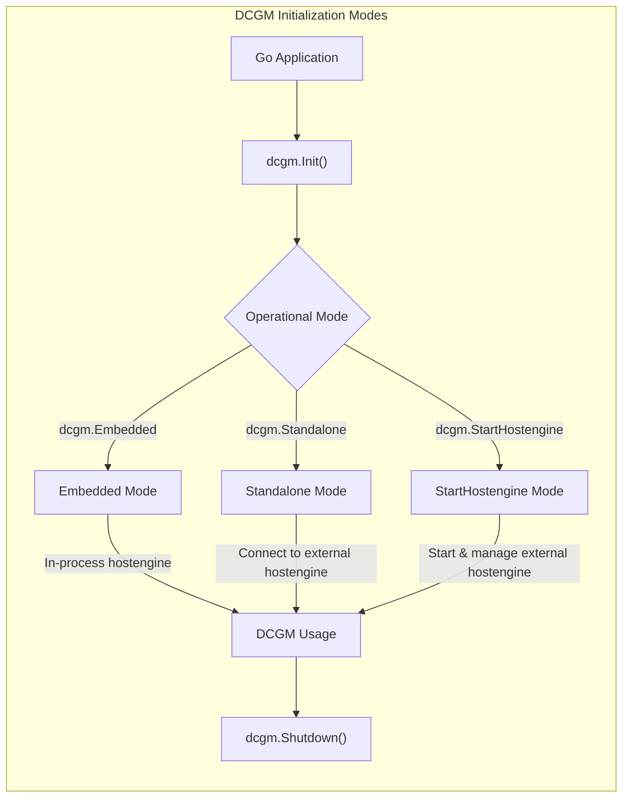
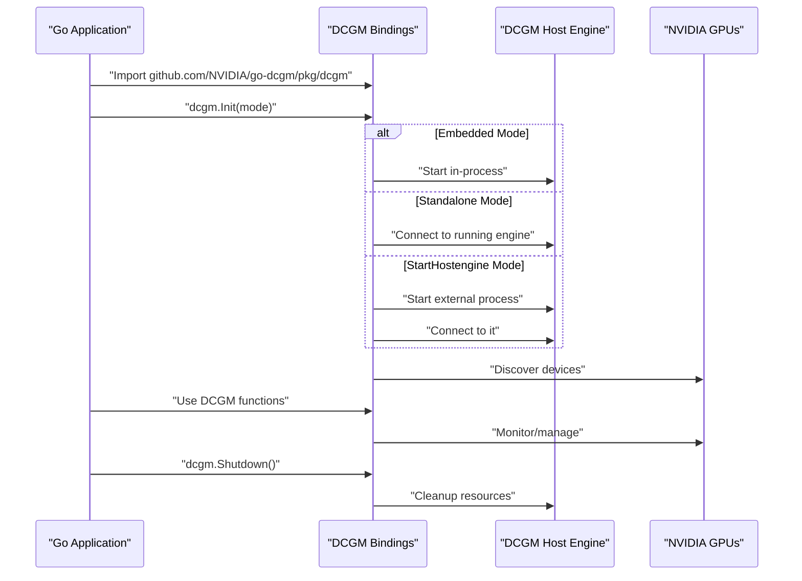

<!-- source: DeepWiki mcp.deepwiki.com · repo NVIDIA/go-dcgm · page 1.1 Installation and Setup · fetched 2026-10-26 -->

# Installation and Setup

<details>
<summary>Relevant source files</summary>

The following files were used as context for generating this wiki page:

- [.gitignore](.gitignore)
- [.golangci.yml](.golangci.yml)
- [Makefile](Makefile)
- [README.md](README.md)
- [go.mod](go.mod)
- [go.sum](go.sum)
- [pkg/dcgm/api_test.go](pkg/dcgm/api_test.go)

</details>


This document provides detailed instructions for installing and setting up the NVIDIA Data Center GPU Manager (DCGM) Go bindings. It covers installation prerequisites, obtaining the source code, building the project, and initial configuration. For information about the overall architecture, see [Architecture Overview](#1.2).

## Prerequisites

Before installing go-dcgm, ensure your system meets the following requirements:

| Requirement | Details |
|-------------|---------|
| Go Programming Language | Version 1.23+ (as specified in [go.mod:3]()) |
| NVIDIA GPUs | Compatible NVIDIA data center GPUs |
| NVIDIA DCGM | DCGM library must be installed on the system |
| Development Tools | For building from source: gcc, make |

Sources: [go.mod](), [Makefile]()

## Installation Methods

### Method 1: Using Go Modules

If you're using go-dcgm as a dependency in your Go project, you can add it to your `go.mod` file and let Go handle the installation:

```bash
go get github.com/NVIDIA/go-dcgm
```

Your `go.mod` file should include a line similar to:

```
require github.com/NVIDIA/go-dcgm v<version>
```

### Method 2: Cloning the Repository

For development or to access sample applications, clone the repository directly:

```bash
git clone https://github.com/NVIDIA/go-dcgm.git
cd go-dcgm
```

Sources: [README.md]()

## Building the Project

Once you've obtained the source code, you can build the library and sample applications using the provided Makefile:

```bash
make binary
```

This will build:
- The core go-dcgm package
- All sample applications (deviceInfo, dmon, health, etc.)

To run tests:

```bash
make test-main
```

Sources: [Makefile:21-31](), [Makefile:33-34]()

## DCGM Setup and Initialization Modes

When using go-dcgm, there are three operational modes for initializing DCGM:

### Initialization Modes Diagram



### Mode Details

| Mode | Configuration | Description | Use Case |
|------|---------------|-------------|----------|
| Embedded | `dcgm.Init(dcgm.Embedded)` | Runs the DCGM host engine in the same process as your application | Simplest setup, recommended for standalone applications |
| Standalone | `dcgm.Init(dcgm.Standalone)` | Connects to an already-running DCGM host engine | When a centralized DCGM host engine is already running |
| StartHostengine | `dcgm.Init(dcgm.StartHostengine)` | Starts an external DCGM host engine and connects to it | Recommended for applications that need isolation from the host engine |

Sources: Core Operational Modes diagram

## Typical Setup Flow



Sources: Core Operational Modes diagram

## Environment Setup

To ensure go-dcgm can find the DCGM library on your system, you may need to set these environment variables:

| Environment Variable | Purpose |
|----------------------|---------|
| `LD_LIBRARY_PATH` | Add the path to DCGM libraries (Linux) |
| `DCGM_HOSTENGINE_PATH` | Path to DCGM hostengine binary (for StartHostengine mode) |

## Verification

After installation and setup, you can verify your configuration by:

1. Building and running one of the sample applications:

```bash
# Build the deviceInfo sample
cd samples/deviceInfo
go build
./deviceInfo
```

2. Or running a simple Go program:

```go
package main

import (
    "fmt"
    "github.com/NVIDIA/go-dcgm/pkg/dcgm"
)

func main() {
    // Initialize DCGM in embedded mode
    err := dcgm.Init(dcgm.Embedded)
    if err != nil {
        fmt.Printf("Error initializing DCGM: %v\n", err)
        return
    }
    defer dcgm.Shutdown()
    
    // Get GPU count
    count, err := dcgm.GetDeviceCount()
    if err != nil {
        fmt.Printf("Error getting device count: %v\n", err)
        return
    }
    
    fmt.Printf("Found %d NVIDIA GPU(s)\n", count)
}
```

Sources: [Makefile:21-31]()

## Sample Applications

The go-dcgm repository includes several sample applications that demonstrate various features of the API:

| Sample | Purpose |
|--------|---------|
| deviceInfo | Display basic GPU information |
| dmon | GPU monitoring tool similar to nvidia-smi dmon |
| health | Check GPU health status |
| hostengineStatus | Show status of DCGM host engine |
| policy | Demonstrate policy management |
| processInfo | Show GPU process information |
| restApi | RESTful API for GPU monitoring |
| topology | Display GPU topology information |
| diag | Run diagnostics on GPUs |

You can build all samples at once using `make binary` or navigate to their directories and build them individually.

Sources: [Makefile:21-31]()

## Troubleshooting Installation

If you encounter issues with installation or setup:

1. Ensure DCGM is properly installed on your system
2. Check that your Go version is compatible (1.23+)
3. Verify that your system has compatible NVIDIA GPUs and drivers
4. Ensure environment variables are correctly set
5. Check for errors in build output

For further assistance, you can file issues on the [GitHub repository](https://github.com/NVIDIA/go-dcgm/issues).

Sources: [README.md:9-12](), [go.mod:3]()

---

