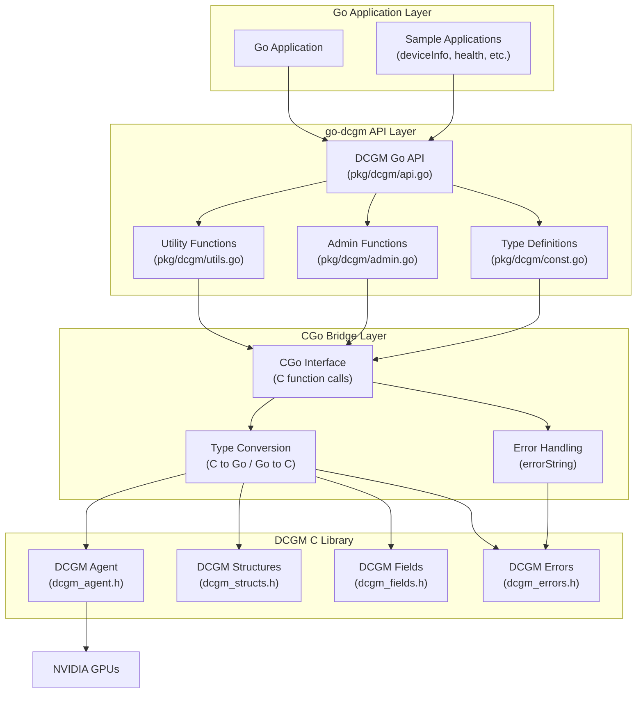
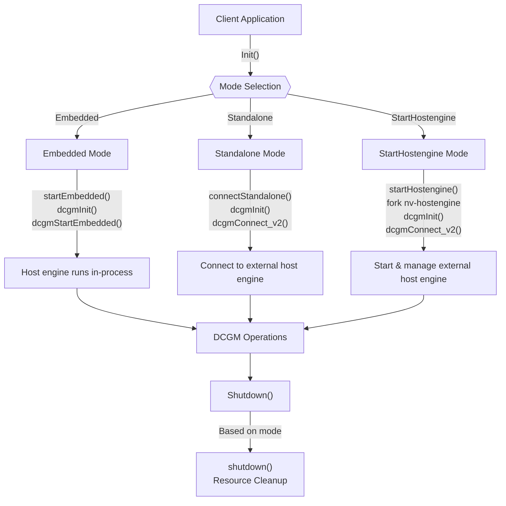
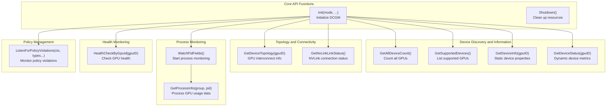
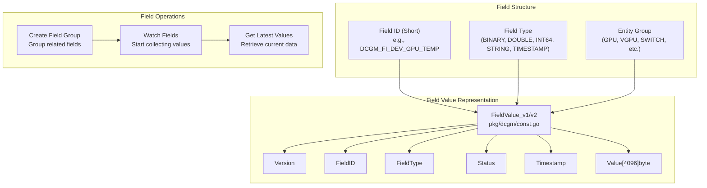
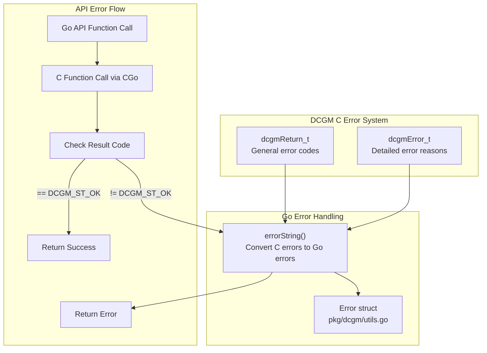
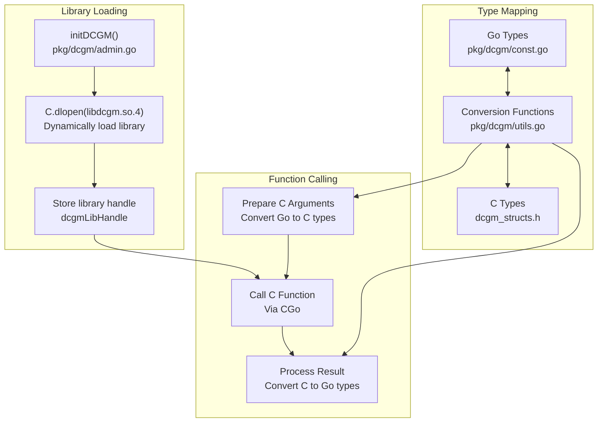

<!-- source: DeepWiki mcp.deepwiki.com · repo NVIDIA/go-dcgm · page 1.2 Architecture Overview · fetched 2026-10-26 -->

# Architecture Overview

<details>
<summary>Relevant source files</summary>

The following files were used as context for generating this wiki page:

- [pkg/dcgm/admin.go](pkg/dcgm/admin.go)
- [pkg/dcgm/api.go](pkg/dcgm/api.go)
- [pkg/dcgm/const.go](pkg/dcgm/const.go)
- [pkg/dcgm/dcgm_agent.h](pkg/dcgm/dcgm_agent.h)
- [pkg/dcgm/dcgm_errors.h](pkg/dcgm/dcgm_errors.h)
- [pkg/dcgm/dcgm_fields.h](pkg/dcgm/dcgm_fields.h)
- [pkg/dcgm/dcgm_structs.h](pkg/dcgm/dcgm_structs.h)
- [pkg/dcgm/diag.go](pkg/dcgm/diag.go)
- [pkg/dcgm/health.go](pkg/dcgm/health.go)
- [pkg/dcgm/profile.go](pkg/dcgm/profile.go)
- [pkg/dcgm/utils.go](pkg/dcgm/utils.go)

</details>


The NVIDIA Data Center GPU Manager (DCGM) Go Bindings provide a Go language interface to NVIDIA's DCGM system, enabling Go applications to monitor and manage NVIDIA GPUs in data center environments. This architecture overview explains the core design of go-dcgm, including its layered structure, operational modes, and integration with the underlying DCGM C library.

For detailed API usage information, see the [Core API Reference](#2) page. For implementation details about how go-dcgm interacts with the C library, see [Interaction with C Library](#3.1).

## Layered Architecture

go-dcgm is structured as a layered system to separate concerns and provide a clean Go API on top of the underlying C library.



The key components in each layer are:

1. **Go Application Layer**:
   - **User Applications**: Custom applications that use the go-dcgm API
   - **Sample Applications**: Ready-to-use examples like deviceInfo, health, and policy monitors

2. **go-dcgm API Layer**:
   - **DCGM Go API**: Public functions for GPU monitoring and management
   - **Utility Functions**: Helpers for type conversion and error handling
   - **Admin Functions**: Functions for DCGM initialization and management
   - **Type Definitions**: Go types corresponding to DCGM C types

3. **CGo Bridge Layer**:
   - **CGo Interface**: Enables calling C functions from Go
   - **Type Conversion**: Translates between Go and C data types
   - **Error Handling**: Converts C error codes to Go errors

4. **DCGM C Library**:
   - **DCGM Agent**: Core DCGM functionality
   - **DCGM Structures**: Data structures used by DCGM
   - **DCGM Fields**: Metric and attribute definitions
   - **DCGM Errors**: Error codes and handling

Sources: 
- [pkg/dcgm/api.go:1-141]()
- [pkg/dcgm/utils.go:1-119]()
- [pkg/dcgm/admin.go:1-242]()
- [pkg/dcgm/const.go:1-193]()
- [pkg/dcgm/dcgm_agent.h:1-346]()
- [pkg/dcgm/dcgm_structs.h:1-643]()

## Operational Modes

go-dcgm supports three distinct modes for connecting to the DCGM hostengine, each suitable for different deployment scenarios:



### 1. Embedded Mode

In Embedded mode, the DCGM hostengine runs within the same process as the Go application. This eliminates inter-process communication overhead but ties the hostengine lifecycle to the application process.

- **Initialization**: `startEmbedded()` in [pkg/dcgm/admin.go:100-113]()
  - Calls `dcgmInit()` followed by `dcgmStartEmbedded()`
- **Shutdown**: `stopEmbedded()` in [pkg/dcgm/admin.go:115-126]()
  - Calls `dcgmStopEmbedded()` followed by `dcgmShutdown()`

### 2. Standalone Mode

In Standalone mode, the Go application connects to an already running DCGM hostengine process. This is ideal when the hostengine is managed separately or multiple applications need to access the same hostengine.

- **Initialization**: `connectStandalone()` in [pkg/dcgm/admin.go:128-161]()
  - Calls `dcgmInit()` followed by `dcgmConnect_v2()`
- **Shutdown**: `disconnectStandalone()` in [pkg/dcgm/admin.go:163-174]()
  - Calls `dcgmDisconnect()` followed by `dcgmShutdown()`

### 3. StartHostengine Mode

In StartHostengine mode, the Go application starts a new DCGM hostengine process and connects to it. The hostengine process is terminated when the application shuts down, providing separation while automating lifecycle management.

- **Initialization**: `startHostengine()` in [pkg/dcgm/admin.go:176-225]()
  - Forks a new process for `nv-hostengine`, then calls `dcgmInit()` and `dcgmConnect_v2()`
- **Shutdown**: `stopHostengine()` in [pkg/dcgm/admin.go:227-241]()
  - Calls `disconnectStandalone()` and terminates the `nv-hostengine` process

The mode is selected when calling `Init()` in [pkg/dcgm/api.go:24-47]() and affects how go-dcgm interacts with the hostengine throughout the application lifecycle.

Sources:
- [pkg/dcgm/api.go:24-66]()
- [pkg/dcgm/admin.go:40-241]()

## API Organization

The go-dcgm API is organized into several functional areas, each handling specific aspects of GPU monitoring and management:



### Key API Areas

1. **Initialization and Shutdown**
   - `Init(mode, args...)`: Start DCGM in the specified mode
   - `Shutdown()`: Clean up resources and shut down DCGM

2. **Device Information**
   - `GetAllDeviceCount()`: Get count of all GPUs 
   - `GetSupportedDevices()`: Get list of DCGM-supported GPUs
   - `GetDeviceInfo()`: Get static device properties
   - `GetDeviceStatus()`: Get dynamic device metrics

3. **Health Monitoring**
   - `HealthCheckByGpuId()`: Check health of specific GPU
   - Functions to set and monitor health watches

4. **Process Monitoring**
   - `WatchPidFields()`: Configure process monitoring
   - `GetProcessInfo()`: Get process GPU usage statistics

5. **Policy Monitoring**
   - `ListenForPolicyViolations()`: Monitor for policy violations
   - `ListenForPolicyViolationsForGroup()`: Monitor specific GPU groups

These APIs are implemented in [pkg/dcgm/api.go]() and build upon the operational mode selected during initialization.

Sources:
- [pkg/dcgm/api.go:1-141]()
- [pkg/dcgm/health.go:1-224]()

## Field Management System

Fields are a fundamental concept in DCGM, representing metrics and attributes that can be monitored. The Field Management System provides mechanisms for defining, watching, and retrieving field values.



### Field Structure

Fields in DCGM are identified by:

1. **Field ID**: Numeric identifier for a specific metric or attribute
   - Defined in [pkg/dcgm/dcgm_fields.h:248-1260]() as DCGM_FI_* constants
   - Examples: DCGM_FI_DEV_GPU_TEMP (temperature), DCGM_FI_DEV_POWER_USAGE (power)

2. **Field Type**: Data type of the field
   - Defined in [pkg/dcgm/dcgm_fields.h:32-58]()
   - Types include BINARY, DOUBLE, INT64, STRING, TIMESTAMP

3. **Entity Association**: What the field applies to
   - Global scope or specific entity (GPU, VGPU, etc.)
   - Entity groups defined in [pkg/dcgm/dcgm_fields.h:224-238]()

### Field Value Representation

Field values are represented by Go structures defined in [pkg/dcgm/const.go:12-32]():

```go
type FieldValue_v1 struct {
    Version   uint
    FieldID   Short
    FieldType uint
    Status    int
    TS        int64
    Value     [4096]byte
}

type FieldValue_v2 struct {
    Version       uint
    EntityGroupId Field_Entity_Group
    EntityID      uint
    FieldID       Short
    FieldType     uint
    Status        int
    TS            int64
    Value         [4096]byte
    StringValue   *string
}
```

The Field Management System provides a standardized way to access GPU metrics, supporting both polling and event-based monitoring patterns.

Sources:
- [pkg/dcgm/const.go:11-32]()
- [pkg/dcgm/dcgm_fields.h:32-58, 224-238, 248-1260]()

## Error Handling

go-dcgm implements comprehensive error handling to translate DCGM C library error codes into idiomatic Go errors.



### Error Types

DCGM defines two main categories of error codes:

1. **DCGM Return Codes** (`dcgmReturn_t` in [pkg/dcgm/dcgm_structs.h:320-383]()):
   - General purpose error codes used throughout the API
   - Examples: `DCGM_ST_OK`, `DCGM_ST_BADPARAM`, `DCGM_ST_GENERIC_ERROR`

2. **DCGM Error Codes** (`dcgmError_t` in [pkg/dcgm/dcgm_errors.h:31-160]()):
   - More specific error codes used primarily for diagnostics
   - Examples: `DCGM_FR_OK`, `DCGM_FR_THERMAL_VIOLATIONS`

### Go Error Implementation

go-dcgm wraps these error codes in a Go-friendly way:

1. **Error Type** (`Error` struct in [pkg/dcgm/utils.go:51-54]()):
   ```go
   type Error struct {
       msg  string         // description of error
       Code C.dcgmReturn_t // dcgmReturn_t value of error
   }
   ```

2. **Error Conversion** (`errorString` in [pkg/dcgm/utils.go:58-64]()):
   ```go
   func errorString(result C.dcgmReturn_t) error {
       if result == C.DCGM_ST_OK {
           return nil
       }
       err := C.GoString(C.errorString(result))
       return fmt.Errorf("%v", err)
   }
   ```

This approach enables idiomatic Go error handling while preserving the detailed error information from the DCGM C library.

Sources:
- [pkg/dcgm/utils.go:50-68]()
- [pkg/dcgm/dcgm_structs.h:320-383]()
- [pkg/dcgm/dcgm_errors.h:31-160]()

## CGo Integration

go-dcgm uses CGo to interface with the DCGM C library, enabling Go applications to access the full functionality of DCGM.



### Library Loading

DCGM C library is loaded dynamically at runtime in [pkg/dcgm/admin.go:66-72]():

```go
dcgmLibHandle = C.dlopen(lib, C.RTLD_LAZY|C.RTLD_GLOBAL)
if dcgmLibHandle == nil {
    return fmt.Errorf("%s not found", dcgmLib)
}
```

This approach allows go-dcgm to be used without requiring the DCGM C library to be present at compile time.

### Type Conversion

go-dcgm defines Go types that correspond to DCGM C types and provides functions to convert between them:

1. **Type Definitions** in [pkg/dcgm/const.go]():
   ```go
   type Short C.ushort
   
   type FieldValue_v1 struct {
       Version   uint
       FieldID   Short
       FieldType uint
       // ... other fields
   }
   ```

2. **Conversion Functions** in [pkg/dcgm/utils.go:20-48]():
   ```go
   func uintPtr(c C.uint) *uint
   func uint64Ptr(c C.longlong) *uint64
   func stringPtr(c *C.char) *string
   // ... other conversions
   ```

### Function Calling

Go functions call DCGM C library functions through CGo, with appropriate type conversions:

```go
// Example from pkg/dcgm/admin.go
var cHandle C.dcgmHandle_t
result = C.dcgmStartEmbedded(C.DCGM_OPERATION_MODE_AUTO, &cHandle)
if err = errorString(result); err != nil {
    return fmt.Errorf("error starting nv-hostengine: %s", err)
}
handle = dcgmHandle{cHandle}
```

This CGo integration provides a seamless bridge between Go and the DCGM C library, allowing for efficient GPU monitoring and management from Go applications.

Sources:
- [pkg/dcgm/admin.go:59-73]()
- [pkg/dcgm/utils.go:20-48]()
- [pkg/dcgm/const.go:5-32]()

## Summary

The go-dcgm architecture provides a well-structured Go interface to NVIDIA's DCGM library, enabling GPU monitoring and management in data center environments. Key architecture aspects include:

1. **Layered Design**: Clear separation between Go API, CGo bridge, and DCGM C library
2. **Flexible Operational Modes**: Support for embedded, standalone, and managed hostengine operation
3. **Comprehensive API**: Functions for device information, monitoring, health checks, and policy management
4. **Field Management**: Standardized system for accessing GPU metrics and attributes
5. **Error Handling**: Idiomatic translation of C errors to Go error values
6. **CGo Integration**: Efficient bridging between Go and C with appropriate type conversions

This architecture enables Go applications to leverage the full power of DCGM while maintaining idiomatic Go code patterns and practices.

Sources:
- [pkg/dcgm/api.go:1-141]()
- [pkg/dcgm/admin.go:1-242]()
- [pkg/dcgm/const.go:1-193]()
- [pkg/dcgm/utils.go:1-119]()

---

