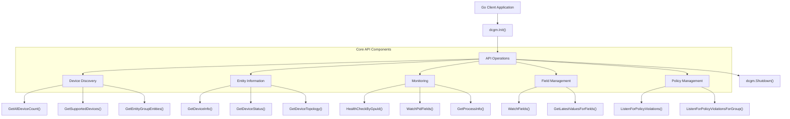
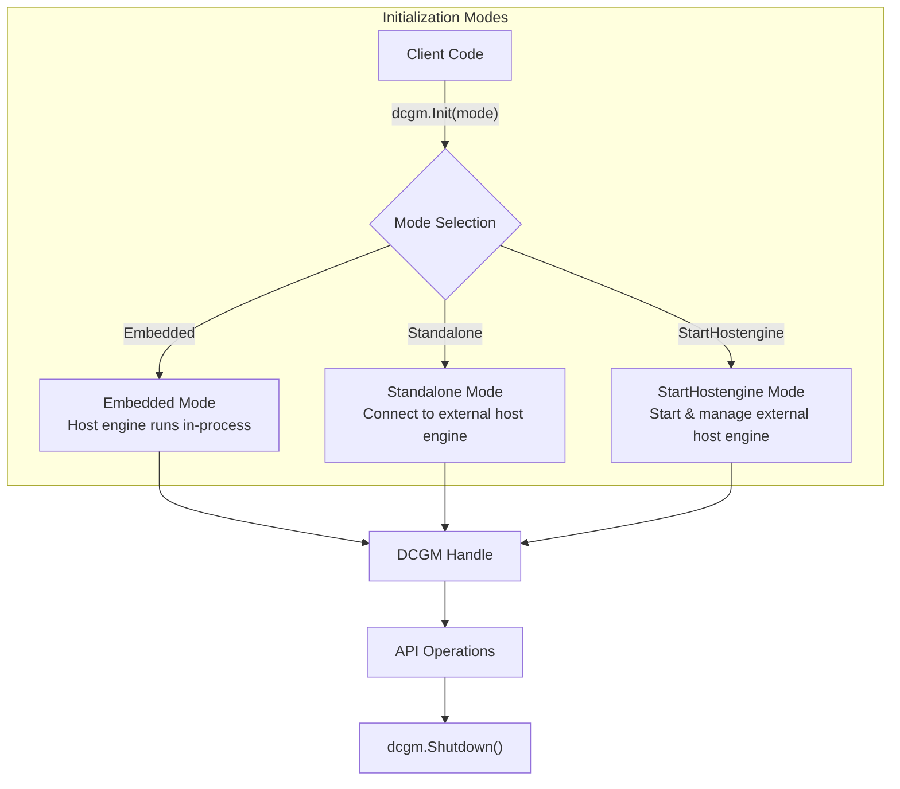
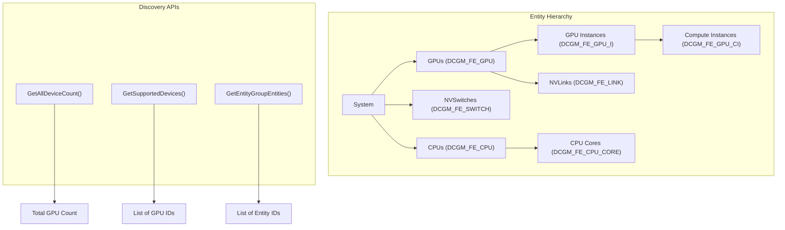
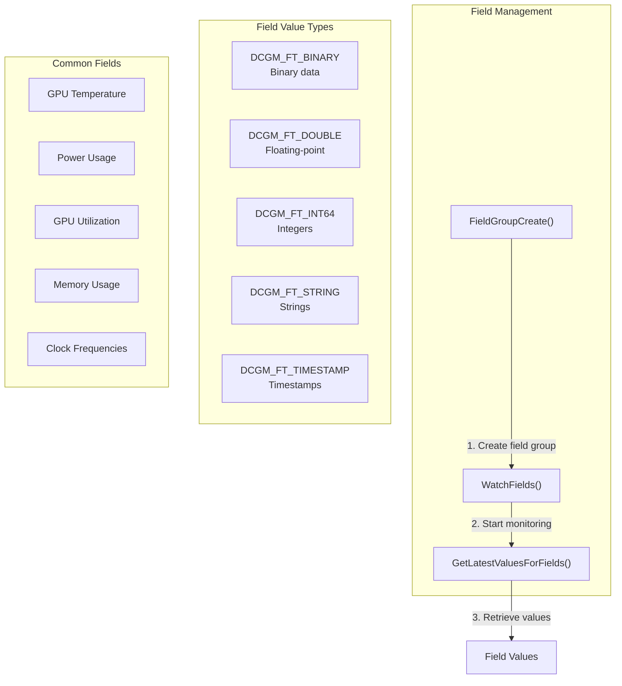
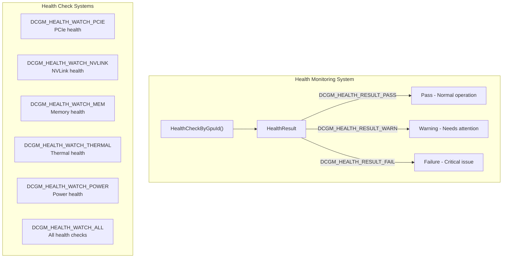
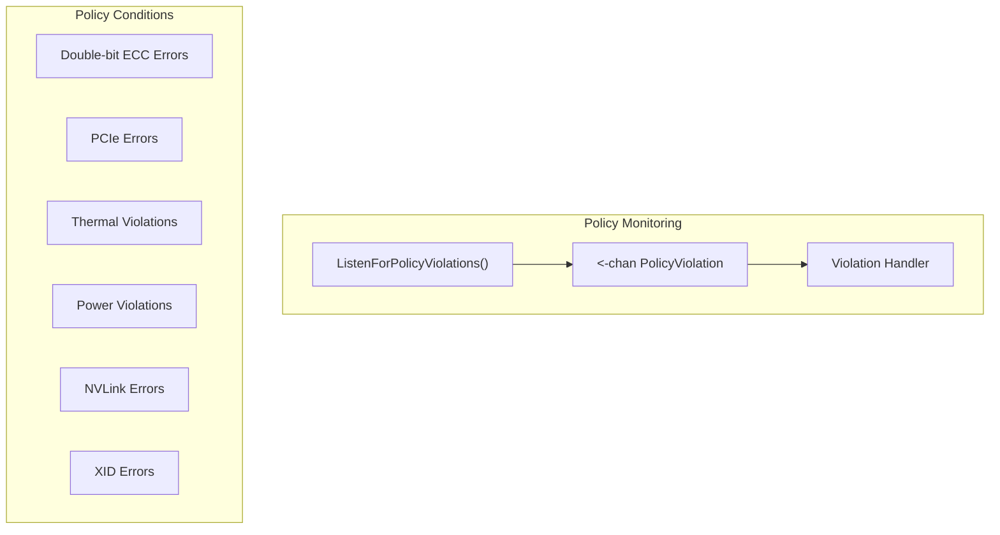
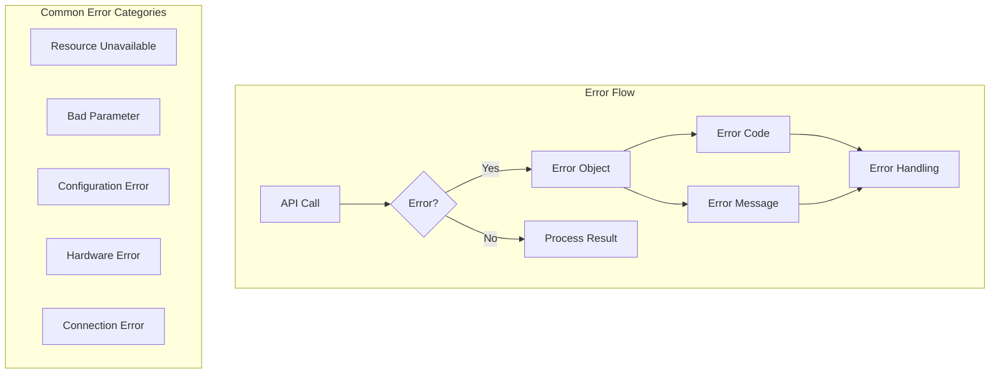

<!-- source: DeepWiki mcp.deepwiki.com · repo NVIDIA/go-dcgm · page 2 Core API Reference · fetched 2026-10-26 -->

# Core API Reference

<details>
<summary>Relevant source files</summary>

The following files were used as context for generating this wiki page:

- [README.md](README.md)
- [pkg/dcgm/api.go](pkg/dcgm/api.go)
- [pkg/dcgm/const.go](pkg/dcgm/const.go)
- [pkg/dcgm/dcgm_agent.h](pkg/dcgm/dcgm_agent.h)
- [pkg/dcgm/dcgm_errors.h](pkg/dcgm/dcgm_errors.h)
- [pkg/dcgm/dcgm_fields.h](pkg/dcgm/dcgm_fields.h)
- [pkg/dcgm/dcgm_structs.h](pkg/dcgm/dcgm_structs.h)
- [pkg/dcgm/profile.go](pkg/dcgm/profile.go)

</details>


The Core API Reference provides an overview of the main components and functions of the NVIDIA Data Center GPU Manager (DCGM) Go bindings. This document covers the fundamental API functions that form the foundation for monitoring and managing NVIDIA GPUs in Go applications.

For information about specific implementation details of DCGM, see [Implementation Details](#3). For examples and usage patterns, see [Examples and Usage](#5).

## API Component Overview



Sources: [pkg/dcgm/api.go:1-141]()

## Initialization and Operational Modes

### Initialization Model



The API must be initialized with one of three operational modes before using any DCGM functionality:

| Mode | Description | Use Case |
|------|-------------|----------|
| Embedded | Host engine runs within your process | Simple applications, maximum performance |
| Standalone | Connects to an already running host engine | Multiple clients, externally managed host engine |
| StartHostengine | Starts a host engine and connects to it | Clean separation, managed lifecycle |

```go
cleanup, err := dcgm.Init(dcgm.Embedded)
if err != nil {
    // Handle error
}
defer cleanup() // Ensures proper shutdown
```

The `Init()` function returns a cleanup function that should be deferred to ensure proper resource cleanup.

Sources: [pkg/dcgm/api.go:18-47]()

## Entity Discovery and Information

### Entity Model



The DCGM API works with different types of entities that can be discovered and monitored:

- **GPUs** - Physical graphics processors
- **GPU Instances** - MIG instances (for multi-instance GPUs)
- **Compute Instances** - Compute instances within MIG instances
- **NVSwitches** - NVIDIA NVSwitch devices
- **NVLinks** - NVIDIA NVLink connections
- **CPUs** - CPU nodes and cores (supported for NVIDIA datacenter CPUs)

### Device Discovery Functions

| Function | Description |
|----------|-------------|
| `GetAllDeviceCount()` | Returns the count of all GPUs in the system |
| `GetSupportedDevices()` | Returns a list of DCGM-supported GPU IDs |
| `GetEntityGroupEntities()` | Returns all entities of a specified group type |
| `GetDeviceInfo()` | Returns detailed information about a specific GPU |
| `GetDeviceStatus()` | Returns current status information for a GPU |
| `GetDeviceTopology()` | Returns connectivity information for a GPU |

Example usage:
```go
// Get list of supported GPUs
gpuIds, err := dcgm.GetSupportedDevices()
if err != nil {
    // Handle error
}

// Get detailed information for each GPU
for _, gpuId := range gpuIds {
    deviceInfo, err := dcgm.GetDeviceInfo(gpuId)
    if err != nil {
        // Handle error
    }
    // Use deviceInfo...
}
```

Sources: [pkg/dcgm/api.go:68-96]()

## Field Management and Monitoring

### Field Management System



DCGM's field management system is the foundation for monitoring GPU metrics. Fields represent measurable values from the GPU, such as temperature, utilization, or error counts. The field system allows:

1. Creating field groups to define collections of metrics
2. Watching fields to start data collection
3. Retrieving field values on demand

Fields are identified by numeric IDs defined in the DCGM library. Examples include:
- `DCGM_FI_DEV_GPU_TEMP` (150) - GPU temperature
- `DCGM_FI_DEV_POWER_USAGE` (155) - Power consumption in watts
- `DCGM_FI_DEV_GPU_UTIL` (203) - GPU utilization percentage
- `DCGM_FI_DEV_MEM_COPY_UTIL` (204) - Memory utilization percentage

Sources: [pkg/dcgm/const.go:11-77], [pkg/dcgm/dcgm_fields.h:200-1259]()

### Health Monitoring



The health monitoring system provides a high-level view of GPU health across several subsystems:

| Health System | Description |
|---------------|-------------|
| `DCGM_HEALTH_WATCH_PCIE` | PCIe connection health |
| `DCGM_HEALTH_WATCH_NVLINK` | NVLink connection health |
| `DCGM_HEALTH_WATCH_MEM` | GPU memory subsystem health |
| `DCGM_HEALTH_WATCH_THERMAL` | Temperature and thermal conditions |
| `DCGM_HEALTH_WATCH_POWER` | Power supply and consumption |
| `DCGM_HEALTH_WATCH_INFOROM` | GPU InfoROM health |

Example usage:
```go
health, err := dcgm.HealthCheckByGpuId(gpuId)
if err != nil {
    // Handle error
}

if health.Status != dcgm.DCGM_HEALTH_RESULT_PASS {
    // Handle health issue
}
```

Sources: [pkg/dcgm/const.go:200-242]()

### Policy Monitoring



Policy monitoring allows setting up listeners for specific GPU conditions:

1. Register for policy violations with `ListenForPolicyViolations()`
2. Receive violations through a Go channel
3. Act on violations as they occur

Example usage:
```go
ctx, cancel := context.WithCancel(context.Background())
defer cancel()

violations, err := dcgm.ListenForPolicyViolations(ctx, 
    dcgm.DbePolicy, dcgm.PCIePolicy, dcgm.ThermalPolicy)
if err != nil {
    // Handle error
}

// Process violations as they arrive
for violation := range violations {
    // Handle violation
}
```

Sources: [pkg/dcgm/api.go:116-125]()

## Core API Function Reference

The table below summarizes the key functions in the DCGM Go bindings Core API:

| Function | Description | Input | Output |
|----------|-------------|-------|--------|
| `Init` | Initializes DCGM in specified mode | Mode, optional args | Cleanup function, error |
| `Shutdown` | Stops DCGM and cleans up resources | None | Error |
| `GetAllDeviceCount` | Returns count of all GPUs | None | Count, error |
| `GetEntityGroupEntities` | Returns entities of specified group | Entity group | Entity list, error |
| `GetSupportedDevices` | Returns supported GPU IDs | None | GPU ID list, error |
| `GetDeviceInfo` | Returns detailed GPU information | GPU ID | Device info, error |
| `GetDeviceStatus` | Returns current GPU status | GPU ID | Device status, error |
| `GetDeviceTopology` | Returns GPU connectivity info | GPU ID | Connection list, error |
| `WatchPidFields` | Configures monitoring for processes | None | Group handle, error |
| `GetProcessInfo` | Returns per-GPU process statistics | Group handle, PID | Process info list, error |
| `HealthCheckByGpuId` | Performs health check on GPU | GPU ID | Health results, error |
| `ListenForPolicyViolations` | Sets up policy monitoring | Context, conditions | Violation channel, error |
| `Introspect` | Returns hostengine statistics | None | Status, error |
| `GetSupportedMetricGroups` | Returns supported metric groups | GPU ID | Metric group list, error |
| `GetNvLinkLinkStatus` | Returns NVLink connection status | None | NVLink status list, error |

Sources: [pkg/dcgm/api.go:1-141]()

## Error Handling



DCGM functions return Go errors that include DCGM-specific error codes and messages. Common error codes include:

| Error Code | Description |
|------------|-------------|
| `DCGM_ST_OK` | Success (no error) |
| `DCGM_ST_BADPARAM` | Invalid parameter provided |
| `DCGM_ST_NOT_CONFIGURED` | Required configuration missing |
| `DCGM_ST_NOT_SUPPORTED` | Operation not supported on this GPU |
| `DCGM_ST_INIT_ERROR` | Initialization error |
| `DCGM_ST_NVML_ERROR` | Underlying NVML error |
| `DCGM_ST_CONNECTION_NOT_VALID` | Invalid connection to host engine |
| `DCGM_ST_GPU_NOT_SUPPORTED` | GPU not supported by DCGM |

Example error handling:
```go
devices, err := dcgm.GetSupportedDevices()
if err != nil {
    if err.Code == dcgm.DCGM_ST_INIT_ERROR {
        // Handle initialization error
    } else if err.Code == dcgm.DCGM_ST_CONNECTION_NOT_VALID {
        // Handle connection error
    } else {
        // Handle other errors
    }
}
```

Sources: [pkg/dcgm/dcgm_structs.h:320-382]()

This Core API Reference provides a foundation for understanding the DCGM Go bindings. For details on specific functionality, please refer to the relevant sections of this documentation.

---

