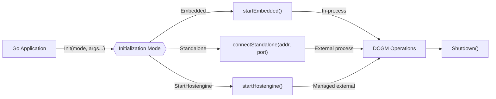
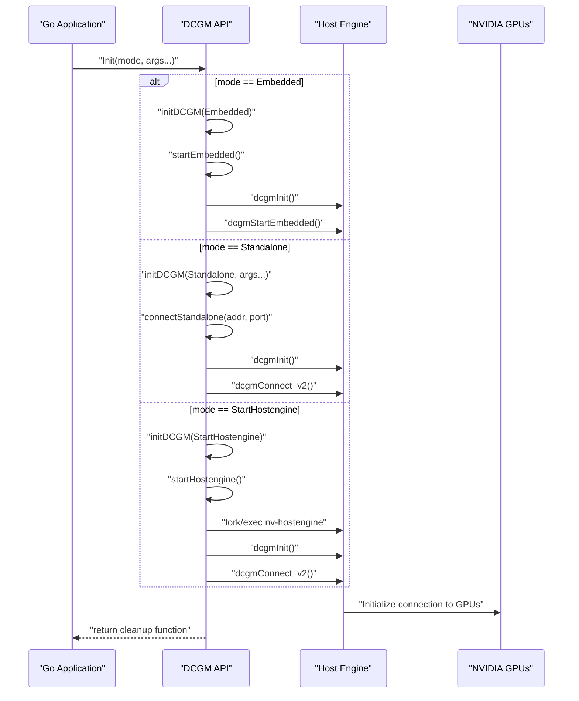
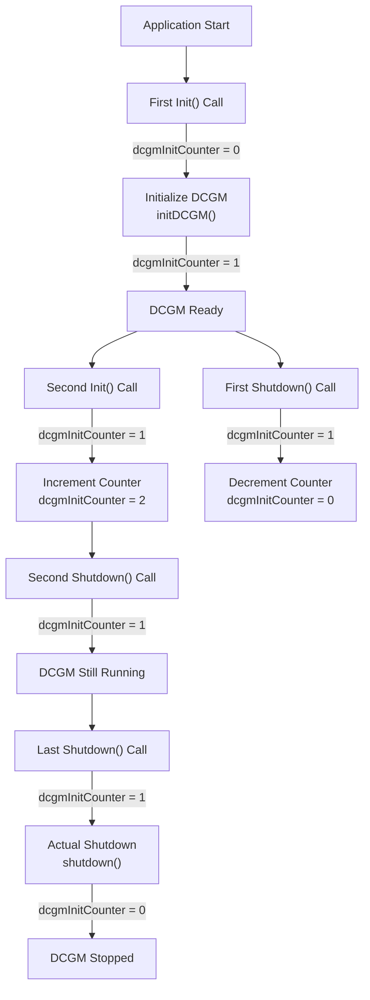
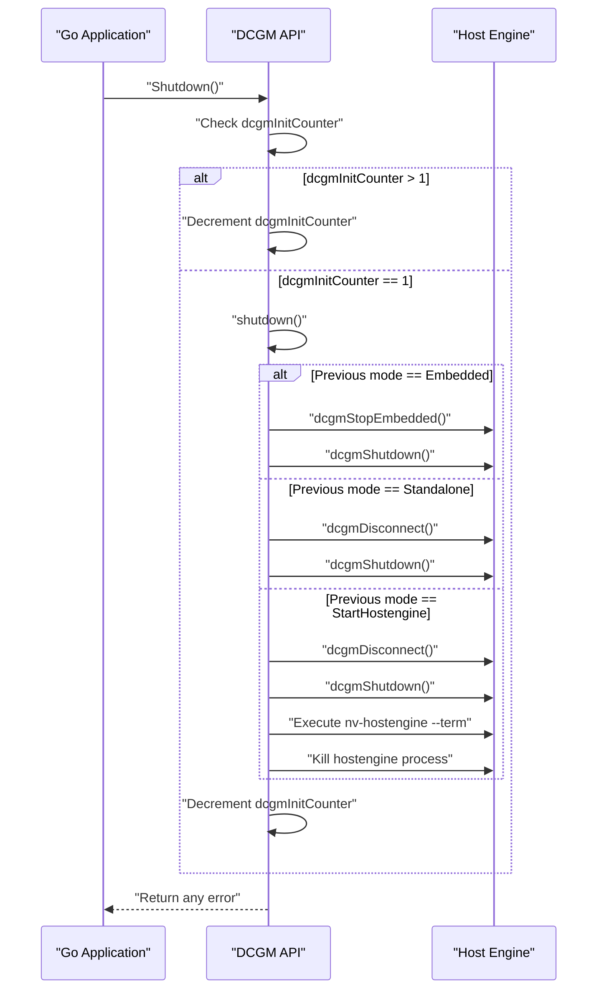
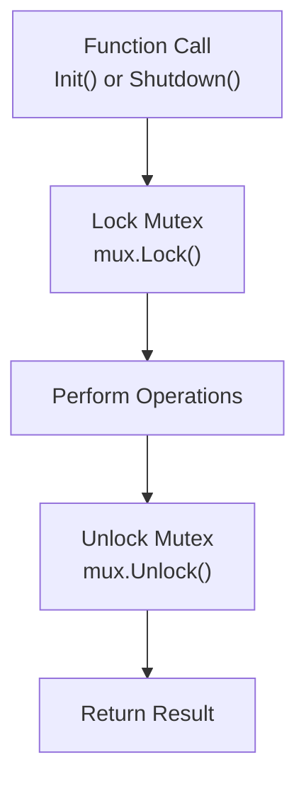

<!-- source: DeepWiki mcp.deepwiki.com · repo NVIDIA/go-dcgm · page 2.1 Initialization and Shutdown · fetched 2026-10-26 -->

# Initialization and Shutdown

<details>
<summary>Relevant source files</summary>

The following files were used as context for generating this wiki page:

- [pkg/dcgm/admin.go](pkg/dcgm/admin.go)
- [pkg/dcgm/api.go](pkg/dcgm/api.go)
- [pkg/dcgm/diag.go](pkg/dcgm/diag.go)
- [pkg/dcgm/health.go](pkg/dcgm/health.go)
- [pkg/dcgm/profile.go](pkg/dcgm/profile.go)
- [pkg/dcgm/utils.go](pkg/dcgm/utils.go)

</details>


This document explains how to initialize and shut down the NVIDIA Data Center GPU Manager (DCGM) using the Go bindings. Proper initialization is essential before using any DCGM functionality, and proper shutdown helps prevent resource leaks.

For information on how to use DCGM after initialization, see [Core API Reference](#2) and its sub-pages.

## Initialization Modes Overview

The go-dcgm library supports three distinct operational modes for initialization. Each mode has different characteristics regarding process isolation, lifecycle management, and connection behavior.



Sources: [pkg/dcgm/api.go:18-47](). [pkg/dcgm/admin.go:41-48]()

### Mode Descriptions

| Mode | Description | Use Case | Process Model |
|------|-------------|----------|--------------|
| `Embedded` | Runs DCGM host engine within the same process as the application | Simplest setup, self-contained applications | Single process |
| `Standalone` | Connects to an already running DCGM host engine | When a host engine is already running as a system service | Application process + External host engine |
| `StartHostengine` | Starts a new host engine process and manages its lifecycle | More isolation than embedded, but still managed lifecycle | Application process + Child host engine process |

Sources: [pkg/dcgm/admin.go:41-48]()

## Initialization Process

The initialization process creates a connection to DCGM and prepares it for use. The `Init` function handles this process and returns a cleanup function that can be deferred.



Sources: [pkg/dcgm/api.go:18-47](). [pkg/dcgm/admin.go:59-225]()

### Initialization Code Example

To initialize DCGM in your application, use the `Init` function with your desired mode:

```go
// Initialize DCGM in embedded mode
cleanup, err := dcgm.Init(dcgm.Embedded)
if err != nil {
    log.Fatalf("Failed to initialize DCGM: %v", err)
}
defer cleanup() // Important: defer the cleanup function

// Your DCGM code here...
```

Sources: [pkg/dcgm/api.go:18-47]()

### Reference Count Mechanism

The DCGM initialization employs a reference counting mechanism to allow multiple components to safely initialize and shut down DCGM:



Sources: [pkg/dcgm/api.go:13-16](). [pkg/dcgm/api.go:18-66]()

## Mode-Specific Initialization Details

### Embedded Mode

In Embedded mode, the DCGM host engine runs within the same process as your application:

1. `dcgmInit()` is called to initialize DCGM
2. `dcgmStartEmbedded()` starts the host engine in embedded mode
3. A handle to the DCGM instance is stored for future operations

Sources: [pkg/dcgm/admin.go:100-113]()

### Standalone Mode

In Standalone mode, your application connects to an already running DCGM host engine:

1. `dcgmInit()` is called to initialize DCGM
2. `dcgmConnect_v2()` establishes a connection to the specified address and port
3. A handle to the DCGM connection is stored for future operations

Required arguments:
- Address of the host engine (e.g., IP address or hostname)
- Socket type indicator (0 for TCP socket, 1 for Unix domain socket)

Sources: [pkg/dcgm/admin.go:128-161]()

### StartHostengine Mode

In StartHostengine mode, your application starts a new DCGM host engine process and manages its lifecycle:

1. Locates the `nv-hostengine` binary in the system PATH
2. Creates a temporary Unix domain socket file
3. Forks and executes `nv-hostengine` with appropriate arguments
4. Connects to the newly started host engine using the socket
5. Stores both the connection handle and the process ID for cleanup

Sources: [pkg/dcgm/admin.go:176-225]()

## Shutdown Process

The shutdown process cleans up DCGM resources and terminates or disconnects from the host engine. Like initialization, it uses a reference counting mechanism to ensure proper cleanup.



Sources: [pkg/dcgm/api.go:49-66](). [pkg/dcgm/admin.go:86-241]()

### Mode-Specific Shutdown Details

#### Embedded Mode Shutdown

1. `dcgmStopEmbedded()` is called to stop the embedded host engine
2. `dcgmShutdown()` is called to clean up DCGM resources

Sources: [pkg/dcgm/admin.go:115-126]()

#### Standalone Mode Shutdown

1. `dcgmDisconnect()` is called to disconnect from the host engine
2. `dcgmShutdown()` is called to clean up DCGM resources

Sources: [pkg/dcgm/admin.go:163-174]()

#### StartHostengine Mode Shutdown

1. `dcgmDisconnect()` is called via `disconnectStandalone()`
2. `dcgmShutdown()` is called to clean up DCGM resources
3. `nv-hostengine --term` command is executed to terminate the host engine
4. The host engine process is forcibly killed to ensure cleanup

Sources: [pkg/dcgm/admin.go:227-241]()

## Error Handling and Best Practices

The DCGM initialization and shutdown processes can encounter several types of errors. Here are common error scenarios and best practices for handling them:

### Common Errors

| Error Scenario | Cause | Solution |
|----------------|-------|----------|
| DCGM library not found | The `libdcgm.so.4` shared library is missing | Ensure DCGM is properly installed |
| Connection failure | The DCGM host engine is not running or inaccessible | Check host engine status and connectivity |
| Shutdown before init | `Shutdown()` called before `Init()` | Always call `Init()` before `Shutdown()` |
| Multiple shutdowns | `Shutdown()` called more times than `Init()` | Balance `Init()` and `Shutdown()` calls |

Sources: [pkg/dcgm/admin.go:59-86](). [pkg/dcgm/api.go:49-66]()

### Best Practices

1. **Always use defer with the cleanup function**:
   ```go
   cleanup, err := dcgm.Init(dcgm.Embedded)
   if err != nil {
       return err
   }
   defer cleanup()
   ```

2. **Check for initialization errors before proceeding**:
   ```go
   if err != nil {
       log.Fatalf("Failed to initialize DCGM: %v", err)
   }
   ```

3. **Use the appropriate mode for your use case**:
   - `Embedded` for simplest self-contained applications
   - `Standalone` when a system-wide host engine is already running
   - `StartHostengine` for isolation with managed lifecycle

4. **Handle multiple components safely**:
   - The reference counting mechanism allows multiple components to call `Init()` and `Shutdown()` safely
   - DCGM will only truly initialize on the first `Init()` call and shut down on the last `Shutdown()` call

Sources: [pkg/dcgm/api.go:18-66]()

## Thread Safety

The DCGM initialization and shutdown functions use a mutex to ensure thread safety:



This ensures that concurrent initialization or shutdown operations are properly serialized, preventing race conditions.

Sources: [pkg/dcgm/api.go:13-16](). [pkg/dcgm/api.go:24-26](). [pkg/dcgm/api.go:51-53]()

---

