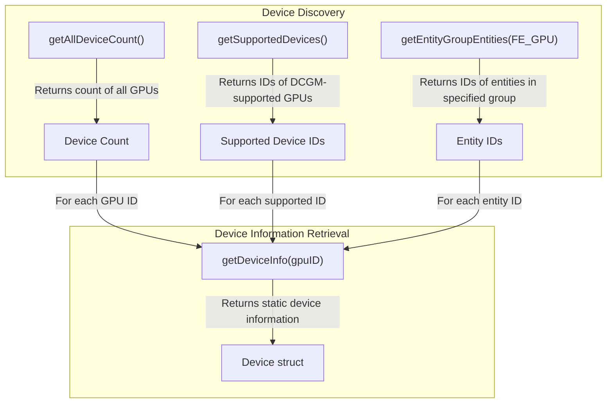
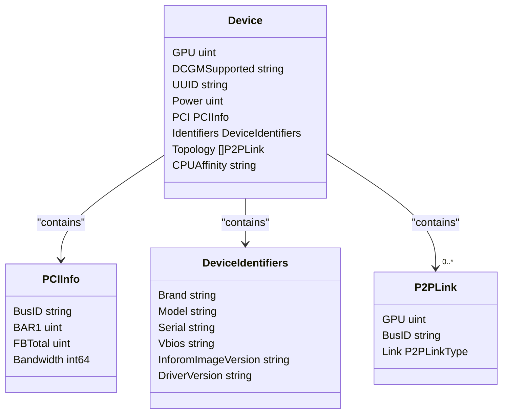
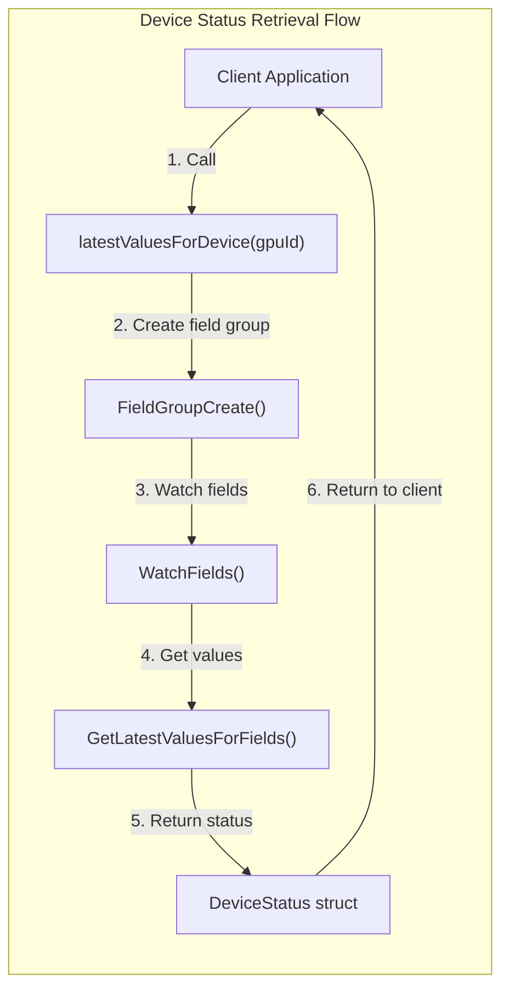
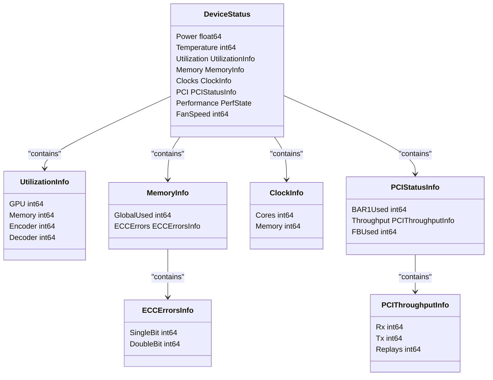
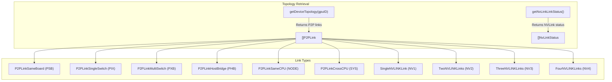
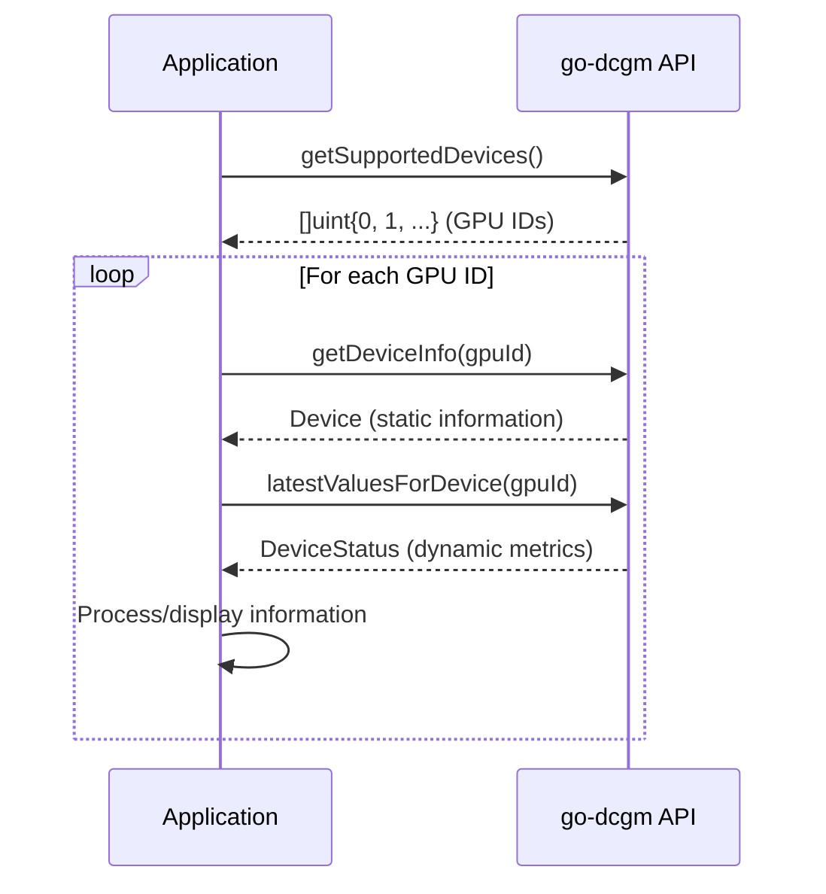

<!-- source: DeepWiki mcp.deepwiki.com · repo NVIDIA/go-dcgm · page 2.2 Device Information and Status · fetched 2026-10-26 -->

# Device Information and Status

Relevant source files

The following files were used as context for generating this wiki page:

- [pkg/dcgm/device_info.go](pkg/dcgm/device_info.go)
- [pkg/dcgm/device_status.go](pkg/dcgm/device_status.go)
- [pkg/dcgm/hostengine_status.go](pkg/dcgm/hostengine_status.go)
- [pkg/dcgm/topology.go](pkg/dcgm/topology.go)

This page documents how to retrieve both static device information and dynamic status metrics for NVIDIA GPUs using the go-dcgm bindings. It covers the core APIs for discovering GPU devices, querying their properties, and monitoring their real-time performance metrics.

For health-specific monitoring and diagnostics, see [Health Monitoring](#2.3). For information about creating field groups and watching fields, see [Field Management](#2.4).

## Device Discovery and Enumeration

Before retrieving information about specific GPUs, you first need to discover the available devices in your system.

Sources: [pkg/dcgm/device_info.go:49-61](), [pkg/dcgm/device_info.go:83-98](), [pkg/dcgm/device_info.go:64-80]()

### Retrieving Device Information

The `getDeviceInfo` function returns comprehensive static information about a GPU device, including its identifiers, capabilities, and hardware properties.

Sources: [pkg/dcgm/device_info.go:207-285](), [pkg/dcgm/device_info.go:18-46]()

The `Device` struct provides the following information:

- **Basic information**: GPU ID, UUID, and DCGM support status
- **Power information**: Default power limit in watts
- **PCI information**: Bus ID, memory sizes, and bandwidth
- **Device identifiers**: Brand, model, serial number, etc.
- **Topology**: Peer-to-peer links to other GPUs
- **CPU affinity**: Which CPU cores the GPU is affiliated with

Example fields of interest in the `Device` struct:

| Field | Type | Description |
|-------|------|-------------|
| GPU | uint | GPU ID used in DCGM |
| DCGMSupported | string | "Yes" or "No" indicating DCGM support |
| UUID | string | Unique device identifier |
| Power | uint | Default power limit in watts |
| PCI.BusID | string | PCI bus identifier |
| PCI.FBTotal | uint | Total framebuffer memory in MB |
| Identifiers.Brand | string | GPU brand name |
| Identifiers.Model | string | GPU model name |
| CPUAffinity | string | BitSet representation of CPU core affinity |

## Device Status Monitoring

While device information provides static properties, device status monitoring allows you to observe the real-time performance metrics and state of GPUs.

Sources: [pkg/dcgm/device_status.go:88-194]()

The `latestValuesForDevice` function handles the process of creating field groups, watching fields, and retrieving the latest values for various metrics.

Sources: [pkg/dcgm/device_status.go:14-86]()

The `DeviceStatus` struct provides the following real-time metrics:

- **Power consumption**: Current power usage in watts
- **Temperature**: Current GPU temperature in Celsius
- **Utilization**: GPU, memory, encoder, and decoder usage percentages
- **Memory**: Memory usage and ECC error counts
- **Clocks**: Current core and memory clock frequencies
- **PCI**: PCI bus usage and throughput
- **Performance**: Current performance state (P-state)
- **Fan speed**: Current fan speed percentage

Example fields of interest in the `DeviceStatus` struct:

| Field | Type | Unit | Description |
|-------|------|------|-------------|
| Power | float64 | Watts | Current power consumption |
| Temperature | int64 | °C | Current GPU temperature |
| Utilization.GPU | int64 | % | GPU compute utilization percentage |
| Utilization.Memory | int64 | % | Memory copy utilization percentage |
| Memory.ECCErrors.SingleBit | int64 | Count | Single-bit ECC error count |
| Clocks.Cores | int64 | MHz | Current SM clock frequency |
| PCI.Throughput.Rx | int64 | MB | PCI receive throughput |
| Performance | PerfState | - | Current performance state (P0-P15) |

## GPU Topology

GPU topology information is useful for understanding the physical and logical connections between GPUs, which can impact performance for multi-GPU workloads.

Sources: [pkg/dcgm/topology.go:14-40](), [pkg/dcgm/topology.go:70-139](), [pkg/dcgm/topology.go:142-166]()

The topology information provides details about:

- **Peer-to-peer connections**: How GPUs are connected to each other
- **Connection types**: PCIe or NVLink connections with varying capabilities
- **NVLink status**: The state of NVLink connections between GPUs or NVSwitches

## Usage Examples

### Retrieving Device Information and Status

The following sequence diagram illustrates how to retrieve both device information and status:

This approach allows you to gather both static device properties and current performance metrics in a single iteration through your GPUs.

### Key Field Constants for Monitoring

When creating custom field groups for device monitoring, these are the key field constants used in the device status retrieval:

| Field Constant | Description | Used in |
|----------------|-------------|---------|
| DCGM_FI_DEV_POWER_USAGE | Power consumption | DeviceStatus.Power |
| DCGM_FI_DEV_GPU_TEMP | GPU temperature | DeviceStatus.Temperature |
| DCGM_FI_DEV_GPU_UTIL | GPU utilization | DeviceStatus.Utilization.GPU |
| DCGM_FI_DEV_MEM_COPY_UTIL | Memory utilization | DeviceStatus.Utilization.Memory |
| DCGM_FI_DEV_SM_CLOCK | SM clock frequency | DeviceStatus.Clocks.Cores |
| DCGM_FI_DEV_MEM_CLOCK | Memory clock frequency | DeviceStatus.Clocks.Memory |
| DCGM_FI_DEV_ECC_SBE_AGG_TOTAL | Single-bit ECC errors | DeviceStatus.Memory.ECCErrors.SingleBit |
| DCGM_FI_DEV_PSTATE | Performance state | DeviceStatus.Performance |

Source: [pkg/dcgm/device_status.go:110-127]()

## Best Practices

1. **Cache device information**: The static device information rarely changes during runtime, so cache it rather than fetching it repeatedly.

2. **Use field groups efficiently**: When monitoring device status, create field groups once and reuse them rather than creating new groups for each query.

3. **Monitor selectively**: For production monitoring, focus on the most critical metrics (temperature, utilization, memory, and errors) rather than retrieving all fields.

4. **Consider topology for multi-GPU workloads**: Use topology information to optimize workload distribution across GPUs, especially for applications requiring fast GPU-to-GPU communication.

5. **Handle unsupported fields gracefully**: Some fields may not be supported on all GPU models, so check for error conditions and handle them appropriately.

---

