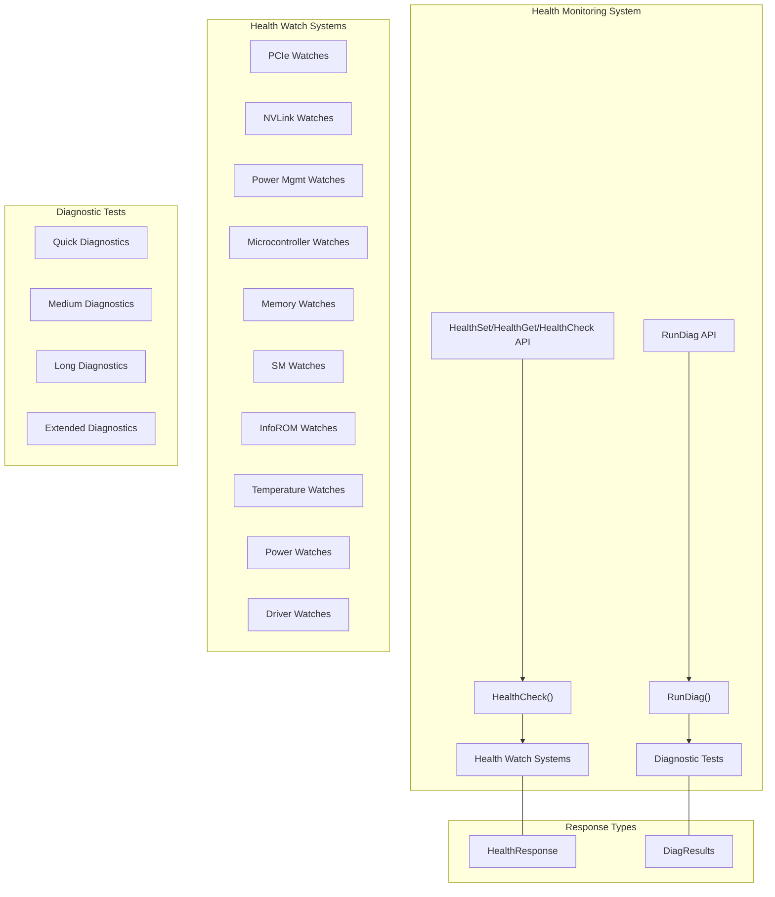
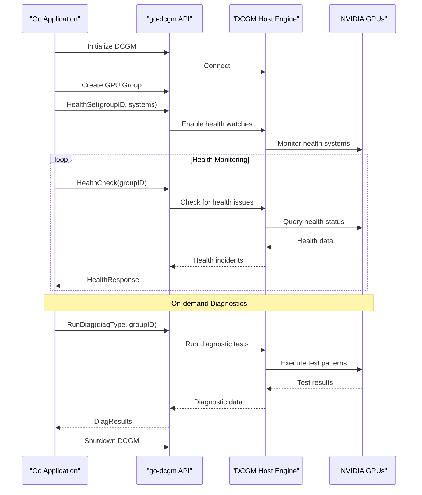
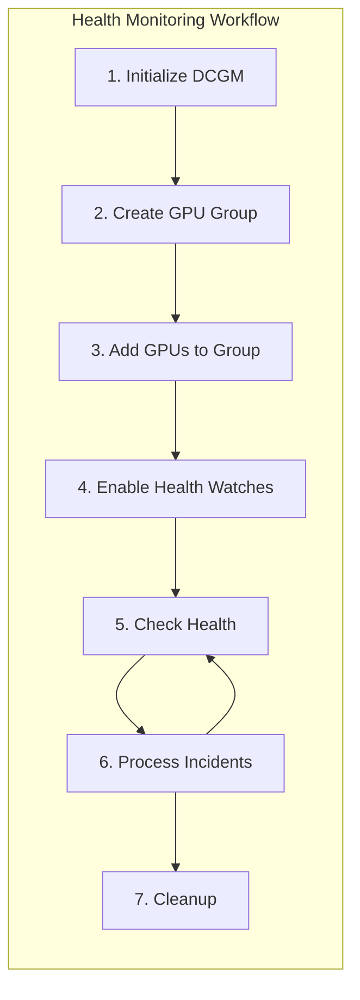

<!-- source: DeepWiki mcp.deepwiki.com · repo NVIDIA/go-dcgm · page 2.3 Health Monitoring · fetched 2026-10-26 -->

# Health Monitoring

<details>
<summary>Relevant source files</summary>

The following files were used as context for generating this wiki page:

- [pkg/dcgm/admin.go](pkg/dcgm/admin.go)
- [pkg/dcgm/diag.go](pkg/dcgm/diag.go)
- [pkg/dcgm/health.go](pkg/dcgm/health.go)
- [pkg/dcgm/utils.go](pkg/dcgm/utils.go)

</details>


## Overview

This document details the health monitoring system provided by the NVIDIA Data Center GPU Manager (DCGM) Go bindings. The health monitoring system enables you to proactively detect and diagnose issues in NVIDIA GPUs by monitoring various hardware subsystems and running diagnostics. For information about running specific diagnostics, see [Building and Testing](#4). For information about policy-based monitoring, see [Policy Monitoring](#2.7).

Sources: [pkg/dcgm/health.go:17-39]()

## Health Monitoring Architecture

The health monitoring system in go-dcgm is built on two core capabilities:

1. **Health Watches** - Continuous monitoring of GPU subsystems for issues
2. **Diagnostics** - On-demand tests that verify GPU functionality

### Health Monitoring System Structure



Sources: [pkg/dcgm/health.go:32-139](), [pkg/dcgm/diag.go:15-210]()

### Health Monitoring Data Flow



Sources: [pkg/dcgm/health.go:101-140](), [pkg/dcgm/diag.go:194-210](), [pkg/dcgm/admin.go:59-84]()

## Health Monitoring API

### Key Structures

The health monitoring system uses several key structures:

#### Health Check Structures

| Structure | Description | Key Fields |
|-----------|-------------|------------|
| `SystemWatch` | Represents a single health watch system and its status | `Type`, `Status`, `Error` |
| `DeviceHealth` | Represents the health status of a GPU device | `GPU`, `Status`, `Watches` |
| `HealthResponse` | Contains results of a health check operation | `OverallHealth`, `Incidents` |
| `Incident` | Details about a health check incident | `System`, `Health`, `Error`, `EntityInfo` |
| `DiagErrorDetail` | Detailed information about a health check error | `Message`, `Code` |

Sources: [pkg/dcgm/health.go:32-99]()

#### Diagnostic Structures

| Structure | Description | Key Fields |
|-----------|-------------|------------|
| `DiagResult` | Result of a single diagnostic test | `Status`, `TestName`, `TestOutput`, `ErrorCode`, `ErrorMessage` |
| `DiagResults` | Contains results of all diagnostic tests | `Software` |
| `DiagType` | Enum for diagnostic test types | `DiagQuick`, `DiagMedium`, `DiagLong`, `DiagExtended` |

Sources: [pkg/dcgm/diag.go:16-53]()

### Health System Types

The health monitoring system can monitor various GPU subsystems. These can be enabled individually or together using bitwise operations. The constant `DCGM_HEALTH_WATCH_ALL` enables all health watches.

| Health System | Description |
|---------------|-------------|
| PCIe watches (1) | Monitors PCIe errors and bandwidth |
| NVLINK watches (2) | Monitors NVLINK connections and errors |
| Power Management unit watches (4) | Monitors power management functionality |
| Microcontroller unit watches (8) | Monitors MCU operation |
| Memory watches (16) | Monitors memory errors and utilization |
| Streaming Multiprocessor watches (32) | Monitors SM operation |
| Inforom watches (64) | Monitors Inforom integrity |
| Temperature watches (128) | Monitors temperature thresholds |
| Power watches (256) | Monitors power consumption |
| Driver-related watches (512) | Monitors driver operation |

Sources: [pkg/dcgm/health.go:199-223]()

### Health Status Values

The health monitoring system reports health status using standardized values:

| Status Value | String Representation | Description |
|--------------|------------------------|-------------|
| 0 | "Healthy" | System is functioning normally |
| 10 | "Warning" | Warning condition detected |
| 20 | "Failure" | Failure condition detected |
| Other | "N/A" | Status not available |

Sources: [pkg/dcgm/health.go:187-197]()

### Function Reference

#### Health Monitoring Functions

```mermaid
classDiagram
    class HealthSet {
        +GroupHandle groupID
        +HealthSystem systems
        +error
    }
    
    class HealthGet {
        +GroupHandle groupID
        +HealthSystem, error
    }
    
    class HealthCheck {
        +GroupHandle groupID
        +HealthResponse, error
    }
    
    class RunDiag {
        +DiagType diagType
        +GroupHandle groupID
        +DiagResults, error
    }
    
    HealthSet --> "GPU Group" : Sets watches on
    HealthGet --> "GPU Group" : Gets watches from
    HealthCheck --> "GPU Group" : Checks health of
    RunDiag --> "GPU Group" : Runs diagnostics on
```

Sources: [pkg/dcgm/health.go:53-140](), [pkg/dcgm/diag.go:194-210]()

The health monitoring API includes the following key functions:

#### `HealthSet(groupID GroupHandle, systems HealthSystem) error`

Enables the specified health watch systems for a group of GPUs. The `systems` parameter is a bitmask of the health systems to monitor.

Example:
```go
// Enable PCIe and Memory watches for a group of GPUs
err := dcgm.HealthSet(groupID, dcgm.DCGM_HEALTH_WATCH_PCIE | dcgm.DCGM_HEALTH_WATCH_MEMORY)
```

Sources: [pkg/dcgm/health.go:53-59]()

#### `HealthGet(groupID GroupHandle) (HealthSystem, error)`

Retrieves the currently enabled health watch systems for a group of GPUs.

Example:
```go
// Get currently enabled health watches
systems, err := dcgm.HealthGet(groupID)
```

Sources: [pkg/dcgm/health.go:63-71]()

#### `HealthCheck(groupID GroupHandle) (HealthResponse, error)`

Checks the configured watches for any errors, failures, or warnings that have occurred since the last check. The first call initializes the watches but doesn't return any incidents. Subsequent calls return any incidents that occurred since the last check.

Example:
```go
// Check for health issues
response, err := dcgm.HealthCheck(groupID)
if err == nil && response.OverallHealth != dcgm.DCGM_HEALTH_RESULT_PASS {
    // Handle health issues
    for _, incident := range response.Incidents {
        // Process each incident
    }
}
```

Sources: [pkg/dcgm/health.go:101-140]()

#### `RunDiag(diagType DiagType, groupID GroupHandle) (DiagResults, error)`

Runs diagnostic tests on a group of GPUs with the specified diagnostic level.

Example:
```go
// Run quick diagnostics
results, err := dcgm.RunDiag(dcgm.DiagQuick, groupID)
```

Sources: [pkg/dcgm/diag.go:194-210]()

## Diagnostic System

The diagnostic system complements health monitoring by providing on-demand, comprehensive testing of GPU functionality. Diagnostics can be more intensive and thorough than health watches, making them suitable for periodic health verification or troubleshooting.

### Diagnostic Levels

The diagnostic system offers four levels of testing, with increasing thoroughness and runtime:

1. **Quick (DiagQuick)**: Fast, basic health checks with minimal impact
2. **Medium (DiagMedium)**: More comprehensive checks with moderate runtime
3. **Long (DiagLong)**: Extensive health checks with longer runtime
4. **Extended (DiagExtended)**: The most thorough system checks, longest runtime

Sources: [pkg/dcgm/diag.go:21-33]()

### Diagnostic Tests

The diagnostic system can run various tests. The available software-related tests include:

| Test ID | Test Name | Description |
|---------|-----------|-------------|
| DCGM_SWTEST_DENYLIST | Denylist check | Checks for presence of drivers on the denylist (e.g. nouveau) |
| DCGM_SWTEST_NVML_LIBRARY | NVML library check | Checks for presence and version of NVML library |
| DCGM_SWTEST_CUDA_MAIN_LIBRARY | CUDA library check | Checks for presence and version of CUDA library |
| DCGM_SWTEST_CUDA_RUNTIME_LIBRARY | CUDA RT library check | Checks for presence and version of CUDA runtime library |
| DCGM_SWTEST_PERMISSIONS | Permissions check | Verifies character device permissions |
| DCGM_SWTEST_PERSISTENCE_MODE | Persistence mode check | Verifies persistence mode is enabled |
| DCGM_SWTEST_ENVIRONMENT | Environment check | Checks for CUDA environment variables that may slow tests |
| DCGM_SWTEST_PAGE_RETIREMENT | Page retirement check | Checks for pending frame buffer page retirement |
| DCGM_SWTEST_GRAPHICS_PROCESSES | Graphics processes check | Checks for running graphics processes |
| DCGM_SWTEST_INFOROM | Inforom check | Checks for inforom corruption |

Additionally, hardware tests include memory, PCIe, SM stress, targeted stress, targeted power, memory bandwidth, and more.

Sources: [pkg/dcgm/diag.go:72-97](), [pkg/dcgm/diag.go:99-127]()

### Diagnostic Result Status

Diagnostic tests return one of the following status values:

| Status | Description |
|--------|-------------|
| pass | Test completed successfully |
| skipped | Test was skipped |
| warn | Test completed with warnings |
| fail | Test failed |
| notrun | Test was not run |

Sources: [pkg/dcgm/diag.go:56-70]()

## Example Workflows

### Basic Health Monitoring Workflow



Sources: [pkg/dcgm/health.go:142-185]()

### Implementation Example

The helper function `healthCheckByGpuId` demonstrates a complete health monitoring workflow for a single GPU:

1. Create a GPU group with a random name
2. Add the specified GPU to the group
3. Enable all health watches
4. Check the health status
5. Process the results
6. Clean up by destroying the group

This pattern can be extended to monitor multiple GPUs or specific health systems.

Sources: [pkg/dcgm/health.go:142-185]()

### Integration with Diagnostic Testing

For comprehensive health verification, combine continuous health monitoring with periodic diagnostic tests:

1. Set up health watches for continuous monitoring
2. Periodically run quick diagnostics during normal operation
3. When health watches detect issues, run more extensive diagnostics to pinpoint problems
4. After maintenance or before critical workloads, run extended diagnostics to verify full system health

This approach provides both real-time issue detection and thorough system verification when needed.

Sources: [pkg/dcgm/health.go:101-140](), [pkg/dcgm/diag.go:194-210]()

## Best Practices

1. **Initialize watches first**: The first call to `HealthCheck` initializes the watches but doesn't return incidents. Make this call early in your application's lifecycle.

2. **Use appropriate watch systems**: Enable only the health watches relevant to your application to minimize overhead.

3. **Consider diagnostic timing**: Quick diagnostics can be run more frequently, while extended diagnostics should be reserved for maintenance windows due to their impact on performance.

4. **Handle transient issues**: Some health incidents may be transient. Consider implementing retry or threshold logic before taking action.

5. **Group related GPUs**: Create logical groups of GPUs for monitoring to organize health management by workload or hardware configuration.

Sources: [pkg/dcgm/health.go:101-105]()

---

