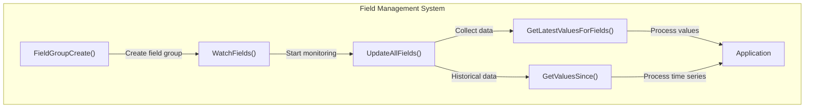
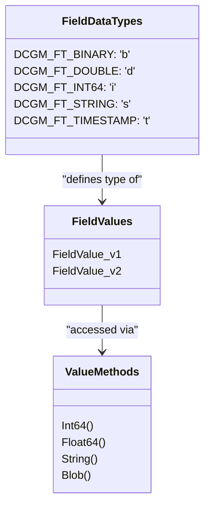
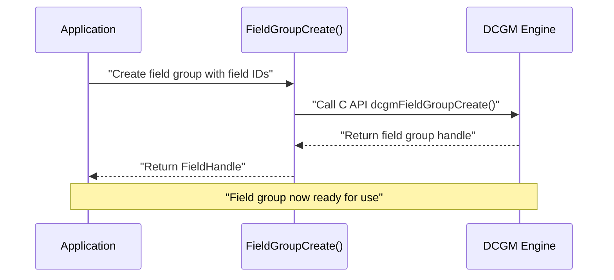
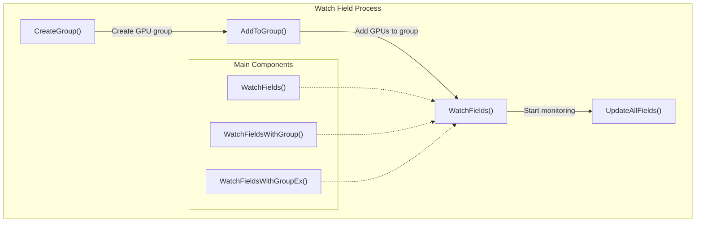
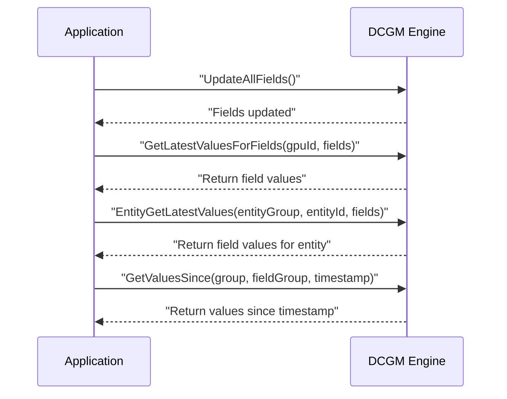
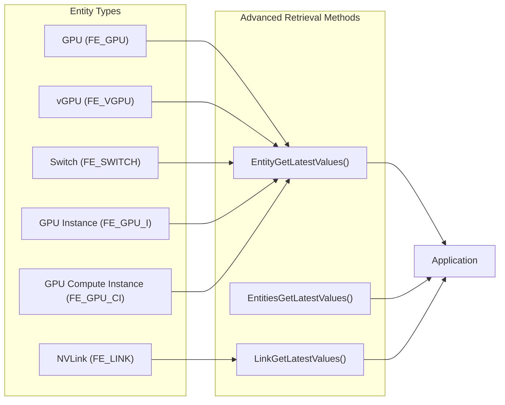
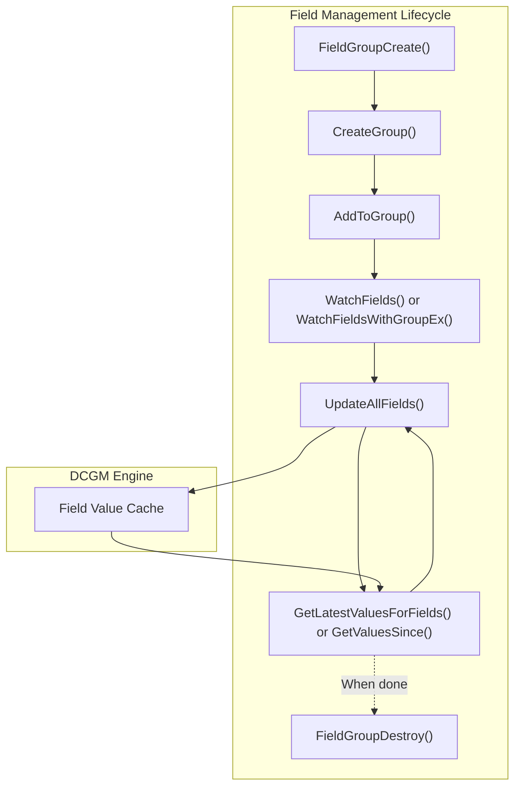

<!-- source: DeepWiki mcp.deepwiki.com · repo NVIDIA/go-dcgm · page 2.4 Field Management · fetched 2026-10-26 -->

# Field Management

<details>
<summary>Relevant source files</summary>

The following files were used as context for generating this wiki page:

- [pkg/dcgm/const.go](pkg/dcgm/const.go)
- [pkg/dcgm/dcgm_agent.h](pkg/dcgm/dcgm_agent.h)
- [pkg/dcgm/dcgm_errors.h](pkg/dcgm/dcgm_errors.h)
- [pkg/dcgm/dcgm_fields.h](pkg/dcgm/dcgm_fields.h)
- [pkg/dcgm/dcgm_structs.h](pkg/dcgm/dcgm_structs.h)
- [pkg/dcgm/field_values.go](pkg/dcgm/field_values.go)
- [pkg/dcgm/field_values_cb.c](pkg/dcgm/field_values_cb.c)
- [pkg/dcgm/field_values_cb.h](pkg/dcgm/field_values_cb.h)
- [pkg/dcgm/field_values_test.go](pkg/dcgm/field_values_test.go)
- [pkg/dcgm/fields.go](pkg/dcgm/fields.go)
- [pkg/dcgm/process_info.go](pkg/dcgm/process_info.go)

</details>


Field Management in DCGM provides the foundation for monitoring and collecting GPU metrics. This system enables applications to define sets of metrics (fields) to monitor, start data collection, and retrieve field values at different timestamps. Field Management serves as the data acquisition pipeline for other DCGM components like [Health Monitoring](#2.3) and [Policy Monitoring](#2.7).

## Overview of Field Management

The Field Management system allows you to:

1. Create groups of related metrics (field groups)
2. Start data collection for these metrics
3. Retrieve current and historical values
4. Process metric data in various formats



Sources: [pkg/dcgm/fields.go:63-80](), [pkg/dcgm/fields.go:98-117](), [pkg/dcgm/fields.go:194-214](), [pkg/dcgm/fields.go:281-288](), [pkg/dcgm/field_values.go:72-99]()

## Field Types and Structure

DCGM fields are identified by numeric IDs and can contain different data types. The Field Management system handles type conversion automatically when retrieving values.

### Field Data Types



Sources: [pkg/dcgm/const.go:36-45](), [pkg/dcgm/const.go:11-32](), [pkg/dcgm/fields.go:307-324](), [pkg/dcgm/fields.go:385-402]()

### Field Value Structures

The DCGM Go bindings provide two main structures for representing field values:

- `FieldValue_v1`: Basic field value structure
- `FieldValue_v2`: Extended structure with entity information

```
FieldValue_v1 {
    Version   uint
    FieldID   Short
    FieldType uint
    Status    int
    TS        int64
    Value     [4096]byte
}

FieldValue_v2 {
    Version       uint
    EntityGroupId Field_Entity_Group
    EntityID      uint
    FieldID       Short
    FieldType     uint
    Status        int
    TS            int64
    Value         [4096]byte
    StringValue   *string
}
```

Sources: [pkg/dcgm/const.go:11-32]()

## Creating and Managing Field Groups

Field groups are collections of related metrics that can be monitored together. Creating a field group is the first step in collecting GPU metrics.

### Field Group Creation



Sources: [pkg/dcgm/fields.go:63-80]()

### Example: Creating a Field Group

To create a field group, specify a name and an array of field IDs:

```go
// Create a group of GPU utilization fields
fields := []dcgm.Short{
    dcgm.DCGM_FI_DEV_GPU_UTIL,        // GPU utilization
    dcgm.DCGM_FI_DEV_MEM_COPY_UTIL,   // Memory utilization
    dcgm.DCGM_FI_DEV_POWER_USAGE,     // Power usage
    dcgm.DCGM_FI_DEV_GPU_TEMP         // Temperature
}

fieldGroup, err := dcgm.FieldGroupCreate("utilization_metrics", fields)
if err != nil {
    // Handle error
}
defer dcgm.FieldGroupDestroy(fieldGroup)
```

Sources: [pkg/dcgm/fields.go:63-80](), [pkg/dcgm/fields.go:84-91]()

## Watching Fields

After creating a field group, you need to start data collection by watching the fields for one or more GPUs.

### Starting Data Collection



Sources: [pkg/dcgm/fields.go:98-117](), [pkg/dcgm/fields.go:126-149]()

### Example: Watching Fields

To watch fields for a GPU:

```go
// Create a group for the GPU
group, err := dcgm.CreateGroup("my_gpu_group")
if err != nil {
    // Handle error
}

// Add GPU 0 to the group
err = dcgm.AddToGroup(group, 0)
if err != nil {
    // Handle error
}

// Start watching the fields for this GPU group
watchHandle, err := dcgm.WatchFields(0, fieldGroup, "watch_handle")
if err != nil {
    // Handle error
}
```

You can also use `WatchFieldsWithGroupEx()` to customize update frequency and other parameters:

```go
// Watch fields with custom update frequency (1 second), 
// keeping 60 seconds of history and up to 60 samples
err := dcgm.WatchFieldsWithGroupEx(
    fieldGroup, 
    group, 
    1000000,  // 1 second in microseconds
    60.0,     // 60 seconds max age
    60        // Max samples to keep
)
```

Sources: [pkg/dcgm/fields.go:98-117](), [pkg/dcgm/fields.go:126-141]()

## Updating and Retrieving Field Values

Field data must be updated periodically and can be retrieved using several methods.

### Updating Field Data



Sources: [pkg/dcgm/fields.go:281-288](), [pkg/dcgm/fields.go:194-214](), [pkg/dcgm/fields.go:232-248](), [pkg/dcgm/field_values.go:72-99]()

### Example: Retrieving Field Values

To get the latest field values:

```go
// Update all fields to ensure data is current
err := dcgm.UpdateAllFields()
if err != nil {
    // Handle error
}

// Retrieve the latest values for specific fields
values, err := dcgm.GetLatestValuesForFields(0, fields)
if err != nil {
    // Handle error
}

// Process field values
for _, value := range values {
    switch value.FieldID {
    case dcgm.DCGM_FI_DEV_GPU_UTIL:
        gpuUtil := value.Int64()
        fmt.Printf("GPU Utilization: %d%%\n", gpuUtil)
    case dcgm.DCGM_FI_DEV_GPU_TEMP:
        temp := value.Int64()
        fmt.Printf("GPU Temperature: %d°C\n", temp)
    }
}
```

Sources: [pkg/dcgm/fields.go:281-288](), [pkg/dcgm/fields.go:194-214](), [pkg/dcgm/fields.go:307-324]()

### Time Series Data Retrieval

To retrieve historical data since a specific timestamp:

```go
// Get values since a particular time
values, nextTime, err := dcgm.GetValuesSince(
    dcgm.GroupAllGPUs(),
    fieldGroup,
    startTime
)
if err != nil {
    // Handle error
}

// Process time series data
for _, value := range values {
    timestamp := time.Unix(0, value.TS*1000)
    fmt.Printf("Field %d, Time: %s, Value: %d\n", 
               value.FieldID, timestamp, value.Int64())
}

// Update startTime for next query
startTime = nextTime
```

Sources: [pkg/dcgm/field_values.go:72-99](), [pkg/dcgm/field_values.go:17-69](), [pkg/dcgm/field_values_test.go:40-124]()

## Advanced Field Operations

DCGM provides additional methods for working with different entity types and multiple entities.



Sources: [pkg/dcgm/fields.go:232-248](), [pkg/dcgm/fields.go:254-279](), [pkg/dcgm/fields.go:220-226]()

### Entity-Based Retrieval

For non-GPU entities or multiple entities:

```go
// Get values for an NVLink entity
linkValues, err := dcgm.LinkGetLatestValues(0, switchId, fields)

// Get values for any entity type
values, err := dcgm.EntityGetLatestValues(
    dcgm.FE_GPU_I,  // GPU Instance
    instanceId,
    fields
)

// Get values for multiple entities at once
entityPairs := []dcgm.GroupEntityPair{
    {EntityGroupId: dcgm.FE_GPU, EntityId: 0},
    {EntityGroupId: dcgm.FE_GPU, EntityId: 1},
}
values, err := dcgm.EntitiesGetLatestValues(entityPairs, fields, 0)
```

Sources: [pkg/dcgm/fields.go:220-226](), [pkg/dcgm/fields.go:232-248](), [pkg/dcgm/fields.go:254-279]()

## Field Management Data Flow

The complete data flow for field management is illustrated below:



Sources: [pkg/dcgm/fields.go:63-80](), [pkg/dcgm/fields.go:98-117](), [pkg/dcgm/fields.go:194-214](), [pkg/dcgm/fields.go:281-288](), [pkg/dcgm/fields.go:84-91]()

## Field Management Parameters

Some key parameters when working with field management:

| Parameter | Description | Default |
|-----------|-------------|---------|
| updateFreq | Update frequency in microseconds | 30,000,000 (30 seconds) |
| maxKeepAge | Maximum age to keep samples in seconds | 0 (keep indefinitely) |
| maxKeepSamples | Maximum number of samples to keep | 1 |
| fieldGroupName | User-defined name for the field group | - |
| groupName | User-defined name for the GPU group | - |

Sources: [pkg/dcgm/fields.go:17-29](), [pkg/dcgm/fields.go:98-117](), [pkg/dcgm/fields.go:126-149]()

## Common Field IDs

DCGM provides hundreds of fields for monitoring different aspects of GPUs. Here are some commonly used fields:

| Field ID | Description | Type |
|----------|-------------|------|
| DCGM_FI_DEV_GPU_UTIL | GPU utilization percentage | INT64 |
| DCGM_FI_DEV_MEM_COPY_UTIL | Memory utilization percentage | INT64 |
| DCGM_FI_DEV_GPU_TEMP | GPU temperature (°C) | INT64 |
| DCGM_FI_DEV_POWER_USAGE | Power usage in watts | DOUBLE |
| DCGM_FI_DEV_TOTAL_ENERGY_CONSUMPTION | Total energy consumption in mJ | INT64 |
| DCGM_FI_DEV_PCIE_TX_THROUGHPUT | PCIe TX throughput | INT64 |
| DCGM_FI_DEV_PCIE_RX_THROUGHPUT | PCIe RX throughput | INT64 |
| DCGM_FI_DEV_XID_ERRORS | XID errors | INT64 |
| DCGM_FI_DEV_FB_FREE | Free frame buffer memory | INT64 |
| DCGM_FI_DEV_FB_USED | Used frame buffer memory | INT64 |

Sources: [pkg/dcgm/dcgm_fields.h:250-1060]()

## Best Practices

1. **Optimize Update Frequency**: Set appropriate update frequency based on your monitoring needs. Very frequent updates may impact performance.

2. **Group Related Fields**: Create logical field groups based on monitoring objectives (e.g., thermal metrics, memory metrics).

3. **Clean Up Resources**: Always destroy field groups when no longer needed using `FieldGroupDestroy()`.

4. **Error Handling**: Check return values from all DCGM API calls, especially when retrieving field values.

5. **Historical Data**: Use `GetValuesSince()` for tracking trends over time, rather than storing values yourself.

6. **Default Group**: Use `GroupAllGPUs()` to monitor all GPUs in the system without creating a custom group.

Sources: [pkg/dcgm/fields.go:17-29](), [pkg/dcgm/fields.go:63-80](), [pkg/dcgm/fields.go:84-91](), [pkg/dcgm/field_values.go:72-99]()

## Related Functionality

Field Management is a foundational component of DCGM that supports other high-level features:

- [Health Monitoring](#2.3): Uses field data to detect and report GPU health issues
- [Policy Monitoring](#2.7): Sets up conditions and actions based on field values
- [Process Information](#2.6): Tracks GPU usage by specific processes using field data
- [Device Information and Status](#2.2): Provides current and historical device metrics

---

