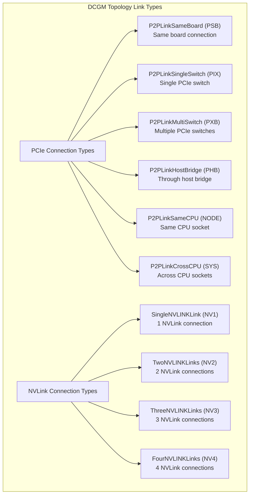
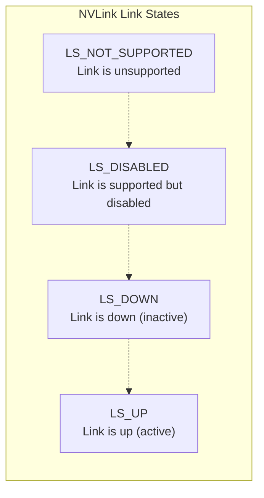
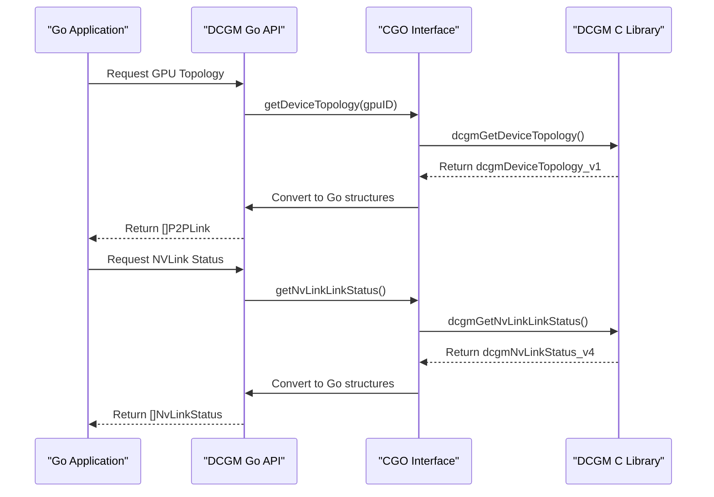
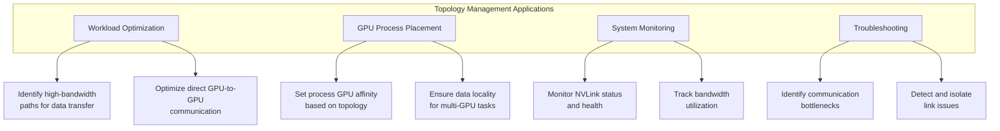

<!-- source: DeepWiki mcp.deepwiki.com · repo NVIDIA/go-dcgm · page 2.5 Topology Management · fetched 2026-10-26 -->

# Topology Management

<details>
<summary>Relevant source files</summary>

The following files were used as context for generating this wiki page:

- [pkg/dcgm/const.go](pkg/dcgm/const.go)
- [pkg/dcgm/dcgm_agent.h](pkg/dcgm/dcgm_agent.h)
- [pkg/dcgm/dcgm_errors.h](pkg/dcgm/dcgm_errors.h)
- [pkg/dcgm/dcgm_fields.h](pkg/dcgm/dcgm_fields.h)
- [pkg/dcgm/dcgm_structs.h](pkg/dcgm/dcgm_structs.h)
- [pkg/dcgm/device_info.go](pkg/dcgm/device_info.go)
- [pkg/dcgm/device_status.go](pkg/dcgm/device_status.go)
- [pkg/dcgm/hostengine_status.go](pkg/dcgm/hostengine_status.go)
- [pkg/dcgm/topology.go](pkg/dcgm/topology.go)

</details>


Topology Management in DCGM Go bindings enables users to discover and analyze the interconnect topology between GPUs and other devices in a system. This page covers the APIs for retrieving GPU connectivity information, analyzing link types, and using topology data to optimize applications.

## Introduction to GPU Topology

GPU topology refers to the physical and logical connectivity between GPUs in a system and between GPUs and other components like CPUs. Understanding the topology is crucial for:

- Optimizing multi-GPU workloads by placing related computations on directly connected GPUs
- Determining the best data transfer paths between devices
- Identifying potential bottlenecks in the system architecture

DCGM provides both PCIe and NVLink topology information, allowing applications to make informed decisions about data placement and communication patterns.

Sources: [pkg/dcgm/topology.go:1-214](), [pkg/dcgm/dcgm_fields.h:336-347]()

## Topology Concepts and Components

### Link Types

DCGM categorizes GPU connections using the `P2PLinkType` enumeration:



Sources: [pkg/dcgm/topology.go:15-40](), [pkg/dcgm/topology.go:42-68]()

### Link States

For NVLink connections, DCGM tracks the current state using the `Link_State` type:



Sources: [pkg/dcgm/topology.go:142-154]()

## Topology Data Structures

DCGM Go bindings provide several key structures for handling topology information:

### P2PLink Structure

The `P2PLink` structure represents a peer-to-peer connection between GPUs:

| Field | Type | Description |
|-------|------|-------------|
| GPU | uint | ID of the GPU |
| BusID | string | PCIe bus ID of the GPU |
| Link | P2PLinkType | Type of P2P connection |

### NvLinkStatus Structure

The `NvLinkStatus` structure contains information about an NVLINK connection status:

| Field | Type | Description |
|-------|------|-------------|
| ParentId | uint | ID of the parent entity (GPU or NVSwitch) |
| ParentType | Field_Entity_Group | Type of the parent entity |
| State | Link_State | Current state of the NVLINK |
| Index | uint | Link index number |

Sources: [pkg/dcgm/topology.go:70-78](), [pkg/dcgm/topology.go:156-166]()

## Topology Management API Flow



Sources: [pkg/dcgm/topology.go:117-140](), [pkg/dcgm/topology.go:168-213](), [pkg/dcgm/dcgm_agent.h:403]()

## Retrieving Topology Information

### Getting GPU Device Topology

The `getDeviceTopology` function retrieves the topology information for a specific GPU:

```go
// Get topology information for a GPU
links, err := getDeviceTopology(gpuID)
if err != nil {
    // Handle error
}

// Process topology links
for _, link := range links {
    fmt.Printf("GPU %d connected to GPU %d via %s\n", 
                gpuID, link.GPU, link.Link.PCIPaths())
}
```

This function first calls the C function `dcgmGetDeviceTopology` and then converts the result into a more Go-friendly format.

### Getting NVLink Status

The `getNvLinkLinkStatus` function retrieves the status of all NVLinks in the system:

```go
// Get status of all NVLinks
links, err := getNvLinkLinkStatus()
if err != nil {
    // Handle error
}

// Process NVLink status
for _, link := range links {
    if link.State == LS_UP {
        fmt.Printf("NVLink %d on %s %d is active\n", 
                  link.Index, link.ParentType, link.ParentId)
    }
}
```

Sources: [pkg/dcgm/topology.go:117-140](), [pkg/dcgm/topology.go:168-213]()

## Internal Implementation Details

### P2P Link Type Conversion

The `getP2PLink` function (in `topology.go`) maps from the C enum values to the Go `P2PLinkType` enum:

```go
func getP2PLink(path uint) P2PLinkType {
    switch path {
    case C.DCGM_TOPOLOGY_BOARD:
        return P2PLinkSameBoard
    case C.DCGM_TOPOLOGY_SINGLE:
        return P2PLinkSingleSwitch
    // ... other cases ...
    }
    return P2PLinkUnknown
}
```

### Bus ID Retrieval

The implementation uses `getBusID` to retrieve the PCIe bus ID for a GPU:

```go
func getBusID(gpuID uint) (string, error) {
    var device C.dcgmDeviceAttributes_v3
    device.version = makeVersion3(unsafe.Sizeof(device))
    
    result := C.dcgmGetDeviceAttributes(handle.handle, C.uint(gpuID), &device)
    if err := errorString(result); err != nil {
        return "", fmt.Errorf("error getting device busid: %s", err)
    }
    return *stringPtr(&device.identifiers.pciBusId[0]), nil
}
```

Sources: [pkg/dcgm/topology.go:80-104](), [pkg/dcgm/topology.go:106-115]()

## Use Cases for Topology Information



Sources: [pkg/dcgm/topology.go:1-214](), [pkg/dcgm/device_info.go:245-253]()

## Example: GPU Topology Analysis

Below is an example of how to analyze topology information to find the best GPU pairs for communication:

```go
// Find the best connected GPU pairs
func findBestGPUPairs(gpuIDs []uint) map[uint]uint {
    bestPairs := make(map[uint]uint)
    
    for _, gpu1 := range gpuIDs {
        links, _ := getDeviceTopology(gpu1)
        
        bestLink := P2PLinkUnknown
        bestGPU := uint(0)
        
        for _, link := range links {
            // Skip self-connections
            if link.GPU == gpu1 {
                continue
            }
            
            // Prefer NVLink connections
            if link.Link >= SingleNVLINKLink {
                bestGPU = link.GPU
                bestLink = link.Link
                break
            }
            
            // Otherwise prefer the closest PCIe connection
            if link.Link > bestLink {
                bestGPU = link.GPU
                bestLink = link.Link
            }
        }
        
        if bestGPU != 0 {
            bestPairs[gpu1] = bestGPU
        }
    }
    
    return bestPairs
}
```

## NVLink vs PCIe Performance Considerations

Understanding the topology can significantly impact application performance. Here's a comparison of different link types:

| Link Type | Relative Bandwidth | Typical Use Case |
|-----------|-------------------|------------------|
| NVLink (4 links) | Highest (up to 600 GB/s) | ML training, multi-GPU simulation |
| NVLink (1 link) | High (up to 150 GB/s) | HPC applications |
| PCIe Same Board | Medium-High | Specialized multi-GPU cards |
| PCIe Single Switch | Medium | GPUs in same server |
| PCIe Multi Switch | Medium-Low | GPUs across different parts of system |
| PCIe Host Bridge | Low | Typical server configuration |
| PCIe Cross CPU | Lowest | Multi-socket servers |

## Integration with Device Information

Topology information is also accessible through the Device Info API. When retrieving device information, topology details are included:

```go
deviceInfo, err := getDeviceInfo(gpuID)
if err != nil {
    // Handle error
}

// Access topology information
for _, link := range deviceInfo.Topology {
    fmt.Printf("Connection to GPU %d: %s\n", link.GPU, link.Link.PCIPaths())
}
```

Sources: [pkg/dcgm/device_info.go:245-253]()

## Conclusion

Topology Management in DCGM provides essential capabilities for understanding and optimizing GPU communication paths. By leveraging the topology information provided by these APIs, applications can make informed decisions about workload placement and data movement strategies, leading to better performance in multi-GPU environments.

For related information on device discovery and attributes, see [Device Information and Status](#2.2).

---

