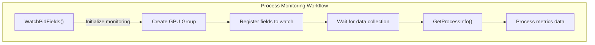
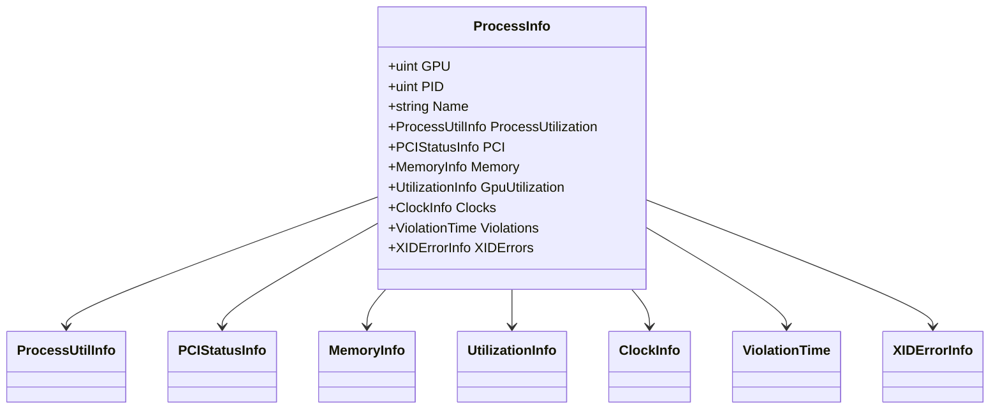
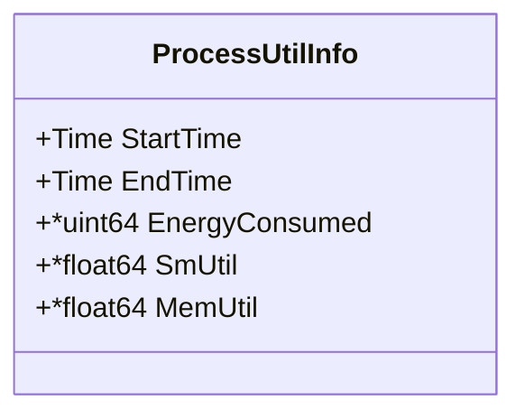
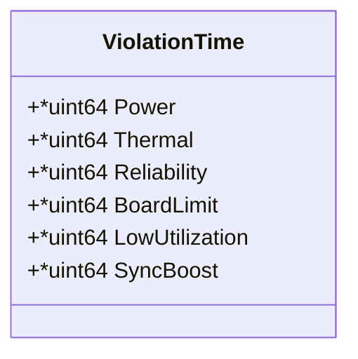
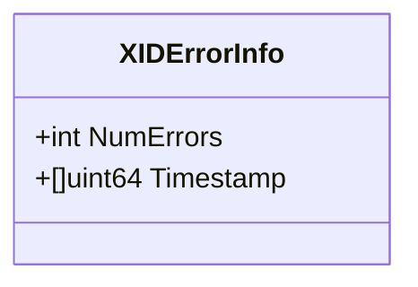
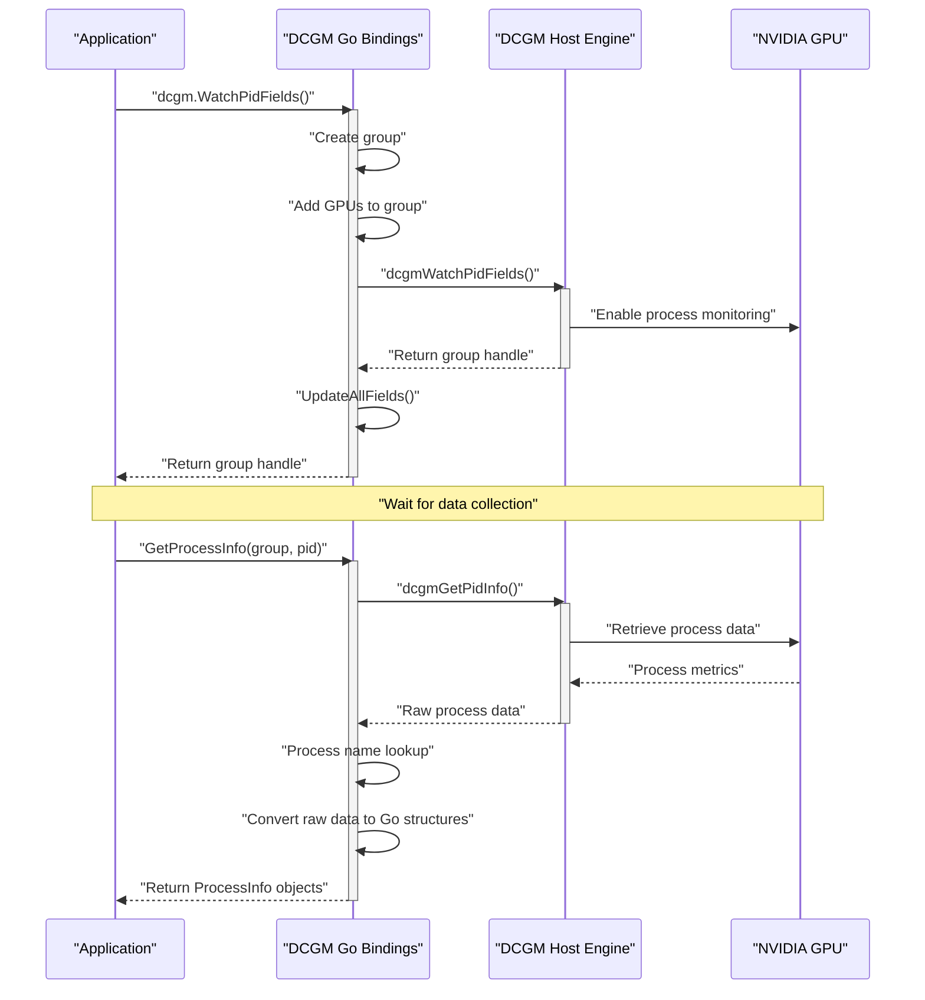
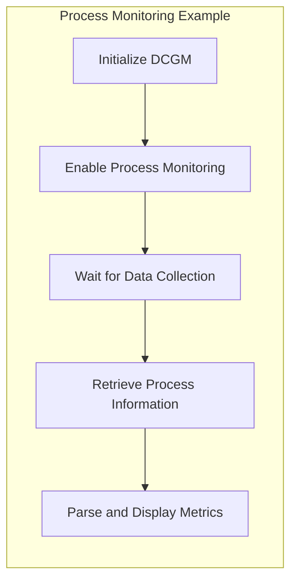

<!-- source: DeepWiki mcp.deepwiki.com · repo NVIDIA/go-dcgm · page 2.6 Process Information · fetched 2026-10-26 -->

# Process Information

<details>
<summary>Relevant source files</summary>

The following files were used as context for generating this wiki page:

- [pkg/dcgm/fields.go](pkg/dcgm/fields.go)
- [pkg/dcgm/process_info.go](pkg/dcgm/process_info.go)
- [samples/processInfo/main.go](samples/processInfo/main.go)
- [samples/restApi/handlers/utils.go](samples/restApi/handlers/utils.go)

</details>


This document describes the process monitoring capabilities provided by the go-dcgm library. It focuses on how to track and monitor GPU processes, retrieve detailed process statistics, and understand process-related resource utilization metrics. For information about general device monitoring, see [Device Information and Status](#2.2). For field management used by process monitoring, see [Field Management](#2.4).

## Overview of Process Monitoring

Process monitoring allows applications to gather detailed metrics about processes utilizing NVIDIA GPUs. This functionality is critical for monitoring resource usage, debugging performance issues, and accounting for GPU resource consumption in multi-process environments.



Sources: [pkg/dcgm/process_info.go:95-128](), [samples/processInfo/main.go:48-85]()

## Key Data Structures

The go-dcgm library provides several structures to represent process information and related metrics. These structures encapsulate various aspects of GPU process utilization.

### ProcessInfo Structure

The `ProcessInfo` structure is the primary container for all process-related information, combining various metric categories for a specific GPU process.



Sources: [pkg/dcgm/process_info.go:70-91]()

### ProcessUtilInfo Structure

The `ProcessUtilInfo` structure provides utilization metrics specific to a process running on a GPU.



Sources: [pkg/dcgm/process_info.go:32-43]()

### ViolationTime Structure

The `ViolationTime` structure tracks the duration of various throttling conditions affecting a process.



Sources: [pkg/dcgm/process_info.go:46-59]()

### XIDErrorInfo Structure

The `XIDErrorInfo` structure contains information about critical XID errors encountered during process execution.



Sources: [pkg/dcgm/process_info.go:62-67]()

## Process Monitoring API

### Enabling Process Monitoring

Before you can retrieve process information, you must first enable process monitoring through the `WatchPidFields` or `WatchPidFieldsEx` functions.



Sources: [pkg/dcgm/process_info.go:95-128](), [samples/processInfo/main.go:64-71]()

#### WatchPidFields

The `WatchPidFields` function enables monitoring of GPU process-related fields with default parameters:

```go
group, err := dcgm.WatchPidFields()
```

This function internally creates a group containing all supported GPUs and configures field watches with default parameters.

Sources: [pkg/dcgm/process_info.go:95-97]()

#### WatchPidFieldsEx

For more fine-grained control, `WatchPidFieldsEx` allows customization of monitoring parameters:

```go
group, err := dcgm.WatchPidFieldsEx(
    updateFreq,    // Update frequency as time.Duration
    maxKeepAge,    // Maximum age to keep samples as time.Duration
    maxKeepSamples, // Maximum number of samples to keep
    gpus...        // Optional list of specific GPUs to monitor
)
```

This function allows you to specify:
- How frequently metrics should be updated
- How long to keep historical samples
- How many samples to keep
- Which specific GPUs to monitor (default: all supported GPUs)

Sources: [pkg/dcgm/process_info.go:95-97]()

### Retrieving Process Information

Once process monitoring is enabled, you can retrieve process information using the `GetProcessInfo` function:

```go
pidInfo, err := dcgm.GetProcessInfo(group, pid)
```

Where:
- `group` is the group handle returned from `WatchPidFields` or `WatchPidFieldsEx`
- `pid` is the process ID to query

The function returns a slice of `ProcessInfo` structures, one for each GPU the process is using.

Sources: [pkg/dcgm/process_info.go:130-221]()

## Important Implementation Details

### Internal Process Information Collection

The `getProcessInfo` function is the core implementation for retrieving process information:

1. It creates a C structure (`dcgmPidInfo_t`) to hold the process data
2. It calls the DCGM C library function `dcgmGetPidInfo`
3. It retrieves the process name from the `/proc` filesystem
4. It converts the C data structures to Go structures
5. It adjusts units for certain metrics (e.g., energy from mWs to Joules)

Sources: [pkg/dcgm/process_info.go:130-221]()

### Process Name Resolution

The library looks up process names using the Linux `/proc` filesystem:

```go
func processName(pid uint) (string, error) {
    f := fmt.Sprintf("/proc/%d/comm", pid)
    b, err := os.ReadFile(f)
    if err != nil {
        // TOCTOU: process terminated
        if os.IsNotExist(err) {
            return "", nil
        }
        return "", err
    }
    return strings.TrimSuffix(string(b), "\n"), nil
}
```

This means that process name resolution is Linux-specific and relies on the `/proc` filesystem.

Sources: [pkg/dcgm/process_info.go:223-234]()

## Usage Example

Here is a typical usage pattern for monitoring GPU processes:



The following example demonstrates how to monitor a specific process:

1. Initialize DCGM in embedded mode
2. Enable process monitoring with `WatchPidFields`
3. Wait for data collection to occur
4. Retrieve process information for a specific PID
5. Format and display the process metrics

Sources: [samples/processInfo/main.go:54-86]()

## Available Process Metrics

The following table summarizes the key metrics available for monitored processes:

| Metric Category | Specific Metrics | Description |
|-----------------|------------------|-------------|
| Execution Stats | PID, Name, Start Time, End Time | Basic process execution information |
| Performance Stats | Energy Consumed, Memory Used, Clock Speeds, Utilization | Performance-related metrics |
| PCI Stats | PCIe Rx/Tx Bandwidth, PCIe Replays | PCIe bus utilization metrics |
| Memory Stats | Global Memory Used, ECC Errors | Memory usage and error metrics |
| Event Stats | Single/Double Bit ECC Errors, XID Errors | Error and event counters |
| Slowdown Stats | Power, Thermal, Reliability, etc. | Reasons for throttling or slowdowns |
| Process Utilization | SM Utilization, Memory Utilization | Process-specific utilization metrics |

Sources: [samples/processInfo/main.go:14-45](), [samples/restApi/handlers/utils.go:51-82]()

## Important Notes and Considerations

1. **Enabling Watches Before Process Start**: For complete process monitoring, `WatchPidFields` should be called before the target process starts. This ensures all metrics are captured from the beginning of process execution.

2. **Root Privileges**: Some monitoring functions may require root privileges to enable certain health watches.

3. **Data Collection Delay**: After enabling process monitoring, it's recommended to wait a few seconds for DCGM to collect initial data before retrieving process information.

4. **Multiple GPUs**: A single process can use multiple GPUs. The `GetProcessInfo` function returns a slice of `ProcessInfo` structures, one for each GPU the process is using.

5. **Process Termination**: If a process has terminated, the `EndTime` field will have a non-zero value. For running processes, `EndTime` will be 0 and the string representation will show "Running".

Sources: [samples/processInfo/main.go:48-53](), [samples/processInfo/main.go:69-71]()

## Integration with Applications

Process information can be integrated into various application types:

1. **Command-Line Tools**: Similar to the sample application, creating utilities that display process information.

2. **Monitoring Dashboards**: Including process metrics in web-based dashboards or monitoring systems.

3. **Resource Accounting**: Tracking GPU resource usage by process for billing or chargeback.

4. **Application Profiling**: Analyzing process metrics to identify performance bottlenecks or optimization opportunities.

The REST API example shows how process information can be exposed through an HTTP endpoint for integration with web applications or monitoring systems.

Sources: [samples/restApi/handlers/utils.go:51-82](), [samples/restApi/handlers/utils.go:196-206]()

---

