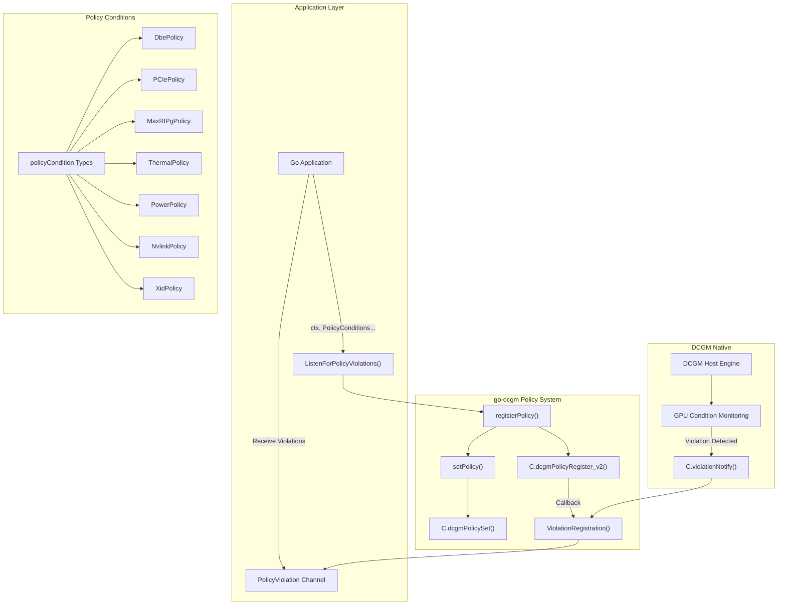
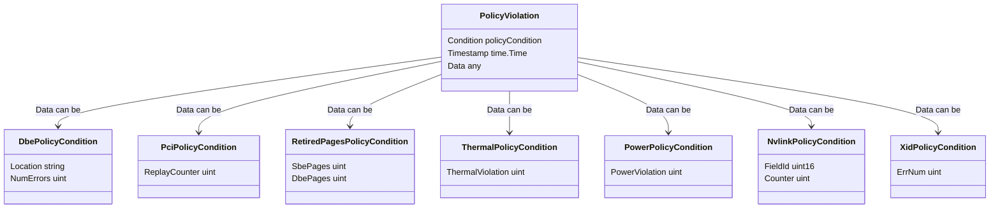
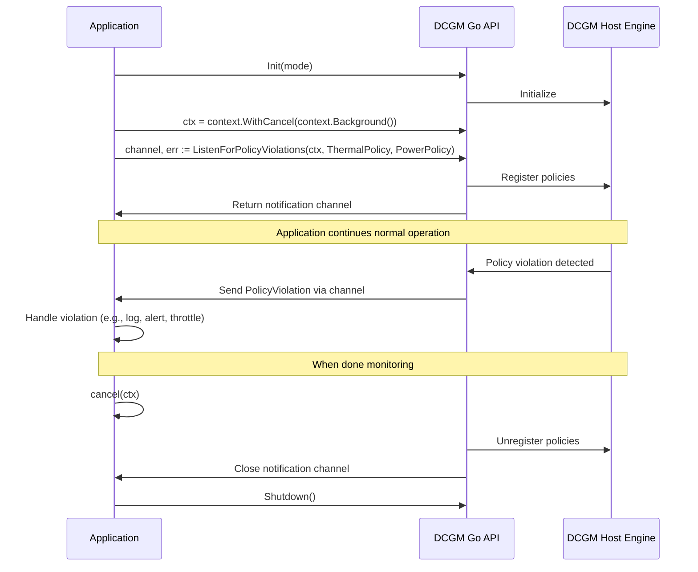
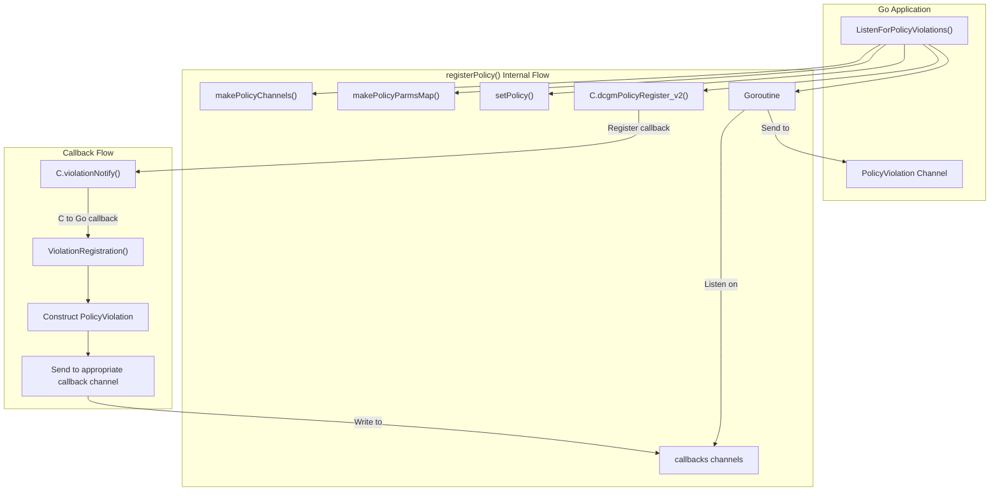
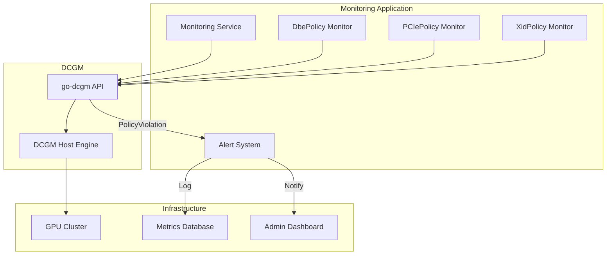
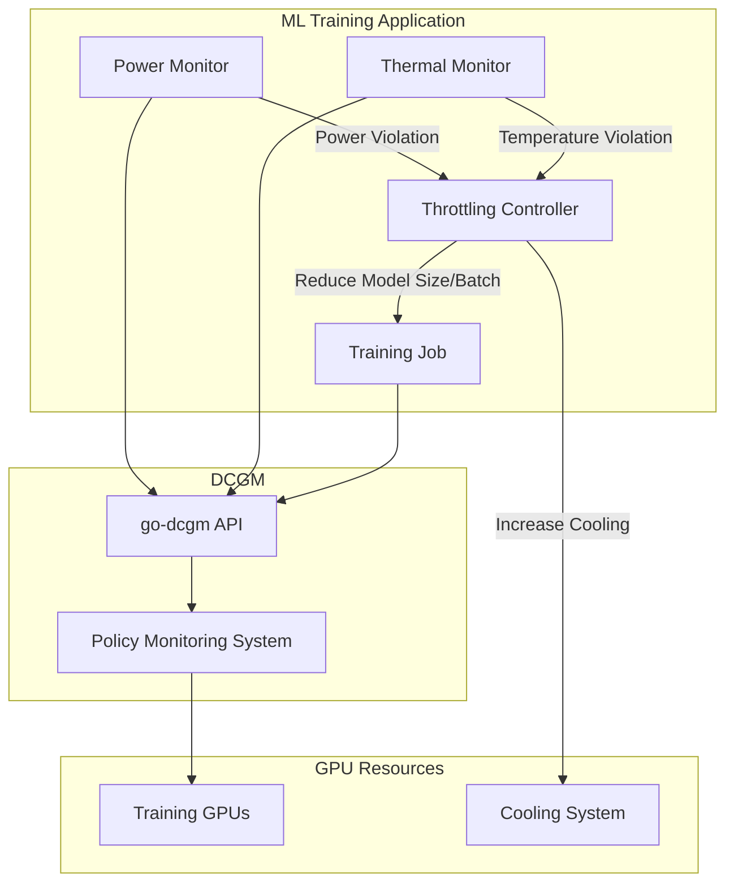

<!-- source: DeepWiki mcp.deepwiki.com · repo NVIDIA/go-dcgm · page 2.7 Policy Monitoring · fetched 2026-10-26 -->

# Policy Monitoring

<details>
<summary>Relevant source files</summary>

The following files were used as context for generating this wiki page:

- [pkg/dcgm/api.go](pkg/dcgm/api.go)
- [pkg/dcgm/internal.go](pkg/dcgm/internal.go)
- [pkg/dcgm/policy.go](pkg/dcgm/policy.go)
- [pkg/dcgm/policy_test.go](pkg/dcgm/policy_test.go)
- [pkg/dcgm/profile.go](pkg/dcgm/profile.go)

</details>


## Purpose and Scope

This document explains the policy monitoring subsystem of the NVIDIA DCGM Go bindings. Policy monitoring allows applications to monitor NVIDIA GPUs for specific conditions that might require intervention, such as hardware errors, temperature or power threshold violations, and more. The policy monitoring system provides a channel-based notification mechanism that applications can use to receive real-time alerts about GPU health and performance issues.

This page focuses on setting up policy monitoring, available policy types, and how to handle policy violation notifications. For information about general health monitoring, see [Health Monitoring](#2.3).

## Policy Monitoring Overview



Sources: [pkg/dcgm/policy.go:22-46](). [pkg/dcgm/api.go:114-125](). [pkg/dcgm/policy.go:327-409]().

## Policy Condition Types

The go-dcgm library provides several policy condition types that can be monitored:

| Policy Type | Constant | Description | 
|-------------|----------|-------------|
| Double-bit ECC Error | `DbePolicy` | Detects uncorrectable ECC memory errors |
| PCI Error | `PCIePolicy` | Detects PCI bus transmission errors |
| Maximum Retired Pages | `MaxRtPgPolicy` | Alerts when too many GPU memory pages have been retired |
| Thermal Limit | `ThermalPolicy` | Monitors for GPU temperature exceeding a threshold |
| Power Limit | `PowerPolicy` | Detects when GPU power consumption exceeds a threshold |
| NVLink Error | `NvlinkPolicy` | Monitors NVLink interconnect for errors |
| XID Error | `XidPolicy` | Detects GPU driver/hardware errors (XID events) |

Sources: [pkg/dcgm/policy.go:22-46](). 

## Policy Violation Data Structure

When a policy violation occurs, the application receives a `PolicyViolation` structure through a channel. This structure contains:



Sources: [pkg/dcgm/policy.go:50-122]().

## Setting Up Policy Monitoring

The go-dcgm library provides two main functions for setting up policy monitoring:

1. `ListenForPolicyViolations`: Monitors all GPUs in the system
2. `ListenForPolicyViolationsForGroup`: Monitors a specific group of GPUs

Both functions return a Go channel that delivers `PolicyViolation` notifications.

### Basic Usage Pattern



Sources: [pkg/dcgm/api.go:114-125](). [pkg/dcgm/policy.go:327-409]().

### Code Example

The following is a typical pattern for using policy monitoring:

```go
// Initialize DCGM
cleanup, err := dcgm.Init(dcgm.Embedded)
if err != nil {
    log.Fatalf("Failed to initialize DCGM: %v", err)
}
defer cleanup()

// Create a context with cancellation for policy monitoring
ctx, cancel := context.WithCancel(context.Background())
defer cancel()

// Start listening for thermal and power policy violations on all GPUs
violations, err := dcgm.ListenForPolicyViolations(ctx, dcgm.ThermalPolicy, dcgm.PowerPolicy)
if err != nil {
    log.Fatalf("Failed to set up policy monitoring: %v", err)
}

// Handle policy violations
for violation := range violations {
    switch violation.Condition {
    case dcgm.ThermalPolicy:
        data := violation.Data.(dcgm.ThermalPolicyCondition)
        log.Printf("Thermal violation detected: %d°C at %v", data.ThermalViolation, violation.Timestamp)
    case dcgm.PowerPolicy:
        data := violation.Data.(dcgm.PowerPolicyCondition)
        log.Printf("Power violation detected: %dW at %v", data.PowerViolation, violation.Timestamp)
    }
}
```

Sources: [pkg/dcgm/policy_test.go:290-344]().

## Internal Policy Monitoring Workflow



Sources: [pkg/dcgm/policy.go:327-409](). [pkg/dcgm/policy.go:137-196](). [pkg/dcgm/policy.go:202-287]().

## Policy Parameter Configuration

Each policy type has specific threshold parameters that determine when a violation occurs. The go-dcgm library uses a parameter map to configure these thresholds:

| Policy | Field Type | Default Threshold Value |
|--------|------------|-------------------------|
| DbePolicy | Boolean | 1 (any error triggers a violation) |
| PCIePolicy | Boolean | 1 (any error triggers a violation) |
| MaxRtPgPolicy | Numeric | 10 retired pages |
| ThermalPolicy | Numeric | 100°C |
| PowerPolicy | Numeric | 250W |
| NvlinkPolicy | Boolean | 1 (any error triggers a violation) |
| XidPolicy | Boolean | 1 (any error triggers a violation) |

Sources: [pkg/dcgm/policy.go:150-196]().

## Example Use Cases

### GPU Health Monitoring in a Data Center

For a large-scale GPU deployment, policy monitoring can be used to detect hardware issues before they cause application failures:



Sources: [pkg/dcgm/policy.go:22-46](). [pkg/dcgm/api.go:114-125]().

### Thermal Management for ML Training

For machine learning workloads that may cause GPUs to heat up, thermal policy monitoring can help implement proactive cooling or workload throttling:



Sources: [pkg/dcgm/policy.go:22-46](). [pkg/dcgm/policy.go:232-246]().

## Best Practices

1. **Context Management**: Always use a context with cancellation to properly clean up policy monitoring resources.

2. **Error Handling**: Policy violations should be handled gracefully by your application. Consider implementing appropriate error handling and recovery mechanisms.

3. **Multiple Policy Types**: You can monitor multiple policy types simultaneously by passing multiple policy conditions to the `ListenForPolicyViolations` function.

4. **Resource Cleanup**: Make sure to cancel the context when done to properly unregister policies and free resources.

5. **Policy Thresholds**: The default thresholds may need adjustment for your specific hardware and workload. Consider testing to determine appropriate values.

Sources: [pkg/dcgm/policy.go:327-409](). [pkg/dcgm/policy_test.go:290-344]().

## Limitations

- Policy monitoring requires the DCGM host engine to be running.
- Some policy types may only be applicable to certain GPU models.
- There may be a slight delay between a condition occurring and the violation being reported.

Sources: [pkg/dcgm/policy.go:289-325]().

---

