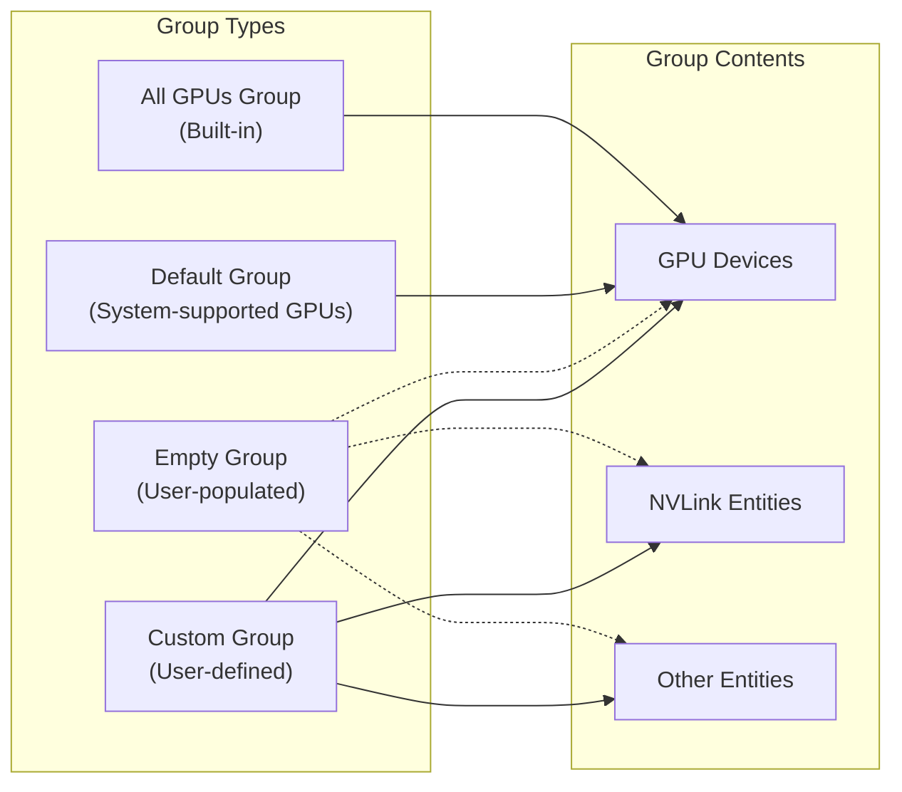
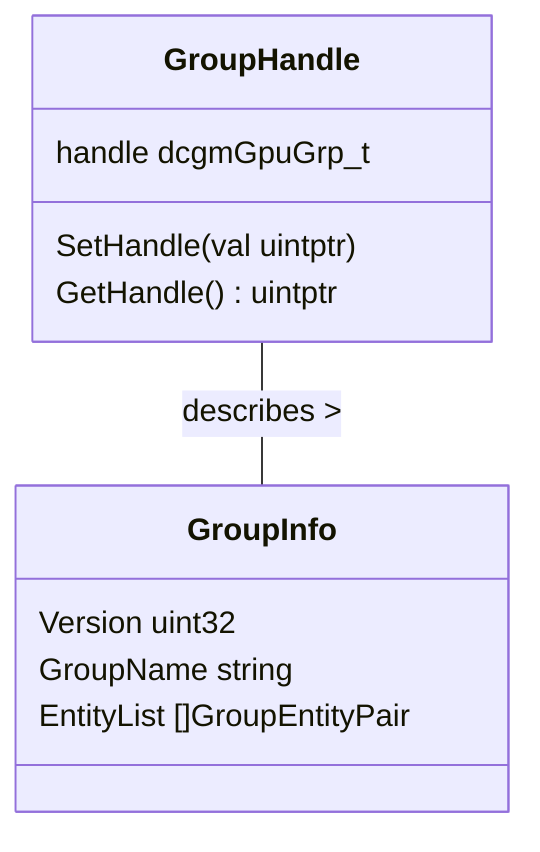
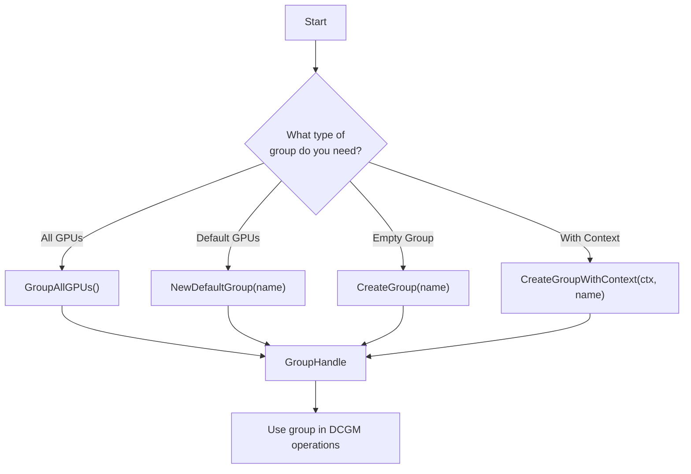
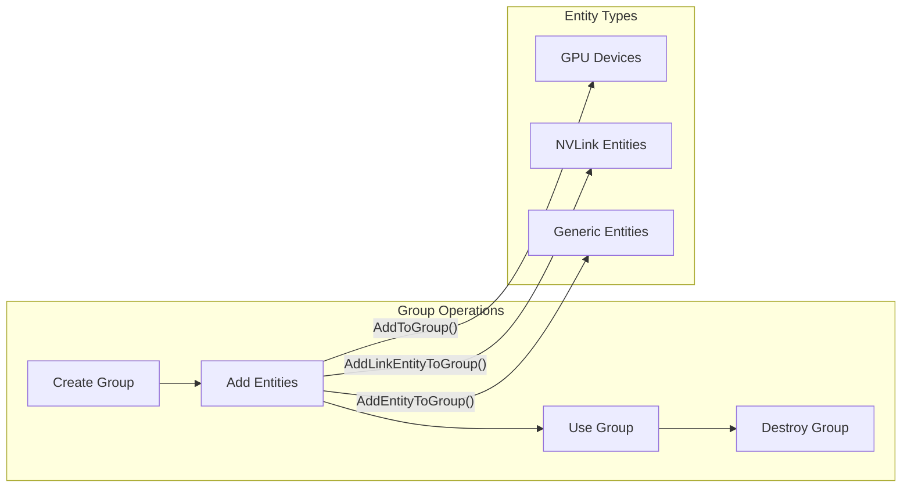
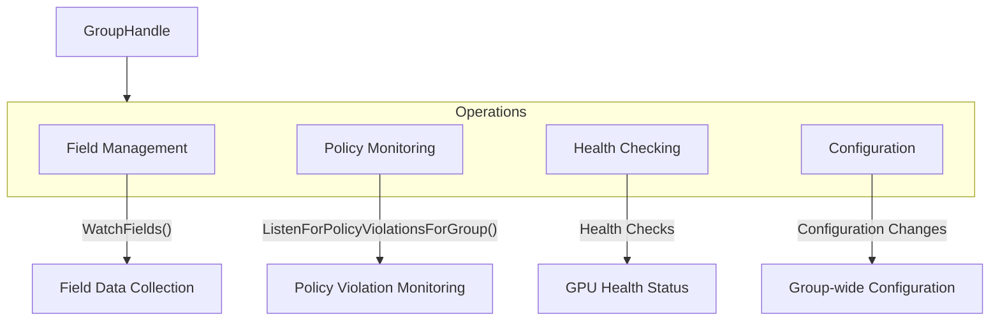
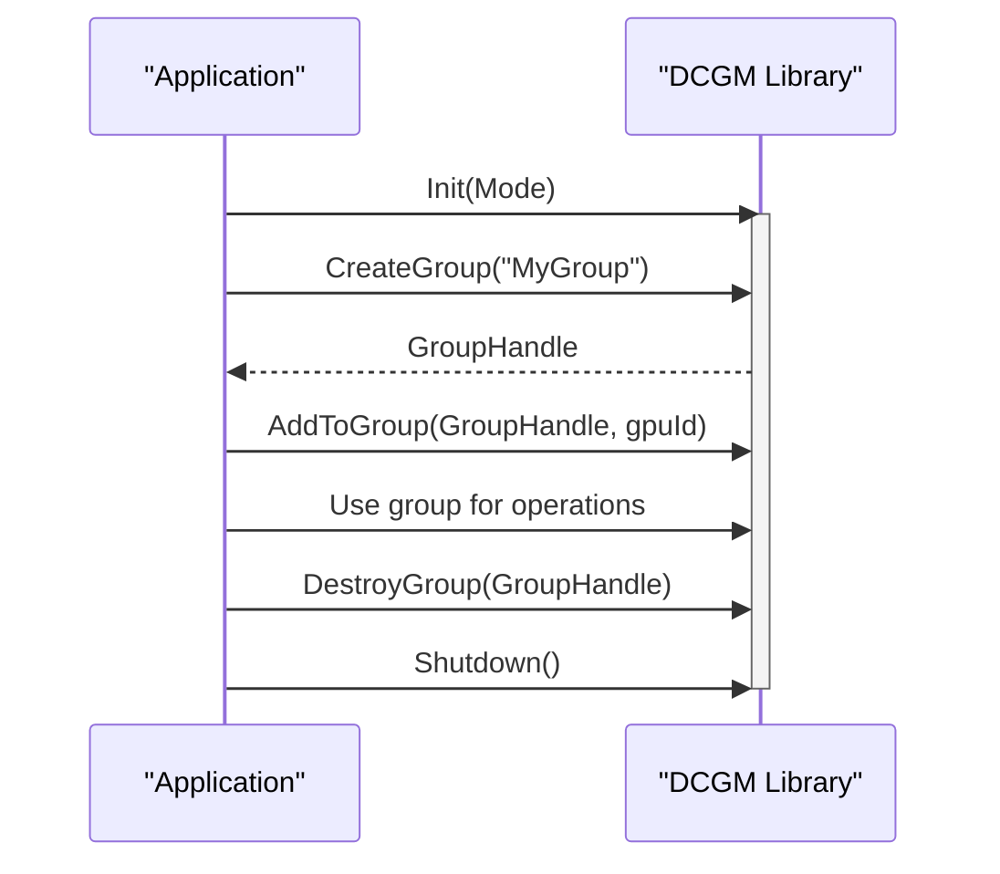

<!-- source: DeepWiki mcp.deepwiki.com · repo NVIDIA/go-dcgm · page 2.8 GPU Group Management · fetched 2026-10-26 -->

# GPU Group Management

<details>
<summary>Relevant source files</summary>

The following files were used as context for generating this wiki page:

- [pkg/dcgm/api.go](pkg/dcgm/api.go)
- [pkg/dcgm/gpu_group.go](pkg/dcgm/gpu_group.go)
- [pkg/dcgm/profile.go](pkg/dcgm/profile.go)

</details>


## Purpose and Scope

This document describes how to create and manage groups of GPUs using the NVIDIA Data Center GPU Manager (DCGM) Go bindings. GPU Groups provide a way to organize and collectively manage multiple GPUs as a single logical unit. This is particularly useful for operations that need to be performed on specific subsets of GPUs in a system, such as monitoring, policy enforcement, and field management.

For information about monitoring fields across GPU groups, see [Field Management](#2.4). For policy monitoring across groups, see [Policy Monitoring](#2.7).

## Group Concepts

GPU Groups in DCGM are collections of GPU devices and other entities that can be managed together. Each group is represented by a `GroupHandle`, which serves as a reference to the group in DCGM operations.



Sources: [pkg/dcgm/gpu_group.go:15-37]()

DCGM supports several types of GPU groups:

1. **All GPUs Group**: A pre-defined group that includes all GPUs in the system
2. **Default Group**: Contains all GPUs supported by DCGM
3. **Empty Group**: A user-created group with no initial members
4. **Custom Group**: A user-populated group with specific entities

The maximum number of entities allowed in a group is defined by the constant `DCGM_GROUP_MAX_ENTITIES`.

Sources: [pkg/dcgm/gpu_group.go:15-37]()

## Group Handle

The `GroupHandle` struct is the primary data structure used to reference and manage GPU groups. It encapsulates a C-level DCGM group handle and provides Go-friendly methods for group management.



Sources: [pkg/dcgm/gpu_group.go:21-31](), [pkg/dcgm/gpu_group.go:110-114]()

## Creating GPU Groups

DCGM provides multiple ways to create GPU groups depending on your needs:



Sources: [pkg/dcgm/gpu_group.go:34-66](), [pkg/dcgm/gpu_group.go:142-149]()

### Creating a Group for All GPUs

To obtain a group that includes all GPUs in the system:

```go
allGPUsGroup := dcgm.GroupAllGPUs()
```

This returns a pre-defined group that represents all GPUs and can be used immediately with DCGM functions.

Sources: [pkg/dcgm/gpu_group.go:34-36]()

### Creating a Default Group

To create a group containing all DCGM-supported GPUs:

```go
defaultGroup, err := dcgm.NewDefaultGroup("MyDefaultGroup")
if err != nil {
    // Handle error
}
```

Sources: [pkg/dcgm/gpu_group.go:54-66]()

### Creating an Empty Group

To create an empty group that you can populate with specific GPUs:

```go
emptyGroup, err := dcgm.CreateGroup("MyCustomGroup")
if err != nil {
    // Handle error
}
```

Sources: [pkg/dcgm/gpu_group.go:38-51]()

### Creating a Group with Context

For operations that need to respect context cancellation:

```go
ctx, cancel := context.WithTimeout(context.Background(), 5*time.Second)
defer cancel()

groupWithContext, err := dcgm.CreateGroupWithContext(ctx, "ContextAwareGroup")
if err != nil {
    // Handle error (including context timeout)
}
```

Sources: [pkg/dcgm/gpu_group.go:142-149]()

## Managing Group Membership

After creating a group, you can add various entities to it:



Sources: [pkg/dcgm/gpu_group.go:69-97]()

### Adding GPUs to a Group

To add a specific GPU to a group:

```go
gpuId := uint(0)  // ID of the GPU to add
err := dcgm.AddToGroup(myGroup, gpuId)
if err != nil {
    // Handle error
}
```

Sources: [pkg/dcgm/gpu_group.go:69-76]()

### Adding Link Entities

For NVLink topology management:

```go
index := uint(1)     // Link index
parentId := uint(0)  // Parent device ID
err := dcgm.AddLinkEntityToGroup(myGroup, index, parentId)
if err != nil {
    // Handle error
}
```

Sources: [pkg/dcgm/gpu_group.go:79-86]()

### Adding Generic Entities

For other entity types:

```go
entityGroupId := dcgm.FE_GPU  // Entity group type
entityId := uint(0)           // Entity ID within that group
err := dcgm.AddEntityToGroup(myGroup, entityGroupId, entityId)
if err != nil {
    // Handle error
}
```

Sources: [pkg/dcgm/gpu_group.go:89-97]()

## Getting Group Information

You can retrieve information about a group using `GetGroupInfo`:

```go
groupInfo, err := dcgm.GetGroupInfo(myGroup)
if err != nil {
    // Handle error
}

fmt.Printf("Group name: %s\n", groupInfo.GroupName)
fmt.Printf("Entity count: %d\n", len(groupInfo.EntityList))

// List entities in the group
for _, entity := range groupInfo.EntityList {
    fmt.Printf("Entity: Group=%v, ID=%d\n", entity.EntityGroupId, entity.EntityId)
}
```

The `GroupInfo` struct provides details about the group:

| Field | Type | Description |
|-------|------|-------------|
| Version | uint32 | Version information for the struct |
| GroupName | string | Name of the group |
| EntityList | []GroupEntityPair | List of entities in the group |

Sources: [pkg/dcgm/gpu_group.go:110-139]()

## Using Groups with Other DCGM Functions

GPU groups can be used with various DCGM functions to perform operations on multiple GPUs at once. Here are some common use cases:



Sources: [pkg/dcgm/api.go:120-125]()

### Policy Monitoring for a Group

To monitor policy violations for a specific group:

```go
ctx := context.Background()
violations, err := dcgm.ListenForPolicyViolationsForGroup(
    ctx, 
    myGroup, 
    dcgm.PolicyCondition_Thermal, 
    dcgm.PolicyCondition_Power
)
if err != nil {
    // Handle error
}

// Process violations as they occur
for violation := range violations {
    fmt.Printf("Policy violation: %+v\n", violation)
}
```

Sources: [pkg/dcgm/api.go:122-125]()

## Group Lifecycle Management

Proper group lifecycle management is important to avoid resource leaks:



Sources: [pkg/dcgm/api.go:18-66](), [pkg/dcgm/gpu_group.go:38-51](), [pkg/dcgm/gpu_group.go:100-107]()

### Destroying Groups

When you're done with a group, you should destroy it to free resources:

```go
err := dcgm.DestroyGroup(myGroup)
if err != nil {
    // Handle error
}
```

Note that the pre-defined "All GPUs" group cannot be destroyed as it's managed by DCGM internally.

Sources: [pkg/dcgm/gpu_group.go:100-107]()

## Best Practices

When working with GPU groups in DCGM, consider the following best practices:

1. **Group Selection**:
   - Use `GroupAllGPUs()` for operations that should apply to all GPUs
   - Use custom groups for operations specific to a subset of GPUs
   - Use `NewDefaultGroup()` for operations on DCGM-supported GPUs only

2. **Resource Management**:
   - Always destroy custom groups when no longer needed
   - Be aware of the `DCGM_GROUP_MAX_ENTITIES` limit for group size

3. **Context Awareness**:
   - Use `CreateGroupWithContext()` for operations that should respect context cancellation

4. **Error Handling**:
   - Check return errors from all group operations
   - Handle potential failure cases such as trying to add a non-existent GPU

5. **Performance Considerations**:
   - Creating many small groups may be less efficient than using filters with larger groups
   - Group operations have some overhead, so reuse groups when possible

Sources: [pkg/dcgm/gpu_group.go:34-149]()

---

