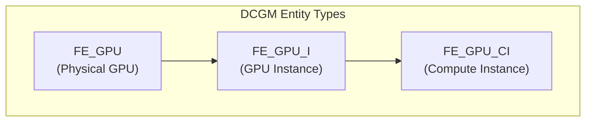
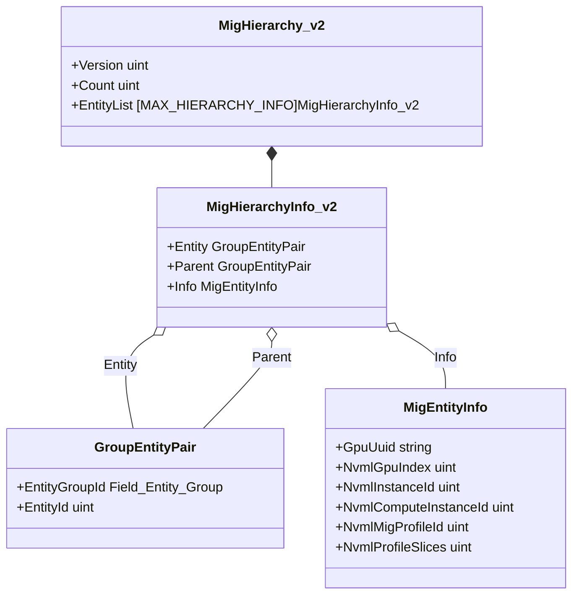
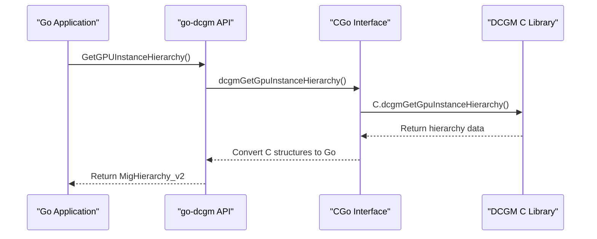
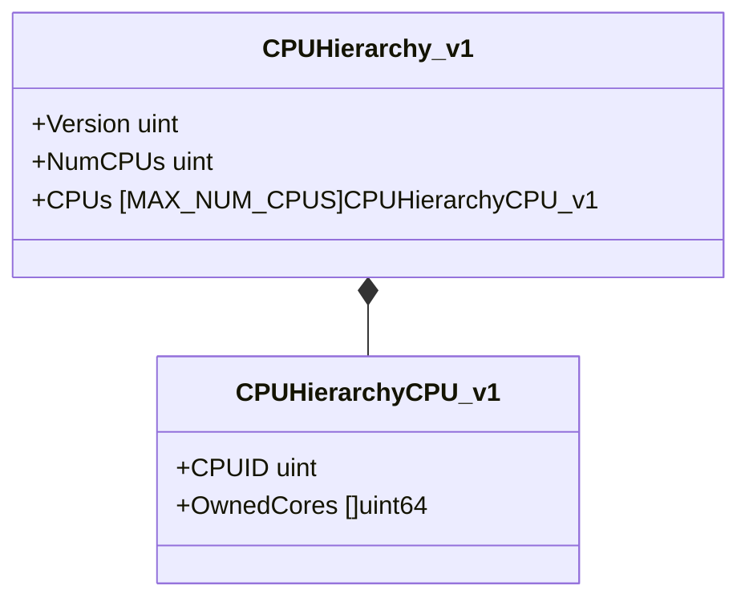
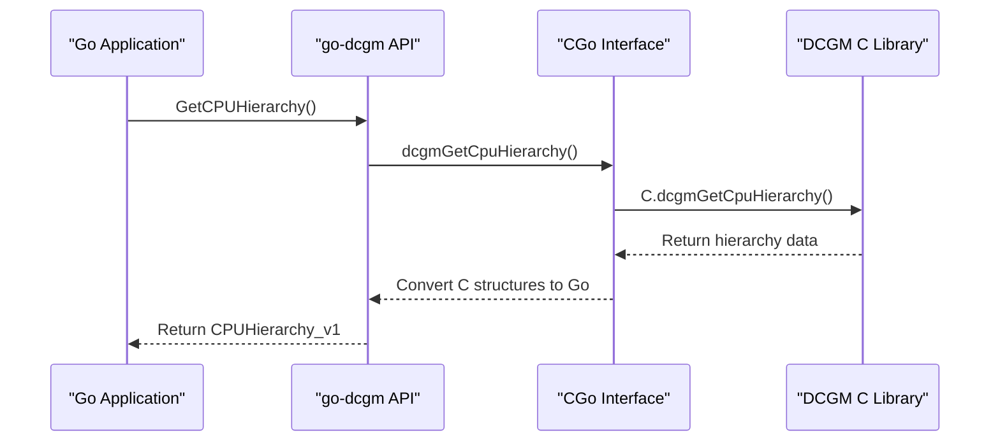
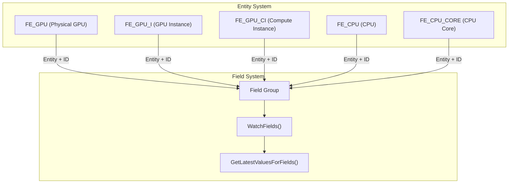

<!-- source: DeepWiki mcp.deepwiki.com · repo NVIDIA/go-dcgm · page 2.9 MIG and CPU Support · fetched 2026-10-26 -->

# MIG and CPU Support

<details>
<summary>Relevant source files</summary>

The following files were used as context for generating this wiki page:

- [pkg/dcgm/cpu.go](pkg/dcgm/cpu.go)
- [pkg/dcgm/mig.go](pkg/dcgm/mig.go)
- [samples/policy/main.go](samples/policy/main.go)
- [tests/dcgm_test.go](tests/dcgm_test.go)
- [tests/nvsmi.go](tests/nvsmi.go)

</details>


This page explains how to work with Multi-Instance GPU (MIG) capabilities and retrieve CPU information using the go-dcgm library. The DCGM Go bindings provide comprehensive support for both MIG configuration monitoring and basic CPU metrics collection, enabling applications to gather a complete view of the system's compute resources.

## Multi-Instance GPU (MIG) Support

NVIDIA's Multi-Instance GPU (MIG) feature allows a single GPU to be partitioned into multiple GPU instances, each with dedicated compute resources, memory, and bandwidth. The go-dcgm library provides structures and functions to retrieve information about the MIG configuration on supported GPUs.

### MIG Entity Types

The library defines several entity types that represent different components in a MIG-enabled system:



Sources: [pkg/dcgm/mig.go:14-61](). These entity types are defined in the `Field_Entity_Group` enum.

### Key MIG Structures

The go-dcgm library provides several structures to represent MIG entities and their relationships:



Sources: [pkg/dcgm/mig.go:63-113]()

The key structures are:

1. `GroupEntityPair` - Represents a DCGM entity with its type and ID
2. `MigEntityInfo` - Contains detailed information about a MIG entity, including its parent GPU, instance IDs, and profile information
3. `MigHierarchyInfo_v2` - Connects MIG entities to their parents in the hierarchy
4. `MigHierarchy_v2` - The top-level structure containing the complete MIG hierarchy

### Retrieving MIG Hierarchy Information

To retrieve the complete MIG hierarchy information, use the `GetGPUInstanceHierarchy()` function:



Sources: [pkg/dcgm/mig.go:116-127](), [pkg/dcgm/mig.go:129-149]()

The function returns a `MigHierarchy_v2` structure containing information about all MIG entities in the system. If there's an error retrieving the information, it returns the error along with any partial data that was collected.

### Example Usage

Here's how you might retrieve and iterate through the MIG hierarchy:

```go
// Initialize DCGM
cleanup, err := dcgm.Init(dcgm.Embedded)
if err != nil {
    // Handle error
}
defer cleanup()

// Get MIG hierarchy
hierarchy, err := dcgm.GetGPUInstanceHierarchy()
if err != nil {
    // Handle error
}

// Iterate through MIG entities
for i := uint(0); i < hierarchy.Count; i++ {
    entity := hierarchy.EntityList[i]
    
    // Process based on entity type
    switch entity.Entity.EntityGroupId {
    case dcgm.FE_GPU:
        // Process physical GPU
    case dcgm.FE_GPU_I:
        // Process GPU instance
    case dcgm.FE_GPU_CI:
        // Process compute instance
    }
}
```

## CPU Support

In addition to GPU monitoring, go-dcgm provides functions to retrieve information about the CPU hierarchy in the system.

### CPU Hierarchy Structures

The go-dcgm library defines structures to represent CPUs and their cores:



Sources: [pkg/dcgm/cpu.go:35-51]()

The key structures are:

1. `CPUHierarchyCPU_v1` - Contains information about a single CPU, including its ID and a bitmask of owned cores
2. `CPUHierarchy_v1` - The top-level structure containing information about all CPUs in the system

### CPU Constants

The library defines several constants related to CPU support:

| Constant | Value | Description |
|----------|-------|-------------|
| `MAX_NUM_CPU_CORES` | 1024 | Maximum number of CPU cores supported |
| `MAX_NUM_CPUS` | 64 | Maximum number of CPUs supported |
| `MAX_CPU_CORE_BITMASK_COUNT` | 16 | Maximum count of CPU core bitmasks |

Sources: [pkg/dcgm/cpu.go:22-32]()

### Retrieving CPU Hierarchy Information

To retrieve information about CPUs and their cores, use the `GetCPUHierarchy()` function:



Sources: [pkg/dcgm/cpu.go:54-65](), [pkg/dcgm/cpu.go:67-85]()

The function returns a `CPUHierarchy_v1` structure containing information about all CPUs in the system. If there's an error retrieving the information, it returns the error along with any partial data that was collected.

### Example Usage

Here's how you might retrieve and analyze the CPU hierarchy:

```go
// In some environments, you may need to set this environment variable
// to skip hardware checks that might otherwise prevent CPU data collection
os.Setenv("DCGM_SKIP_SYSMON_HARDWARE_CHECK", "1")

// Initialize DCGM
cleanup, err := dcgm.Init(dcgm.Embedded)
if err != nil {
    // Handle error
}
defer cleanup()

// Get CPU hierarchy
hierarchy, err := dcgm.GetCPUHierarchy()
if err != nil {
    // Handle error
}

// Iterate through CPUs
for i := uint(0); i < hierarchy.NumCPUs; i++ {
    cpu := hierarchy.CPUs[i]
    
    // Count cores owned by this CPU
    coreCount := 0
    for j := uint(0); j < dcgm.MAX_CPU_CORE_BITMASK_COUNT; j++ {
        // Count set bits in the bitmask
        bitmask := cpu.OwnedCores[j]
        for bitmask > 0 {
            if bitmask & 1 == 1 {
                coreCount++
            }
            bitmask >>= 1
        }
    }
    
    fmt.Printf("CPU %d has %d cores\n", cpu.CPUID, coreCount)
}
```

Sources: [tests/dcgm_test.go:48-76]()

## Integration with Field System

Both MIG entities and CPUs can be monitored using the DCGM field system. When working with fields, you'll need to specify the entity group and entity ID to identify the target of the monitoring.



Sources: [pkg/dcgm/mig.go:14-38]()

## Best Practices

1. **Error Handling**: Always check for errors when calling MIG and CPU functions, as these features may not be available on all systems or configurations.

2. **Environment Variables**: When working with CPU monitoring, you may need to set the `DCGM_SKIP_SYSMON_HARDWARE_CHECK` environment variable to bypass hardware checks that might otherwise prevent CPU data collection.

3. **Performance Considerations**: Retrieving the complete MIG and CPU hierarchies can be resource-intensive. Cache this information when appropriate rather than making repeated calls.

4. **Testing**: When writing tests for MIG or CPU functionality, consider using conditional tests that only run when the appropriate hardware is available, or mock the hardware for testing purposes.

---

