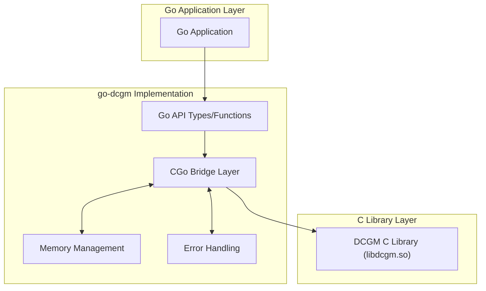
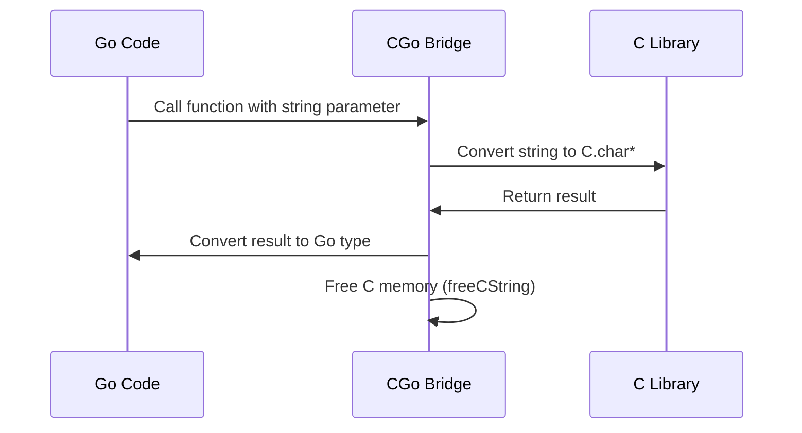
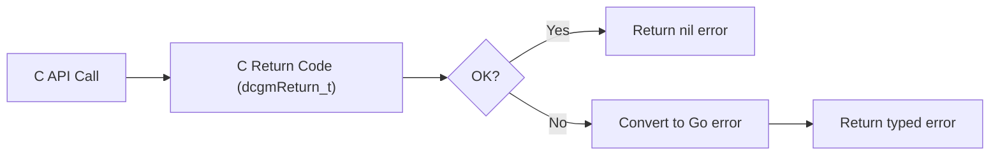
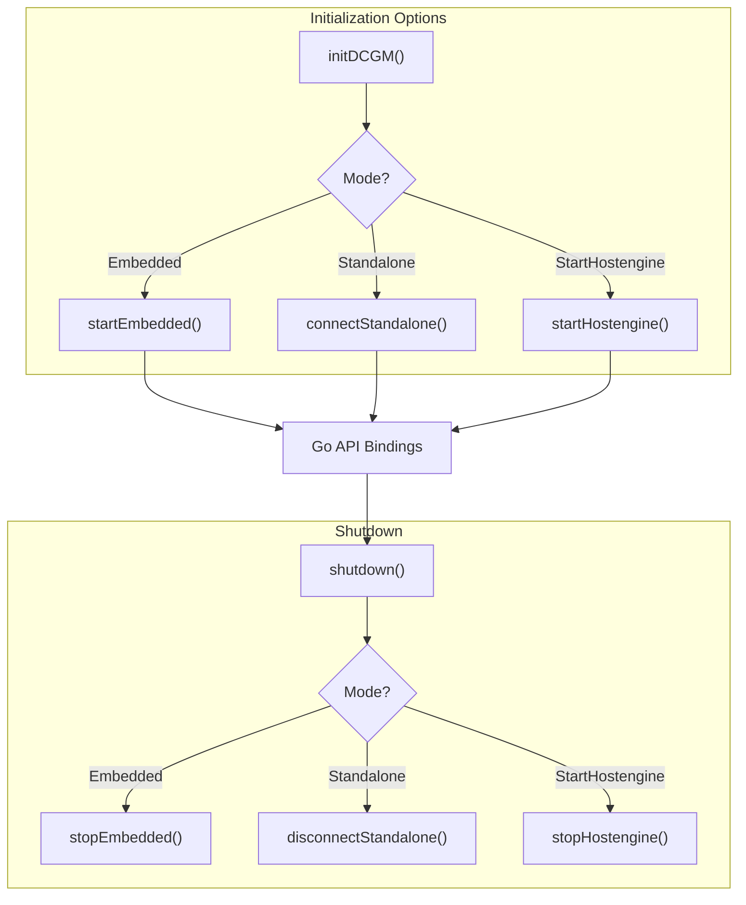
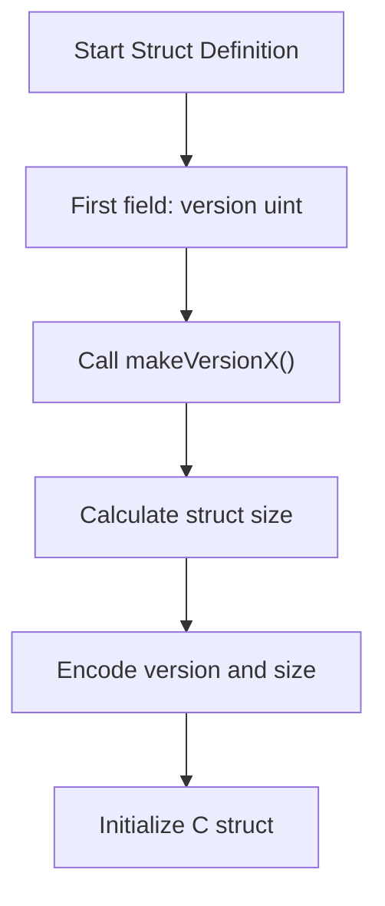
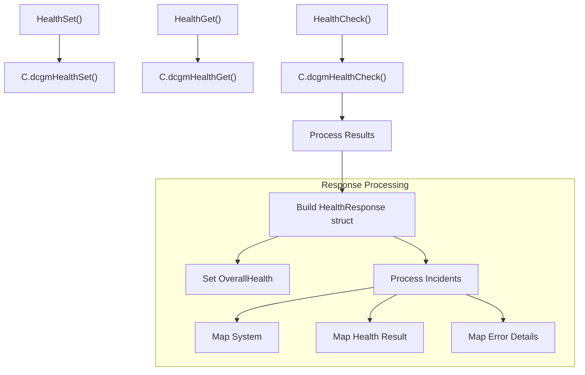
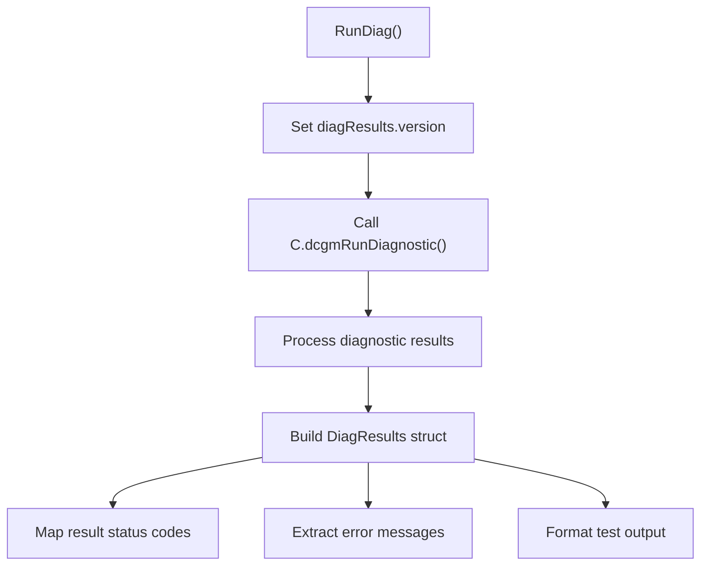

<!-- source: DeepWiki mcp.deepwiki.com · repo NVIDIA/go-dcgm · page 3 Implementation Details · fetched 2026-10-26 -->

# Implementation Details

<details>
<summary>Relevant source files</summary>

The following files were used as context for generating this wiki page:

- [pkg/dcgm/admin.go](pkg/dcgm/admin.go)
- [pkg/dcgm/const.go](pkg/dcgm/const.go)
- [pkg/dcgm/dcgm_agent.h](pkg/dcgm/dcgm_agent.h)
- [pkg/dcgm/dcgm_errors.h](pkg/dcgm/dcgm_errors.h)
- [pkg/dcgm/dcgm_fields.h](pkg/dcgm/dcgm_fields.h)
- [pkg/dcgm/dcgm_structs.h](pkg/dcgm/dcgm_structs.h)
- [pkg/dcgm/dcgm_structs_internal.h](pkg/dcgm/dcgm_structs_internal.h)
- [pkg/dcgm/dcgm_test_apis.h](pkg/dcgm/dcgm_test_apis.h)
- [pkg/dcgm/diag.go](pkg/dcgm/diag.go)
- [pkg/dcgm/health.go](pkg/dcgm/health.go)
- [pkg/dcgm/nvml.h](pkg/dcgm/nvml.h)
- [pkg/dcgm/utils.go](pkg/dcgm/utils.go)

</details>


This document provides a technical overview of the internal implementation of the NVIDIA Data Center GPU Manager (DCGM) Go bindings. It focuses on how the Go bindings interface with the underlying C library, the memory management approach, and the core architectural design patterns used in the codebase.

## CGo Bridge Architecture

The primary mechanism enabling Go to interact with NVIDIA's DCGM C library is CGo, which allows Go code to call C code directly. This interface forms the foundation of the entire implementation.



The CGo bridge creates a thin layer between Go and C, handling type conversions, memory management, and error propagation. Each Go function that interfaces with DCGM translates to one or more C function calls through this bridge.

Sources: [pkg/dcgm/admin.go:17-28](). [pkg/dcgm/utils.go:1-18]().

### Type Mapping System

The Go binding establishes a systematic mapping between Go types and DCGM C types.

```mermaid
classDiagram
    class "C Types" {
        C.ushort
        C.longlong
        C.char*
        C.dcgmReturn_t
    }
    
    class "Go Types" {
        Short
        int64
        string
        Error struct
    }
    
    class "Conversion Utilities" {
        uintPtr()
        uint64Ptr()
        int64Ptr()
        stringPtr()
        errorString()
    }
    
    "Go Types" <-- "Conversion Utilities"
    "C Types" --> "Conversion Utilities"
```

For example, the `Short` type in Go is defined to map directly to the C type `ushort`, which is fundamental for DCGM field identifiers.

Sources: [pkg/dcgm/const.go:1-9](). [pkg/dcgm/utils.go:20-49]().

## Memory Management

Managing memory correctly across the Go/C boundary is crucial for the stability of the bindings. The implementation uses careful allocation and deallocation strategies to prevent memory leaks.



Key aspects of memory management include:

1. **C String Handling**: Go strings passed to C functions are converted to C-style strings and then properly freed after use
2. **Pointer Conversion**: Utilities to safely convert between Go and C pointer types
3. **Structured Memory Release**: Systematic approach to ensure all C-allocated memory is released

Sources: [pkg/dcgm/utils.go:66-68](). [pkg/dcgm/admin.go:96-97]().

## Data Types and Constants

The binding provides Go equivalents for DCGM data types, constants, and error codes.

### Type Definitions

The implementation defines many Go types that mirror DCGM C types:

| Go Type | C Type | Purpose |
|---------|--------|---------|
| `Short` | `C.ushort` | Used for field IDs |
| `FieldValue_v1` | `dcgmFieldValue_v1` | Represents field values (v1) |
| `FieldValue_v2` | `dcgmFieldValue_v2` | Represents field values (v2) |
| `Error` | - | Wraps DCGM error codes |
| `HealthSystem` | `dcgmHealthSystems_t` | Health system identifiers |
| `HealthResult` | - | Health check results |

### Special Values Handling

DCGM uses special "blank" values to indicate missing or unavailable data. The Go binding implements functions to detect these values:

```go
// IsInt32Blank checks if an integer value represents DCGM's "blank" value (0x7ffffff0)
func IsInt32Blank(value int) bool {
    return value >= dcgmInt32Blank
}

// IsInt64Blank checks if an integer value represents DCGM's "blank" value (0x7ffffffffffffff0)
func IsInt64Blank(value int64) bool {
    return value >= dcgmInt64Blank
}
```

Sources: [pkg/dcgm/const.go:11-78](). [pkg/dcgm/utils.go:70-80]().

## Error Handling System

The binding implements a comprehensive error handling system that converts C-style error codes to idiomatic Go errors.



The central mechanism is the `Error` struct which encapsulates both the error message and DCGM return code:

```go
// Error represents an error returned by the DCGM library
type Error struct {
    msg  string         // description of error
    Code C.dcgmReturn_t // dcgmReturn_t value of error
}

func (e *Error) Error() string { return e.msg }
```

Most functions in the binding follow a pattern of calling the C function, checking the return code, and converting any error to a Go error object.

Sources: [pkg/dcgm/utils.go:50-64](). [pkg/dcgm/dcgm_errors.h:31-161]().

## Operational Modes

The DCGM Go binding supports three operational modes, each with different initialization and connection patterns.



1. **Embedded Mode**: Runs the DCGM engine within the same process as the Go application
2. **Standalone Mode**: Connects to an already running DCGM host engine
3. **StartHostengine Mode**: Starts a new DCGM host engine process and connects to it

Each mode has specific initialization and shutdown procedures:

| Mode | Initialization | Shutdown |
|------|----------------|----------|
| Embedded | `dcgmInit()` + `dcgmStartEmbedded()` | `dcgmStopEmbedded()` + `dcgmShutdown()` |
| Standalone | `dcgmInit()` + `dcgmConnect_v2()` | `dcgmDisconnect()` + `dcgmShutdown()` |
| StartHostengine | Start process + `dcgmInit()` + `dcgmConnect_v2()` | `disconnectStandalone()` + terminate process |

Sources: [pkg/dcgm/admin.go:40-241](). [pkg/dcgm/dcgm_agent.h:55-178]().

## Versioning Strategy

DCGM uses versioned structs to maintain backward compatibility. The Go binding implements this through version helper functions:



The versioning helpers encode both the struct size and version number into a single field:

```go
func makeVersion1(struct_type uintptr) C.uint {
    version := C.uint(struct_type | 1<<24)
    return version
}

func makeVersion2(struct_type uintptr) C.uint {
    version := C.uint(struct_type | 2<<24)
    return version
}

// Additional version helpers...
```

When making API calls, the struct version is always set before passing the struct to the C function. This ensures backward compatibility as the DCGM library evolves.

Sources: [pkg/dcgm/utils.go:82-118](). [pkg/dcgm/health.go:105-107](). [pkg/dcgm/diag.go:195-196]().

## Field Management

Field management is fundamental to DCGM operations. The Go binding provides a type system to represent field IDs, values, and metadata.

```mermaid
classDiagram
    class "FieldValue_v1" {
        Version uint
        FieldID Short
        FieldType uint
        Status int
        TS int64
        Value [4096]byte
    }
    
    class "FieldValue_v2" {
        Version uint
        EntityGroupId Field_Entity_Group
        EntityID uint
        FieldID Short
        FieldType uint
        Status int
        TS int64
        Value [4096]byte
        StringValue *string
    }
    
    class "Field Type Constants" {
        DCGM_FT_BINARY
        DCGM_FT_DOUBLE
        DCGM_FT_INT64
        DCGM_FT_STRING
        DCGM_FT_TIMESTAMP
    }
    
    "FieldValue_v1" <-- "Field Type Constants"
    "FieldValue_v2" <-- "Field Type Constants"
```

DCGM fields have specific types (binary, double, integer, string, timestamp) and the binding ensures correct type handling. Special constants represent "blank" or error values for each data type.

Sources: [pkg/dcgm/const.go:11-78](). [pkg/dcgm/dcgm_fields.h:32-59]().

## Health and Diagnostics Implementation

The health monitoring and diagnostics systems demonstrate how the binding interfaces with more complex DCGM functionality.

### Health Monitoring



The health system converts between Go representation of health watches, results, and error details to their C counterparts.

Sources: [pkg/dcgm/health.go:52-182](). [pkg/dcgm/const.go:200-488]().

### Diagnostics



The diagnostic system demonstrates conversion between complex C structs and more idiomatic Go structures, with careful handling of status codes, test names, and error messages.

Sources: [pkg/dcgm/diag.go:56-210]().

## Conclusion

The go-dcgm implementation creates a robust, idiomatic Go interface to the DCGM C library through careful type mapping, memory management, and error handling. The CGo bridge is central to this design, allowing seamless integration between Go and C while maintaining memory safety and type correctness.

By following design patterns like versioned structs, proper cleanup of C resources, and consistent error handling, the binding delivers DCGM's powerful GPU management capabilities to Go applications in a way that feels native to the language.

---

