<!-- source: DeepWiki mcp.deepwiki.com · repo NVIDIA/go-dcgm · page 3.1 Interaction with C Library · fetched 2026-10-26 -->

# Interaction with C Library

Relevant source files

The following files were used as context for generating this wiki page:

- [pkg/dcgm/admin.go](pkg/dcgm/admin.go)
- [pkg/dcgm/dcgm_structs_internal.h](pkg/dcgm/dcgm_structs_internal.h)
- [pkg/dcgm/dcgm_test_apis.h](pkg/dcgm/dcgm_test_apis.h)
- [pkg/dcgm/diag.go](pkg/dcgm/diag.go)
- [pkg/dcgm/field_values.go](pkg/dcgm/field_values.go)
- [pkg/dcgm/field_values_cb.c](pkg/dcgm/field_values_cb.c)
- [pkg/dcgm/field_values_cb.h](pkg/dcgm/field_values_cb.h)
- [pkg/dcgm/field_values_test.go](pkg/dcgm/field_values_test.go)
- [pkg/dcgm/health.go](pkg/dcgm/health.go)
- [pkg/dcgm/nvml.h](pkg/dcgm/nvml.h)
- [pkg/dcgm/utils.go](pkg/dcgm/utils.go)

This document describes how the go-dcgm package interfaces with NVIDIA's Data Center GPU Manager (DCGM) C library using CGo. It covers the bridging mechanisms, memory management, type conversions, error handling, and callback systems that make the native C library accessible through Go code.

## Overview of the CGo Bridge Layer

The go-dcgm package uses CGo to access the DCGM C library functions. CGo is a feature of Go that allows Go programs to call C code. This bridge layer is essential for allowing Go applications to utilize the NVIDIA DCGM library's GPU monitoring and management capabilities without requiring C code from the application developers.

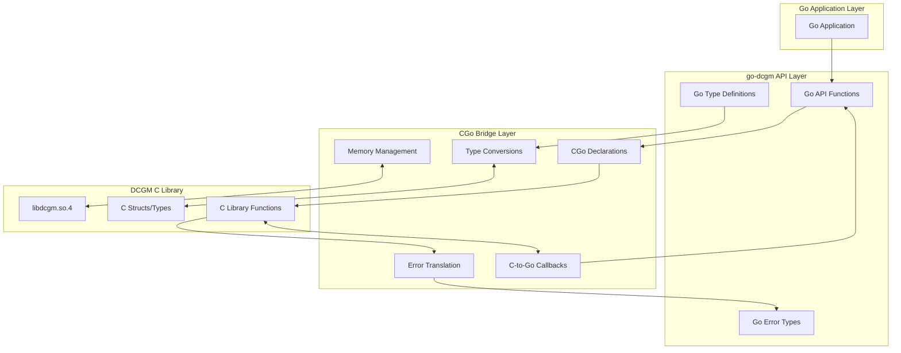

Sources: [pkg/dcgm/admin.go:19-28](), [pkg/dcgm/utils.go:3-7]()

## Library Loading and Initialization

The go-dcgm package dynamically loads the DCGM C library at runtime rather than being statically linked.

### Dynamic Library Loading

The library is loaded using the `dlopen` C function, which is accessed through CGo. This approach allows for runtime loading of the library and error handling if the library is not available.

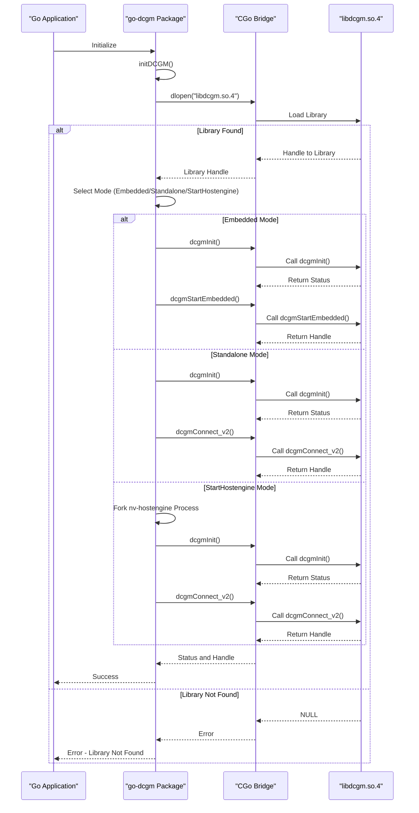

Sources: [pkg/dcgm/admin.go:59-84](), [pkg/dcgm/admin.go:100-241]()

### Operational Modes

The go-dcgm package supports three operational modes for interacting with the DCGM library:

1. **Embedded Mode**: DCGM host engine runs in-process with the Go application
2. **Standalone Mode**: Connect to an already running external DCGM host engine
3. **StartHostengine Mode**: Start a new external DCGM host engine and connect to it

Each mode has different initialization and cleanup requirements, but they all operate through the same CGo interface.

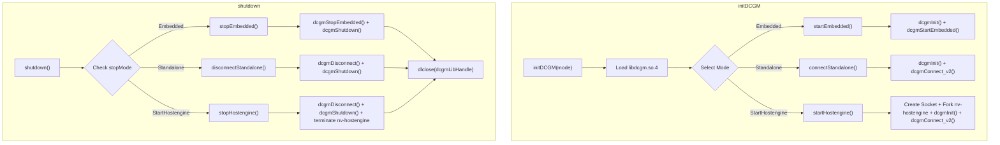

Sources: [pkg/dcgm/admin.go:41-48]()), [pkg/dcgm/admin.go:59-241]()

## Type Conversion and Memory Management

### Type Conversions

Go-dcgm implements various utility functions to convert between Go and C types. These functions handle the different type systems and ensure correct data representation across the language boundary.

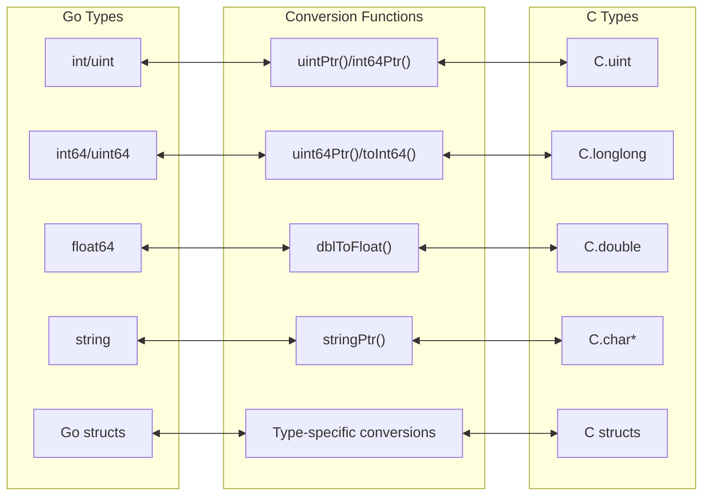

Sources: [pkg/dcgm/utils.go:20-48]()

### Memory Management

Memory must be carefully managed when interfacing with C code. The go-dcgm package uses several strategies:

1. **Garbage Collection**: Go's garbage collector handles Go memory
2. **Manual Cleanup**: C memory must be manually freed
3. **Version Management**: Handles C struct versioning by using helper functions like `makeVersion1`

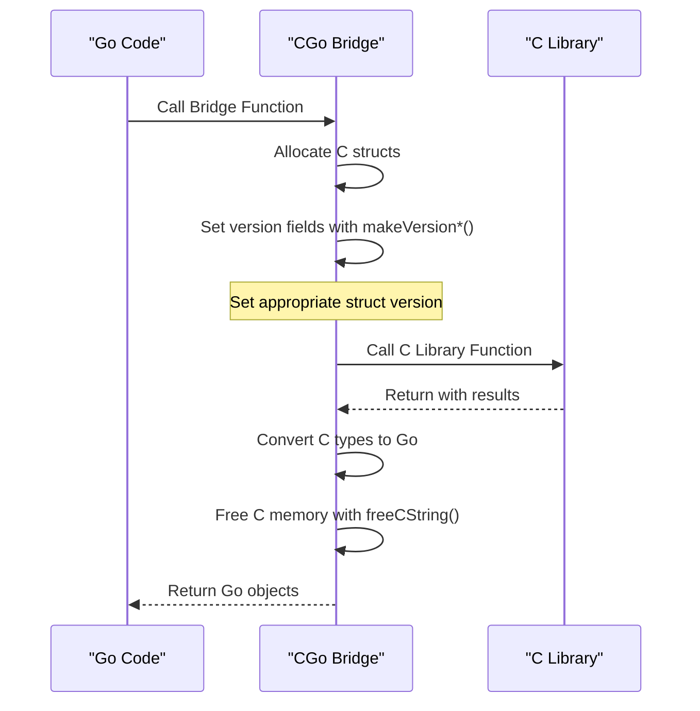

Sources: [pkg/dcgm/utils.go:66-68]()), [pkg/dcgm/utils.go:82-110]()

## Error Handling

The DCGM C library returns error codes that need to be translated into Go errors. The go-dcgm package provides the mechanisms to perform this translation.

### Error Translation

The package defines an `Error` struct that represents DCGM errors and implements the Go `error` interface. The `errorString` function translates C library error codes into Go errors.

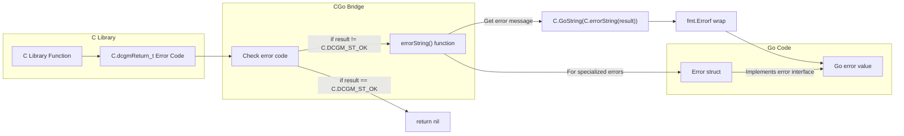

Sources: [pkg/dcgm/utils.go:50-64]()

## Callback Mechanisms

The DCGM C library uses callbacks for certain operations. Go-dcgm implements a system to allow C code to call back into Go code.

### C-to-Go Callbacks

For features that require callbacks from C to Go, the package uses an exported Go function with a C wrapper. The Go function is registered through CGo and called by the C library through the wrapper.

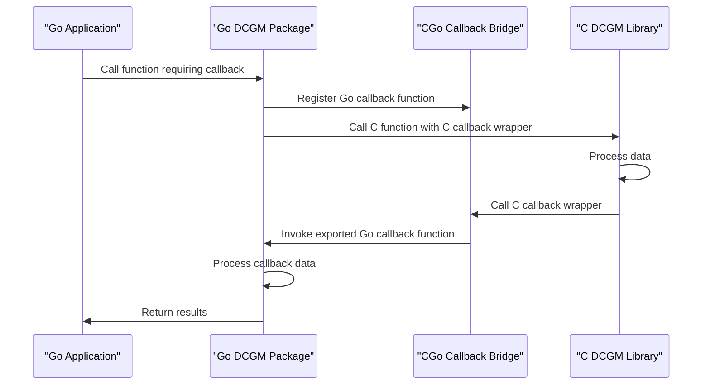

A specific example of this mechanism can be seen in the field values callback system:

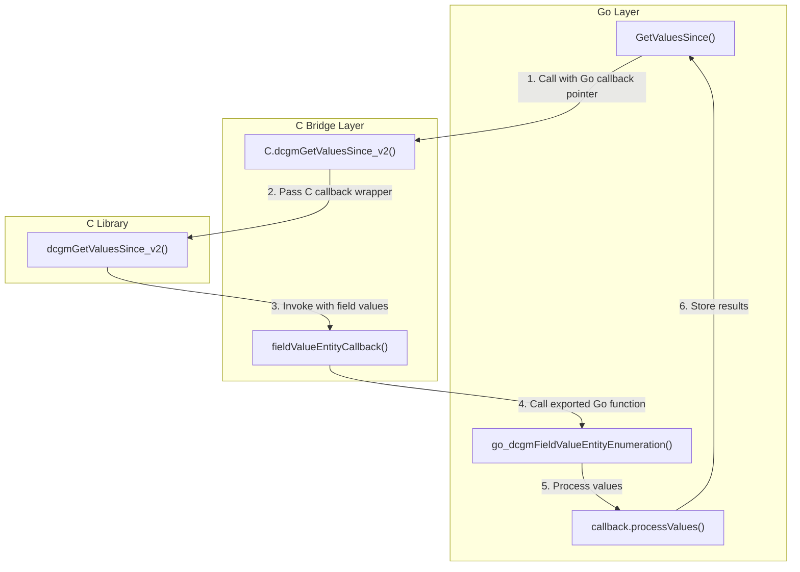

Sources: [pkg/dcgm/field_values.go:20-28](), [pkg/dcgm/field_values.go:51-69](), [pkg/dcgm/field_values_cb.c:21-27]()

## Common Interaction Patterns

The go-dcgm package follows several common patterns when interacting with the C library.

### Struct Versioning

DCGM C structs have versioned fields to support backward compatibility. The go-dcgm package handles this with helper functions:

1. `makeVersion1`, `makeVersion2`, etc. functions set the version field of C structs
2. These versions tell the C library which fields are valid in the struct

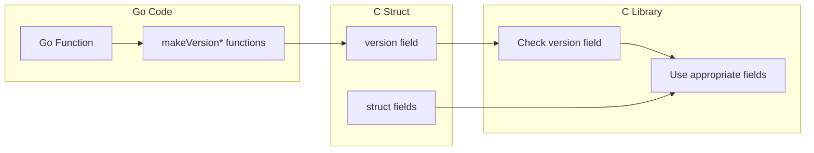

Sources: [pkg/dcgm/utils.go:82-110]()

### Function Call Pattern

Most go-dcgm functions follow a similar pattern when interacting with the C library:

1. Prepare Go input parameters
2. Convert Go parameters to C parameters
3. Initialize C struct with appropriate version
4. Call C function via CGo
5. Check for errors
6. Convert C results back to Go
7. Clean up C memory
8. Return Go results

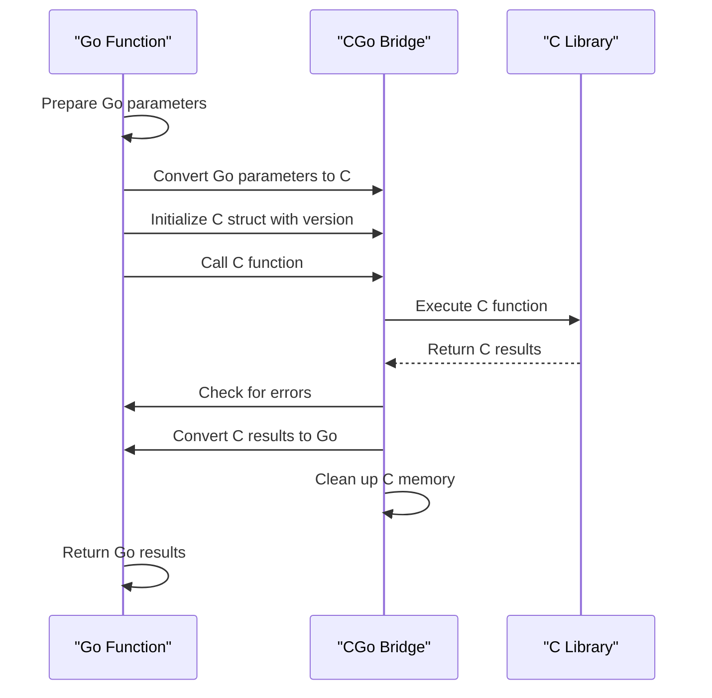

An example of this pattern can be seen in the `HealthCheck` function:

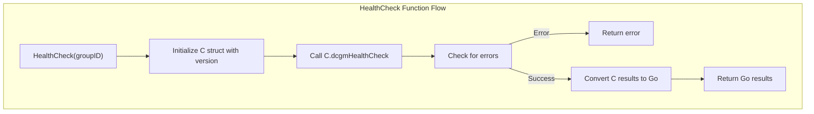

Sources: [pkg/dcgm/health.go:101-140]()

## Summary

The go-dcgm package's interaction with the DCGM C library is characterized by:

1. **CGo Bridge**: Uses CGo to call C functions from Go
2. **Dynamic Loading**: Loads the DCGM C library at runtime
3. **Type Conversion**: Converts between Go and C types
4. **Memory Management**: Carefully manages C memory allocations
5. **Error Handling**: Translates C error codes to Go errors
6. **Callbacks**: Implements a system for C code to call back into Go code
7. **Versioning**: Handles C struct versioning for backward compatibility

These mechanisms work together to provide a Go-friendly API for the DCGM library while handling the complexities of cross-language interaction.

---

